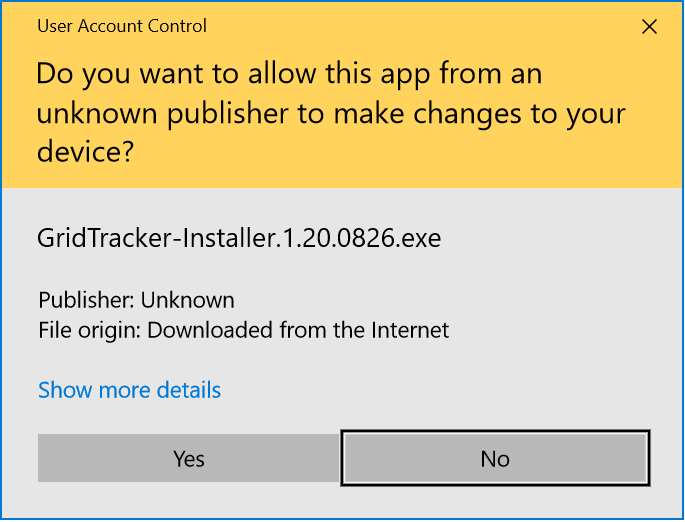
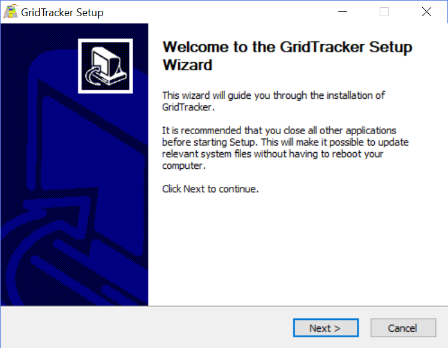
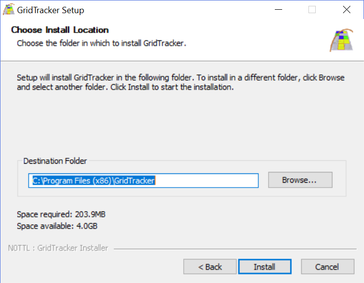
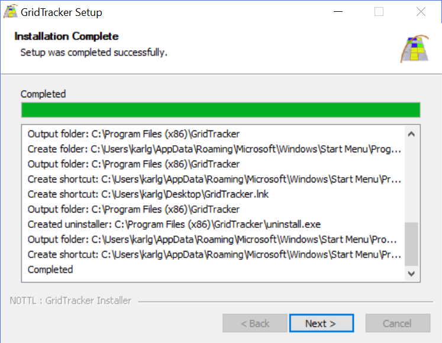
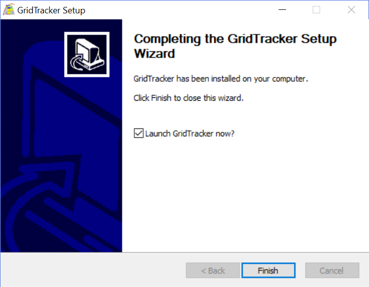
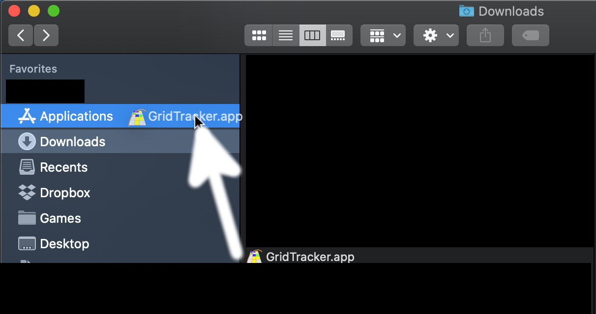
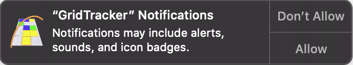

# Windows

1. Download the latest version from [https://gridtracker.org/downloads/](https://gridtracker.org/downloads/) being sure to use the file link under Windows. Save the file to your Downloads directory and then double click on `GridTracker-Installer.<verion>.exe` to start the installation process. \
\
You may be prompted with a “User Access Control” dialog. If so, click the **Yes** button to continue. 

 

2. Click **Next** to continue.



3. GridTracker will present the default installation location. It is recommended that you use this, but you may select path if desired, but clicking the **Browse…** button. \
\
Click **Install** to continue.



4. When the installation finishes click **Next** to continue.



5. The installation is now complete. Click **Finish** to close the installer and launch GridTracker for the first time. \
\
You may uncheck “Launch GridTracker now” if you do not want to launch it after clicking the **Finish** button.



Proceed to the [Configuring WSJT-X and JTDX for GridTracker](Appendix-B-Configuring-WSJT-X-and-JTDX-for-GridTracker.md) section for next steps.


# MacOS

1. Download the latest version from [https://gridtracker.org/downloads/](https://gridtracker.org/downloads/)\
\
Open a Finder window and navigate to the place that the download is in; likely the Downloads directory. It may need to be unzipped (double click the zip file) or your browser may have already done that for you.\
\
Once you have the GridTracker.app, drag it to your Applications folder:



2. Next you need to open the Applications folder, **Command-Click** GridTracker, then Click **Open**. \
\
MacOS will present a security warning allowing you to decide to override system security settings, click **Open**. You should not see this warning after this.

> Screen grab needed for MAC system security override screen.

3. And another asking permission for notifications.


You will get two more pop-ups after the program has been running, one to allow incoming network traffic:

4. And another asking permission for notifications.



You will want to Allow network notifications, and it is up to you if you want to Allow the Notifications.

Proceed to the [Configuring WSJT-X and JTDX for GridTracker](Appendix-B-Configuring-WSJT-X-and-JTDX-for-GridTracker.md) section for next steps.

# Linux Intel/AMD Archs

## Redhat based distros

1. Download the latest version .rpm for your architecture from [https://gridtracker.org/downloads/](https://gridtracker.org/downloads/)
2. Install either by running from where you downloaded the .rpm
   ```bash
   sudo dnf install ./GridTracker2-2.xxxxxx.x-arch.rpm
   ```
   where arch is your system architecture (x86_64, aarch64 or armv7l) or by double clicking to launch Discover Software Center.

Proceed to the [Configuring WSJT-X and JTDX for GridTracker](Appendix-B-Configuring-WSJT-X-and-JTDX-for-GridTracker.md) section for next steps.

## Debian based distros

1. Download the latest version .deb for your architecture from [https://gridtracker.org/downloads/](https://gridtracker.org/downloads/)
2. Install using dpkg from where you downloaded the .deb
   ```bash
   sudo dpkg -i ./GridTracker2-2.xxxxxx.x-arch.deb
   ```
   where arch is your system architecture (amd64, arm64, armv7l)

Proceed to the [Configuring WSJT-X and JTDX for GridTracker](Appendix-B-Configuring-WSJT-X-and-JTDX-for-GridTracker.md) section for next steps.

## Arch linux

> Need new instructions for .pacman file

Proceed to the [Configuring WSJT-X and JTDX for GridTracker](Appendix-B-Configuring-WSJT-X-and-JTDX-for-GridTracker.md) section for next steps.

## All other Linuxes
(or using the tar.gz packge)

Download the tar.gz package for your architecture from [https://gridtracker.org/downloads/](https://gridtracker.org/downloads/), decompress and execute the GridTracker exectuable from the decompressed directory.

```bash
$ tar -xf GridTracker-<version>-linux-<arch>.tar.gz
```

Run the GridTracker executable from the now decompressed package directory.

> Need new instructions for .APK and .AppImage

Proceed to the [Configuring WSJT-X and JTDX for GridTracker](Appendix-B-Configuring-WSJT-X-and-JTDX-for-GridTracker.md) section for next steps.