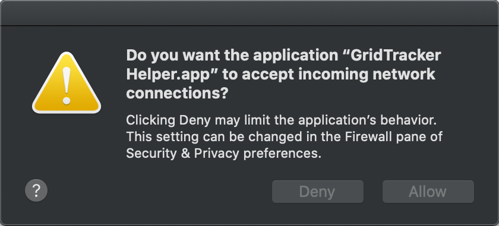

# Appendix A: Installing GridTracker2

Download GridTracker2 from [gridtracker.org/downloads](https://gridtracker.org/downloads/). Choose the package for your system, as described below. When it is installed, continue with [Appendix B](Appendix-B-Configuring-WSJT-X-and-JTDX-for-GridTracker.md) to connect it to WSJT-X or JTDX.

## Windows

1. Download the Windows installer, `GridTracker2-<version>-setup.exe`. One installer works on both 64-bit and 32-bit Windows. (For Windows 7 and 8, download the separate Windows 7 installer.)
2. Double-click the installer in your Downloads folder.

   ```{tip}
   If Windows refuses to run the installer, right-click it, choose **Properties**, and on the **General** tab tick **Unblock** if it is there. Then run it again.
   ```

3. Accept the license agreement.
4. Choose whether to install for yourself only (the default, no administrator rights needed) or for everyone on the computer, and where to install it. The defaults are fine for most people.
5. Click **Install**, then **Finish** to start GridTracker2.

The installer adds GridTracker2 to the Start menu and the desktop.

```{note}
The first time GridTracker2 runs, Windows Firewall may ask whether to allow it on your network. Allow it on **private** networks at least, so it can receive messages from WSJT-X. After an update, check that the firewall still allows it.
```

## macOS

1. Download the macOS disk image, `GridTracker2-<version>.dmg`. It works on both Intel and Apple Silicon Macs.
2. Open it, and drag **GridTracker2** to your **Applications** folder.
3. Open GridTracker2 from the Applications folder.
4. macOS asks whether GridTracker2 may find devices on your local network. Click **Allow**: GridTracker2 needs this to receive messages from WSJT-X.

   

5. macOS may also ask whether GridTracker2 may send notifications. That is up to you.

   

## Linux

Packages are available for Intel and AMD (x86_64), 64-bit ARM (arm64 / aarch64) and 32-bit ARM (armv7l). Pick the one for your distribution and architecture; `<version>` and `<arch>` stand for the version and architecture in the file name.

### Debian, Ubuntu, Raspberry Pi OS and other Debian-based distributions

```bash
sudo apt install ./GridTracker2-<version>-<arch>.deb
```

### Fedora, Red Hat and other RPM-based distributions

```bash
sudo dnf install ./GridTracker2-<version>-<arch>.rpm
```

### Arch Linux and other pacman-based distributions

```bash
sudo pacman -U ./GridTracker2-<version>-<arch>.pacman
```

### Alpine Linux

```bash
sudo apk add --allow-untrusted ./GridTracker2-<version>-<arch>.apk
```

### Any distribution: AppImage

Make the AppImage executable and run it:

```bash
chmod +x GridTracker2-<version>-<arch>.AppImage
./GridTracker2-<version>-<arch>.AppImage
```

### Any distribution: tar.gz

Unpack the archive anywhere, even on a USB stick, and run `gridtracker2` from the unpacked folder:

```bash
tar -xf GridTracker2-<version>-<arch>.tar.gz
```

```{tip}
If GridTracker2 starts on Linux but shows no text at all, the font cache may be out of date. Run `fc-cache -fv`, then start GridTracker2 again.
```
