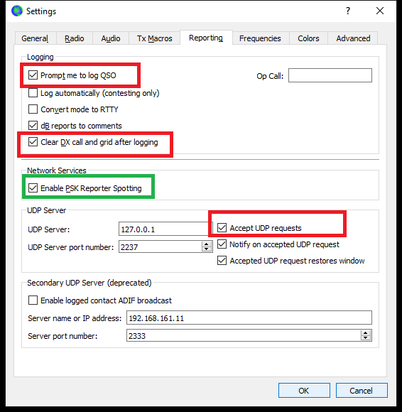
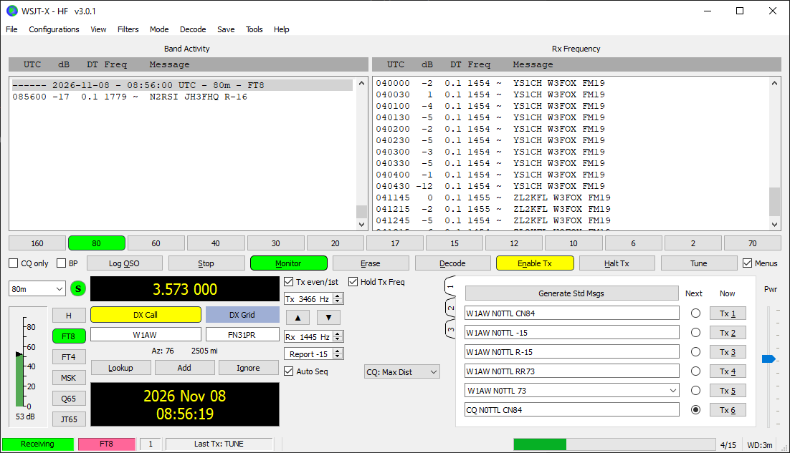
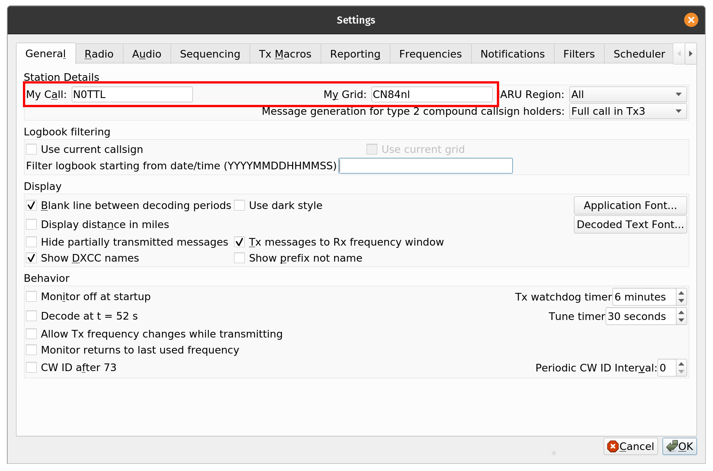
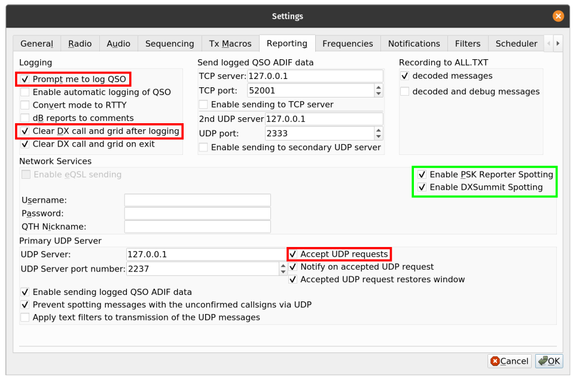
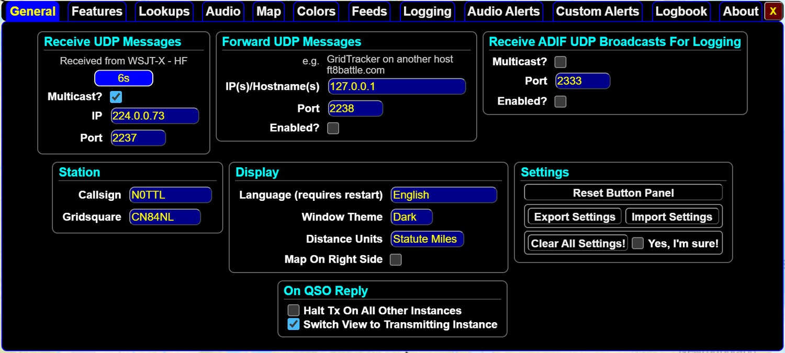

# Appendix B: Configuring WSJT-X and JTDX

## WSJT-X

In WSJT-X, open **File → Settings**.

On the **General** tab, enter your callsign and grid. We recommend your 6-character grid (for example CN84NL rather than CN84) for more accurate maps and spot reports. We also recommend **Double-click on call sets Tx enable** and **Disable Tx after sending 73**.

On the **Reporting** tab:

* **Prompt me to log QSO**, **Clear DX call and grid after logging** and **Accept UDP requests** are **required**. Without them GridTracker2 can't log your QSOs or call stations from the Call Roster, and the map behaves strangely.
* Under **UDP Server**, the address and port are where WSJT-X sends its messages: `127.0.0.1` and `2237` by default, when GridTracker2 runs on the same computer.
* We recommend **Enable PSK Reporter Spotting**, so other stations can see where they are being heard, and the band activity graph has more data.

In WSJT-X's main window, untick **CQ only** and tick **Hold Tx Freq** (both are just below the band buttons). If the Call Roster can call stations that are calling CQ but not other stations, these two boxes are usually why.

WS – Digital Mode Suite and MSHV are set up the same way.

## JTDX

In JTDX, open **Settings**.

On the **General** tab, enter your callsign and grid, preferably your 6-character grid.

On the **Reporting** tab, **Prompt me to log QSO**, **Clear DX call and grid after logging** and **Accept UDP requests** are **required**. We recommend **Enable PSK Reporter Spotting**.

To reply from the Call Roster to stations that aren't calling CQ, set JTDX's **Misc → Accept UDP Reply Message** to **CQ and 73** or **any messages**.

## GridTracker2

The first time it runs, GridTracker2 reads the address and port from your WSJT-X or JTDX settings, so usually there is nothing to do. When everything is working, the status bar at the top of the side panel shows **RECEIVE** and your frequency and mode appear above it.

{width=260px}

If it still shows "waiting for message" after 15 seconds or so, open [Settings → General](../GridTracker-Overview/Settings-Sub-Menus.md#general-tab) and check the **Receive UDP Messages** box:

* The **Port** must match the port in WSJT-X's UDP Server setting.
* If WSJT-X sends to a multicast address (224.0.0.0 to 239.255.255.255), tick **Multicast?** and enter the same address in **IP**.

### Using Multicast

Normally only one program can receive WSJT-X's messages. If you also run other companion programs (a logging program, JTAlert, another copy of GridTracker2), set WSJT-X's UDP Server to a multicast address such as `224.0.0.73`, tick **Multicast?** in every program, and use the same address and port in all of them. Multicast is also the way to run WSJT-X and GridTracker2 on different computers on the same network.

In WSJT-X, also tick the network interfaces to send multicast on (**Outgoing interfaces**), including the loopback interface when GridTracker2 runs on the same computer.

Alternatively, use **Forward UDP Messages** in GridTracker2's General tab to pass the messages on to one more program.

### Firewalls and Antivirus Software

If GridTracker2 still doesn't receive anything, a firewall or antivirus program may be blocking it. Allow both WSJT-X and GridTracker2 on your network (private and public networks, if your security software asks). After changing these settings, restart both WSJT-X and GridTracker2. Windows users should check the firewall settings again after GridTracker2 updates.
