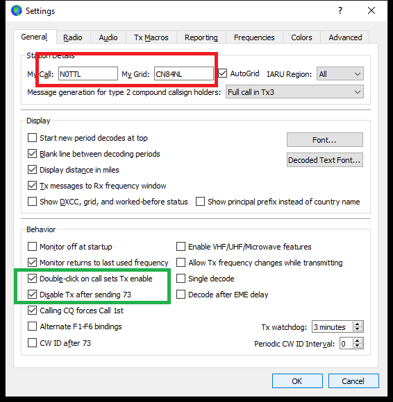
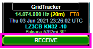
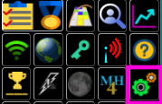
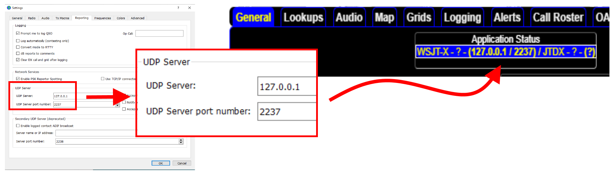
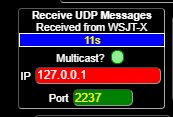

# Configuring WSJT-X for GridTracker

In WSJT-X **Settings** > **General** tab you will need to enter your Callsign and Maidenhead Grid Square.  We recommend setting your grid to your "MH6 "grid square (eg: CN84NL vs CN84) for higher map and Spot reporting accuracy.

We also recommend enabling "Double-click on call sets Tx enable" and "Disable Tx after sending 73".

In WSJT-X **Settings>Reporting** tab, options:"Prompt me to log QSO", "Clear DX call and grid after logging" and "Accept UDP requests" are **required** for GridTracker to function properly with WSJT-X._ Not having these enabled can lead to frustration, lost logs and strange behavior in the Map view.

We recommended enabling  "PSK Reporter Spotting" to help other WSJT-X users as well as GridTracker users to know if they are propagating and give more data to the "Band Activity Graph" in your area.

Continue to [Configuring GridTracker](#configuring-gridtracker-for-wsjt-x--jtdx), to verify GridTracker is receiving messages from WSJT-X.

# Configuring JTDX for GridTracker

In JTDX **Settings** / **General** tab you will need to enter your Callsign and Maidenhead Grid Square.  We recommended to seting your grid to your "MH6 "grid square (eg: CN84NL vs CN84) for higher map and Spot reporting accuracy.

In JTDX **Settings** / **Reporting** tab options "Prompt me to log QSO", "Clear DX call and grid after logging" and "Accept UDP requests" are **required** for GridTracker to function properly with JTDX. Not having these enabled can lead to frustration, lost logs and strange behavior in the Map view.

We recommend enabling "PSK Reporter Spotting" and "Enable DXSummit Spotting" to help other JTDX users as well as GridTracker users to know if they are propagating and give more data to the "Band Activity Graph" in your area.

Continue to [Configuring GridTracker](#configuring-gridtracker-for-wsjt-x--jtdx), to verify GridTracker is receiving messages from JTDX.

# Configuring GridTracker for WSJT-X & JTDX

GridTracker's IP address and Port settings _must_ match WSJT-X's.  If they don't the two applications won't be able to communicate with each other.  If you have opened WSTJ-X but don't see "RECEIVE" in the control panel check your GridTracker settings.

To do that click on the "**Gears**" button in the Button Panel to open the **Settings** menu.  Once the **Settings** menu is open click on the "**General**" tab (first tab on the left) to verify your IP and Port settings.   

At the top of the **General** tab the "Application Status" should read:  

**WSJT-X - ? - (127.0.0.1/2237)/JTDX - ? - (?)**

**127.0.0.1** is the localhost (your machine) IP and is the default for GridTracker; **2237** is the Port.  

If you are using a multicast IP in the range of 224.0.0.0 to 239.255.255.255, you must enable Multicast and enter the IP. To do that click the button next to "Multicast?" and type in the IP address.  The Port number remains 2237.

**Note:**  if you’re running WSJT-X and GridTracker on separate computers use multicast address 224.0.0.73. 

If you are still having trouble with networking, troubleshooting may involve your operating system or 3rd party Firewall and Application settings for local and remote network access.  If you are using Windows and have a service like BitDefender enabled you will have to go into its settings for applications and give both WSJT-X and GridTracker private and public network access. If you find that the networking was not enabled for either of the applications, once you make changes you must restart both GridTracker and WSJT-X for networking setting changes to take effect. 
