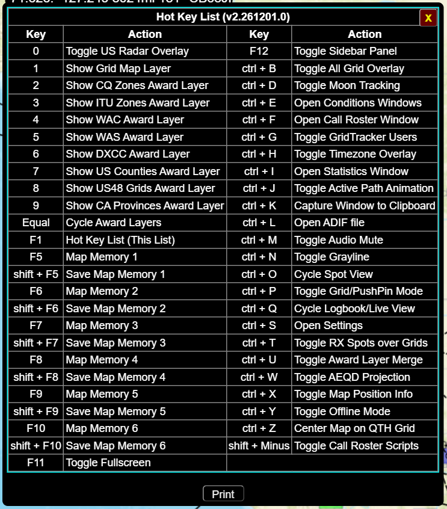

# Appendix C: Hotkeys

Hotkeys let you reach GridTracker2's functions straight from the keyboard. They work while the main window is the active window and the Settings panel is closed. Press **F1** to see the list in GridTracker2; its **Print** button prints it.

{width=420px}

```{note}
Letter hotkeys use the **Ctrl** key, so that typing in text fields can't set them off. **Ctrl+C** and **Ctrl+V** are left for Copy and Paste. Older versions used plain letters, and some functions have moved: the Call Roster is now **Ctrl+F**, the Conditions window **Ctrl+E**, path animation **Ctrl+J**, time zones **Ctrl+H**, and **9** shows the Canadian provinces layer.
```

## Map Layers

| Key | Action |
| --- | --- |
| 1 | Show the grid map (no award layer) |
| 2 | CQ zones award layer |
| 3 | ITU zones award layer |
| 4 | Worked All Continents (WAC) award layer |
| 5 | Worked All States (WAS) award layer |
| 6 | DXCC award layer |
| 7 | US counties award layer |
| 8 | US continental grids (US48) award layer |
| 9 | Canadian provinces (WACP) award layer |
| = | Cycle through the award layers |
| Ctrl+U | Keep grids, paths and spots with an award layer ("Keep Other Layers With Award View") |
| 0 | US weather radar on or off |
| Ctrl+B | Maidenhead grid lines on or off |
| Ctrl+D | Moon on or off |
| Ctrl+H | Time zones on or off |
| Ctrl+N | Grayline on or off |
| Ctrl+G | GridTracker Spotters on or off |
| Ctrl+O | Cycle the spot view: off, RX Spots, RX Heatmap |
| Ctrl+T | RX spots over the grids, or instead of them |

## Map View

| Key | Action |
| --- | --- |
| Ctrl+Q | Cycle the Data filter: Live, Logbook, Logbook & Live |
| Ctrl+P | Grid squares or push pins |
| Ctrl+W | Mercator or azimuthal equidistant (AEQD) projection |
| Ctrl+J | Path animation on or off |
| Ctrl+Z | Center the map on your grid |
| Ctrl+X | Hide or show the position under the mouse pointer |
| Shift+F5 to Shift+F10 | Remember the current map view (six memories) |
| F5 to F10 | Return to a remembered map view |

## Windows

| Key | Action |
| --- | --- |
| Ctrl+F | Open the Call Roster |
| Ctrl+I | Open the Statistics window |
| Ctrl+E | Open the Current Conditions window |
| Ctrl+S | Open the Settings panel |
| Esc | Close the Settings panel or the hotkey list |
| F1 | Show the hotkey list |
| F11 | Full screen on or off |
| F12 | Hide or show the side panel |

## Other

| Key | Action |
| --- | --- |
| Ctrl+L | Open an ADIF log file |
| Ctrl+M | Mute or unmute audio |
| Ctrl+K | Copy the main window to the clipboard, and save it as a picture in the Screenshots folder |
| Ctrl+Y | Offline Mode on or off |
| Shift+– | Call Roster alert script on or off |

## Every Window

| Key | Action |
| --- | --- |
| Ctrl (or Alt) and + or – | Zoom the window in or out |
| Ctrl+Alt and the mouse wheel | Zoom the window in or out |
| Ctrl+0 (or Alt+0) | Reset the window's zoom |
| Cmd+Q (macOS) | Quit GridTracker2 |

The roster window has hotkeys of its own; see [Hotkeys in the Roster Window](../Making-GridTracker-Work-For-You/Using-Call-Roster.md#hotkeys-in-the-roster-window).
