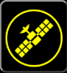
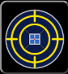
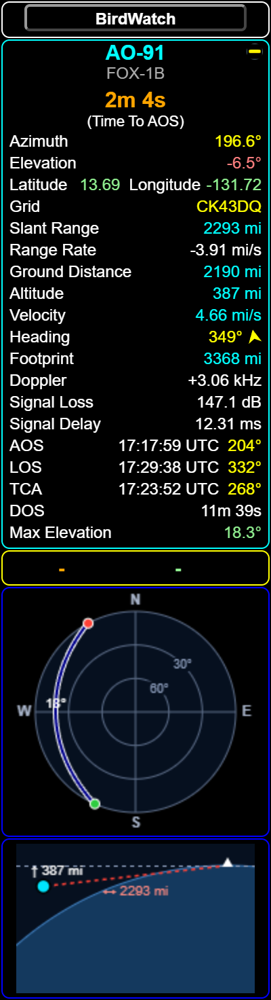
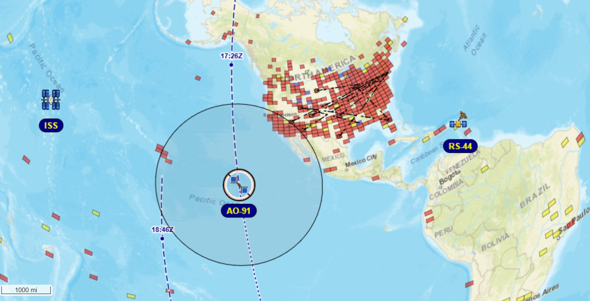
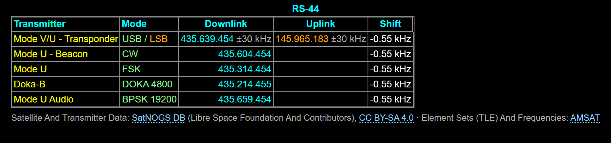
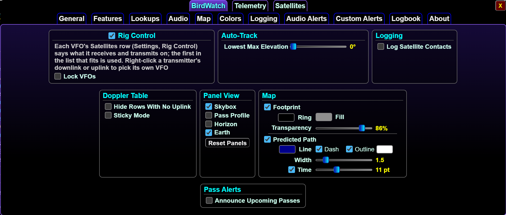
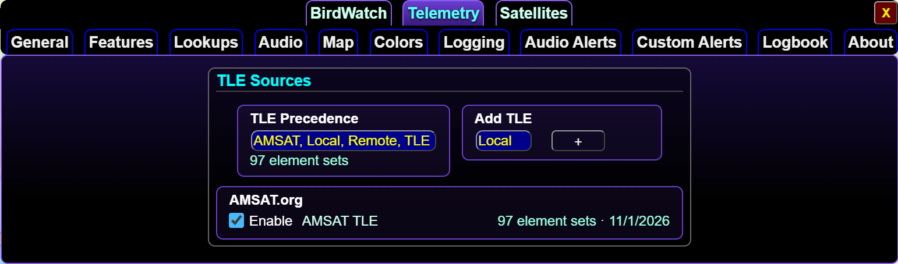

# BirdWatch

**BirdWatch** tracks amateur satellites. It shows where they are on the map, when they will pass over you, and the frequencies to tune to as they move. With [Rig Control](Rig-and-Rotor-Control.md) it can also keep your radio on a satellite's downlink and uplink through the whole pass, and with Rotor Control it can point your antenna at it.

A few terms used in this chapter:

* **AOS** (Acquisition Of Signal): the moment a satellite rises above your horizon.
* **LOS** (Loss Of Signal): the moment it sets below your horizon again. The time between them is a **pass**.
* **TLE** (Two-Line Element set): the two lines of numbers that describe a satellite's orbit. BirdWatch works out every position and pass from them, so they need to be fairly recent.
* **Doppler shift**: as a satellite comes toward you its signals are heard higher in frequency, and lower as it moves away. BirdWatch works out the shift for every second of the pass.

## Turning It On

In [Settings → Features](GridTracker-Overview/Settings-Sub-Menus.md#features-tab), under **Service**, tick **BirdWatch**. This adds:

* the **Toggle Satellite Tracking** button to the button panel;
* the **BirdWatch** panel on the map;
* a row of three BirdWatch tabs in Settings: **BirdWatch**, **Telemetry** and **Satellites**.

BirdWatch works offline: the satellite data it needs comes with GridTracker2. While you are online (and BirdWatch is on), the data is kept up to date automatically.

```{tip}
Enter your station's height above sea level in **Elevation** in Settings → General → Station (feet when your distance unit is miles or nautical miles, meters otherwise). BirdWatch uses it for the satellites' positions, their Doppler shift, and when they rise and set.
```

## The Buttons

| Button | Name | What it does | Hotkey |
| --- | --- | --- | --- |
| {width=32px} | Toggle Satellite Tracking | Turns satellite tracking on and off: the BirdWatch panel, the satellites on the map and the three buttons below. Gray while off. | Ctrl+F12 |
| {width=32px} | Auto Select Next AOS Satellite | Turns Auto-Track on and off (see [Auto-Track](#auto-track)). Gray while off. | Ctrl+\\ |
| {width=32px} | Doppler | Opens the transmitters window of the selected satellite (see [The Transmitters Window](#the-transmitters-window)). Gray while no satellite is selected. Right-click to bring the window forward without closing it. | |
| {width=32px} | Pass Timeline | Shows the passes of your tracked satellites over the next 24 hours (see [Pass Timeline](#pass-timeline)). | |

The last three only appear while satellite tracking is on. Like the other buttons, you can drag them to another place in the button panel.

**Ctrl+]** and **Ctrl+[** select the next and the previous of your tracked satellites, in the order of the Tracked Satellites list.

## The BirdWatch Panel

{width=200px .gt-float-right}

The BirdWatch panel is as wide as the side panel and sits on the opposite side of the window, over the map's corner. It is only as tall as what it shows.

* Click the title **BirdWatch** to hide the panel. Click the **☰** that appears in its place to bring it back.
* Right-click the title (or the side panel's GridTracker2 title) to swap the two panels from one side to the other. This is the same as **Control Panel On Left Side** in Settings → General.
* The boxes under the title can be put in another order: drag a box by its top border. **Reset Panels** in the BirdWatch tab of Settings puts them back.

Most of the panel is about the **selected satellite**. Click a satellite on the map to select it (click it again to clear the selection), or let [Auto-Track](#auto-track) select one for you. The selection is also noted in the Event Viewer.

### Satellite Information

The first box shows the selected satellite's name in cyan, and under it its longer name if it has one.

* Hold the mouse over the name to see what the satellite database knows about it: its other names, status, launch date, operator and countries.
* Click the name to center the map on the satellite.
* Right-click the name to open the satellite's page in the SatNOGS database in your browser (not in Offline Mode).
* The **–** in the corner folds the box down to the name; **+** opens it again.

Under the name, one item is shown large at the top (the **featured** item, with its name in brackets under it). By default it is **Time To AOS**, counting down to the next rise, which becomes **Time To LOS** while the satellite is up: orange while it is below your horizon, green while it is up.

The rows below it can be:

* **Azimuth** and **Elevation:** where to point your antenna: the compass direction to the satellite, and its angle above your horizon (green while it is up, red while it is below).
* **Latitude/Longitude** and **Grid:** the point on the ground under the satellite, and its grid square.
* **Slant Range:** the straight-line distance from you to the satellite. **Range Rate:** how fast it is moving away from you (+) or toward you (–).
* **Ground Distance:** the distance along the ground to the point under it.
* **Altitude**, **Velocity** and **Heading:** its height, its speed, and the direction it is moving over the ground.
* **Footprint:** the diameter of the area on the ground the satellite can be heard from.
* **Doppler:** the Doppler shift right now, **Signal Loss** (free-space path loss) and **Signal Delay** (one way). Hover to see the frequency they are worked out for: the satellite's first downlink.
* **AOS**, **LOS** and **TCA** (Time Of Closest Approach, when it is highest): the time of each and the azimuth at it. **DOS** (Duration Of Signal): how long the pass lasts.
* **Max Elevation:** how high this pass climbs. An 👁 after it marks a **visible pass**: the satellite is high enough and in sunlight while your sky is dark, so you may see it with your own eyes.
* **Rotor Control:** where your rotator points (while Rotor Control is on). Orange until it is connected. Click it to open its settings.

These are hidden until you turn them on: **Pass Progress** (how much of the pass has gone by), **Orbital Period**, **Inclination**, **Apogee**, **Perigee**, **Revolution** (the orbit number since launch) and **Sun Elevation** (the sun's height at your location, measured from the map's Terminator setting; below 0 is night).

Hold the mouse over a row to see what it means. To arrange the list:

* **Right-click a row's name** for a menu: **Featured** makes it the large item at the top, the ticks show or hide each row, **Enable All** shows every row, and **Default List** puts the list back as it was (the colors you picked stay).
* **Right-click a value** to pick its color.
* **Drag a row** to move it up or down the list.

Times are shown in UTC or your local time, as you chose for the clock in the side panel. Distances use the unit in Settings → General.

### Rig Box

While Rig Control is on, a box with a yellow border shows your radio's two frequencies for the satellite: the downlink VFO (the one you receive on) on the first row in yellow, and the uplink VFO (the one you transmit on) on the second. Each has its mode after it. The uplink row is left out while you follow a transmitter with no uplink, such as a beacon.

* The small icon before each frequency is that VFO's **Connect**: click it to connect or disconnect. It is light blue while connected, orange while connecting, red when the radio can't be reached, and gray while off.
* **Re-center** (beside the frequencies, while the radio follows a satellite) puts both VFOs back on the transmitter's Doppler-corrected frequency, dropping your own tuning away from it. It lights up while you have tuned away; hover over it to see by how much.
* The lock beside the uplink row is **Lock VFOs** (see [Following a Satellite With Your Rig](#following-a-satellite-with-your-rig)).
* **Follow** and **Unfollow** (while a satellite is selected and the radio is connected) start and stop following the selected satellite. Unfollow leaves the radio where it is.
* Click the box to open the transmitters window. Right-click it to open BirdWatch's settings.

### Sky Views

Four drawings of the selected satellite's pass can be shown under the information. Pick them in **Panel View** in the BirdWatch tab of Settings. In each, AOS is green, LOS red, and a cyan dot shows where the satellite is now while it is up. Hold the mouse over one for a reminder of how to read it.

* **Skybox** (on by default): the whole sky as a circle seen from below, north at the top and east on the right. The horizon is the outer circle and straight overhead is the center. The pass's track runs across it, with its highest point marked.
* **Pass Profile:** the satellite's elevation through the pass, with the AOS and LOS times under its ends.
* **Horizon:** the pass as you would see it facing the horizon: compass directions along the bottom, elevation up the side.
* **Earth** (on by default): the satellite seen from the side, above the curve of the Earth. Your station is on top with your horizon dashed. The line to the satellite is green while it is above your horizon and red while it is below, with its height (↑) and its distance from you (↔).

## Satellites on the Map



Each tracked satellite is drawn on the map as a small satellite icon with its name under it, and moves as it goes around the Earth. An icon is drawn dim while the satellite is in the Earth's shadow (while the Grayline is on).

* **Click** a satellite to select it; it is ringed. Click it again to clear the selection.
* **Right-click** a satellite to select it and open its transmitters window.
* **Hold the mouse over** a satellite to see its transmitters, with their frequencies corrected for where it is right now.

For the selected satellite (and the one under the mouse) BirdWatch also draws:

* its **Footprint:** the circle on the ground that can hear it right now. Stations inside it can work each other through the satellite.
* its **Predicted Path:** its ground track, from a little behind it to up to an orbit ahead. The part already flown and the part to come are drawn differently, and a mark with its time is placed every ten minutes ahead.

Their colors and styles are in **Map** in the BirdWatch tab of Settings.

## Pass Timeline


The **Pass Timeline** button opens a chart at the top of the map with the next 24 hours of passes of every tracked satellite, one row each. Now is at the left edge (the red line), and the hours are marked along the top.

* Each pass is a yellow bar from its AOS to its LOS. The higher the pass climbs, the taller and brighter the bar. Where there is room, its highest elevation and its length in minutes are written on it, and an 👁 marks a visible pass.
* Hold the mouse over a bar to see its AOS and LOS times and azimuths, the time to AOS and LOS, its duration and its highest elevation.
* Click a bar to select its satellite.
* **Export Passes (.ics)** saves the next three days of passes as a calendar file you can open in your phone's or computer's calendar. Each pass has a reminder before it rises. Only passes that climb at least the **Lowest Max Elevation** of Pass Alerts are saved, and the reminder comes **Minutes Before AOS** (both in the BirdWatch tab of Settings).
* The red **X** closes the timeline.

## The Transmitters Window



The transmitters window lists the selected satellite's active transmitters, from the SatNOGS database. Open it with the **Doppler** button, a right-click on the satellite on the map, or a click on the rig box. It follows the selection: select another satellite and the window shows its transmitters.

The columns are:

* **Transmitter:** its name, in yellow. Hover for its details (its type, service, and whether it is an inverting transponder).
* **Mode:** its downlink mode (FM, USB, CW, a data mode and its baud...). Where the uplink's mode is different, as on an inverting transponder, it follows in orange.
* **Downlink:** the frequency to tune to *right now*, corrected for Doppler. For a transponder (a range of frequencies) it is the middle of the range, with its half width after it in gray (±15 kHz). Hover to see the satellite's own frequency.
* **Uplink:** the frequency to transmit on right now, corrected the other way.
* **Shift:** the Doppler shift right now.

Amateur transmitters come first, and two-way ones (repeaters and transponders) before beacons. Transmitters outside the amateur service are drawn dim. With Rig Control on, a small letter after each frequency shows which VFO it would go to.

With Rig Control connected you can click the table to tune your radio, see [Following a Satellite With Your Rig](#following-a-satellite-with-your-rig).

## Pass Alerts

BirdWatch can announce a tracked satellite a few minutes before it rises, for example: "AO-91 rises in 5 minutes, max elevation 42 degrees". Each pass is announced only once, and only passes that climb high enough. Turn on **Announce Upcoming Passes** in the BirdWatch tab of Settings, see [Pass Alerts](#pass-alerts-settings) below.

## Logging Satellite QSOs

With **Log Satellite Contacts** ticked (BirdWatch tab of Settings), a QSO you log while the selected satellite is up is logged as a satellite contact: its propagation mode is set to Satellite and the satellite's name is added (the ADIF `PROP_MODE` SAT and `SAT_NAME`). If your logging program already set them, its values are kept. Your satellite QSOs then show under **Prop: Satellite** in the Map View Filters.

## Settings: BirdWatch Tab

The BirdWatch tabs sit in a row of their own above the other Settings tabs, in BirdWatch's colors. They are there while BirdWatch is ticked in Settings → Features. Right-click the rig box in the BirdWatch panel to go straight to the BirdWatch tab.



### Rig Control

The box in the title turns BirdWatch's use of your radio on or off. While it is ticked, your radio follows the selected satellite, whether you selected it or Auto-Track did. While it is off, BirdWatch sends your radio nothing. It is on by default; the radio itself is set up in Rig Control, see [Rig and Rotor Control](Rig-and-Rotor-Control.md).

* The note under it is a reminder that each VFO's **Satellites** row in Rig Control says what it receives and transmits on, and that you can right-click a transmitter's downlink or uplink to pick its VFO.
* **Lock VFOs:** turning one VFO's dial tunes the other with it, for a linear transponder. The change is scaled by the two frequencies, and goes the other way for an inverting transponder. Both keep following the Doppler shift. The lock in the rig box is the same setting.

### Auto-Track

* **Lowest Max Elevation:** Auto-Track only selects a satellite whose pass climbs at least this high, 0° to 60°. At 0° every pass counts.

### Logging

* **Log Satellite Contacts:** see [Logging Satellite QSOs](#logging-satellite-qsos).

### Doppler Table

* **Hide Rows With No Uplink:** leaves the transmitters you can't transmit to, such as beacons, out of the transmitters window.
* **Sticky Mode:** when Auto-Track selects a satellite, the radio first follows a transmitter in the same mode as the one you followed before (FM to FM, for example). Otherwise, and for a satellite you select, it follows the transmitter you last followed on that satellite, else the first in the table. A click in the table always sets what you click.

### Panel View

The drawings shown in the BirdWatch panel: **Skybox**, **Pass Profile**, **Horizon** and **Earth** (see [Sky Views](#sky-views)). **Reset Panels** puts the panel's boxes back in their first order.

### Map

* **Footprint:** draws the footprint of the selected satellite and the one under the mouse. Pick its **Ring** and **Fill** colors and the fill's **Transparency**.
* **Predicted Path:** draws the selected satellite's ground track. Pick its **Line** color, **Dash** (dotted behind the satellite, dashed ahead), **Outline** (a halo in a color of your choice, so the line stands out on any map) and **Width**. **Time** adds a mark with its time every ten minutes ahead, in the size you set.

Options are grayed out while their item is off.

(pass-alerts-settings)=
### Pass Alerts

* **Announce Upcoming Passes:** announces each pass of a tracked satellite before it rises. The options below it appear while it is on:
  * **Minutes Before AOS:** how long before it rises, 1 to 30 minutes.
  * **Lowest Max Elevation:** only passes that climb at least this high, 0° to 80° (10° by default). This also chooses which passes Export Passes saves.
  * **Also When It Rises:** a second announcement at AOS, with the azimuth to look at.
  * **Speak:** says it aloud, with the voice, rate and volume of Audio Alerts (and their mute).
    * **Before AOS** and **When It Rises:** your own wording, if you like. In it, `{N}` is the satellite's name, `{T}` the minutes to AOS and `{D}` the degrees (its highest elevation before AOS, the azimuth it rises at). Leave a box empty to use the wording shown in gray.
  * **Show In Traffic List:** adds the announcement to the Event Viewer.
  * **Send With Pushover / Simplepush:** sends it to your phone as well, with the services set up in Settings → Features → Online (see [Push Notifications](Third-Party-Integrations/PushNotifications-Integrations.md)). Not in Offline Mode.
  * **Test Alert:** makes an announcement now, in every way that is turned on.

## Settings: Telemetry Tab

The Telemetry tab chooses where BirdWatch gets its TLEs. A satellite can only be tracked while one of these sources has a TLE for it.



### AMSAT.org

**AMSAT TLE** is AMSAT's daily set of TLEs for the amateur satellites, built in and kept up to date. Tick **Enable** to use it (it is on by default). The line shows how many element sets it holds and their date, or Off.

### TLE Precedence

When a satellite is in more than one source, the first source in this order that has it is used (AMSAT, Local, Remote, TLE by default). An override (below) always wins.

### Add TLE

Pick what to add, then click **+**:

* **Local:** a TLE file on your computer. **+** opens a file chooser.
* **Remote:** a TLE file on the internet, by its address (https:// or ftp://). If the site needs a login, fill in the **Username** and **Password** under it; otherwise leave them empty. Press **Enter** or click **+** to load it.
* **TLE:** paste or type the two lines of a TLE (a name line before them is optional). As you type, the line under the box says whether they are valid: each line must be 69 characters, the first starting with 1 and the second with 2, with correct checksums, both for the same satellite. **+** waits until they are.
* **Manual:** a form for a TLE's values, one by one: **Name**, **Catalog Number**, **Revolution**, **Epoch (UTC)**, **Inclination**, **RAAN**, **Eccentricity**, **Argument Of Perigee**, **Mean Anomaly**, **Mean Motion** (revolutions per day) and **BSTAR**. Hover over a field for what it means; a value out of range is pointed out. The form has its own Save and Cancel.

If you add a satellite that is already in another source, BirdWatch asks whether to make your TLE an **override**: it is then used for that satellite instead of the other source's. AMSAT's own address can't be added as a remote source; use the AMSAT TLE line instead.

### Your Sources

Each kind you have added gets its own box. Every row starts with **Enable**, so you can turn a source off without removing it, and ends with **✕** to remove it.

* **Local TLE Files:** the end of each file's path (hover for the whole path) and how many element sets it holds, or "File not found". A changed file is noticed and loaded again by itself.
* **Manual TLEs:** each satellite you typed in, with the date of its TLE and an **Override** badge if it overrides another source. **✎** edits it.
* **Remote TLE:** HTTP or FTP, the address, and how many element sets it holds (or "Not loaded yet", or what went wrong). **Refresh Every 24 Hours** loads it again each day (on by default once it has loaded). **🔑** shows its username and password so you can change them, and **↻** loads it now.

## Settings: Satellites Tab


### Tracked Satellites

The satellites BirdWatch tracks. At first these are the ISS, SO-50, AO-91, RS-44 and AO-07. Each row shows the satellite's name (hover for its details), its catalog number, its longer name and, when it is not simply in orbit, its status.

* **✕** stops tracking a satellite; the **⊖** in the header stops tracking all of them.
* **✎** opens the satellite's TLE in the Manual form of the Telemetry tab. What you save there overrides the TLE it had, for example when a new satellite's TLE has changed after launch and your sources haven't caught up.

### Add Satellite

* Type part of a name or a catalog number in the search box. The list shows the satellites in your TLE sources that match, with how many were found.
* **Only With Uplinks:** only satellites with a transmitter you can transmit to.
* **Scan By Rig:** only satellites your connected radio **Can Hear** (a downlink in its receive range) or **Can Work** (a downlink it can hear and an uplink it can transmit on, with a second VFO). It needs Rig Control connected to a radio whose frequency ranges are known: rigctld, or an Icom over CI-V (flrig doesn't report them). It is a guide only: BirdWatch doesn't know about a second radio or a transverter.
* **Scan Near AOS:** checks every satellite the filters let through, and lists the ones that are up now and will stay up for five more minutes, and the ones that will rise within the hour. Their **AOS In** column counts down to their rise.
* **+** tracks a satellite (**✓** means it already is); the **⊕** in the header tracks every satellite in the results. **✎** opens a satellite's TLE in the Manual form.

## Auto-Track

With the **Auto Select Next AOS Satellite** button on (it is on by default), BirdWatch selects a satellite for you:

* While satellites are up, it picks the most useful one: first one you can work (an amateur repeater or transponder), then one you can hear. Of equally useful ones, it picks the one that sets first.
* It keeps that satellite until it sets, even if a better one rises meanwhile.
* While none is up, it selects the next one to rise.
* Only passes that climb at least Auto-Track's **Lowest Max Elevation** count.

You can still click another satellite. Your choice stays until Auto-Track's pick moves on to the next pass. The Event Viewer notes each satellite Auto-Track selects.

## Following a Satellite With Your Rig

With [Rig Control](Rig-and-Rotor-Control.md) set up and connected, BirdWatch tunes your radio for the selected satellite and keeps correcting the Doppler shift through the pass: the downlink VFO is kept where the signal is heard, and the uplink VFO where the satellite will hear you.

### Which VFO Does What

In Settings → Features → Rig Control, each VFO has a **Satellites** row that tells BirdWatch what it may use that VFO for: a band (10m to 1.2cm), **All Frequencies**, or a **Custom** range in MHz, each for **RX**, **TX** or **RX/TX**. Add as many ranges as you need. A new VFO is set to All Frequencies RX; a VFO with no ranges is not used for satellites. For example, for a 2m/70cm FM satellite on a dual-band radio, you might give VFO-A "70cm RX" and its second VFO "2m TX".

When BirdWatch needs a VFO for a downlink or an uplink, it uses the first VFO in the list whose ranges fit. Use the **▲** and **▼** beside a VFO's name to change the order. See [Rig and Rotor Control](Rig-and-Rotor-Control.md) for setting up the VFOs themselves.

To send one transmitter's downlink or uplink to a particular VFO, right-click it in the transmitters window and pick the **Downlink VFO** or **Uplink VFO**. **Automatic** goes back to the first VFO that fits. A picked VFO's letter is shown in yellow after the frequency.

### Starting and Stopping

When a satellite is selected, the radio follows one of its transmitters: the one you last followed on that satellite, else (with Sticky Mode and Auto-Track's pick) one in the same mode as before, else the first in the table. The Event Viewer notes which transmitter is followed, and its downlink and uplink.

In the transmitters window, with Rig Control connected:

* Click a transmitter's **name** to follow all of it: its mode is set, and its downlink and uplink are followed. The uplink is only followed on a radio with a second VFO. Click the name again to stop.
* Click its **Mode** to set only the mode, its **Downlink** to follow only the receive side, or its **Uplink** to follow only the transmit side. Click again to stop that part.
* What is followed is highlighted, and a green line at the top of the window says that the radio is following.

When the uplink is followed and the transmitter's description gives a CTCSS (PL) tone, the tone is set too, on radios that can set one.

**Unfollow** in the rig box stops following and leaves the radio where it is; **Follow** starts again.

### Voice and Data Modes

The mode set on the radio comes from the transmitter: FM for FM voice and packet, USB for SSB and for PSK data, and CW or AM as they are. On an inverting transponder the uplink gets its own mode (for example LSB up, USB down). Modes the radio has no name for are left alone. BirdWatch's voice modes stay as they are even when a VFO's **SSB Data** is ticked in Rig Control.

### Your Own Tuning

You can still tune the radio yourself. When you move a VFO's dial away from the Doppler-corrected frequency, for example to find a station on a linear transponder, BirdWatch keeps your offset and goes on correcting the Doppler shift around it. **Re-center** in the rig box drops your offsets. Following another transmitter starts again with no offset.

With **Lock VFOs** on, turning one VFO's dial moves the other with it, so you stay on the same spot of a linear transponder; on an inverting transponder the other VFO moves the other way.

```{note}
If a VFO reads far from the frequency BirdWatch sent (for example the radio can't tune that band), it is set again, and after a few tries it is no longer followed. If setting the uplink moves the downlink, your radio has no separate VFO for the uplink, and the uplink is no longer followed. Both are explained in the Event Viewer.
```

### Rotor Control: Follow Satellite

With Rotor Control on, tick **Follow Satellite** under it in Settings → Features. Your rotator then follows the selected satellite while it is up, and a few minutes before it rises points at where it will come up. The rotator's position is shown in the BirdWatch panel's information. See [Rig and Rotor Control](Rig-and-Rotor-Control.md) for connecting the rotator.

### Multi-Mode Decoder

The Multi-Mode Decoder's **Follow BirdWatch** switches the decoder to the mode of the transmitter your radio follows (CW, SSTV, Packet, Sat Data, FT8 or FT4), and listens on BirdWatch's downlink VFO. See [The Multi-Mode Decoder](Multi-Mode-Decoder/Multi-Mode-Decoder.md).

## Data Credits

* Satellite names, details, modes and transmitters come from [SatNOGS DB](https://db.satnogs.org), by the [Libre Space Foundation](https://libre.space) and its volunteer contributors, licensed under [CC BY-SA 4.0](https://creativecommons.org/licenses/by-sa/4.0/).
* The amateur satellites' element sets (TLE) and frequencies come from [AMSAT](https://www.amsat.org), The Radio Amateur Satellite Corporation. Thank you, AMSAT, for keeping the amateur satellites flying and their element sets up to date.

These credits are also shown at the bottom of the Satellites tab, in the transmitters window and in Settings → About. See [License Agreement and Copyright](License-Agreement-and-Copyright.md#satellite-data) for the full notices.
