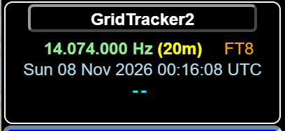

# Getting Started

Start GridTracker2 from the Start menu or desktop (Windows), the Applications folder (macOS), or your applications menu or the command line (Linux).

GridTracker2 doesn't need WSJT-X or JTDX to be installed or running, but it finds them if they are. When it can read their settings, it uses your callsign, grid, band, mode and network settings from them. If no decoding program is connected, enter your callsign and grid in [Settings → General](GridTracker-Overview/Settings-Sub-Menus.md#general-tab) → Station.

## Connecting to WSJT-X or JTDX

When GridTracker2 is receiving from WSJT-X, the top of the side panel shows your frequency, band and mode, and the status bar shows **RECEIVE**.

{width=260px}

{width=260px}

If the status bar shows "waiting for message", GridTracker2 hasn't heard from WSJT-X yet. It can take up to 15 seconds. If it stays that way:

* WSJT-X may not be running, or may be set up to send somewhere else. See [Appendix B](Appendices/Appendix-B-Configuring-WSJT-X-and-JTDX-for-GridTracker.md).
* Another companion program may be receiving WSJT-X's messages instead. To run several companion programs together, set them all up for multicast (see [Using Multicast](Appendices/Appendix-B-Configuring-WSJT-X-and-JTDX-for-GridTracker.md#using-multicast)).
* A firewall may be blocking GridTracker2.

## Your First Session

Once decodes are arriving:

1. **Look at the map.** Grids light up as stations are heard. Your logged QSOs are colored too; see [The Map](GridTracker-Overview/GridTracker-Map-View-—-Main-WIndow.md).
2. **Open the Call Roster** (the Call Roster button, or **Ctrl+F**). Tick what you are hunting under **Wanted**, and click a highlighted callsign to call that station. See [The Call Roster](Making-GridTracker-Work-For-You/Using-Call-Roster.md).
3. **Load your logbook.** In [Settings → Logging](GridTracker-Overview/Settings-Sub-Menus.md#logging-tab), add your LoTW, QRZ.com or other logs so GridTracker2 knows what you have already worked and confirmed, and choose where new QSOs are sent.
4. **Set up alerts** so you hear about wanted stations: see [Alerts](Making-GridTracker-Work-For-You/Setting-Up-Audio-and-Visual-Alerts.md).
5. **Explore the Settings.** Turn on POTA Hunting, DX Feeds or SOTA Chasing in Settings → Features if you enjoy those.

```{tip}
Hold the mouse over almost any button or setting to see what it does.
```
