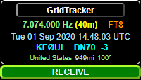
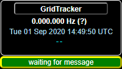

# Getting Started

Depending on your operating system, GridTracker can be started from the command line, the start menu or a shortcut.

GridTracker does not require WSJT-X or WST-X derivitive to be installed on your computer or even running to operate.  However it does however automatically detect if WSJT-X or some derivitives are installed and if it is running when it starts up.

If GridTracker can locate the configuration file of your WSJT-X or WSJT-X derivitive  in your system, it will automatically read your callsign, Maidenhead grid square, operating band, operating mode and your network configuration.  If GridTracker discovers that WSJT-X or WSJT-X derivitive  is a running process on your computer during your initial startup of GridTracker it will attempt to configure itself to the network configuration details of the running program.

When a connection between GridTracker and WSJT-X has been established the operating info section at the top of the control panel will indicate your frequency and time/date information the WSJT-X status bar is displaying "RECEIVE".

If GridTracker has not received status information from WSJT-X then the WSJT-X status bar will show waiting for message.  

WSJT-X may not be running or configured in a way that allowed GridTracker to detect network settings, or GridTracker  may not have heard a message from WSJT-X yet (it could take up to 15 seconds.)  You may also be running other companion programs that have "taken over" the UDP[^udp] network connection.  If you are using another companion program, you may want to shut it down for now as you become familiar with GridTracker and its extensive features. If you decide to run other companion programs in parallel, you will want to configure WSJT-X and all other programs to use Multicast[^multicast].

If all this has gone according to plan, GridTracker should be receiving information from WSJT-X or WSJT-X derivitive  in real-time! If not see [Appendix B](Appendices/Appendix-B-Configuring-WSJT-X-andJTDX-for-GridTracker) for detailed instructions for how to configure WSJT-X or WSJT-X derivitive .

---

[^udp]: UDP stands for User Datagram Protocol. It's a communications protocol that can be used as an alternative to TCP (transmission control protocol) to send messages (i.e., datagrams) between computing devices in a network.
[^multicast]: Multicast is an IP network addressing class that allows computers, and applications to receive information to a group rather then only between individual assets. This also differs from Broadcast in that computers and applications can selectively join or leave the mulitcast group.