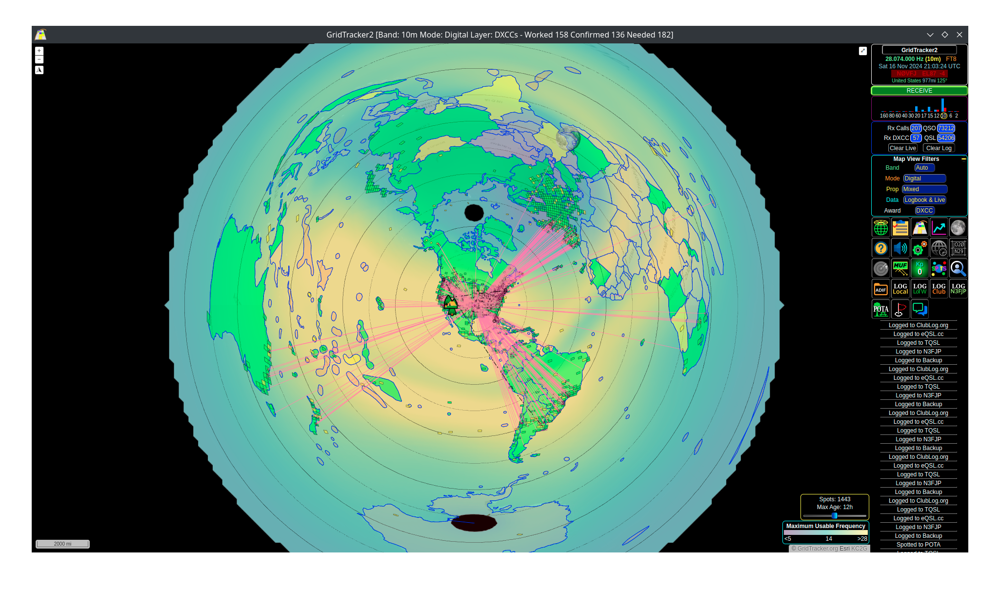
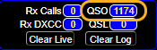
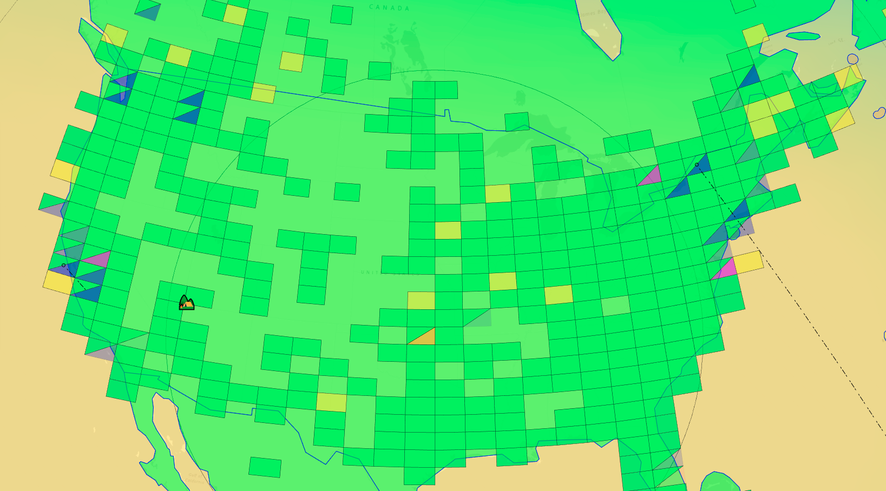

The GridTracker Map is a visual representation of all of your radio contacts (QSOs) by Maidenhead grids.  You can move the map by clicking anywhere on it and dragging.  You can enlarge the map to look at all of the grids where you do or don't have contacts in a single country.  You can reduce the map size to look at all of the grids where you've made contacts across the globe.  

**WSJT-X is loaded with grid squares and is the reason GridTracker exists!** 

GridTracker loads your active **wsjtx_log.adi** file at every startup _automatically._ This "seeds" GridTracker with your "worked" QSOs. (But it also has options that allow you to load other log files from other sources.)

Towards the top right corner of GridTracker is a label "QSO" with a number to the right: This is the number of QSOs also known as "Log Records" GridTracker was able to find in your **wsjtx_log.adi** log file (plus other log files if you choose to import them.)

Those QSOs will be highlighted with yellow boxes on a map that correspond to the standard Maidenhead grid system used in ham radio to locate contacts. Yyou can define the color coding for not only your contacts, but _confirmed_ contacts (red boxes) and live traffic in the settings menu.

A standard WSJT-X message usually contains the sender's Maidenhead grid location. It's included in the standard \[default\] messages WSJT-X creates:

> "**CQ N0TTL CN84**"\
> **"N0TTL N2VFL FN20"**

GridTracker will take grid locations from the live message decodes done in WSJT-X and map them on the GridTracker map in real time.  

GridTracker also recognizes when two stations are in a QSO with each other.  It will draw a "Q-path" (geodesic line) between the grids of the two stations.  If you elect to enable animations the line will appear as "marching ants" in the direction of the traffic.  We call this "QSX" (traffic between two stations).

After you've accumulated some confirmed stations in WSJT-X you will eventually see some grids are divided in half by a diagonal line.  These grids are what we term "split grids" (not to be confused with "rig split".)

The GridTracker map will show a split grid when you select the option to show both _Logbook_ (or historical) data and _Live_ data. A _split grid_  is one where you have previously logged a QSO with a station in the grid (yellow triangle) but there is currenty live QSX traffic (blue triangle) occurring. You will also see green and  aqua triangles.  This means that a station in the grid is calling CQ.
