# The Side Panel

The side panel runs down the right side of the main window (or the left, with **Control Panel On Left Side** in Settings → General). From top to bottom it has the operating information, the status bar, the band activity graph, the Quick Stats, the Map View Filters and the button panel. What used to be the message list at the bottom is now the [Event Viewer](#event-viewer). The band activity graph, Quick Stats and Map View Filters can be moved above or below the buttons, see [Rearranging the Panel](#rearranging-the-panel).

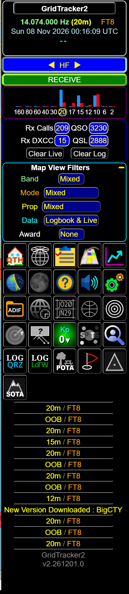{width=150px .gt-float-right}

Click the title "GridTracker2" at the top to hide the panel and give the whole window to the map. Click the **↔** that appears, or press **F12**, to bring it back.

## Operating Information

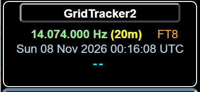{width=260px}

* **Frequency, band and mode:** the frequency and band your active radio program is on, and its mode. Hover over them for a reminder of what they are.
* **Date and time:** click to switch between UTC and your local time.
* **The station you are working:** the callsign you are calling or last called, their grid and their last signal report. The line below gives their DXCC entity, the distance and the bearing (heading) to them.
  * Click the callsign to open the Lookup window for it.
  * Right-click the callsign to open your Logbook filtered to that station (**Shift**+right-click shows only confirmed QSOs).
  * Click their grid to center the map on it.

### Several radios

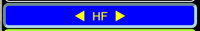{width=260px}

When more than one WSJT-X, JTDX, AC Log or Log4OM is sending to GridTracker2, a selector appears under the operating information. The ◀ and ▶ arrows step through them, and the panel and map follow the one you choose. Each WSJT-X instance appears under its name (WSJT-X started with `--rig-name=HF` shows as "HF").

## Status Bar

{width=260px}

The status bar shows what your active radio program is doing:

| Text | Color | Meaning |
| --- | --- | --- |
| waiting for message | green | Nothing has been received from WSJT-X or JTDX yet. |
| RECEIVE | green | Receiving. |
| DECODE | blue | Decoding. |
| TRANSMIT | red | Transmitting. |
| CONNECTED | green | AC Log or Log4OM is the active radio. |
| *name* CLOSED | purple | The active WSJT-X or JTDX has been closed. |
| IGNORE | gray | GridTracker2 is ignoring incoming messages. |

Click the status bar to stop reading incoming WSJT-X and JTDX messages, for example while you test something; it then shows IGNORE. Click it again to resume.

## Band Activity

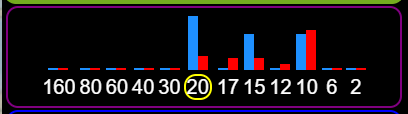{width=260px}

The bar graph shows how busy each band is around your grid in your current mode. Your current band's label is circled.

* **Red bars:** the band activity score from PSK-Reporter, for your grid and mode.
* **Blue bars:** activity seen by GridTracker2's own network (Off-Air Services).

Hold the mouse over a bar to see the numbers behind it: the score, how many stations were spotted, and how many are transmitting and receiving. Right-click the graph to pop it out into its own small window that you can place anywhere on your screen; right-click that window to close it.

The graph needs **Off-Air Services** and **Band Activity** turned on in [Settings → Features](Settings-Sub-Menus.md#features-tab). **Neighboring Grids** adds the activity of the eight grids around yours.

## Quick Stats

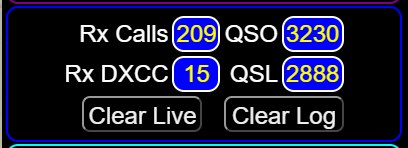{width=260px}

* **Rx Calls:** how many callsigns you have heard this session.
* **Rx DXCC:** how many DXCC entities you have heard this session.
* **QSO:** how many QSOs are in your logbook.
* **QSL:** how many of them are confirmed.

Click a number to open the matching list in the Statistics window: Rx Calls and Rx DXCC open the Live tab, QSO opens the Logbook, and QSL opens the Logbook showing confirmed QSOs only.

* **Clear Live** clears everything you have heard this session: live grids, paths, callsigns and the Rx Calls and Rx DXCC counts.
* **Clear Log** clears your logbook from GridTracker2's display. It doesn't delete any files. The button then reads **Load Log**; click it to load your logs again. You might clear the log to change which logs are loaded, see [Logging Options](../Making-GridTracker-Work-For-You/GridTracker-Logging-Options-and-Functions.md).

When your [Logbook Filters](Settings-Sub-Menus.md#logbook-tab) leave out some QSOs, an orange **Log Entries Filtered** line appears here. Click it to open the filters.

```{tip}
What counts as a QSO and a QSL depends on which logs you load. WSJT-X's own log only knows that you logged a QSO, not whether the other station confirmed it. To see confirmations, load your LoTW, QRZ.com or ClubLog log, or a log from your logging program, in [Settings → Logging](Settings-Sub-Menus.md#logging-tab).
```

## Map View Filters

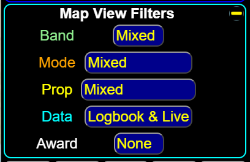{width=260px}

The Map View Filters choose which part of your logbook and live traffic is shown on the map. They also apply to the award layers, the Statistics window, and the POTA, SOTA and DX Feeds markers. Click the **–** in the corner to fold the box away; click its title to open it again.

* **Band:** **Auto** follows the band your radio program is on. **Mixed** shows all bands. Or pick a single band.
* **Mode:** **Auto** follows your current mode. **Mixed** shows all modes. **Digital** and **Phone** show those groups. Or pick a single mode.
* **Prop:** the propagation mode recorded in your log (Satellite, EME, Meteor Scatter, Sporadic E and so on), or **Mixed** for all.
* **Data:** **Live** shows what you are hearing now, **Logbook** shows your QSOs, and **Logbook & Live** shows both. **Ctrl+Q** cycles through them.
* **Award:** shows an award layer: CQ zones, ITU zones, continents (WAC), US states (WAS), DXCC, US counties (USC), US48 grids, or Canadian provinces (WACP). See [Award Layers](GridTracker-Map-View-—-Main-WIndow.md#award-layers).

```{tip}
If QSOs seem to be missing from the map, check these filters first. To see everything you have ever worked, set Band, Mode and Prop to Mixed and Data to Logbook.
```

## The Button Panel

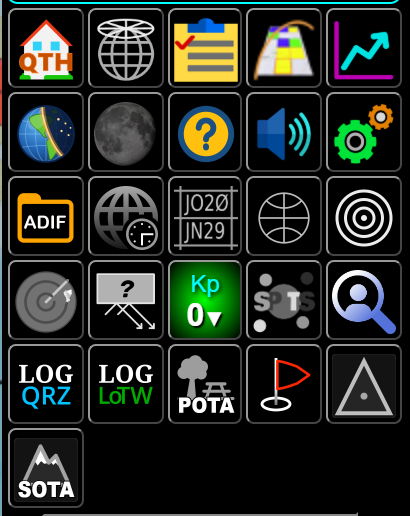{width=260px}

The buttons open windows and turn map layers on and off. A button that is turned off is drawn in gray. Some buttons only appear while the feature they belong to is turned on, so your panel may have fewer or more buttons than shown here.

You can **drag a button** to another place in the panel to rearrange them. **Reset Button Order** in Settings → General puts them back in their default order.

Buttons that open a window toggle it: click once to open, again to close. **Right-click** one of them to bring its window forward without closing it.

| Button | Name | What it does | Hotkey |
| --- | --- | --- | --- |
| {width=32px} | Re-center map | Centers the map on your grid, turns it back to north up and resets the zoom. | Ctrl+Z |
| {width=32px} | Projection | Switches between the flat (Mercator) map and the azimuthal equidistant (AEQD) map centered on your grid. Each keeps its own view. | Ctrl+W |
| {width=32px} | Call Roster | Opens the [Call Roster](../Making-GridTracker-Work-For-You/Using-Call-Roster.md) window. | Ctrl+F |
| 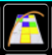{width=32px} | Push-Pin Mode | Switches between colored grid squares and push pins. | Ctrl+P |
| 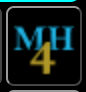{width=32px} | Maidenhead Width | In push-pin mode only: MH6 places pins on the 6-character sub-square when a station sent one (otherwise on its 4-character square), MH4 places every pin on its 4-character square. | |
| {width=32px} | Statistics | Opens the [Statistics](../Making-GridTracker-Work-For-You/GridTracker-Statistics.md) window with your logbook and award progress. | Ctrl+I |
| 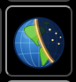{width=32px} | Grayline | Shades the night side of the Earth. | Ctrl+N |
| 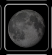{width=32px} | Moon | Shows the Moon's position. Hover over it for its azimuth and elevation, useful for EME. | Ctrl+D |
| 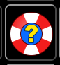{width=32px} | User Guide | Opens this User Guide in its own window. Type in the search box at its top to find a word (**Enter** for the next match, **Shift+Enter** for the previous one). Its toolbar zooms, prints or saves it, and its **☰** button shows page thumbnails and the contents. **Esc** closes the window. | |
| {width=32px} | Audio Mute | Mutes or unmutes all of GridTracker2's sounds and spoken alerts. | Ctrl+M |
| {width=32px} | Settings | Opens the [Settings](Settings-Sub-Menus.md) panel. | Ctrl+S |
| {width=32px} | Load ADIF Log | Opens any ADIF log file and adds it to your logbook. The file is also added to Local File(s) in Settings → Logging, so it loads at every start. | Ctrl+L |
| {width=32px} | Reload Local ADIF Files | Reloads the local files listed in Settings → Logging. Shown when its **Menu Button** is ticked. | |
| {width=32px} | Time Zones | Shows the time zones. Hover over a zone to see its name, offset and local time. | Ctrl+H |
| 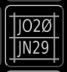{width=32px} | All Grid Overlay | Draws and labels the Maidenhead grid lines. | Ctrl+B |
| {width=32px} | Major Parallels and Meridians | Draws the Equator, the tropics, the polar circles and the prime meridian. | |
| 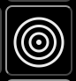{width=32px} | Range Rings | Draws distance rings around your grid. | |
| 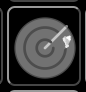{width=32px} | US Radar | Shows the US weather radar. | 0 |
| 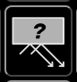{width=32px} | Prediction Layer | Cycles through the propagation prediction layers. Right-click to pick one directly, and to show or hide its legend. See [Prediction Layers](GridTracker-Map-View-—-Main-WIndow.md#prediction-layers). | |
| 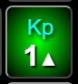{width=32px} | Current Conditions | Opens the [Conditions](../Making-GridTracker-Work-For-You/Other-Windows.md#current-conditions) window. While GridTracker2 receives the planetary K index, the button shows it, with an arrow for its trend; it pulses during a geomagnetic storm (Kp above 5). | Ctrl+E |
| {width=32px} | Spot Reports | Cycles between off, **RX Spots** (the stations that heard you, on the map) and **RX Heatmap**. Right-click to pick one directly and to show or hide the spots legend. | Ctrl+O |
| {width=32px} | Lookup | Opens the [Lookup](../Making-GridTracker-Work-For-You/Other-Windows.md#callsign-lookup) window. | |
| 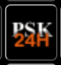{width=32px} | PSK 24 Hour Report | Loads the stations that heard you on PSK-Reporter in the last 24 hours. | |
| {width=32px} | QRZ.com Log | Downloads your QRZ.com logbook. | |
| 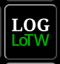{width=32px} | LoTW Log | Downloads your Logbook of The World confirmations. | |
| {width=32px} | ClubLog Log | Downloads your ClubLog logbook. | |
| 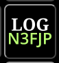{width=32px} | N3FJP Log | Downloads the log from N3FJP AC Log. | |
| 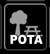{width=32px} | Parks On The Air | Shows POTA activations on the map. Shown while **POTA Hunting** is on. | |
| 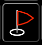{width=32px} | GridTracker Spotters | Shows the other GridTracker2 users who are spotting. Hover over the button to see how many are on the map. | Ctrl+G |
| 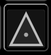{width=32px} | DX Feed Spots | Shows DX Cluster and CW Skimmer spots on the map. Shown while **DX Feeds** is on. | |
| {width=32px} | Summits on the Air | Shows SOTA activators on the map. Shown while **SOTA Chasing** is on. | |
| 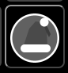{width=32px} | Santa Tracker | Follows Santa and his reindeer around the world. Shown from December 1st to 25th. | |
| {width=32px} | Event Viewer | Shows the [Event Viewer](#event-viewer). Right-click to choose whether it shows over the map or in a window of its own. | |
| 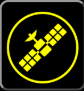{width=32px} | Toggle Satellite Tracking | Turns BirdWatch's satellite tracking on and off: its panel, the satellites on the map, and its Auto-Track, Doppler and Pass Timeline buttons. Shown while **BirdWatch** is on. See [BirdWatch](../BirdWatch.md). | Ctrl+F12 |
| 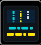{width=32px} | Toggle Multi-Mode Decoder | Opens the [Multi-Mode Decoder](../Multi-Mode-Decoder/Multi-Mode-Decoder.md) window; right-click to bring it forward. A green dot on it means the decoder is listening in the background (FT8, FT4 or WSPR). Shown while **Multi-Mode Decoder** is on. | |

The log download buttons (PSK, QRZ.com, LoTW, ClubLog and N3FJP) appear when you tick their **Menu Button** in [Settings → Logging](Settings-Sub-Menus.md#logging-tab). Online buttons are hidden in Offline Mode.

### Santa Tracker

From December 1st the Santa Tracker button appears. Turn the tracker on to see a countdown, at the top of the map, until Santa leaves at midnight on December 24th (your time). Then a box on the map shows where he is, his next stop and how many gifts he has delivered. Click where he is to center the map on him, and hover over a stop to see its DXCC entity and state or province. Shortly before he reaches you, contact with Santa is lost...

## Rearranging the Panel

The band activity graph, the Quick Stats and the Map View Filters can each be moved above or below the others, and above or below the button panel. Move the mouse to the top border of a box: the cursor changes to a hand. Drag the box from there to where you want it; the space it will drop into is shown dimmed as you go. GridTracker2 remembers the order.

**Reset Panels** in Settings → General puts the boxes back in their usual order.

## Event Viewer

Click the **Event Viewer** button in the button panel to see what has happened, newest first. Each event has its **Time**, its **Source** (GridTracker, Logging, Decode, WSJT-X, Roster, BirdWatch, Rotor or SOTA) and the **Event** itself:

* band and mode changes;
* decodes that set off a Custom Alert, with a 🚩;
* each new QSO ("▲ New QSO *call* ▲"), and the result of sending it to each of your logs, for example "Logged to QRZ.com", or a failure;
* "Spotted to POTA" when a park QSO was spotted;
* BirdWatch's announcements and the rotator's moves;
* screenshots, Call Roster script changes, callsign database updates and new versions of GridTracker2. When a new version has downloaded, an **Install and Restart** button in its event installs it and restarts.

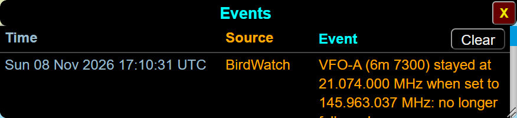{width=440px}

Your own callsign is shown in yellow, and the station you are working in cyan. Events are kept for this session only, and never longer than a day. **Clear**, in the list's header, empties the list.

The Event Viewer opens over the map, like the Settings panel; click its red **X** or press **Esc** to close it. Drag it by its title bar to move it, and drag its bottom right corner to make it bigger or smaller. It comes back where you left it.

Right-click the Event Viewer button to choose where it shows: **View In Main** (the panel over the map) or **View As Window** (a window of its own, which you can put anywhere on your screen).

With **Open Event Viewer On Error** on in [Settings → General](Settings-Sub-Menus.md#general-tab), an error, such as a log upload that failed, opens the Event Viewer by itself.
