# The Map

The map fills most of the main window. Drag it to move around, and zoom with the mouse wheel or the **+** and **–** buttons in the top left corner. Below them, the compass button turns the map back to north up. The button in the top right corner makes the map full screen (or press **F11**).

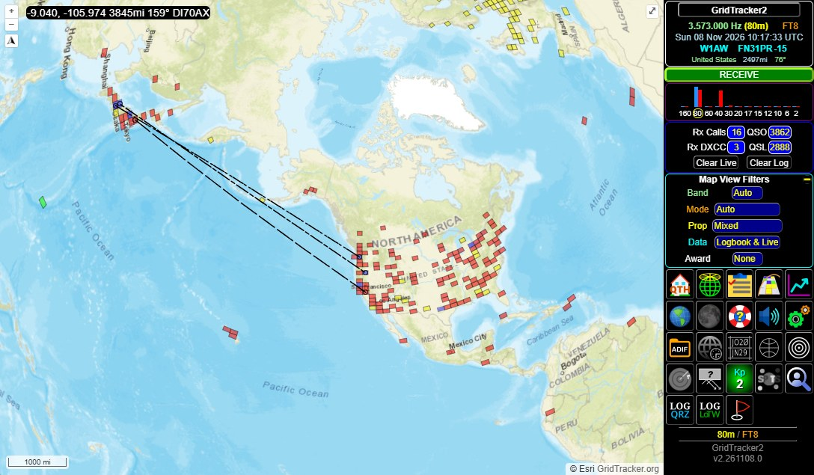

## Grids

The map is divided into Maidenhead grid squares. A grid is colored when you have worked a station there, or hear one there now. The colors are set in [Settings → Colors](Settings-Sub-Menus.md#colors-tab):

| Default color | Name | Meaning |
| --- | --- | --- |
| Yellow | QSO | You have worked a station in this grid. |
| Red | QSL | Your QSO in this grid is confirmed. |
| Blue | QSX | Stations here are working someone else. |
| Green | CQ | A station here is calling CQ. |
| Cyan | CQ DX | A station here is calling CQ DX. |
| Yellow | QRZ | A station here is calling you. |
| Orange | QTH | Your own grid. |

Which grids are colored depends on the [Map View Filters](Control-Panel.md#map-view-filters): your logbook, live traffic, or both.

With **Split QSL Grids** on (Settings → Map), a grid that is both in your logbook and live is split diagonally: one half shows your logbook status, the other the live traffic. Live grids fade out after they were last heard, at the speed set by **Live Grid Decay**.

```{note}
In push-pin mode, the **Maidenhead Width** button chooses how precisely pins are placed. With MH6, a station is pinned on its 6-character sub-square when its grid has 6 characters, and on its 4-character square when that's all it sent. With MH4, every station is pinned on its 4-character square, including those that sent 6 characters. No station is hidden in either mode.
```

### Grid details

Hold the mouse over a colored grid to see who is in it: each station's call, frequency, reports, who they are working, mode, band, QSL status, last message, DXCC entity and time. The header names the grid, whether you are seeing Live or Logbook data, and the DXCC entities and states that share it. Click a callsign in the table to look it up.

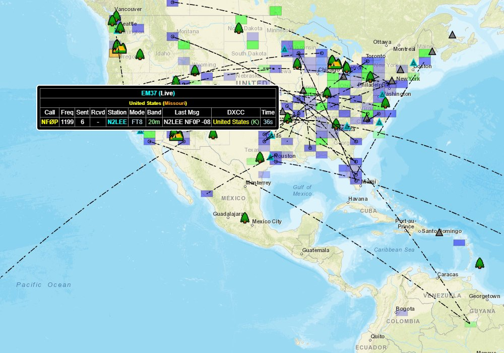

* **Right-click** a grid to pop its details out into a separate window that stays open. Callsigns there can be clicked to look them up.
* **Shift**+right-click selects the text so you can copy it.
* While no award layer is shown, right-click and hold on an empty part of the map to see that grid's name, its distance and bearing from you, its latitude and longitude, and every DXCC entity and state that shares it.
* With **Auto Mouseover Grids** off (Settings → Map), click and hold a grid to see its details.

### Paths

When two stations are in a QSO, a line (a great-circle path) is drawn between their grids. QSX paths are traffic between other stations; QRZ paths involve you. With **Animate** on (Settings → Map, or **Ctrl+J**), the paths move in the direction of the traffic. A station that doesn't send a grid is drawn at the center of its DXCC entity when **Missing Grid DXCC Fallback** is on.

When a station calls a directed CQ (CQ NA, CQ EU, CQ JA...), the area they are calling is outlined, while **Outline Directed CQ Areas** is on.

### Lookup-derived grids

When a station hasn't sent its grid, GridTracker2 may find it another way: from a callsign lookup, the US or Canadian callsign database, PSK-Reporter spots or GridTracker2's own spotting network. A grid found this way is a likely location rather than a certain one, and is marked with a diamond (◇) in the rosters.

## Push Pins

Click the **Push-Pin Mode** button (or press **Ctrl+P**) to show a pin for each station instead of colored grids. Pins are drawn in the band colors:

* a plain pin for a station you have worked;
* a pin with a black cap for a confirmed QSO;
* a diamond head for a station you are hearing now.

In MH4 pin mode with Band set to Mixed, logbook pins use the Gridsquare Colors for worked and confirmed. A **Maidenhead Width** button appears in pin mode to switch between 4- and 6-character placement.

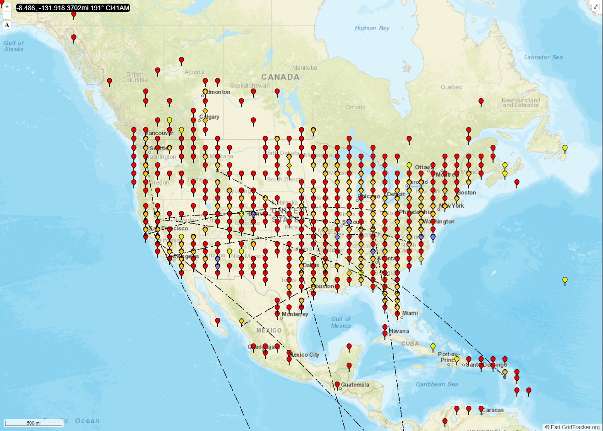

## Projections

The **Projection** button (or **Ctrl+W**) switches between the flat Mercator map and an azimuthal equidistant (AEQD) map centered on your grid. On the AEQD map, straight lines from the center are great-circle paths, so the direction to any station is its true bearing from you, the way your beam points. Grids farther than about 11,500 miles aren't drawn on it.

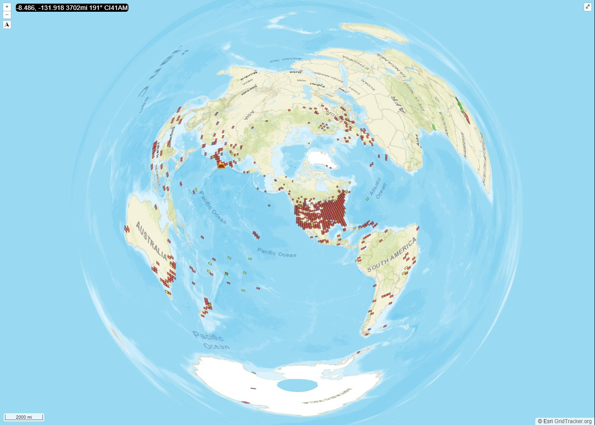

## Base Maps

Settings → Map offers more than 35 base maps: street, topographic, satellite, ocean, dark and light maps from Esri, OpenStreetMap, Carto, OpenTopoMap, USGS, NASA and others. Newer additions include Topographical by OpenTopoMap, Topographical, Satellite and Satellite Topo by USGS, and Satellite Firefly by Esri. **Auto Night Map** switches to a second map at night. Offline Mode uses the maps that are built into GridTracker2.

## Overlays

### Grayline

The **Grayline** button (or **Ctrl+N**) shades the night side of the Earth. Settings → Map sets how dark it is, and where the terminator (the edge between day and night) is drawn: at the horizon, or at civil, nautical or astronomical twilight.

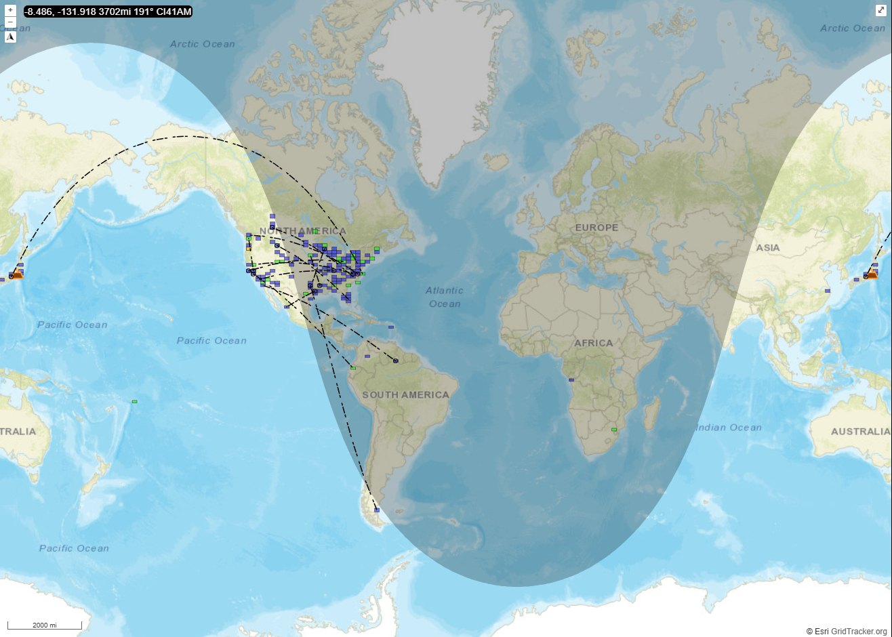

### Range Rings, Parallels and Meridians

**Range Rings** draws circles around your grid at the distance set in Settings → Map. **Major Parallels and Meridians** draws the Equator, the Tropics of Cancer and Capricorn, the Arctic and Antarctic Circles, the prime meridian and the 180° meridian. Both work in either projection, in the colors chosen in Settings → Map.

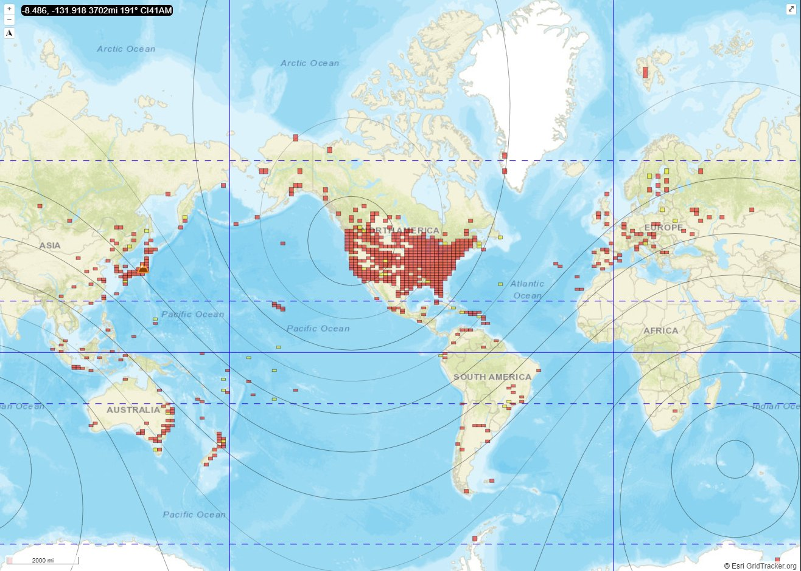

### Maidenhead Grid Lines

**All Grid Overlay** (or **Ctrl+B**) draws the grid lines and labels them. As you zoom in, the labels change from the two-letter fields (DM) to the four-character squares (DM78). Its opacity is set in Settings → Map.

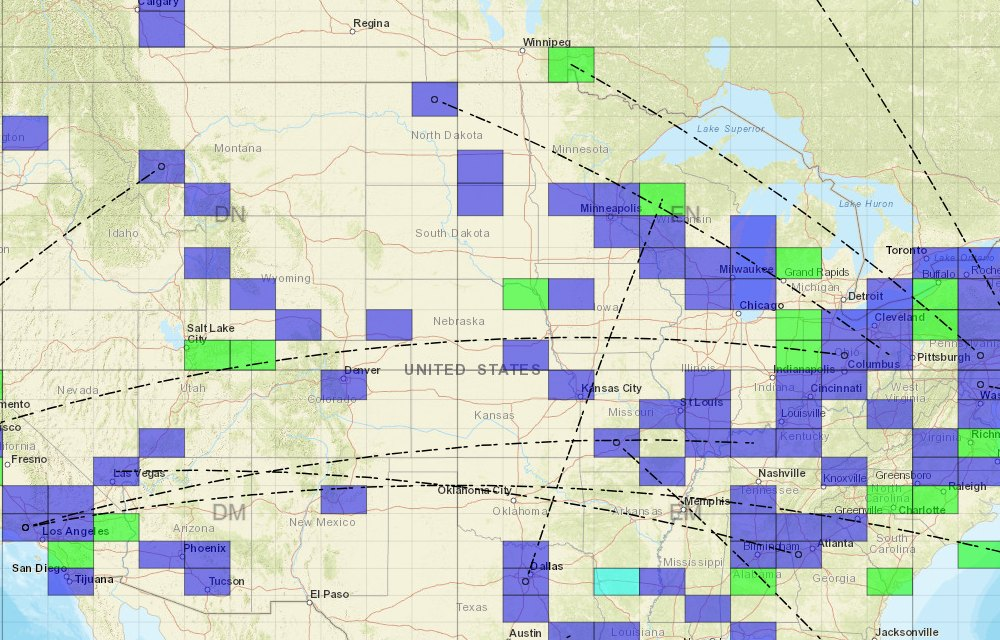

### Time Zones

**Time Zones** (or **Ctrl+H**) shows the world's time zones. Hold the mouse over a zone to see its name, its offset from UTC and its local date and time.

### Moon

**Moon** (or **Ctrl+D**) shows where the Moon is overhead. Hold the mouse over it to see its azimuth and elevation from your grid: red below the horizon, yellow below 10°, green above.

### US Weather Radar

**US Radar** (or **0**) shows the US weather radar from the National Weather Service, refreshed every 10 minutes.

### Prediction Layers

The **Prediction Layer** button cycles through propagation prediction maps. Right-click it to choose one directly, and to show or hide its legend in the corner of the map. Settings → Map sets how opaque they are.

* **Maximum Usable Frequency:** the highest frequency that will reflect off the ionosphere, from KC2G.
* **Critical Frequency NVIS:** the critical frequency (foF2) for near-vertical incidence skywave, from KC2G.
* **Es Probability Index:** where sporadic E is likely, from PROPquest. A slider moves the prediction up to 11 hours ahead or back.
* **Probability of Aurora:** from NOAA's Space Weather Prediction Center.
* **Tropospheric Inversion VHF:** where tropospheric ducting may carry VHF and UHF signals, with areas of 6 m sporadic E, from vhf.dxview.org.

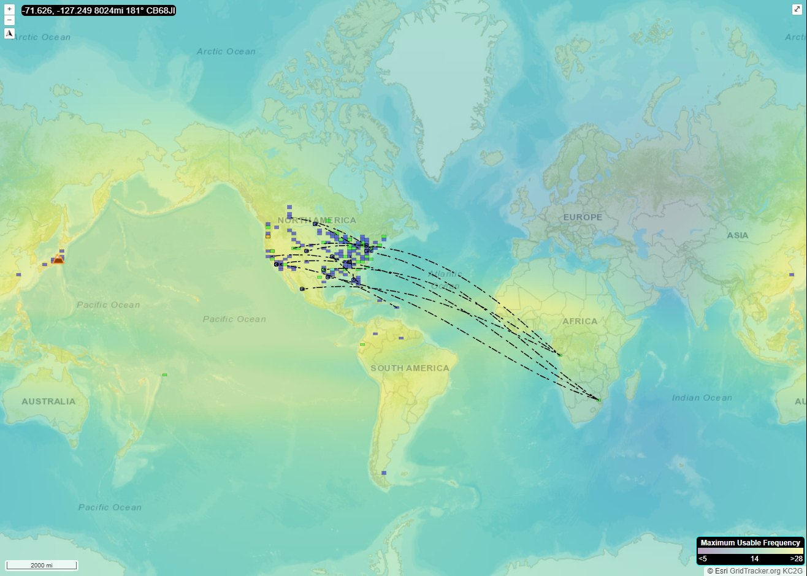

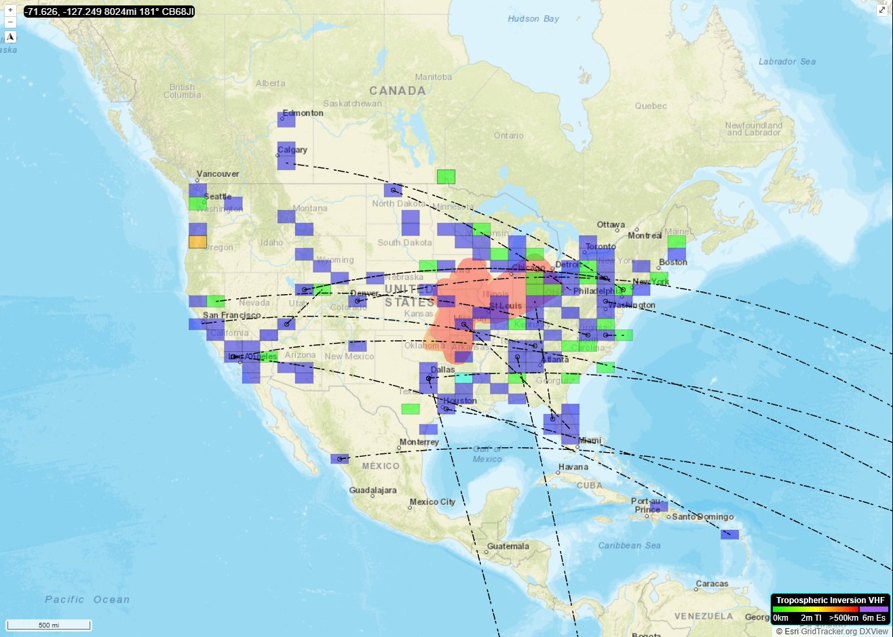

### RX Spots

The **Spot Reports** button shows where your signal has been heard: **RX Spots** places each station that heard you on the map, and **RX Heatmap** shows the same reports as a heat map. Spots come from PSK-Reporter and from GridTracker2's own spotting network, and need **Spotting** turned on in Settings → Features. Hold the mouse over a spot to see who heard you, how well, and when.

A legend in the corner of the map shows how many spots there are, and **Max Age**, how far back they go. Type hours and minutes into its boxes, or use its slider. Right-click the Spot Reports button to show or hide the legend.

With **Spots Over Grids** on (Settings → Features, or **Ctrl+T**), the spots are drawn over your grids; with it off, they replace them while shown.

## Award Layers

Choose an **Award** in the Map View Filters, or press a number key, to color the map by your progress toward an award: confirmed areas in green, worked but unconfirmed areas in yellow, and areas you still need with a faint red tint.

| Key | Award layer |
| --- | --- |
| 1 | None (back to the grid map) |
| 2 | CQ zones |
| 3 | ITU zones |
| 4 | Worked All Continents (WAC) |
| 5 | Worked All States (WAS) |
| 6 | DXCC entities |
| 7 | US counties (USA-CA) |
| 8 | US continental grids (US48) |
| 9 | Canadian provinces (WACP) |
| = | Cycle through them |

Hold the mouse over a zone, state, county or entity to see the bands and modes you have worked and confirmed it on, or "Needed". Like everything else, the award layers follow the Band, Mode and Prop filters: set them to Mixed to see your progress on all bands and modes.

While an award layer is shown, the grids, paths and spots are hidden. Turn on **Keep Other Layers With Award View** in Settings → Map (or press **Ctrl+U**) to keep them.

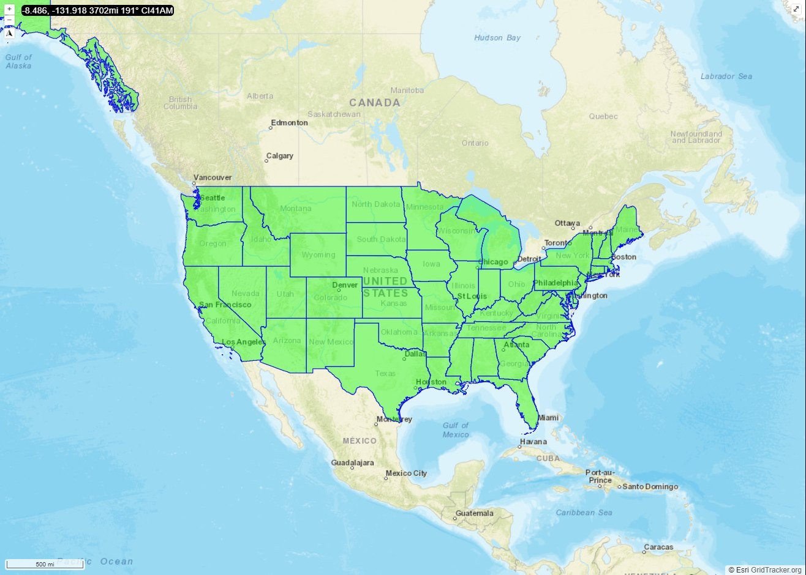

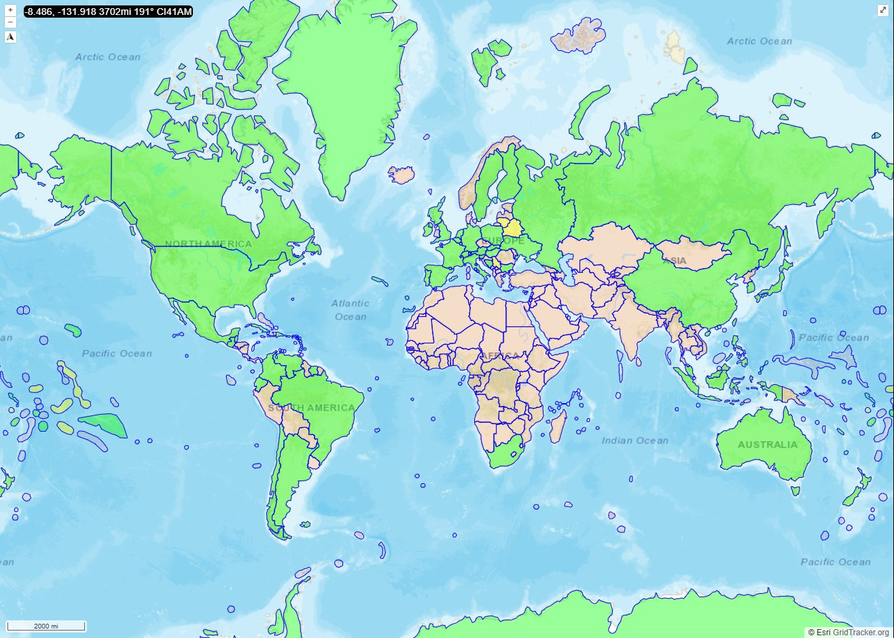

## Spot Markers

POTA parks, SOTA summits and DX Feeds spots each have their own markers and button. All of them follow the Band and Mode filters, and their tooltips list every spot on that marker.

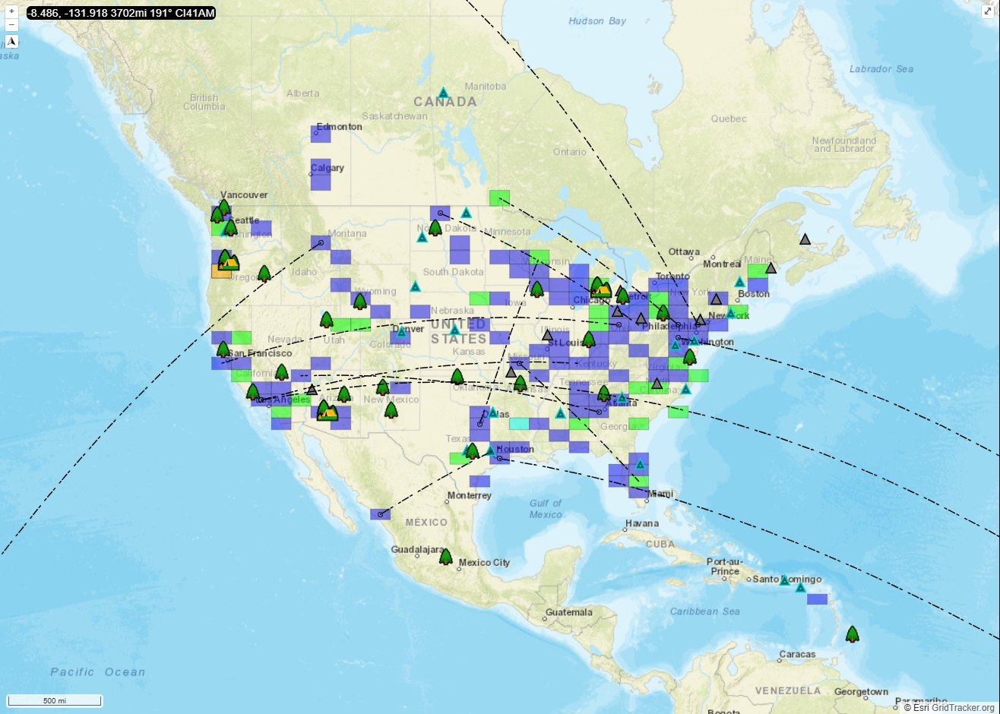

Each kind of marker has three looks:

| | | |
| --- | --- | --- |
| **DX Feeds** | | |
| 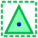{width=24px} A radio is on the spot's band and mode | {width=24px} A radio is on the spot's band, in another mode | {width=24px} No radio is on the spot's band |
| **SOTA** | | |
| 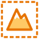{width=24px} A radio is on the spot's band and mode | {width=24px} A radio is on the spot's band, in another mode | {width=24px} No radio is on the spot's band |
| **POTA** | | |
| {width=24px} A radio is on the spot's band and mode, not worked today | {width=24px} Worked today on this band and mode | {width=24px} No radio is on the spot's band and mode |

* **Hover** over a marker for its details. Right-click a POTA park to pop the tooltip out into its own window.
* **Click** a marker to work the spot: it goes to a radio already on the spot's band and mode (WSJT-X, JTDX, AC Log or Log4OM); otherwise to a connected AC Log or Log4OM, which can also tune your rig; otherwise to the active WSJT-X or JTDX as Gen Msgs. Where markers are stacked, only the top one is worked.
* A marker for the callsign in a radio's DX Call is **ringed**, so you can find it on the map.
* With **Group Overlapping Spots** on (Settings → Map), markers in the same DXCC entity that would overlap are combined into one, with a compact tooltip ("POTA Spot × 3", "Feed Spot × 2").

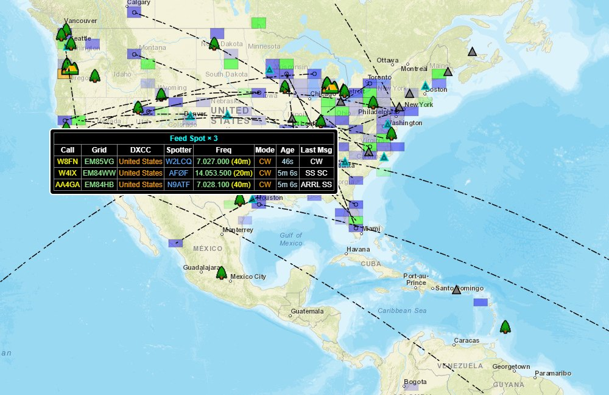

See [Parks On The Air](../Third-Party-Integrations/GridTracker2-and-Parks-On-The-Air.md), [Summits On The Air](../Third-Party-Integrations/GridTracker2-and-Summits-On-The-Air.md) and [The Feed Roster and DX Feeds](../Making-GridTracker-Work-For-You/Using-Feed-Roster.md) for more.

### GridTracker Spotters

The **GridTracker Spotters** button (or **Ctrl+G**) shows a flag for each GridTracker2 user who is spotting, filtered by the Band and Mode filters. Hover over a flag for their call, grid, band, mode, distance and bearing; the call is green if you have a confirmed QSO with them, yellow if worked, and cyan if new on your current band and mode. Click a flag to look the station up.

## Map Position

The top left corner shows the latitude, longitude, distance, bearing and 6-character grid under the mouse pointer. Press **Ctrl+X** to hide or show it.

Press **Shift+F5** to **Shift+F10** to remember up to six map views, and **F5** to **F10** to return to them.

## Rotator

With **CatRotator / PstRotator** turned on in Settings → Features, **Ctrl**+click anywhere on the map to turn your antenna toward that point.
