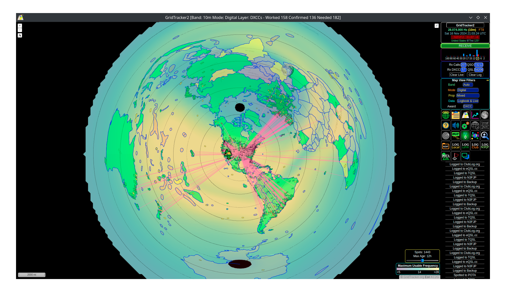
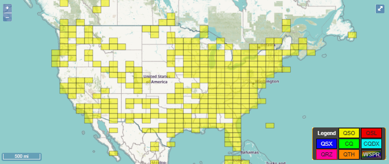
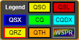
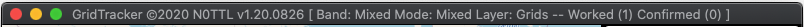
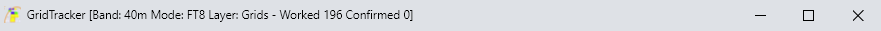

# GridTracker Main Window
GridTracker's main window is made up of the GridTracker Map, the Control Panel as well as detail in the application title bar.

## **GridTracker Map** 

The GridTracker Map shows the "_grid status_" for as much or as little of the world as you choose.  You can enlarge it to focus on just one country or continent or reduce it to show the entire globe.  Once you've decided where to focus the map it's up to you to decide what types of _overlays_ to add to the base map and what details and data those overlays show.  

This example above shows _logbook data_ for a user.  All of the Maidenhead grids where they have made a QSO are highlighted in yellow.  If you choose to display _live_ data or _logbook and live_ data you'll also see grids highlighted in different colors. The legend in the lower, left corner of the map window shows the color coding scheme used for highlighting grids.  

&#10148; **_Practice Tip:_**  You can change the grid color coding to suit your preferences in the **Settings>Grids** menu.

If you mouse-over --  that is, take your mouse pointer and hover over any "highlighted" grid -- you'll get a temporary pop-up window that displays information about stations in grid.  It will show information for any QSO's you made in the grid and/or the live traffic occurring at that grid right now.

If you **right-click** any grid you'll get a fixed pop-up window where you can examine the grid details with your mouse or keyboard.

## **GridTracker Map Legend**

This is the legend for the GridTracker Map.  
Remember:

* You can turn it on or off.
* You can [change any of these colors](Settings-Sub-Menus.md#grids-tab) to suit your preferences.

The legend uses standard  "Q" codes as shorthand to identify the status of grids in the GridTracker Map.   

* QSO: Grids where you have made a contact, a QSO(s)
* QSL: Grids where your QSO(s) have been confirmed by the other station.    
* QSX: Grids with decoded traffic, but none of it is communicating with you.
* CQ: Grids where at least one station is calling CQ.
* CQDX: Grids where at least one station is calling CQ DX. 
* QRZ: Grids where at least one station is calling for you.
* QTH: Your home grid. 
* WSPR: Grids heard while listening for the WSPR weak signal mode. The grid color will depend upon the band the grid was decoded on according to the PSK Reporter color scheme.

## **GridTracker Title Bar**

The Title Bar will look slightly different depending on your operating system.

It will show information about the map features you have chosen to use.  In these examples the user is using a map that shows:

**Top example, Mac OS**:  all the grids with contacts for all _bands_ (i.e., Band: Mixed) and all _modes_ (i.e., Mode: Mixed).

**Bottom example, Windows 10**:  all grids with contacts made on the 40 meter _band_ using FT-8 _mode._
