# GridTracker Settings

There are extensive menu options under the **Settings** that allow users to optimize GridTracker to suit their specific preferences.  Each of these submenus will be discussed in detail in this section.  

## General Tab

The basic settings for GridTracker operation are under the General Tab.

* **Application Status:**  Status of WSJT-X and/or ????  and which IP address they're using ??
* **Receive UDP messages:**  The box immediately below the text shows how long it has been since you've received a UDP message.  Colors change red, blue, yellow, depending on what ???  
* **Multicast:**  If you choose to multicast then click on this button and enter the appropriate IP address in the box that appears.  The default IP value is 127.0.0.1
* **Port:**  The default Port number for receiving UDP messages is 2237
* **Forward UDP messages**, e.g. GridTracker or another host
  * **IP:**  The default IP address is 127.0.0.1
  * **Port:**  The default port for outgoing UDP messages is 2238.
  * **Enabled?:**  self-explanatory
* **Center Gridsquare:**  Since Gridtracker can retrieve information from WSJT-X it will automatically use the grid square you enter as "My Grid" in the Station Details setup for WSJT-X.  However if you would like to use another grid square as the default center of your GridTracker map then type it in this space.
* **Distance Units:**  You can select kilometers, statute miles, nautical miles or degrees.
* **Decode Traffic Waterfall:**  GridTracker will automatically decode traffic you are receiving in the WSJT-X waterfall.  Click this button to turn this option off.  
* **Check for new version** of GridTracker
* **Clear all Settings:**  Click here to reset all the GridTracker program settings to their defaults.
* **Export Settings:**  This button allows you to export or import a set of specific Gridtracker user settings.  

Why would you do this?  Possibly if you are allowing someone else to learn GridTracker on your computer and you want to save your preferred settings while they experiment with others.  Possibly as a backup if you change computers.  You could reinstall GridTracker and simply import your preferred settings instead of changing all of them by hand.  

**Note:**  the default file name assigned to this settings file is:  **C:\\Users\\%user%\\Documents\\gt_settings.json** in Windows or **/Home/$user/Documents/gt_settings.json** in Linux. That is the file name given to the export and _that specific file name_ will be retrieved for import.  If different people are using a single computer (say at a club) and each one wanted to export and import their own particular  Gridtracker settings then they'll have to fiddle around with exporting, saving and renaming files in some agreed fashion.  

## Lookups Tab

The Lookups Tab controls which internet website is used for  callsign lookups as well as operation of the lookup function.  

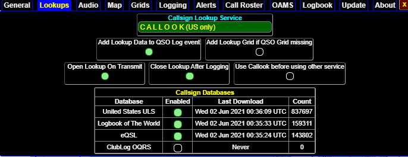

* **Callsign Lookup Service:** Clicking this button shows a dropdown list of four options:
  * **CALLOOK**  -  This is the default but note it contains data for United States stations only
  * **HamQth.com**
  * **QRZ.com**
  * **QRZCQ.com**
* **Add Lookup Data to QSO Log Event**:  Choosing this option adds data to the GridTracker log only; it won't add it back to the  WSJT-X .adif file.
* **Add Lookup Grid if QSO is Missing**:  This works pretty well for a "standard" U.S. callsign composed of four to six characters.  **_However_** **_note_**_:_  depending on which lookup service you select you may or may not be able to retrieve a grid ID.  Callook.com doesn't provide grid IDs for callsigns outside of the US. Neither can it handle callsigns that have a slash with a special designation.
* **Open Lookup on Transmit:**  Automatically opens the Callsign Lookup window when you transmit a callsign.
* **Close Lookup After Logging:**   Automatically closes the Callsign Lookup window when you click to confirm a QSO and add it to your WSJT-X log data.
* **Use Callook before using another service:**  self-explanatory.
* **Callsign Databases** -- you have the choice to enable or disable four databases
  * **United States ULS:** Downloads a database of US Callsigns from GridTracker based on the FCC ULS Database. (This is required to show states and counties in the Call Roster). This database is updated approximately weekly.
  * **Logbook of the World:** Downloads a database of LoTW users from the ARRL. This is enables the LoTW column in the Call Roster. This is updated weekly.
  * **eQSL:** Downloads a database of eQSL users. This enables the eQSL column in the Call Roster.
  * **ClubLog OQRS:** Downloads a database of OQRS users from ClubLog. This enables the OQRS column in the Call Roster.

## Audio Tab

The Audio Tab has controls for the text-to-speech alert function and selection of the audio device GridTracker uses.  It also has controls for two of the optional alerts available in GridTracker:  the lightning alert and the option to get an audio notification whenever you log a new QSO with WSJT-X.

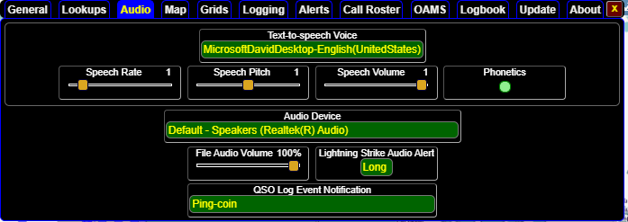

Click on any of the green buttons  to get a drop down menu to choose your preferences.  

**Note:**  when choosing the Audio Device, **DO NOT** select the sound card you are using with WSJT-X to interface with your radio.

## Map Tab

This is the submenu that controls the appearance of QRZ path overlays, PSK-Spot information and other overlay features that show what’s happening with active stations.  From left to right, and up to down:   

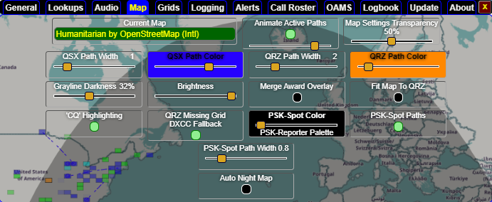

* **Current Map:**  There are over 30 alternatives for the base map layer.  (The default is Humanitarian by OpenStreetMap (Intl).

   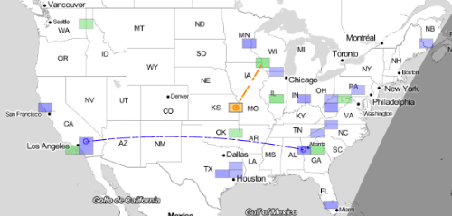
* **Animate Active Paths:**  GridTracker is set up to show "active paths", i.e., a line reflecting an attempt by one station to contact another.  You can choose to use an animated path line that shows the direction of the attempted contact.  The slider control under the enable button controls how fast the "running ants" in the animation move.   
* **Map Setting Transparency:**  It's helpful to be able to see _some_ of the features (say, boundary lines between countries or States/Provinces) in the base map even though you've got a contact grid overlaid on top.  The slider for map transparency (actually it's the grid overlay transparency) to suit your preferences.
* **QSX Path Color:** Change the path color
* **QRZ Path Color:**  Change the path color
* **Grayline Darkness:** Self-explanatory
* **Brightness:** Adjusts the relative brightness of the underlying base map.
* **Merge Award Overlay:** Clicking this box allows you to display award overlays on top of your base layer with its grid status map.  If you don't chose this option then the award layers will replace the base layer.
* **Fit Map to QRZ:** This allows GT to automatically size your map and re-center it so that the map displays both your position and the grid of the other station. This activates when you Enable TX in WSJT-X. Once the transmit in WSJT-X has been disabled (either by the user or by the software, such as when a QSO is completed and logged) the map resets itself to the zoom and center you had it at prior to starting the QSO.  Calling CQ zooms the map in on your location until transmit is disabled.
* **CQ Highlighting:**  Turn this option on or off to have a red border placed around the U.S. State or the country that is the subject of a CQ message in WSJT-X.  Examples:  CQ NA XXXXX for someone trying to reach North America or CQ AK  YYYYY for someone trying to reach any station in Alaska.
* **QRZ Missing Grid - DXCC Fallback:**  If a gridsquare is not transmitted, uses the center of the DX Entity based on the callsign of the station to draw QSX paths.
* **PSK Spot Color (PSK-Reporter Palette):**  Choose what color you want your PSK spots to be when you turn that feature on.
* **PSK Spot Paths:** Choose whether or not you want to see the paths drawn between your home QTH and PSK spots.  The paths will be the same color you chose for the PSK Spot color.\*\*  
* **PSK Spot Path Width:** Self-explanatory
* **Auto Night Map:**  If you would prefer to work with a night map that automatically is substituted for the "Current Map" you've selected above as your base map this is where you make that change.  When you click the green button to turn this feature on you'll have over 30 choices for a base map as well as options for choices of night time path colors, PSK spot colors and map brightness.

## Grids Tab

The color coding you choose here is repeated on the legend of GridTracker map.  However there are several other options that let you tailor how the map appears.

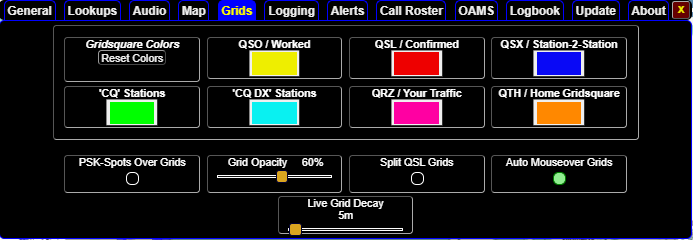

* **PSK-Spots Over Grids:**  If you choose this option then when you click on the "Spots" feature in the GridTracker Feature Menu your PSK Reported Data will be overlaid on top of your Live, Logbook and/or Live & Logbook grids and/or any Award layers.  If you don't use this option then PSK data will replace the grid square overlay until you click on "Spots" to turn it off. 

Here's an example of what PSK spot paths may look like.  The example on the left show PSK spots and path lines between them and your QTH if you choose **_not_**  to display the information on top of your grid map.  The example on the right shows PSK data superimposed on top of a grid map.

 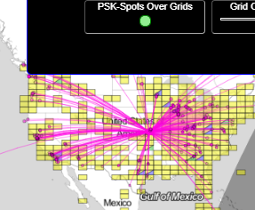 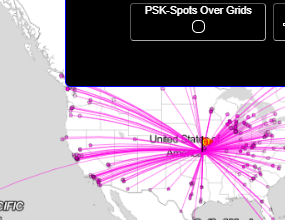

Again:  you have the choice to show those paths or not.  That's a button in the **Settings > Map** menu.

* **Grid Opacity:**  This slider controls how opaque or transparent the grid color coding is.  
* **Split QSL Grids:** This enables split grid mode. If a station is active in a grid that is already worked or confirmed, a diagnal line splits a grid with half indicating the worked/confirmed status, the other half shows QSX/CQ/CQ-DX/QRZ status.
* **Auto Mouseover Grids:**  A nifty and useful feature.  If you click this button to turn it on and point your mouse to a grid you'll get a pop-up window that lists the station information for either (a) the active, live station(s) in that grid, or (b) a list of the stations in your log for that grid.  If you're operating in Logbook & Live mode and with Split QSL Grids and the grid square is divided diagonally the mouseover works for each triangle separately.
* **Live Grid Decay:**  The opacity of _active grids_ diminishes over time.  This slider controls how quickly that happens. You can use this feature to be able to tell at a glance just how current the CQ calls are on your GridTracker Map.

## Logging Tab

The Logging Tab gives you extensive options for importing and exporting QSO data to external websites and software logging programs.  

**_Important Note_** Again:  while GridTracker maintains a file of your QSOs it should not be considered your _primary_ logging site.  **Gridtracker is a log viewer, not a logging program.**  WSJT-X maintains a text based and an ADIF file of your contacts but it is not a logging program either.  Use the GT Logging feature to automatically send contact information to your permanent, master log.

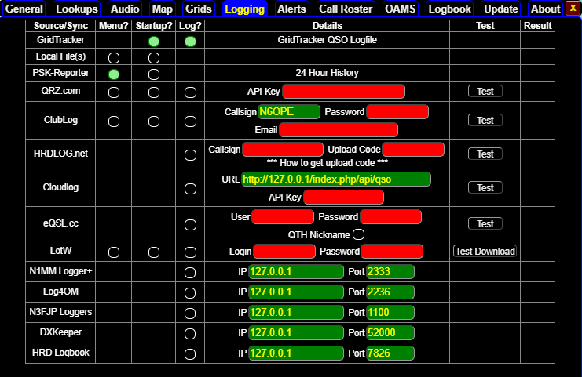

Although this menu can look complicated at first glance it really is straightforward to use.  The Logging menu allows you to automatically send new QSO contact data to one (or more) local and web based sites.  In order to do this you'll have to have and enter the appropriate location and/or login data for the site.

When you install GridTracker in a **Windows system with OneDrive** your GridTracker QSO data is stored as .adif files that get saved within OneDrive. Otherwise GridTracker QSO data is stored as .adif files only on your local disk.  _See_ the[ **GridTracker Data File**](../GridTracker-File-Storage.md#gridtracker-data-files) Storage section in this manual for more details.   

## Alerts Tab

This tab has options to set automatic audio alerts for **_current traffic that you are receiving_**.  WSJT-X (and therefore GridTracker) "hears" what you tell it to hear in terms of frequency band and digital mode.  **_It has no way of knowing and alerting you if a station is active on a different band or mode other than one you are using._**  

You can set an alert for a variety of situations.  It can be anything from a “wanted” grid or country to your buddy's callsign or even your own callsign.  By default alerts are done with Text-to-Speech but you have the choice of using a sound effect instead.

&#10148; **_Practice Tip:_**  If you tend to multitask while on the radio it's helpful to set up an \[audible\] alert for your own callsign so you get "pinged" when someone responds to your Tx.

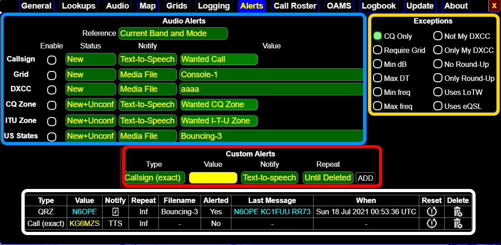

##### **_Setting Classes of Audio Alerts_**

 _&#10148;  See settings outlined in blue in the illustration above._

* **_Reference_**

Clicking on this button allows you to choose from a variety of combinations between band and mode. 

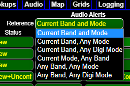

This is the logbook reference for checking if GridTracker should alert for new Callsigns, Grids, DXCC, CQ Zone, ITU Zone or US States.

* **Current Band and Mode** references logged contacts on only the current band and mode.
* **Current Band, Any Mode** references logged contacts on the current band but any mode.
* **Current Band, Any Digi Mode** references logged contacts on the current band and any data mode. A DXCC logged in JT65 won't alert in FT8.
* **Current Mode, Any Band** references logged contacts in the current mode but on any band.
* **Any Band, Any Mode** references any logged contact in your log book without regard for the band or mode.
* **Any Band, Any Digi Mode** references any data mode logged contacts in your logbook without regard for the band.
* **_Audio Alert Criteria_** 

The main box below the heading "Audio Alerts" has a list of standard criteria associated with a contact.   You can set up an alert if _you are receiving a signal_ from a callsign or grid that you haven't previously contacted. 

First click on an open button next to "Callsign" or "CQ Zone", etc. to enable the alert.  Then click on any of the green buttons next to that criteria o see the options available for the contact status (new or new + ucomfirmed), type of notification (text-to-speech or media file), and the alert "value".  

The alert _value_ depends on whether you choose a _text-to-speech_ or a _media file_ for the notification.  If you choose _text_ then a voice will tell you that one of your "wanted calls" is active.  If you choose a _media file_ then you will pick one from 200 plus sound effects to play.  The "value" will simply be the name of the sound effect.

### Setting Exceptions Classes of Alerts 

_&#10148;  See settings outlined in gold in the illustration above._  

The exception list is used to modify or refine one of the criteria in the blue box.    

**CQ Only**:  Limits alerts to only those stations where a wanted Callsign,  ITU zone, etc. is _sending out a CQ_.  You won't get an alert if the station is in the middle of a general FT-8 response.  

**Require Grid:** Limits alerts to only those stations who have included their Grid location in their Tx. 

**Min dB:** Limits alerts to only those stations that you are receiving above a certain sound floor.

**Max DT:**  Limits alerts to only those stations that are transmitting within a fixed time difference from you.  

**Min or Max Freq:**  Limits alerts only those stations above or below a certain frequency.

**Not my DXCC / Only my DXCC:**  Limits alerts to only those stations that are outside or inside your country.  For example setting up an alert to grids needed inside or outside the USA.

**Uses LoTW / Uses eQSL: :**  Click on this option to restrict alerts to only stations that use LoTW or eQSL. 

**No Round-Up / Only Round-Up:** Alerts should either ignore or be only _RTTY Round-Up_ contest messages. useful if you are working RTTY Round-UP and you want to be alerted if a station meets your alert criteria and is participating in the contest. Or if you want to ignore RTTY Round-Up participants even if they would otherwise meet your alert criteria.

### Custom Alerts 

 _&#10148;  See settings outlined in red_

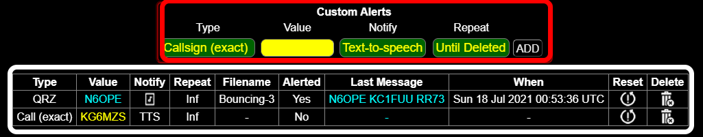

Here's where you can set up a non-standard alert for specific  things such as a specific callsign or DXCC (like when Svalbard finally shows up in your waterfall.)  The table outlined in white that appears directly below shows a list of the customer alerts you've set up.  

The screenshot above shows two custom alerts. The first provides an audio alert (a sound) whenever a decoded WSJT-X message includes the user's callsign. (A QRZ response.)  The second is a text-to-speech alert whenever a specific callsign (KG6MZS) is decoded in WSJT-X.  

Notes:

* You have to click the "Add" button to add a new alert
* The table with custom alerts has buttons to reset an alert or delete (trash) them.

Please see the [Setting Up Alerts](../Making-GridTracker-Work-For-You/Setting-Up-Audio-and-Visual-Alerts.md) section of this manual for examples of how to set up various alerts.

## Call Roster Tab

There are typically only three settings controls on this tab:

* The choice to always keep the Call Roster window (if you have it open) on top of any other GridTracker overlays.
* The length of time that current traffic data is displayed in the Call Roster table from a minimum of 15 seconds to a maximum of 5 minutes.
* Set up an audio alert if a transmission is heard from a "new, wanted" station. A "new, wanted" station is one that meets some selection criteria you've set up in Call Roster

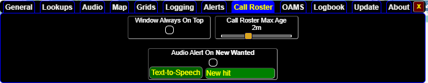

Setting up criteria for "wanted" stations is discussed in detail in the [Call Roster](../Making-GridTracker-Work-For-You/Using-Call-Roster.md) section of this guide.

## OAMS Tab

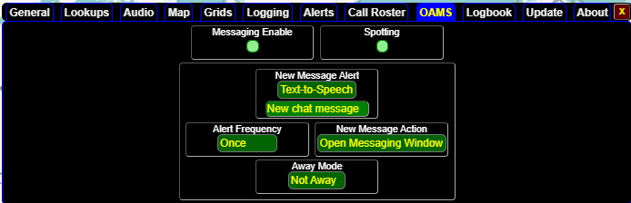

OAMS - pronounced (Ohms) - is the "Off-Air message Service" of GridTracker and Log4OM.  It gives users the ability to share their "on-air" status with other users, allows user to user chat, and permits real-time spotting.  

The OAMS tab has the settings that let you enable or disable the message service and spotting.  It also has the controls for how you receive an alert for an incoming message and how that message is handled.

_"**Spotting**" as used here means spots are coming from other active OAMS users instead of PSK reporter._ This supplements the PSK Reporter spots for the first 5 minutes after your first transmission before GT pings the PSK Reporter server, and can provide updated spots during the 5 minute intervals between PSK Reporter updates while you are active. 

## User Logbook Tab

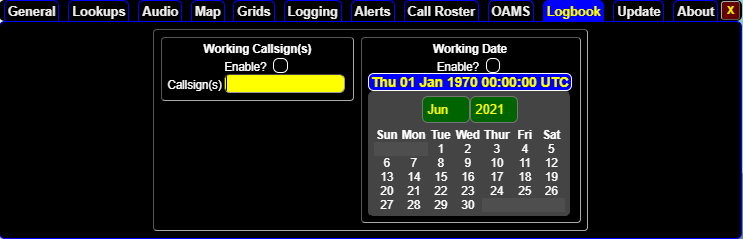

The controls on this page allow users to tailor the GridTracker logbook and its statistics to _individual callsigns_ and/or for a _specific period of time._

You can make any of these choices singly or combine a Working Callsign choice with a Calendar choice.   **You must click on the "Apply Changes"**  button at the bottom of the screen for your choice(s) to take effect.

1. If you leave the button to enable "Working Callsign" unchecked GT will interpret that to mean that _all the QSOs_ - regardless of which callsign made them and their date - should be shown in the Logbook grid overlays and Statistics. 
2. If you do click the button to enable "Working Callsign" and enter a callsign into the box then GT Logbook and statistics functions will reflect data for that callsign only. You may choose to do this if you are traveling away from your home QTH and append an indicator to your call - something like "/4" - to indicate a temporary status.  _But make sure that the callsign you enter here matches the callsign you've entered into the settings for WSJT-X._ 
3. Whether or not you enable "Working Callsign" you can enable "Working Date" to narrow contact data to a specific date.  You could use this to look at statistics for a contest for example.   

**Note:** it isn't possible to limit "Working Date" to a range of dates. The "Working Date" just references the logbook after the specified date.

## Update Tab

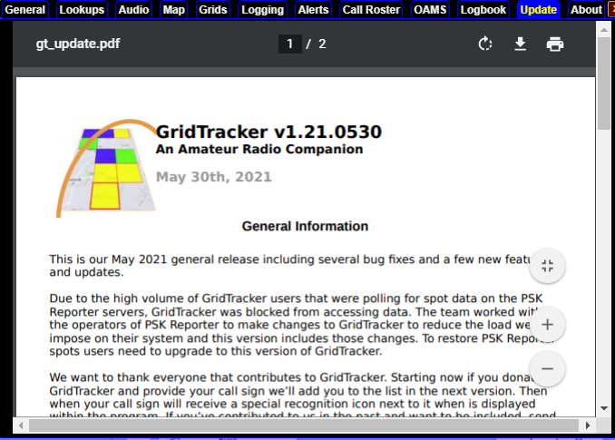

This tab provides update notes for the version of GridTracker that you are using. This is an important section to check after updating GridTracker. This is where the developer team tells you what they changed in the latest version of GridTracker and potentially of major on-going issues that are being worked on.

## About Tab

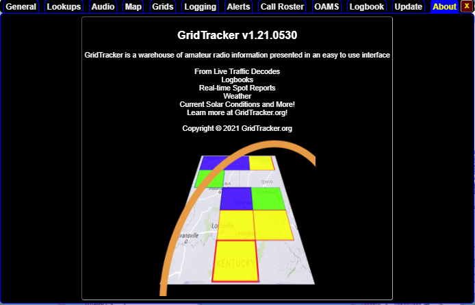

A standard software function that tells you which version of GridTracker you are using, etc.  This is the tab to reference when seeking help or reporting bugs. The entire version number and any beta names are needed so we know exactly which version of GridTracker you are using.