# GridTracker2 Settings

Click the **Settings** button (the gear) in the button panel, or press **Ctrl+S**, to open the Settings panel over the map. Click the red **X** in the top right corner, press **Esc**, or click the gear again to close it.

The tabs along the top are **General**, **Features**, **Radios**, **Lookups**, **Audio**, **Map**, **Colors**, **Feeds**, **Logging**, **Audio Alerts**, **Custom Alerts**, **Logbook** and **About**. The **Radios** tab only appears while Rig Control, Rotor Control or Network Audio is turned on, and the **Feeds** tab while DX Feeds is. While BirdWatch is turned on, its own tabs, **BirdWatch**, **Skeds**, **Display**, **Alerts**, **Telemetry** and **Satellites**, appear in a row above the others; see [BirdWatch](../BirdWatch.md#settings-birdwatch-tab). In a narrow window, **About** moves up to that row so the others fit on one line.

Most tabs are divided into titled boxes. An option that depends on another one is indented under it, and is only shown while the option above it is turned on.

```{tip}
Hotkeys don't work while the Settings panel is open, so they can't be triggered by accident while you type in a settings field.
```

```{note}
The Call Roster and Feed Roster have their own settings, including the Watcher, Exceptions, Ignores and Columns tabs. They are in the roster window, see [The Call Roster](../Making-GridTracker-Work-For-You/Using-Call-Roster.md).
```

## General Tab


### Receive UDP Messages

How GridTracker2 receives messages from WSJT-X, JTDX and similar programs. The line at the top shows how long ago the last message arrived.

* **Multicast?** Turn this on if WSJT-X sends to a multicast address (224.0.0.0 to 239.255.255.255), then enter that address in **IP**. Multicast lets several programs receive the same WSJT-X messages at once.
* **Port:** the UDP port WSJT-X sends to, 2237 by default. The first time GridTracker2 runs it reads the address and port from your WSJT-X or JTDX settings.

See [Appendix B](../Appendices/Appendix-B-Configuring-WSJT-X-and-JTDX-for-GridTracker.md) for how to set up WSJT-X and JTDX to match.

### Forward UDP Messages

GridTracker2 can pass every message it receives on to other programs, for example GridTracker2 on another computer, HamClock, or an online service such as ft8battle.com.

* **IP(s)/Hostname(s):** one or more addresses or hostnames, separated by commas, e.g. `192.168.1.20,ft8battle.com`. A hostname that can't be found (a typo, or no internet) is reported under the field.
* **Port:** the port to send to, 2238 by default. It can't be the same as the receive port.
* **Enabled?** turns forwarding on and off.

### Receive ADIF UDP Broadcasts For Logging

Programs such as fldigi can broadcast each logged QSO as an ADIF record over UDP. With **Enabled?** on, GridTracker2 receives them and logs them just like a QSO logged in WSJT-X: they are added to your logbook and sent to the logs you have chosen in the [Logging tab](#logging-tab). The default port is 2333. Turn on **Multicast?** and enter the **IP** if the program broadcasts to a multicast address.

### Station

* **Callsign:** your callsign, used while no WSJT-X, JTDX, AC Log or Log4OM is connected (for example when you only use DX Feeds). A callsign one of those programs reports is always used for that program. While this field is blank it takes the callsign WSJT-X or JTDX gives.
* **Gridsquare:** your home grid. It centers the map and is used for distances and bearings. By default it is the grid from WSJT-X.
* **Elevation:** your station's height above sea level (in feet with miles or nautical miles as your distance unit, meters otherwise). BirdWatch uses it for where satellites are, their Doppler shift, and when they rise and set.

### Display

* **Language (requires restart):** the language of the interface. Choosing one saves your settings and restarts GridTracker2. See [What's New](../Introduction/Whats-New.md) for the list.
* **App Theme:** the colors of the information GridTracker2 shows, each color with one meaning everywhere outside the rosters. GridTracker2 (the default): frequency light green, band yellow, mode orange, callsign yellow (the other station's cyan), grid cyan, country orange, distance cyan, bearing yellow, times light blue, warnings orange, errors red. Opus' Choice: softer colors of one brightness, a different color for each thing shown side by side (frequency mint, band lavender, mode peach, callsign gold, country pink, distance aqua, bearing lime, times periwinkle, needed pink-violet), labels a step dimmer than the information beside them, errors still red. The menu lists the themes alphabetically; the other 27 are:
  * **Retro computers:** EGA (the 16-color EGA palette, gray buttons and blue tabs), CGA (the classic cyan, magenta and white, yellow for warnings), VGA (the DOS 16-color look, with blue and cyan text boxes and tabs), Amber CRT (an amber monochrome terminal), and Apple ][e, VIC-20 and C-64 (each computer's own colors and text-box look).
  * **Nature and seasons:** Inferno (golds, ambers, flame orange and white-hot), Frost (ice blues, teal, lilac and white), Sunflower (petal yellows, leaf greens, sky blue and seed brown), Country Kitchen (butter yellow, sage, copper and cream with gingham-blue tabs), Autumn (pumpkin, mustard, olive and cream), Deep Sea (glowing aqua, coral, kelp green and sand on navy), Aurora (northern-lights greens, teals and violets), Sunset (gold, coral, rose and lavender on plum), Food Forest (layered leaf greens, apricot, plum, persimmon and fig on bark) and Prairie Home (wheat gold, prairie sage, big-sky blue, coneflower and barn rust on weathered barnwood).
  * **Just for fun:** Bubble Gum (pink, lavender, mint, baby blue and lemon), Synthwave (neon cyan, magenta, mint and sunset orange on purple), Cyberpunk (acid yellow, cyan, magenta and neon green) and Matrix (terminal greens with white for callsigns and titles, amber for warnings).
  * **Modern and easy on the eyes:** Graphite (a modern dark mode, muted colors and one blue accent), High Contrast (pure colors, white text and borders, for low vision and bright rooms), Colorblind Safe (the Okabe-Ito colors, which stay apart with red-green color blindness), OLED Minimal (true black, white and gray, color only for warnings and errors), Night Vision (dim reds that keep your eyes dark-adapted; errors are white, since everything is red) and Grayscale (shades of gray only, values brighter than labels, with red kept for errors).

  The theme also colors the buttons, text boxes, dropdowns, checkboxes, tabs and sliders, the box frames of the control panel and the BirdWatch panel, and the RECEIVE / DECODE / TRANSMIT box, in every window, the rosters included. A theme you choose recolors every open window at once. The Call Roster and Feed Roster keep the callsign, grid and other colors set in their own Settings.
* **Window Theme:** Dark, Light or System.
* **Distance Units:** Kilometers, Statute Miles, Nautical Miles or Degrees.
* **Control Panel On Left Side:** puts the side panel on the left of the window and the map on the right.
* **Open Event Viewer On Error:** an error, such as a log upload that failed, opens the [Event Viewer](Control-Panel.md#event-viewer).
* **Enable Casting:** adds the Cast button to the button panel, to show the map on a TV through a Google TV Streamer or Chromecast. See [Casting the Map](Control-Panel.md#casting-the-map). While it's on, the video's address is shown beside it; click it to copy it, to watch the map in VLC or a browser on your network.
* **Port:** the port the map's video is served on (21575 unless changed). It can be changed while **Enable Casting** is on and nothing is being cast; with **Enable Casting** off it's grayed out.
* **Software Frame Rate** and **Software Resolution:** shown only on a computer without a hardware video encoder, where the map's video is made in software: its frames a second (1 to 30) and its size (480p to 4K). See [Casting the Map](Control-Panel.md#casting-the-map).

### Settings

* **Reset Panels:** puts the boxes of the side panel (band activity, Quick Stats, Map View Filters) back in their usual order, see [Rearranging the Panel](Control-Panel.md#rearranging-the-panel).
* **Reset Button Order:** puts the buttons in the button panel back in their default order.
* **Export Settings** saves all your settings to a file (the suggested name is `GridTracker2 Settings.json`). **Import Settings** loads such a file and restarts GridTracker2. Use this as a backup, or to move your settings to another computer. Files from versions older than 2.241005 can't be imported.
* **Clear All Settings!** returns every setting to its default. It only works while **Yes, I'm sure!** is ticked.

### On QSO Reply

This box only appears while more than one WSJT-X or JTDX is sending to GridTracker2.

* **Halt Tx On All Other Instances:** when you reply to a station from one instance, transmitting is stopped on the others.
* **Switch View to Transmitting Instance:** the main window follows the instance that is transmitting.

## Features Tab

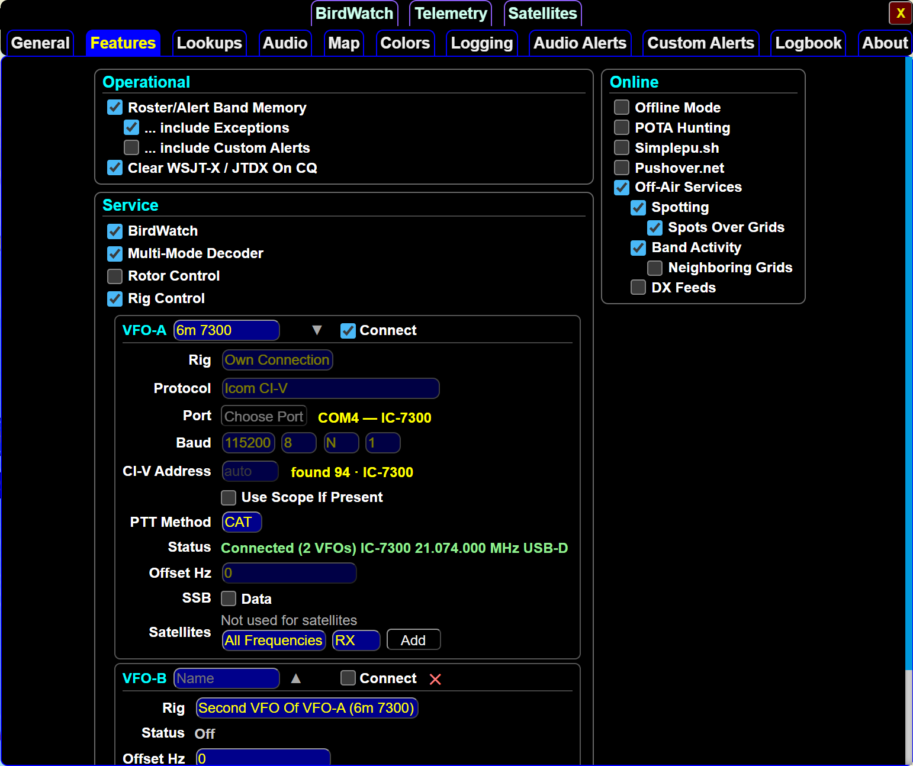

### Operational

* **Roster/Alert Band Memory:** the Call Roster's Logbook, Hunting and Wanted choices and your Audio Alerts are remembered separately for each band and mode. An **M** badge shows next to their headings while this is on. It works while a single WSJT-X or JTDX is running; with several, the same settings are used for all bands and modes.
  * **... include Exceptions** also remembers the Exceptions for each band and mode.
  * **... include Custom Alerts** also remembers the Custom Alerts for each band and mode.
* **Clear WSJT-X / JTDX On CQ:** when you start calling CQ, the DX Call and DX Grid left over from your last QSO are cleared in WSJT-X or JTDX.

### Service

* **BirdWatch (Satellite Tracking):** passes, the satellites on the map, and Doppler-corrected tuning of your rig. Turning it on adds its buttons and its own Settings tabs. See [BirdWatch](../BirdWatch.md).
* **Multi-Mode Decoder:** decodes CW, FT8, FT4, PSK, RTTY, SSTV and many other modes from your rig's or an SDR's audio, in a window of its own. Turning it on adds the Toggle Multi-Mode Decoder button. See [The Multi-Mode Decoder](../Multi-Mode-Decoder/Multi-Mode-Decoder.md).
* **Rotor Control:** turns your antenna rotator toward a station (the roster's **Aim Rotator**, or **Ctrl**+click on the map) or a BirdWatch satellite. The rotator can be on a serial port (Yaesu GS-232, Easycomm II, SPID), or reached through Hamlib's rotctld, CatRotator or PstRotator. See [Rig and Rotor Control](../Rig-and-Rotor-Control.md#rotor-control).
* **Rig Control:** GridTracker2's own connection to your rigs and SDRs (rigctld, flrig, Icom CI-V, Icom LAN, FlexRadio SmartSDR, Kenwood or Yaesu CAT, SPY Server, SDR++), set up as a list of VFOs. The Multi-Mode Decoder and BirdWatch use it. See [Rig and Rotor Control](../Rig-and-Rotor-Control.md#rig-control).
* **Network Audio:** audio over your network (VBAN, RTP, PipeWire / PulseAudio) as Input and Output Devices of the Multi-Mode Decoder. See [Network Audio](../Network-Audio.md).

Rotor Control, Rig Control and Network Audio are set up in the [Radios](#radios-tab) tab.

## Radios Tab

This tab, to the right of Features, appears while Rig Control, Rotor Control or Network Audio is turned on. It has a box for each one that is on:

* **Rig Control:** the VFOs, see [Rig and Rotor Control](../Rig-and-Rotor-Control.md#rig-control).
* **Rotor Control:** the rotator's connection and Follow Satellite, see [Rotor Control](../Rig-and-Rotor-Control.md#rotor-control).
* **Network Audio:** the audio streams, see [Network Audio](../Network-Audio.md).

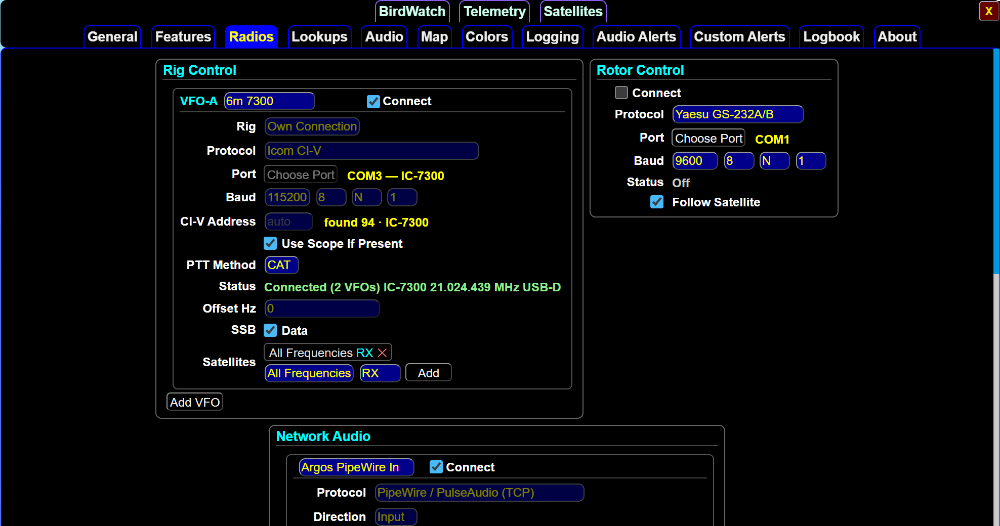

### Online

* **Offline Mode:** turns off every online service, for example for Field Day or a POTA activation without internet. The online maps are replaced by the offline maps, and the Conditions, Lookup, POTA and radar buttons and the online logbook buttons are hidden. **Ctrl+Y** also toggles it.
* **POTA Hunting:** shows Parks On The Air activations on the map, and adds the POTA Wanted choice and POTA column to the Call Roster. See [Parks On The Air](../Third-Party-Integrations/GridTracker2-and-Parks-On-The-Air.md).
* **Simplepu.sh** and **Pushover.net:** send roster alerts to your phone. Each shows its own box when turned on, see [Push Notifications](../Third-Party-Integrations/PushNotifications-Integrations.md).
* **Off-Air Services:** GridTracker2's own online services. While it is off, the GridTracker Spotters, Spot Reports and DX Feed Spots buttons and the band activity graph are hidden. The options under it are:
  * **Spotting:** shows where your signal has been heard (RX spots) on the map.
    * **Spots Over Grids:** shows the spots over your grids instead of in their place.
  * **Band Activity:** the band activity graph in the main panel, from the activity around your grid.
    * **Neighboring Grids:** includes the activity in the grids around yours.
  * **DX Feeds:** DX Cluster and CW Skimmer spots, for the Feed Roster and the map. Turning it on adds the Feeds tab, the Feed Roster and a DX Feed Spots button. See [The Feed Roster and DX Feeds](../Making-GridTracker-Work-For-You/Using-Feed-Roster.md).
    * **SOTA Chasing:** Summits on the Air activators from the DX Feeds spots. See [Summits On The Air](../Third-Party-Integrations/GridTracker2-and-Summits-On-The-Air.md).

```{note}
Turning on POTA Hunting or SOTA Chasing also turns on **Load At Startup** and **Log QSO** for the GridTracker2 log in the Logging tab. GridTracker2 needs its own log to know which parks and summits you have already worked.
```

## Lookups Tab

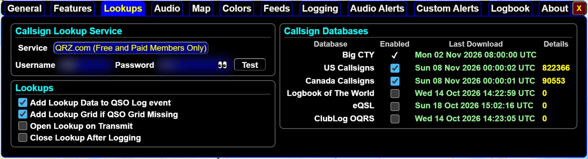

### Callsign Lookup Service

The website used for callsign lookups:

* **CALLOOK (US Only):** the default. Free, no login, but US callsigns only.
* **HamQTH:** free, login required.
* **QRZ.com:** free and paid members.
* **QRZCQ.com:** paid members only.

For every service except CALLOOK, enter your **Username** and **Password** and click **Test**.

### Lookups

* **Add Lookup Data to QSO Log event:** when you log a QSO, details from the lookup (name, QTH and so on) are added to the QSO GridTracker2 logs.
  * **Add Lookup Grid if QSO Grid Missing:** if the QSO has no grid, the grid from the lookup is used.
* **Open Lookup on Transmit:** opens the Lookup window for the station whenever you start transmitting to it.
* **Close Lookup After Logging:** closes the Lookup window after the QSO is logged.

### Callsign Databases

Databases GridTracker2 downloads and keeps up to date. The table shows when each was last downloaded and how many callsigns it holds.

* **Big CTY:** the country (DXCC) prefix list. Always on.
* **US Callsigns:** the FCC license database. Needed for the State and County columns in the rosters.
* **Canada Callsigns:** the Canadian license database, for Canadian provinces.
* **Logbook of The World:** which stations use LoTW, and when they last uploaded. Needed for the LoTW column and the Uses LoTW exception.
* **eQSL:** which stations use eQSL.
* **ClubLog OQRS:** which stations accept QSL requests through ClubLog OQRS.

## Audio Tab

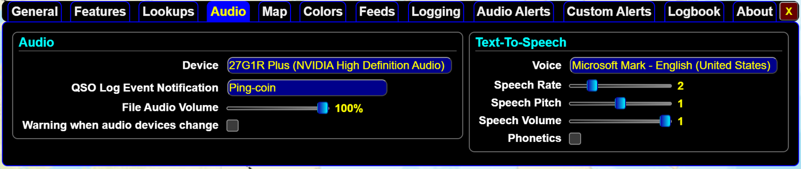

### Audio

* **Output Device:** the sound device GridTracker2 plays its alerts on.
* **QSO Log Event Notification:** a sound played whenever a QSO is logged.
* **File Audio Volume:** the volume of sound file alerts.
* **Warning when audio devices change:** warns you when your sound devices have changed, for example when a USB headset is unplugged. It also warns when an input device the Multi-Mode Decoder listens to has changed or gone missing.

```{warning}
Don't choose the sound card that connects your computer to your radio. GridTracker2's alerts would be transmitted.
```

### Text-To-Speech

The **Voice**, **Speech Rate**, **Speech Pitch** and **Speech Volume** of spoken alerts. **Phonetics** speaks callsigns and grids phonetically (Kilo Seven...).

## Map Tab

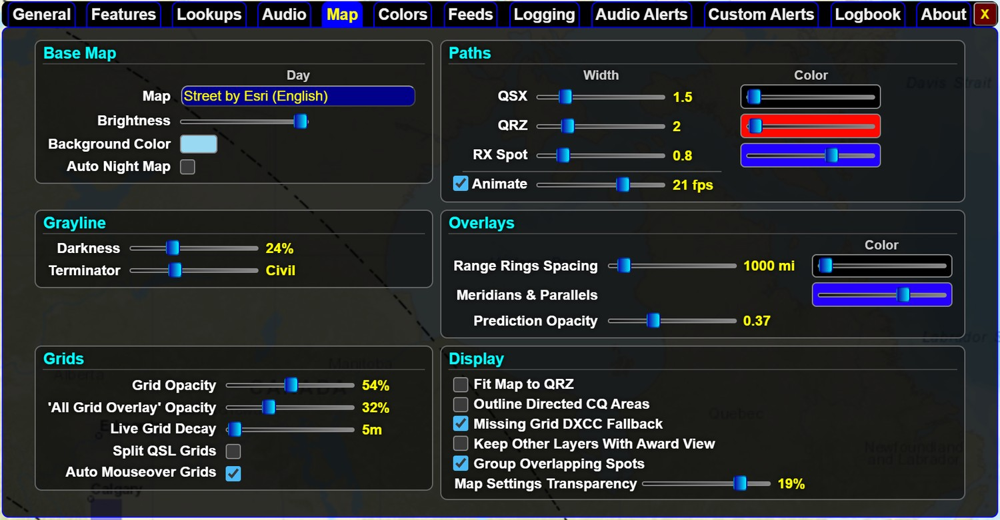

### Base Map

* **Map:** the map drawn under everything else. There are more than 35 to choose from, including street, topographic, satellite and dark maps. In Offline Mode the offline maps are listed instead. A few maps need an **API Key**; its field appears when you pick one.
* **Brightness:** dims the base map, so the grids stand out.
* **Background Color:** the color shown where the map has no tiles, for example beyond the edge of a projection. It is kept for each map.
* **Auto Night Map:** switches to a second map at night. While it is on, a **Night** column appears with its own map, brightness and path colors.

### Paths

The width and color of the lines drawn on the map:

* **QSX:** traffic between two other stations.
* **QRZ:** traffic involving you.
* **RX Spot:** paths to the stations that heard you (shown while Spotting is on). Its color can follow the band colors.
* **Animate:** makes the paths move in the direction of the traffic, at the chosen speed. **Ctrl+J** also toggles it.

### Grayline

* **Darkness:** how dark the night side of the map is.
* **Terminator:** where the line between day and night is drawn: Horizon, Civil, Nautical or Astronomical twilight.

### Overlays

* **Range Rings Spacing:** the distance between the range rings around your QTH, and their color. Turn the rings on with the Range Rings button.
* **Meridians & Parallels:** the color of the Equator, tropics, polar circles and prime meridian, turned on with their button in the button panel.
* **Prediction Opacity:** how opaque the propagation prediction layers are.

### Grids

* **Grid Opacity:** how opaque the colored grids are.
* **'All Grid Overlay' Opacity:** how opaque the Maidenhead grid lines overlay is.
* **Live Grid Decay:** how fast live grids fade out after they were last heard. "No Decay" keeps them until they expire.
* **Split QSL Grids:** a grid you have worked that is also live is split diagonally: one half shows your logbook status, the other half the live traffic.
* **Auto Mouseover Grids:** shows a grid's details when you hold the mouse over it.

### Display

* **Fit Map to QRZ:** while you are transmitting, the map zooms to show you and the station you are working, then returns to your previous view.
* **Outline Directed CQ Areas:** when a station calls a directed CQ (CQ NA, CQ EU, CQ JA...), the area they are calling is outlined on the map.
* **Missing Grid DXCC Fallback:** a station that hasn't sent a grid is drawn at the center of its DXCC entity.
* **Keep Other Layers With Award View:** with an Award picked in the Map View Filters, grids, paths and spots stay on the map. **Ctrl+U** toggles it.
* **Group Overlapping Spots:** POTA, SOTA and DX Feeds markers that would overlap are shown as one marker. Hold the mouse over it to see them all.
* **Map Settings Transparency:** how see-through this tab is, so you can watch the map while you change the settings.

## Colors Tab

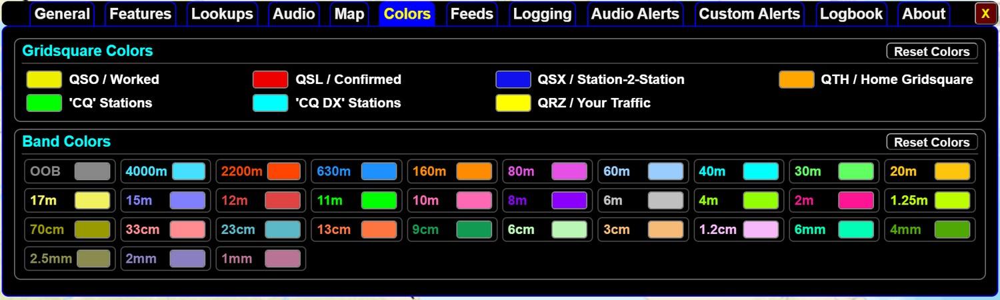

### Gridsquare Colors

The colors of the grids on the map, also shown in the map legend:

* **QSO / Worked** and **QSL / Confirmed:** grids in your logbook.
* **QSX / Station-2-Station:** live traffic between other stations.
* **QTH / Home Gridsquare:** your grid.
* **'CQ' Stations** and **'CQ DX' Stations:** stations calling CQ.
* **QRZ / Your Traffic:** stations calling you.

### Band Colors

The color of each band. Band colors are used for map spots, pins and paths, in both rosters, in the Statistics window and in the Lookup window.

Each box has a **Reset Colors** button in its title to return to the defaults.

## Feeds Tab

This tab appears while **DX Feeds** is turned on in the Features tab.

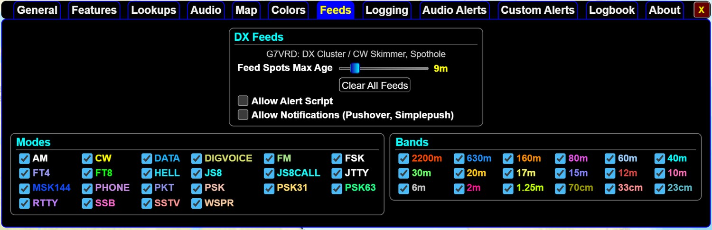

### DX Feeds

* **Feed Spots Max Age:** how long a feed spot stays on the map after it was last spotted, 1 to 60 minutes.
* **Clear All Feeds:** clears all feed spots from the Feed Roster and the map. New spots keep arriving.
* **Allow Alert Script:** lets feed spots run the roster alert script.
* **Allow Notifications (Pushover, Simplepush):** lets feed spots send push notifications.

### Modes and Bands

One tick box for each mode seen in feed spots, and for each band. Untick a mode or band to hide its spots in the Feed Roster and on the map.

## Logging Tab

GridTracker2 is a log *viewer*, not a logging program. The Logging tab sets where your QSOs come from (which logs are loaded) and where new QSOs are sent. See [Logging Options and Functions](../Making-GridTracker-Work-For-You/GridTracker-Logging-Options-and-Functions.md) for how they fit together.

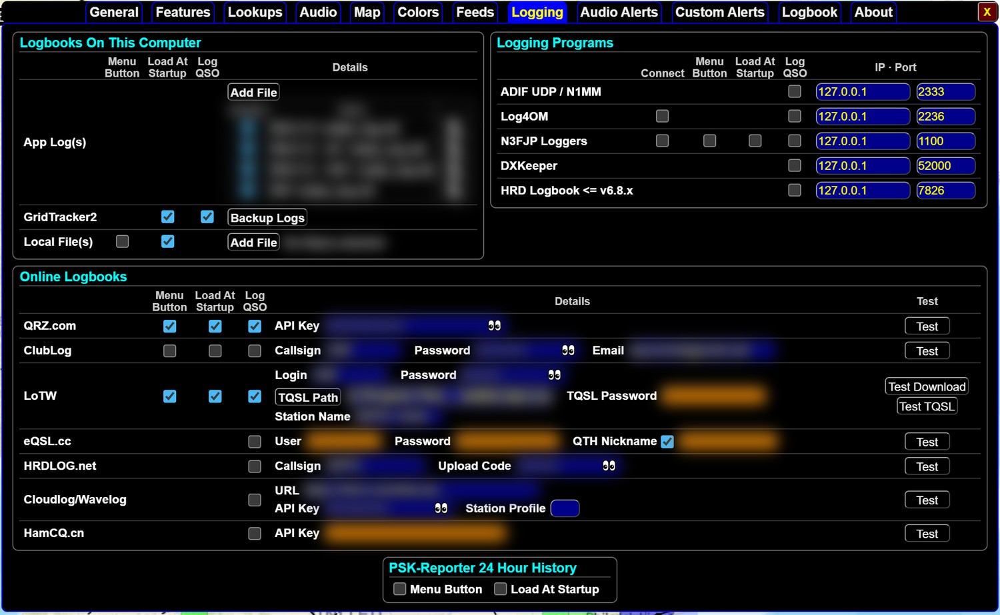

The columns are:

* **Connect:** a live, two-way connection to the program (Log4OM and N3FJP AC Log). A dot next to it shows green while connected, red while not.
* **Menu Button:** adds a button for that log to the button panel, so you can load it whenever you like.
* **Load At Startup:** loads that log when GridTracker2 starts.
* **Log QSO:** sends every new QSO to it.

### Logbooks On This Computer

* **App Log(s):** the log files of WSJT-X, JTDX and similar programs. GridTracker2 finds them automatically; use **Add File** to add others, and untick any you don't want loaded.
* **GridTracker2:** GridTracker2's own backup log of the QSOs it logs. **Backup Logs** opens its folder. Keep this on if you use POTA Hunting or SOTA Chasing.
* **Local File(s):** any other ADIF files you want loaded at startup. Click **Add File** (it also ticks **Load At Startup**). Files opened with the **Load ADIF Log** button are added here too.

### Logging Programs

Logging programs on this or another computer, each with its **IP** address and **Port**:

* **ADIF UDP / N1MM:** sends each QSO as ADIF over UDP, for N1MM Logger+, HRD Logbook 6.9 and later, and other programs that accept it.
* **Log4OM:** **Connect** links to Log4OM's remote control. With **Enable Rig Control** on, clicking a spot also tunes your rig through Log4OM. See [Log4OM](../Third-Party-Integrations/Log4OM-Integration.md).
* **N3FJP Loggers:** AC Log and the other N3FJP loggers. **QSL By** picks which confirmation counts as a QSL. With **Enable Rig Control** on, clicking a spot tunes your rig through AC Log. See [N3FJP AC Log](../Third-Party-Integrations/N3FJP-AC-Log-Integration.md).
* **DXKeeper:** DXLab's logbook.
* **HRD Logbook <= v6.8.x:** older versions of Ham Radio Deluxe's logbook. For version 6.9 and later use ADIF UDP / N1MM.

### Online Logbooks

Enter your account details and click **Test** to check them.

* **QRZ.com:** your logbook **API Key** (a QRZ.com subscription feature).
* **ClubLog:** callsign, password and email.
* **LoTW:** your LoTW website login and password, used to download your confirmations. To upload new QSOs, tick **Log QSO**, then choose the **TQSL Path** (not needed on macOS), your **TQSL Password** if your certificate has one, and the **Station Name** (your TQSL station location). Uploads that fail are queued and retried with the next QSO.
* **eQSL.cc:** user, password, and optionally a **QTH Nickname**.
* **HRDLOG.net:** callsign and upload code.
* **Cloudlog/Wavelog:** the URL of your server, an API key, and the **Station Profile** (click **Test** to load the list).
* **HamCQ.cn:** API key.

### PSK-Reporter 24 Hour History

Loads the stations that heard you on PSK-Reporter over the last 24 hours. These are reception reports, not QSOs.

## Audio Alerts Tab

Audio Alerts speak or play a sound when a station you want is decoded. The alert ticks are separate from the roster's Wanted ticks, so the roster can highlight more than you are alerted for. The **Reference** and **Exceptions** are shared with the roster: changing them here changes them in the roster window, and the other way around.

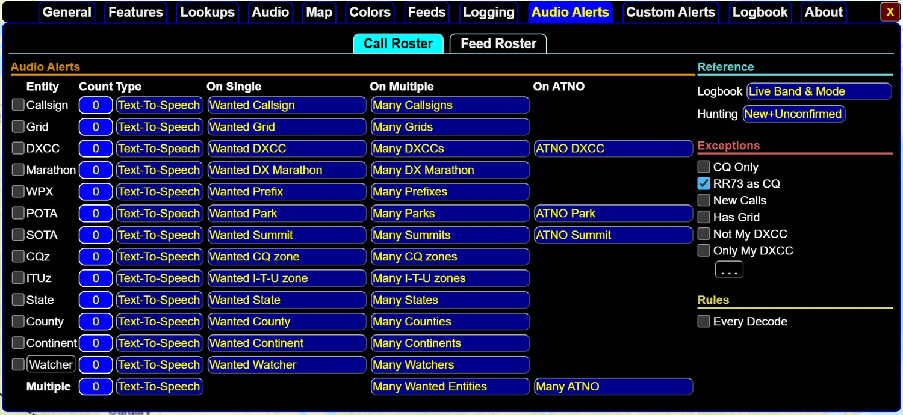

While DX Feeds is on, **Call Roster** and **Feed Roster** sub-tabs appear at the top: each roster has its own alerts. In the roster, a 🔔 after a Wanted item means it has an audio alert; click it to open its sub-tab.

### Audio Alerts

Tick what you want to be alerted for: **Callsign**, **Grid**, **DXCC**, **Marathon**, **WPX**, **POTA** (with POTA Hunting on), **SOTA** (with SOTA Chasing on), **CQz**, **ITUz**, **State**, **County**, **Continent** and **Watcher**. **Multiple** alerts when a station is wanted for more than one of them.

For each one choose:

* **Type:** Text-To-Speech, or Media File (a sound).
* **On Single:** what is said or played when one station is wanted.
* **On Multiple:** what is said or played when several stations are wanted at once.
* **On ATNO** (DXCC, POTA, SOTA and Multiple): played instead when the station is an All Time New One, an entity, park or summit you have never worked.

**Count** shows how many stations are alerting right now.

### Reference

* **Logbook:** which QSOs count as worked:
  * **Live Band & Mode:** QSOs on the band and mode you are on now.
  * **Live Band, Mix Modes:** QSOs on your current band, in any mode.
  * **Live Band, Digi Modes:** QSOs on your current band in any digital mode.
  * **Mix Band, Live Mode:** QSOs in your current mode, on any band.
  * **Mix Band & Modes:** any QSO.
  * **Mix Band & Digi Modes:** any digital QSO.
  * **Award Tracker:** alerts for the awards you track in the roster's Award Tracker instead.
  * The Feed Roster says "Spots" instead of "Live", and adds Phone and CW choices.
* **Hunting:** **New** (never worked), **New+Unconfirmed** (never worked, or worked but not confirmed) or **Mixed**.

### Exceptions

Exceptions narrow down which stations alert: **CQ Only**, **RR73 as CQ** (a station ending a QSO counts as calling CQ), **New Calls**, **Has Grid**, **Not My DXCC** / **Only My DXCC**, **Spotted Me**, **Uses eQSL**, **Uses OQRS**. The Feed Roster adds **Hide Self-Spot**, **Auto Band** and **Auto Mode**. The **. . .** button opens the roster's Exceptions tab for the rest (signal strength, frequency, LoTW, and so on). See [The Call Roster](../Making-GridTracker-Work-For-You/Using-Call-Roster.md#exceptions).

### Rules

* **Every Decode** (Call Roster only): alerts on every decode of a wanted station, not just the first.

## Custom Alerts Tab

Custom Alerts watch for one particular callsign or grid, whatever your roster settings.

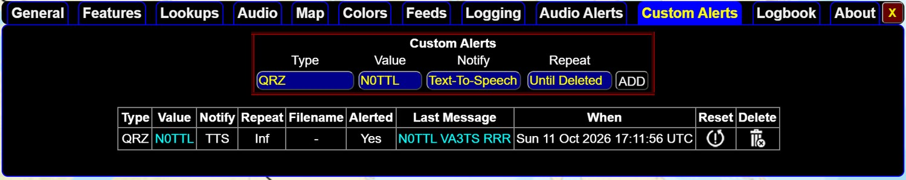

To add one, pick:

* **Type:**
  * **QRZ:** your own callsign, when someone calls you.
  * **Callsign (exact)**, **Callsign (partial)** or **Callsign (regex)**.
  * **Gridsquare:** a 4-character grid.
* **Value:** the callsign, part of a callsign, regular expression or grid.
* **Notify:** **Text-To-Speech**, **Media File**, **Visual Popup** (a small alert window) or **Map Center** (the map moves to the station).
* **Repeat:** **Until Deleted**, **Until Exit**, **Only Once** or **Never Repeat**.

Then click **ADD**. The list below shows your alerts, when each last went off and the message that set it off, with buttons to reset or delete each one. See [Setting Up Audio and Visual Alerts](../Making-GridTracker-Work-For-You/Setting-Up-Audio-and-Visual-Alerts.md) for examples.

## Logbook Tab

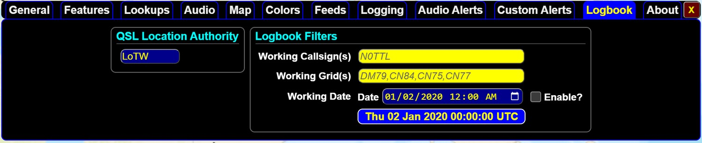

### QSL Location Authority

When the same QSO is in several logs, this picks the one whose location (grid, county and so on) is used: LoTW (the default), QRZ.com, eQSL, Clublog, N3FJP, Other, Last Loaded or None. Click **Apply Changes** to reload your logbooks with the new choice. Your log files aren't changed.

### Logbook Filters

Limit the logbook shown on the map, in the rosters and in Statistics:

* **Working Callsign(s):** only QSOs made with these callsigns, separated by commas. Useful if you have operated under several callsigns, or portable (for example `N0TTL/7`). While the field is empty, it shows the callsigns found in your logs.
* **Working Grid(s):** only QSOs made from these grids.
* **Working Date:** only QSOs made after this date and time (UTC), for example the start of a contest or DXpedition.

Tick **Enable?** next to each filter you want to use, then click **Apply Changes**.

## About Tab

The About tab shows your GridTracker2 version and the versions of the components it is built on. Include them when you ask for help or report a bug.

When a new version has downloaded, it is announced here with an **Install and Restart** button. If you start GridTracker2 with `--disable-auto-updates`, a new version is announced with a **Download** button instead.
