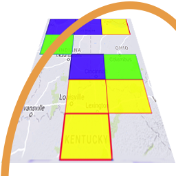

#      **GridTracker User's Guide**

**Software written by**

Stephen “Tag” Loomis / N0TTL and Henry “atouk” Forte / N2VFL
And the GridTracker.org team

## Table of Contents

- [License Agreement and Copyright](License-Agreement-and-Copyright)
- [Technical Support and Assistance](Technical-Support-and-Assistance)
  - [Third-Party Support](Technical-Support-and-Assistance#third-party-support)
- Introduction
  - [What is GridTracker?](Introduction/What-is-GridTracker)
  - [System Requirements](Introduction/System-Requirements)
    - [Hardware Minimum Requirements](Introduction/System-Requirements#hardware-minimum-requirements)
    - [Operating Systems Minimum Requirements](Introduction/System-Requirements#operating-systems-minimum-requirements)
- [GridTracker Installation](GridTracker-Installation)
- [Getting Started](Getting-Started)
- [GridTracker Overview](GridTracker-Overview)
  - [GridTracker Map View — Main Window](GridTracker-Overview/GridTracker-Map-View-—-Main-Window)
    - [GridTracker Map](GridTracker-Overview/GridTracker-Map-View-—-Main-Window#gridtracker-map)
    - [GridTracker Map Legend](GridTracker-Overview/GridTracker-Map-View-—-Main-Window#gridtracker-map-legend)
    - [GridTracker Title Bar](GridTracker-Overview/GridTracker-Map-View-—-Main-Window#gridtracker-title-bar)
  - [Control Panel](GridTracker-Overview/Control-Panel)
    - [Operating Information](GridTracker-Overview/Control-Panel#operating-information)
    - [Tx/Rx Status](GridTracker-Overview/Control-Panel#txrx-status)
    - [Band Activity](GridTracker-Overview/Control-Panel#band-activity)
    - [QSO Status](GridTracker-Overview/Control-Panel#qso-status)
    - [Map View Filters](GridTracker-Overview/Control-Panel#map-view-filters)
    - [GridTracker Features Menu](GridTracker-Overview/Control-Panel#gridtracker-features-menu)
    - [History](GridTracker-Overview/Control-Panel#history)
  - [Settings Sub Menus](GridTracker-Overview/Settings-Sub-Menus)
    - [General Tab](GridTracker-Overview/Settings-Sub-Menus#general-tab)
    - [Lookups Tab](GridTracker-Overview/Settings-Sub-Menus#lookups-tab)
    - [Audio Tab](GridTracker-Overview/Settings-Sub-Menus#audio-tab)
    - [Map Tab](GridTracker-Overview/Settings-Sub-Menus#map-tab)
    - [Grids Tab](GridTracker-Overview/Settings-Sub-Menus#grids-tab)
    - [Logging Tab](GridTracker-Overview/Settings-Sub-Menus#logging-tab)
    - [Alerts Tab](GridTracker-Overview/Settings-Sub-Menus#alerts-tab)
    - [Call Roster Tab](GridTracker-Overview/Settings-Sub-Menus#call-roster-tab)
    - [User Logbook Tab](GridTracker-Overview/Settings-Sub-Menus#user-logbook-tab)
    - [Update Tab](GridTracker-Overview/Settings-Sub-Menus#update-tab)
    - [About Tab](GridTracker-Overview/Settings-Sub-Menus#about-tab)
- [Making GridTracker Work For You](Making-GridTracker-Work-For-You)
  - [Using Call Roster](Making-GridTracker-Work-For-You/Using-Call-Roster)
    - [The Call Roster Page Layout](Making-GridTracker-Work-For-You/Using-Call-Roster#the-call-roster-page-layout)
    - [Call Roster: Data Display Options](Making-GridTracker-Work-For-You/Using-Call-Roster#call-roster-data-display-options)
    - [Call Roster Controls](Making-GridTracker-Work-For-You/Using-Call-Roster#call-roster-controls)
    - [Call Roster: Hunting Options](Making-GridTracker-Work-For-You/Using-Call-Roster#call-roster-hunting-options)
    - [Call Roster Modes](Making-GridTracker-Work-For-You/Using-Call-Roster#call-roster-modes)
    - [Using Call Roster to Respond to a CQ](Making-GridTracker-Work-For-You/Using-Call-Roster#using-call-roster-to-respond-to-a-cq)
  - [GridTracker Logging Options and Functions](Making-GridTracker-Work-For-You/GridTracker-Logging-Options-and-Functions)
    - [Is GridTracker a "Logging Program"?](Making-GridTracker-Work-For-You/GridTracker-Logging-Options-and-Functions#is-gridtracker-a-logging-program)
    - [Sending Logging Information OUT from GridTracker](Making-GridTracker-Work-For-You/GridTracker-Logging-Options-and-Functions#sending-logging-information-out-from-gridtracker)
    - [Importing Logging Information INTO GridTracker](Making-GridTracker-Work-For-You/GridTracker-Logging-Options-and-Functions#importing-logging-information-into-gridtracker)
    - [Using the "Clear Log" and "Load Log" Buttons](Making-GridTracker-Work-For-You/GridTracker-Logging-Options-and-Functions#using-the-clear-log-and-load-logs-buttons)
  - [Setting Up Audio and Visual Alerts](Making-GridTracker-Work-For-You/Setting-Up-Audio-and-Visual-Alerts)
    - [Audio Alerts](Making-GridTracker-Work-For-You/Setting-Up-Audio-and-Visual-Alerts#setting-up-audio-and-visual-alerts)
    - [Visual Alerts](Making-GridTracker-Work-For-You/Setting-Up-Audio-and-Visual-Alerts#visual-alerts)
  - [GridTracker Statistics](Making-GridTracker-Work-For-You/GridTracker-Statistics)
    - [Logbook Data](Making-GridTracker-Work-For-You/GridTracker-Statistics#logbook-data)
    - [Scores and Awards](Making-GridTracker-Work-For-You/GridTracker-Statistics#scores-and-awards)
      - [Scores](Making-GridTracker-Work-For-You/GridTracker-Statistics#scores)
      - [Awards Tabs](Making-GridTracker-Work-For-You/GridTracker-Statistics#awards-tabs)
  - [Features Accessible by HotKeys Only](Making-GridTracker-Work-For-You/Features-Accessible-by-HotKeys-Only)
- [GridTracker File Storage](GridTracker-File-Storage)
  - [GrdiTracker Program Files](GridTracker-File-Storage#gridtracker-program-files)
    - [Windows](GridTracker-File-Storage#gridtracker-program-files#windows)
    - [MacOS](GridTracker-File-Storage#gridtracker-program-files#macos)
    - [Linux](GridTracker-File-Storage#gridtracker-program-files#linux)
  - [GridTracker Data Files](GridTracker-File-Storage#gridtracker-data-files)
    - [Windows](GridTracker-File-Storage#gridtracker-program-files#windows-1)
    - [MacOS](GridTracker-File-Storage#gridtracker-program-files#macos-1)
    - [Linux](GridTracker-File-Storage#gridtracker-program-files#linux-1)
- [Third-Party Integrations](Third-Party-Integrations)
  - [HamClock](Third-Party-Integrations#hamclock)
- [FAQ-Troubleshooting](FAQ-Troubleshooting)
- [Submitting Bug Reports](Submitting-Bug-Reports)
  - [Is it a bug?](Submitting-Bug-Reports#is-it-a-bug)
  - [It is a bug!](Submitting-Bug-Reports#it-is-a-bug)
- [Firewalls](Firewalls)
- [Anti-Virus](Anti-Virus)
- [Release Notes](Release-Notes)
  - [General Information](Release-Notes#general-information)
  - [Program Update](Release-Notes#program-update)

### Appendices

- [Appendix A: Installing GridTracker](Appendices/appendix-a-Installing-GridTracker)
  - [Windows](Appendices/appendix-a-Installing-GridTracker#windows)
  - [MacOS](Appendices/appendix-a-Installing-GridTracker#macos)
  - [Linux Intel/AMD Archs](Appendices/appendix-a-Installing-GridTracker#linux-intelamd-archs)
    - [Redhat based distros](Appendices/appendix-a-Installing-GridTracker#redhat-based-distros)
    - [Debian based distros](Appendices/appendix-a-Installing-GridTracker#debian-based-distros)
    - [Arch linux](Appendices/appendix-a-Installing-GridTracker#arch-linux)
    - [All other linuxes](Appendices/appendix-a-Installing-GridTracker#all-other-linuxes)
  - [Linux ARM 32 / Raspberry Pi - OdroidIn](Appendices/appendix-a-Installing-GridTracker#linux-arm-32-raspberry-pi-odroidin)
- [Appendix B: Configuring WSJT-X and JTDX for GridTracker](Appendices/appendix-b-Configuring-WSJT-X-and-JTDX-for-GridTracker)
  - [Configuring WSJT-X for GridTracker](Appendices/appendix-b-Configuring-WSJT-X-and-JTDX-for-GridTracker#configuring-wsjt-x-for-gridtracker)
  - [Configuring JTDX for GridTracker](Appendices/appendix-b-Configuring-WSJT-X-and-JTDX-for-GridTracker#configuring-jtdx-for-gridtracker)
  - [Configuring GridTracker for WSJT-X & JTDX](appendix-b-Configuring-WSJT-X-and-JTDX-for-GridTracker#configuring-gridtracker-for-wsjt-x-jtdx)
- [Appendix C: Hotkeys](Appendices/appendix-c-Hotkeys)
