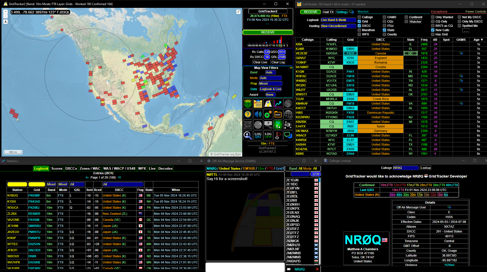

# What Is GridTracker2?

GridTracker2 is designed for Amateur radio use. It's original tag-line was:   "**GridTracker listens to traffic from WSJT-X and displays it on a map**. It will also load ADIF log files".

This was back in February of 2018.  At its core GridTracker2 has remained true to that description but it has evolved to be a very powerful amateur radio tool and not just for FT8.

GridTracker2 is a warehouse of amateur radio information presented in an easy to use interface, from live traffic decodes, logbooks, spot reports, weather, current solar conditions and more.

## Some of the features of GridTracker2 are:

* Highly advanced mapping of real-time and historical contacts on a vivid, highly customizable, interactive map. Many overlays are supported, such as Grayline, real-time award tracking, lightning strikes, Moon position and PSK-Reporter Reception Reports (Spots). Detailed State, Grid and County information is instantly accessible from the map! 
* Audio / Visual Customizable Alerts
* Comprehensive callsign lookup support from popular databases.
* ‘Call Roster’ table view of live activity, also highly customizable to support award chasers or special events. Easily initiate QSOs with a single click. 
* GridTracker2 integrates with many popular logging programs and web based systems, allowing you to see up to the minute progress for awards. 
* Complete DXCC, Country, Callsign Prefix recognition
* 100% offline mode available for field-day, SOTA, IOTA and/or mobile use.
* Off-Air Messaging System (Message potential QSO partners over the Internet)
* Real-time Spotting Network between GT stations
* It’s free!

 # What GridTracker2 is not!

GridTracker2 is not a logging program. Instead it displays your QSO log data from WSJT-X plus any combination of adif formatted files you have stored on your computer, your network, or the internet.

> _GridTracker is currently under active development with you in mind, tell us what you’d like to see!_