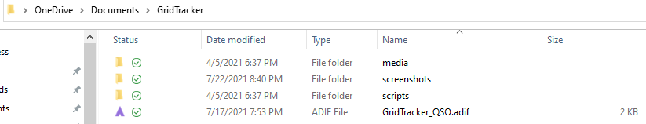

# Features Accessible by Hotkeys Only

| **Hotkey** | **Action** |
| --- | --- |
| **D** | 24 Hour Moon Trajectory |
| **E** | Toggle Rx Spots Flight |
| **H** | Toggle Rx Spots Heatmap |
| **K** | Take a Screen Shot[^screenshots] |
| **Right-click empty grid** **M** | Add Map Center Alert |
| **T** | Toggle Rx Spots over Grids |
| **Right-click empty grid** **T** | Add TTS Alert |
| **Right-click empty grid** **V** | Add Pop-up Alert |
| **X** | Toggle Map Position Info |
| **Y** | Toggle Global Lightning |
| **Z** | Center Map on QTH Grid |

---
[^screenshots]: Screenshots will automatically be saved in your GridTracker directory -- the same folder where your GridTracker_QSO.adif file is saved.  The following illustration is for a Windows 10 operating system: 

