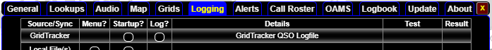
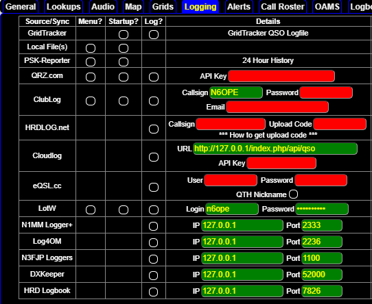
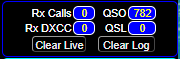
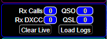

# Is GridTracker a "Logging Program"?

No it is not.  It does keep a log in the form of an .adif file _if you choose to send QSO information to it_ but GridTracker is primarily designed to **_display_** QSO/QSL information, **not to create a permanent database** of your radio contacts.  See the [GridTracker Data Files](../GridTracker-File-Storage.md#gridtracker-data-files) section of this manual for where the GridTracker .adif file is stored.

## QSO/Logging Records Stored by GridTracker 

The first row in the table presented in the **Settings > Logging** menu provides the limited control options for GridTracker's internal logging functions.  It allows you to do _two and only two_ things:

1. Automatically load whatever content the GridTracker_QSO.adif file contains when you start up GridTracker.  This file is saved in the cloud (at least for Windows 10).  _See_ [_the GridTracker Data Files_](../GridTracker-File-Storage.md#gridtracker-data-files) _section._
2. Add data from  any new QSOs made with WSJT-X to the GridTracker_QSO.adif file.

Remember:  GridTracker will always automatically import your WSJT-X_log.adi file every time you start up.  So why would you want or need to open and import your GridTracker_QSO.adif file at start-up if GridTracker is always going to go out and grab the data in the WSJT-X_log.adi file?  Possibly because:

a) You want to import QSO records for digital contacts you've made on apps _other than_ WSJT-X; or perhaps contacts made with phone or CW that you have manually added to the GridTracker_QSO.adif file, and/or

b) You want to import QSL records for your contacts at start-up and you have manually added that information to the GridTracker_QSO.adif file.

There are alternative ways of doing both those things that but it might be convenient for you to have all your contact data for all time saved in the GridTracker_QSO.adif file and to have it uploaded at start-up.  However you will have to do some manual work and use an app outside of GridTracker to retrieve all these outside files and copy and save their contents into a file named "GridTracker_QSO.adif file" which is saved where GridTracker expects to find it.  

Before getting into GridTracker's options for importing QSO data we'll address how you can use GridTracker to send logging information out to other apps since it's a shorter discussion.

## Sending Logging Information OUT from GridTracker

GridTracker can and will import and export QSO logging data from external applications and websites if you choose.  The options to export data are slightly simpler than those to import data so we'll address those first.

TheGridTracker will send the QSO information it detects from WSJT-X out to a number of different, dedicated logging programs if you choose to do so. Here's what the **Settings > Logging** menu looks like with NO options selected:

You have the option to send QSO or logging information to a GridTracker log but also to QRZ.com, LotW, and 10 other outside programs or websites.  You have to enter password or IP address information to do that but once you set it up you can mostly forget it.  

## Importing Logging Information INTO GridTracker

Managing QSO log imports into GridTracker is a slightly more complicated than exporting data because GridTracker gives you more options for when and how you to do it.

### Importing Log Data at Startup

The options to import Local Files, PSK-Reporter info, QRZ, ClubLog and/or LoTW data to the main GridTracker control panel are in the **Settings > Logging** menu at the far left side of that table.

Simply click on one or more of those buttons in the **Startup?** column to add that data.  

**Local Files:**
A "Local" file is one that is stored on your computer or network as opposed to a data file that is retrieved from a **web** site.  In order to add a local file you simply click on the "Add" button and enter the path and file name.  Note:  in a Windows system when you click the "Add File" button a Windows File Explorer window automatically opens which allows you to easily search for an  existing file.  In the example below the user is instructing GridTracker to import a local file named "FieldDay2021.adi" at start up.

**Web Site Data:**
If you choose to import data from the QRZ, ClubLog, or LoTW websites you will have to provide the necessary log in data for the site:  login name or callsign, passwords, etc.  

GridTracker will retrieve QSO data from the site, create a **temporary** .adif file for it, and save that file in the same place where your GridTracker_QSO.adif file is saved. Once you close the GridTracker app that temporary file will be deleted from the cloud.  

### Importing Logs on the Fly / At Will

You use essentially the same process as that for importing logs on the fly to, instead, import log data when you start up GridTracker.  The only change is clicking the check-boxes in the **Startup?** column to make your choices.  

You can then use some or all of those buttons to import "external" data into GridTracker on the fly.

Earlier in this manual we discussed the option to add buttons for importing [Local](../GridTracker-Overview/Control-Panel.md#load-local-log), [QRZ.com](../GridTracker-Overview/Control-Panel.md#download-qrz-log), [ClubLog](../GridTracker-Overview/Control-Panel.md#download-clublog) and [LoTW](../GridTracker-Overview/Control-Panel.md#download-lotw-log) data to the main GridTracker Control Panel. (The button to [Load ADIF](../GridTracker-Overview/Control-Panel.md#load-adif-log-hotkey-l) file is part of the GridTracker Control Panel by default.) 

You can then use some or all of those buttons to import "external" data into GridTracker if and whenever you choose, on the fly.

**Note:**  Again, if you choose to import data from QRZ, ClubLog, or LoTW websites GridTracker will retrieve QSO data from the site, create a **temporary** .adif file for it, and save that file in the same place where your GridTracker_QSO.adif file is saved.  

**Note:**  The GridTracker Control Panel buttons to Load ADIF and Log Local do two different things.  

 The Load ADIF button loads your local GridTracker_QSO.adif

 The Load Local Log button loads whatever local file(s) you've identified in **Settings** **> Logging**

### Using the "Clear Log" and "Load Logs" Buttons

Having discussed importing and exporting log data it's worth reviewing what happens when you use the **Clear Log** and **Load Logs** buttons in the **QSO Status** section of the main GridTracker Control Panel

If you clear log data by clicking on the **Clear Log** button in the QSO Data section of the Control Panel GridTracker:

  Ta Da!:  the QSO Data record now looks like this: 

  

**_Clicking the "Clear Log" Button_** 

1. It will clear the QSO and QSL count in the Control Panel as well as clearing all the grid overlays and Statistics Information but it does not permanently delete any files.  To be clear:  this means it will clear out any/all WSJT-X data as well as any log data you've imported (i.e., LoTW, QRZ, local .adi files, etc.) in the working GridTracker database.

You might choose to do this if you want to change which log files are loaded and shown in GridTracker.

2. The GridTracker_QSO.adif file -- which has been accumulating log data _if you tell it to_ -- remains untouched.  
3. If you have told GridTracker to import log data from an outside source - say LoTW - it will **_delete_** those files from the GridTracker storage folder in the cloud.  _Nothing will happen to your data stored on LoTW however -- those records aren't touched._  

&#10148; **_Practice Tip:_**  Generally speaking you don't have the option to _not_ show WSJT-X QSO data.  GridTracker will always retrieve and display the information contained in the wsjtx_log.adi file stored on your computer.  

However there's a work around if you want to clear WSJT-X data but show QSO/QSL data from a logging program.  **NOTE:** If you have been using GridTracker or have been manually uploading contact information from WSJT-X into that separate logging program then the WSJT-X data will be included.  

1. Click the "**Clear Log"** button in the **QSO Status** section of the main GridTracker Control panel.  That will clear out the WSJT-X data that GridTracker automatically loaded at start up.
2. Use the Load Local or Download LoTW or Download Club Log or Download QRZ Log button to manually load or more of those logs into GridTracker's working database.  

**_Clicking the Load Logs Button_**

This command loads:  (1) the wsjtx_log.adi file and (2) any other .adi / .adif files that you have told GridTracker to load at startup. 