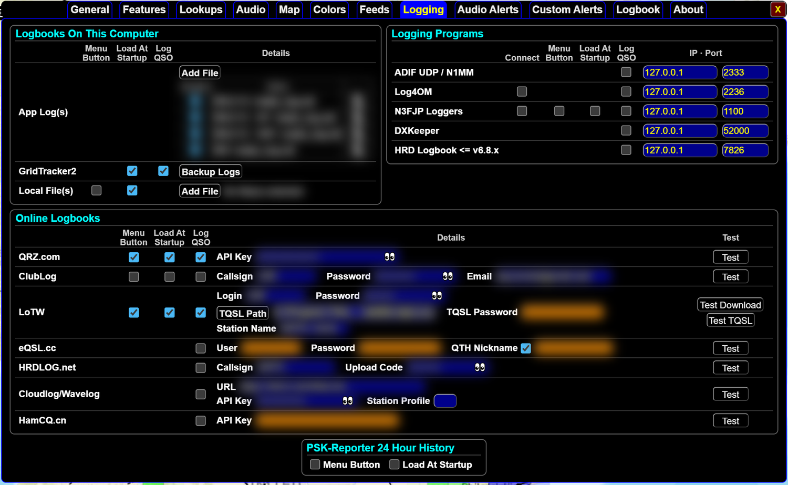

# Logging Options

## Is GridTracker2 a Logging Program?

No. GridTracker2 *displays* your QSOs; it isn't meant to be the master record of your contacts. It keeps a backup log of the QSOs it sees, and it can send each new QSO to your logging program and online logbooks, but your real log should live in a logging program or online logbook.

All of this is set in [Settings → Logging](../GridTracker-Overview/Settings-Sub-Menus.md#logging-tab).



## Where Your Logbook Comes From

When GridTracker2 starts, it loads every log ticked **Load At Startup**, and combines them into one logbook. That logbook colors the map, decides what is wanted in the rosters, and fills the Statistics window.

* **App Log(s):** the logs of WSJT-X, JTDX and WS – Digital Mode Suite. GridTracker2 finds them by itself in their usual folders, and lists them here. Untick any you don't want loaded, for example when another copy of GridTracker2 uses them. **Add File** adds a log it didn't find.
* **GridTracker2:** GridTracker2's own backup log (see below).
* **Local File(s):** any other ADIF files: an export from your logging program, a contest log, an old logbook. Tick **Load At Startup**, then **Add File**.
* **N3FJP Loggers:** your AC Log logbook. AC Log must be running.
* **QRZ.com**, **ClubLog** and **LoTW:** your online logbooks. LoTW is the usual source of confirmations.
* **PSK-Reporter 24 Hour History:** the stations that heard you in the last 24 hours. These are reception reports, not QSOs; they are shown as live grids.

A log downloaded from a website is kept in GridTracker2's data folder and replaced at each download. Your logs on the websites are never changed.

```{tip}
WSJT-X's own log only knows that you logged a QSO, not whether the other station confirmed it. To see your confirmations (QSLs), load your LoTW log, or a log from your logging program that holds your confirmations.
```

When the same QSO is in several logs, the **QSL Location Authority** in [Settings → Logbook](../GridTracker-Overview/Settings-Sub-Menus.md#logbook-tab) decides whose location details are used.

### Loading Logs Whenever You Like

Tick **Menu Button** for a log to add a button for it to the button panel. Click the button to load or reload that log at any time, for example after uploading to LoTW.

The **Load ADIF Log** button (or **Ctrl+L**) opens any ADIF file and adds it to your logbook. It is also added to **Local File(s)**, so it loads at every start; untick or remove it there if you only wanted it once.

### Clear Log and Load Log

**Clear Log** in the side panel removes your logbook from GridTracker2: the QSO and QSL counts, the colored grids and the Statistics are cleared. No files are deleted. The button then reads **Load Log**; click it to load your startup logs again.

This is useful when you change which logs are loaded. For example, to see only your LoTW log: untick everything else's Load At Startup, click **Clear Log**, then **Load Log**. **Clear Log** also clears the cached LoTW, QRZ.com and ClubLog logs, so they are downloaded fresh next time.

## Where New QSOs Go

When you log a QSO in WSJT-X or JTDX (or a program that broadcasts ADIF, or by hand from the Feed Roster), GridTracker2 adds it to your logbook and sends it to every log ticked **Log QSO**:

* **GridTracker2**, its own backup log;
* logging programs: **ADIF UDP / N1MM**, **Log4OM**, **N3FJP Loggers**, **DXKeeper**, **HRD Logbook**;
* online logbooks: **QRZ.com**, **ClubLog**, **LoTW**, **eQSL.cc**, **HRDLOG.net**, **Cloudlog/Wavelog**, **HamCQ.cn**.

The [Event Viewer](../GridTracker-Overview/Control-Panel.md#event-viewer) shows the result for each one, for example "Logged to QRZ.com". Use **Test** next to each online logbook to check your login details.

* **LoTW** uploads go through TQSL. Choose the TQSL program (**TQSL Path**, not needed on macOS), your certificate's **TQSL Password** if it has one, and your **Station Name** (the station location in TQSL). An upload that fails, for example while you are offline, is queued and sent with your next QSO.
* With **Add Lookup Data to QSO Log event** on in Settings → Lookups, details from the callsign lookup (name, QTH, grid and so on) are added to the QSO before it is sent.
* QSOs with a known POTA activator or SOTA summit get its `POTA_REF` or `SOTA_REF`.

```{note}
GridTracker2 receives the QSO from WSJT-X's "Log QSO" window, so WSJT-X must have **Prompt me to log QSO** turned on. See [Appendix B](../Appendices/Appendix-B-Configuring-WSJT-X-and-JTDX-for-GridTracker.md).
```

## The GridTracker2 Backup Log

The **GridTracker2** row keeps a backup log of every QSO GridTracker2 logs, in ADIF files in the **Backup Logs** folder in GridTracker2's data folder (one file for each callsign and grid you operate from, such as `GridTracker2_N0TTL_CN84.adif`). Click **Backup Logs** to open the folder. Every file in it is loaded when **Load At Startup** is ticked.

POTA Hunting and SOTA Chasing rely on this log to know which parks and summits you have worked, so turning either on also turns on this row's **Load At Startup** and **Log QSO**.

See [Files and Folders](../GridTracker-File-Storage.md) for where the data folder is on your computer.

## Limiting What Is Shown

* The [Map View Filters](../GridTracker-Overview/Control-Panel.md#map-view-filters) choose the bands, modes and propagation modes shown on the map and in Statistics.
* The [Logbook Filters](../GridTracker-Overview/Settings-Sub-Menus.md#logbook-tab) in Settings → Logbook limit the whole logbook to certain callsigns, grids or dates. When they leave QSOs out, the side panel shows **Log Entries Filtered**.
