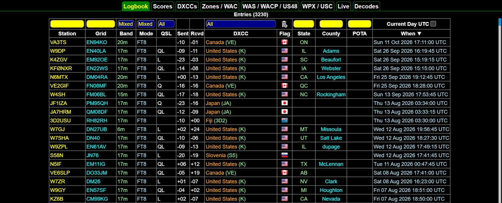
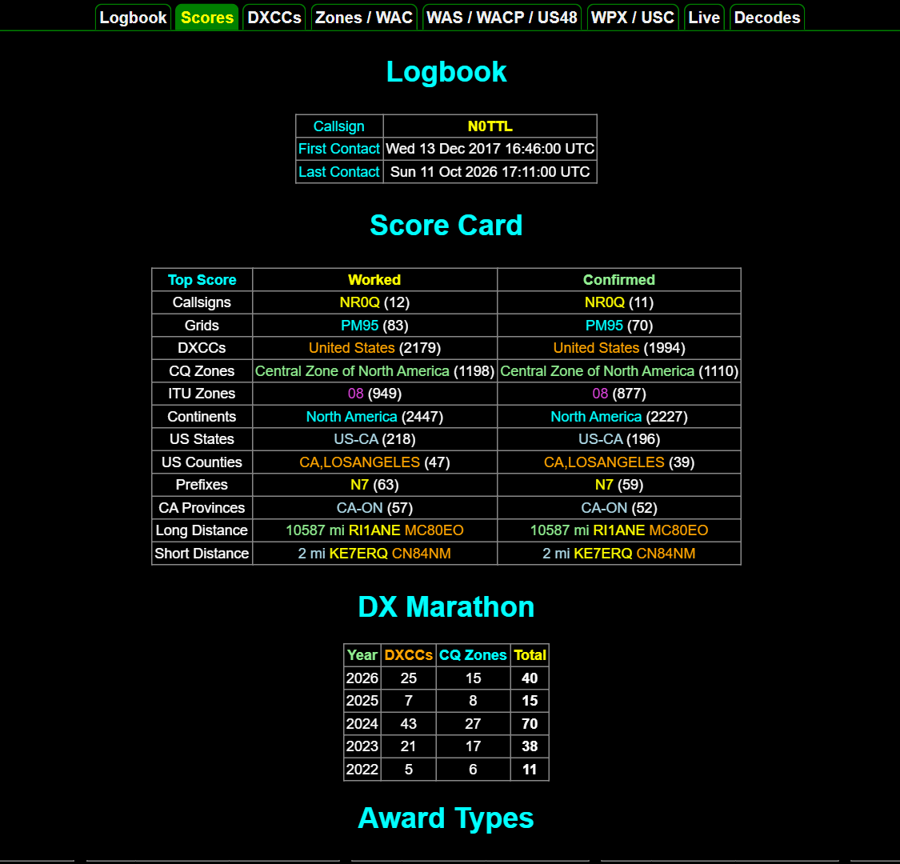
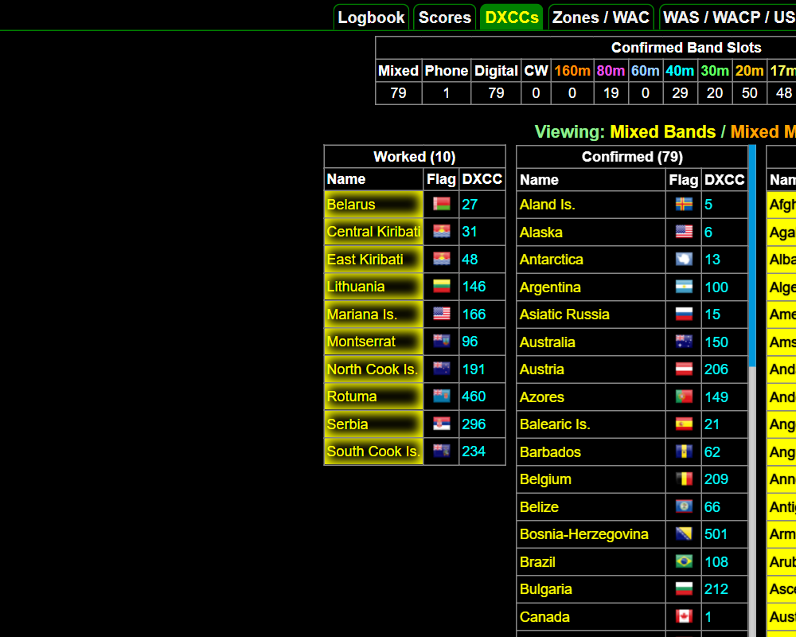
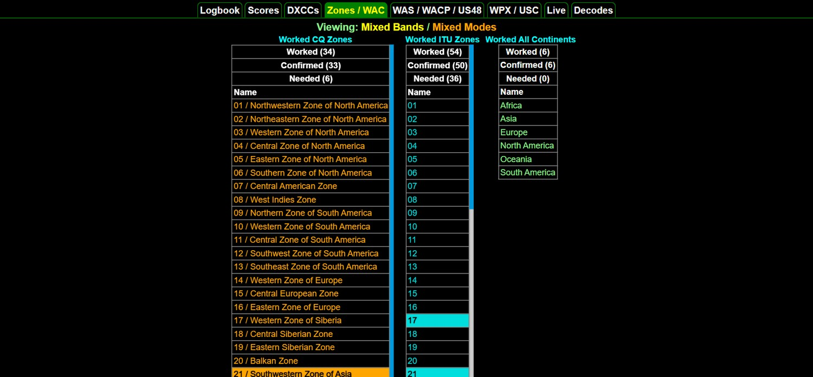
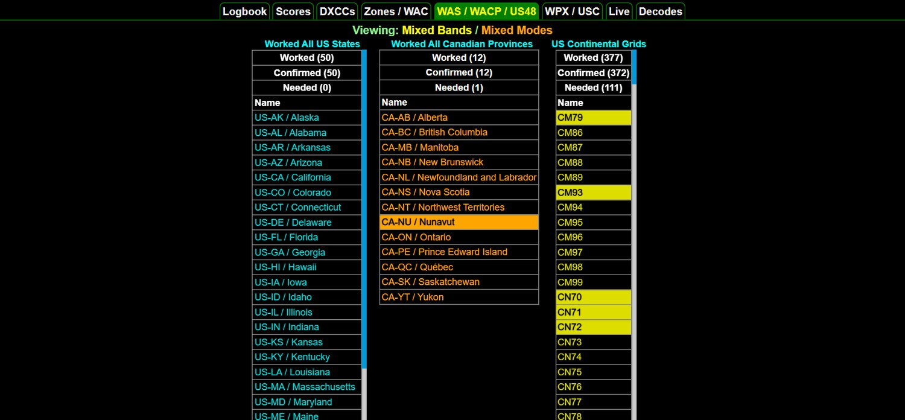
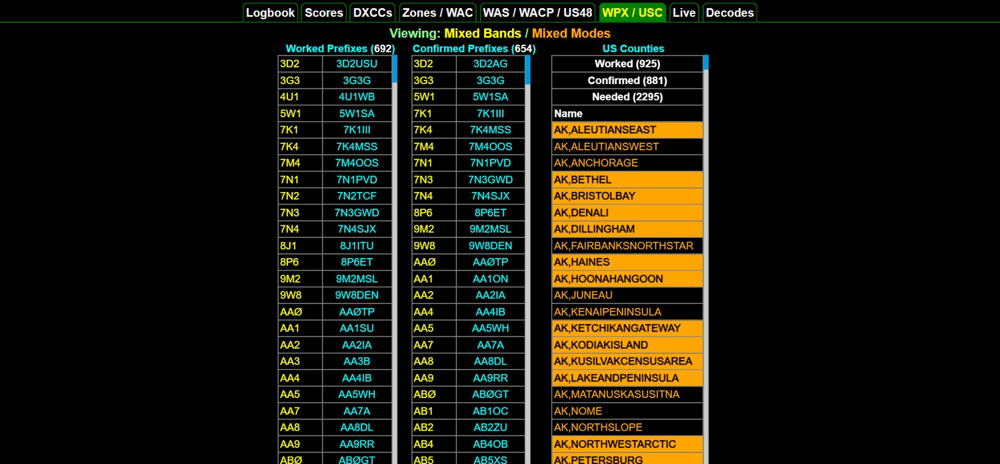
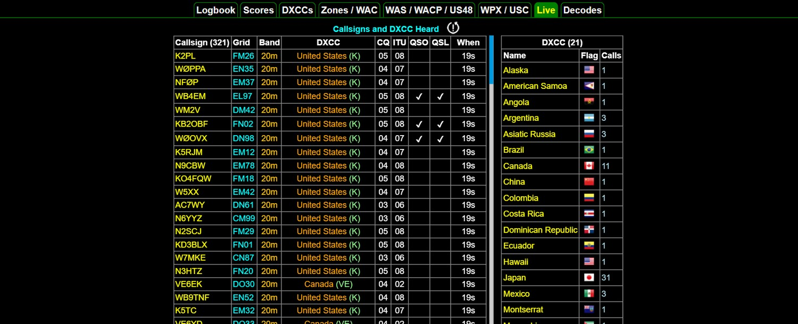
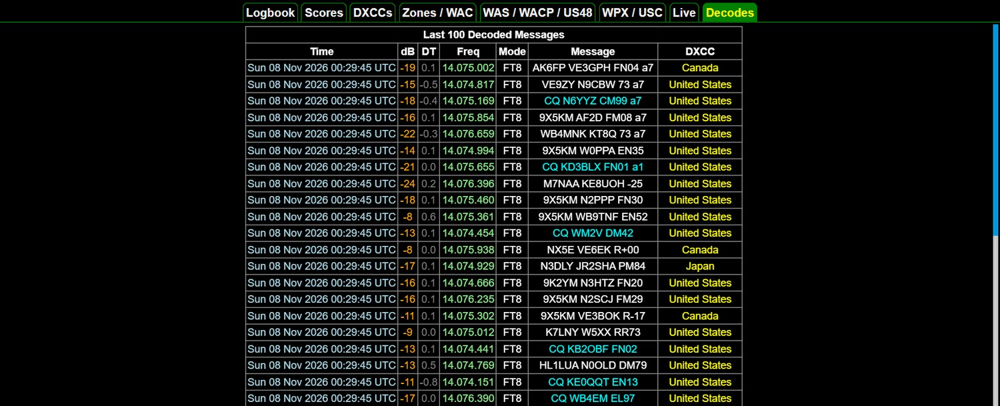

# The Statistics Window

Click the **Statistics** button in the side panel (or press **Ctrl+I**) to open the Statistics window: your logbook, your scores, and your progress toward the major awards. Clicking the QSO, QSL, Rx Calls or Rx DXCC count in the side panel opens it at the matching tab.

What the window shows depends on:

1. the logs you load (see [Logging Options](GridTracker-Logging-Options-and-Functions.md));
2. the [Map View Filters](../GridTracker-Overview/Control-Panel.md#map-view-filters): the award tabs show the band and mode chosen there, named on their "Viewing" line;
3. the [Logbook Filters](../GridTracker-Overview/Settings-Sub-Menus.md#logbook-tab) in Settings → Logbook.

The tabs are **Logbook**, **Scores**, **DXCCs**, **Zones / WAC**, **WAS / WACP / US48**, **WPX / USC**, **Live** and **Decodes**.

## Highlighting

The award tabs use the same highlighting as the rosters:

* **normal** colored text: confirmed;
* **shaded** (a glow around the text): worked but not confirmed;
* **highlighted** (black on a colored background): needed.

## Logbook

Your whole logbook in one list, newest first. The heading shows how many QSOs are listed. It scrolls smoothly even for very large logs, and the search boxes and column headings stay at the top.

The columns are Station, Grid (VUCC grids follow it), Band, Mode, QSL (the letters say where the confirmation came from; hover for their names), Sent, Rcvd, DXCC, Flag, State, County, POTA, SOTA, When, and LoTW, eQSL and OQRS (while their databases are on in Settings → Lookups). The POTA and SOTA columns appear whenever your log has POTA or SOTA QSOs.

### Sorting

Click a column heading to sort by it; an arrow shows the column and direction. Click the same heading again to reverse the order. Sorting by another column keeps the direction. Sent and Rcvd can't be sorted.

### Searching and Filtering

The row above the headings filters the list. Filters combine, so you can look for, say, 20 m FT8 QSOs with Japan that aren't confirmed.

* **Station:** callsigns containing what you type (upper or lower case).
* **Grid:** grids starting with what you type: `EM` finds every EM grid, `EM29` that square. VUCC grids are searched too.
* **Band**, **Mode**, **QSL** and **DXCC:** choose from the values in your log. Mode also offers Phone and Digital; QSL offers Yes, No, or a particular source.
* **State**, **County**, **POTA** and **SOTA:** entries containing what you type.
* **Current Day UTC:** only today's QSOs (UTC).

A trash can appears next to each search box while it has text; click it to clear the box.

Click a callsign to look it up. For an unconfirmed QSO with a station that uses ClubLog OQRS, click the ✔ in the OQRS column to request a QSL through ClubLog.

### Export SOTA Chaser Log

When your log has SOTA QSOs, an **Export SOTA Chaser Log…** button appears next to the count. See [Exporting Your Chaser Log](../Third-Party-Integrations/GridTracker2-and-Summits-On-The-Air.md#exporting-your-chaser-log).

## Scores

{width=480px}

* **Logbook:** the callsigns in your log, and your first and last contacts.
* **Score Card:** your best band and mode, with worked and confirmed counts, for callsigns, grids, DXCC entities, CQ and ITU zones, continents, US states, US counties, prefixes and Canadian provinces, plus your longest and shortest distances.
* **DX Marathon:** the DXCC entities and CQ zones you worked in each of the last five years.
* **Award Types:** worked and confirmed counts for each award, by band, mode and type of mode.
* **Mode Types:** your QSOs by Mixed, Digital, Phone, CW and Other.
* **Distances:** your longest and shortest QSOs by band, mode and type. Click a callsign to look it up.

## DXCCs

{width=480px}

The **Confirmed Band Slots** table counts your confirmed DXCC entities for Mixed, Phone, Digital and CW, and for each band. Below it, three lists: **Worked**, **Confirmed** and **Needed**, with each entity's flag and DXCC number. Click a worked entity to open the Logbook filtered to it.

## Zones / WAC

Worked CQ Zones, Worked ITU Zones and Worked All Continents, each with its worked, confirmed and needed counts.

## WAS / WACP / US48

Worked All US States, Worked All Canadian Provinces, and US Continental Grids (the grids of the 48 contiguous states). Click a worked grid to open the Logbook filtered to it.

## WPX / USC

Your worked and confirmed prefixes, each with the callsign that earned it, and your US counties.

## Live

Every callsign heard this session, with its grid, band, DXCC entity, zones, whether you have worked (QSO) and confirmed (QSL) it, and when it was heard. A second table counts the callsigns heard from each DXCC entity. **Clear Live** in the side panel starts the list again.

## Decodes

The most recent decoded messages, with their time, signal report, time offset, frequency, mode, message and DXCC entity.
