# Logbook Statistics

Clicking on the "Statistics" button in the control panel will open a new window - the **Statistics** window - with every metric the developers could think of that's related to your QSO data.  

**Important Note:**  Just as with the [QSO data](../GridTracker-Overview/Control-Panel.md#qso-status) displayed in grids and the [Award layer overlays](../GridTracker-Overview/Control-Panel.md#cycle-award-overlays-hotkey--equal-sign) on the GridTracker Map the information shown on the various tabs of the **Statistics** menu depends on:

1. The logs you choose to [import](GridTracker-Logging-Options-and-Functions.md#importing-logging-information-into-gridtracker) into GridTracker; and
2. The [Map View Filters](../GridTracker-Overview/Control-Panel.md#map-view-filters) you've chosen for limiting or not limiting that log data; and
3. The working Callsign(s) you have enabled on the [**Settings > Logbook**](../GridTracker-Overview/Settings-Sub-Menus.md#user-logbook-tab) tab.

## Logbook Data     

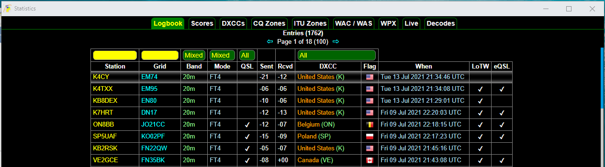

The first tab in the **Statistics**  window is Logbook data.  It's self explanatory:  the columns reflect the data collected by WSJT-X plus any other external logs you've chosen to import into your current working session. 

Again, GridTracker always retrieves your current wsjtx_log.adi file when GridTracker starts up. That's done automatically for you.  If you do not specifically tell GridTracker to retrieve and include any other .adi / .adif files (stored locally or on the internet) then the only data that will be displayed in the **Statistics** window is your current WSJT-X data.

### Manipulating Logbook Data

**_Sorting_**

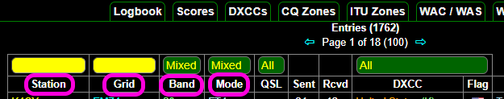

Click on a column header (i.e., Station, Mode, DXCC) to sort the table by that column. The initial sort will be alphabetically from A to A.  Click on the column header again and the table will reverse sort from Z to A. 

**Note:**  You cannot sort the Sent and Rcvd columns.

**_Filtering_**

The Station, Grid, Band, Mode, Grid, QSL and DXCC columns can be filtered singly or in combination.

**_Station Filtering_**

Type at least one character into the yellow oval above **Station** to get all entries in the table that contain that character.  

* The number of QSOs that meet your criteria appears at the top of the page.  

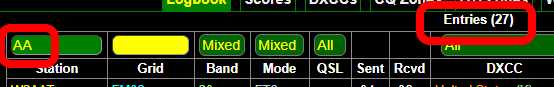

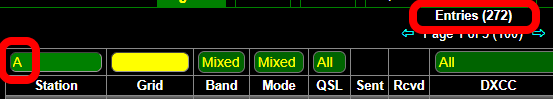

* The initial search results return sorted in reverse chron order:  newest date to earliest.  You can then click on the column headings to do any further sorts you wish.
* The filter is not case sensitive.  If you input an "a" it will automatically be converted to an "A".
* The order you type characters into the search box matters.  The search function does a character string search so will get a different set of results doing a filter search for "JY" than one done for "YJ"

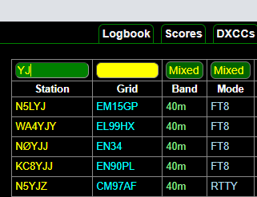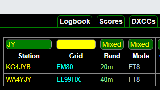

**_Grid Filtering_**

You can filter grid data the same way you filter callsigns:  by typing one or more characters into the yellow box above the **Grid** column label.  However the filter results are entirely dependent on the _order of the search string characters._  Some examples from an actual data set will make this clearer.

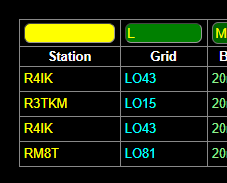

* Filtering the data for Grids with **"L"** returns the following:  four QSOs where **"L"** is the _first letter_ of the two letter grid identification.
* But it omits data where **"L"** is _the second letter_ in the initial two letter grid I.D. such as grids beginning DL, EL, FL, etc.  

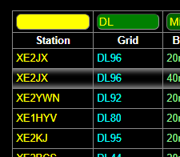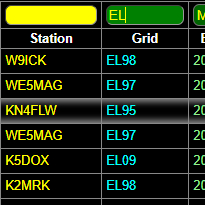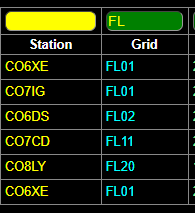

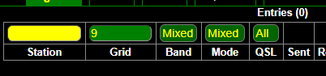

You cannot filter for a number character alone in a grid I.D. alone:

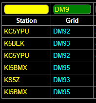

But you can filter for grids that contain a number that follows two alphabetic characters like,  "\✱\✱#"  (where ✱ is a letter and # is a number).  Filtering for **DM9** returns these results:

But it won't return QSOs with grid IDs like:

    **DM79**
    **EK99**
    **JK79**

* You cannot use an asterisk as a place holder for any character in a search string, (i.e., filtering for something like "**D\*1\***"  

You can filter for an exact string of four characters such the the following example which filtered data for grids **"EL96"**:

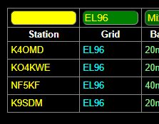

**_Filtering for Band, Mode, QSL, and DXCC_**

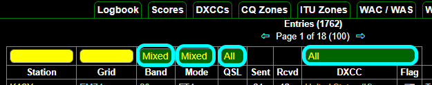

Clicking on any of these green boxes gives you a drop-down menu from which you can make your section. 

The options in the dropdown menus will reflect the data you currently have imported into GridTracker. (Meaning whatever is in your WSJT-X log file plus any other log data you have imported from any outside source.) If you haven't made any contacts on 160 meters or in Olivia or with a station in Iceland then those won't be available options. [**Note:**  the DXCC list is cut off for space reasons.]

| **Band** | **Mode** | **QSL** | **DXCC** |
| --- | --- | --- | --- |
| 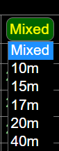 | 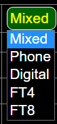 | 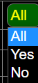 | 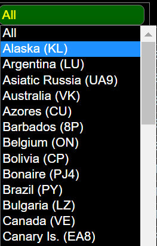 |

## Scores and Awards
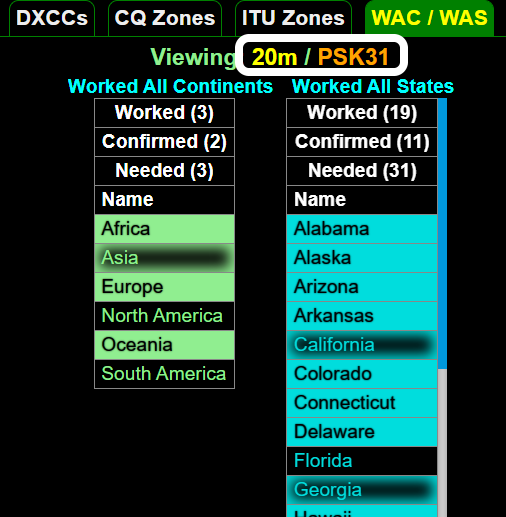

Before discussing the Scores and Awards tabs on the **Statistics** page an explanation of "shading" versus "highlighting" is in order because shading and highlighting are used on most of the awards pages.

* If text is "shaded" it has a fuzzy border around the text.
* If text is highlighted then the text is black with a colored background. 
* If text is a color against a black background we call that "normal" formatting. 

In this sample from the Worked All Continents / Worked All States (WAC/WAS) award page the user has worked three continents (Asia, North America and South America); she's received confirmation of contacts in North and South America ("normal" text) but not for the contacts in Asia ("shaded text).  She needs contacts in Africa, Europe and Oceana ("highlighted" text") to achieve WAC.  The same normal, shaded and highlighted conventions are used for her results in WAS.  

**Take Note:**  These WAC/WAS stats for this user apply only to contacts made on the 20 meter band via PSK31. 

### Scores

The information shown on this tab of **Statistics** is self-explanatory.  It shows the user:

* how many contacts they've made, 
* the location(s) of the other stations they've contacted
* what mode was used for the contact
* whether the QSO was confirmed.

### Awards Tabs

The following screenshots illustrate how your award statistics will vary depending on the options you have set in the Map View Filter.  

This user has worked four continents and 27 U.S. states via the specific mode of FT-4 on the 20 meter band.

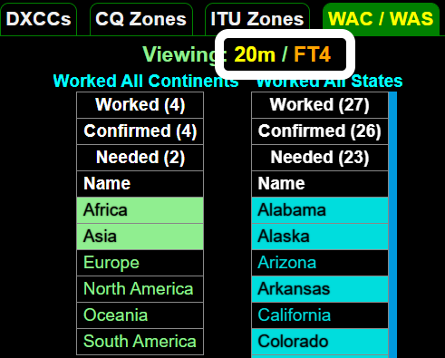

The user has worked 5 continents and 46 states in _some_ digital band on 40 meters.

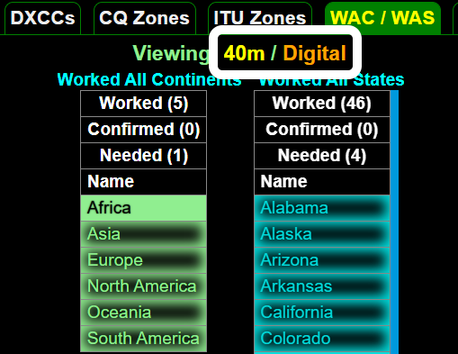   

No contacts in any digital mode on the 160 meter band.

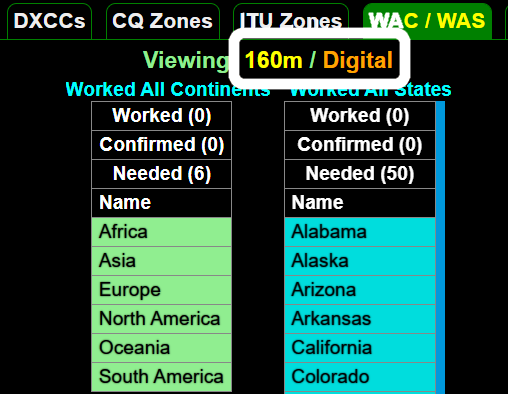

No contacts using CW on the 20 meter band.  

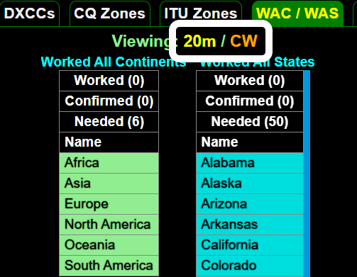