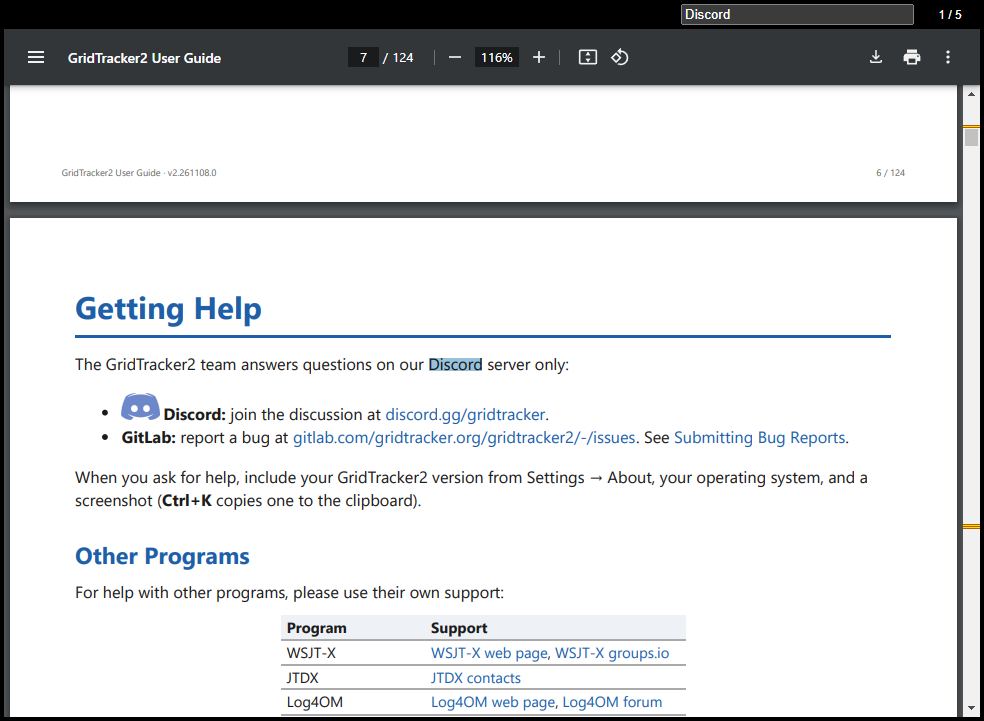
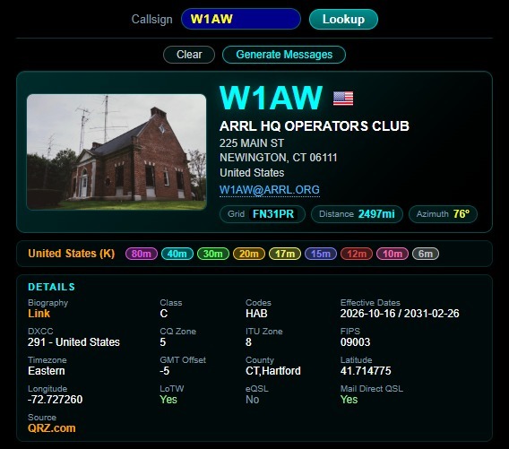
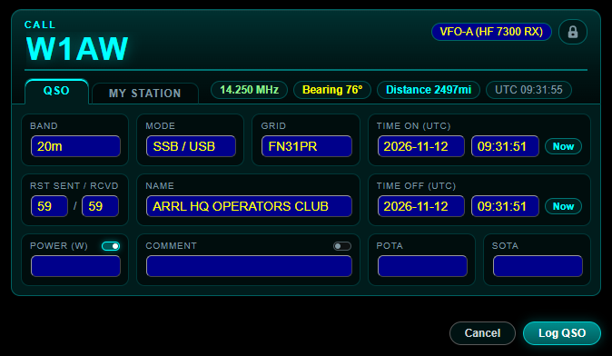

# Other Windows

## User Guide

Click the **User Guide** button (the life ring) in the side panel to open this guide in its own window; click it again to close the window, or right-click it to bring the window forward. The window opens where you last left it.



Type in the search box at the top to find a word: matches are highlighted and counted, **Enter** goes to the next one and **Shift+Enter** to the previous one. The toolbar below it shows the page number, zooms, rotates, prints or saves the guide, and its **☰** button shows page thumbnails and the contents. Links to websites open in your web browser. **Esc** closes the window.

## Callsign Lookup

Click the **Lookup** button in the side panel to open the Callsign Lookup window. Type a callsign and press **Enter** or click **Lookup**. Clicking a callsign almost anywhere in GridTracker2 (the rosters, the Logbook, the map's tooltips, the station you are working in the side panel) also looks it up.



The lookup service is chosen in [Settings → Lookups](../GridTracker-Overview/Settings-Sub-Menus.md#lookups-tab): Callook (US callsigns only, no login), HamQTH, QRZ.com or QRZCQ.com. What is shown depends on the service. From the top:

* **Generate Messages** puts the call and grid into WSJT-X or JTDX without calling. **Clear** empties the window. When GridTracker acknowledges the station, its note is shown above these buttons and its emoji before the call on the card;
* a card with the station's photo, name and address. Click the card to copy the address. Under it are the grid (click to copy it; highlighted when it is new to you) and the distance and bearing from you;
* your own log for that call: the bands and modes you have worked and confirmed it on, your last QSO, and the bands you have worked its DXCC entity on. A band with a dashed outline is worked but not yet confirmed; a filled one is confirmed;
* the **Details**: license class, DXCC entity, zones, IOTA, time zone, county, latitude and longitude, QSL information, and whether the station uses LoTW, eQSL and ClubLog OQRS.

If a lookup doesn't fit in the window, the rest scrolls.

With **Open Lookup on Transmit** on in Settings → Lookups, the station you start calling is looked up automatically. The Lookup window isn't available in Offline Mode.

## Log QSO

GridTracker2 is a log viewer, not a logging program, but it can hand on a QSO you made by hand: a phone or CW contact on your rig, a POTA or SOTA activator from the Feed Roster, or something the Multi-Mode Decoder heard. Turn on **Log QSOs By Hand** in [Settings → Logging](../GridTracker-Overview/Settings-Sub-Menus.md#logging-tab) (off until you turn it on); a **Log QSO** button joins the side panel. The QSO is logged like one logged in WSJT-X: into GridTracker2's own log (so the map and the rosters show it worked), the backup log at once, and every logging program and online logbook ticked **Log QSO** in Settings → Logging. Log QSO only makes a new QSO: it never changes or deletes one already logged.



The window opens from:

* **The Log QSO button** (or **F2**): with Rig Control on, the frequency and, in a voice mode, the mode are your rig's, and the time on is now. If you clicked a station in the Feed Roster (or a spot on the map) and the rig is still within 1 kHz of it, its call, park and grid are filled in too. Click the button again to hide the window; shown again (the button, **F2**), the card is just as you left it until you log it or click **Cancel**. Right-click the button to start a fresh one.
* **The Feed Roster**: double-click a call, or right-click it and pick **Log QSO...**, or click a park or summit in its POTA or SOTA column (see [Logging a POTA or SOTA QSO by Hand](Using-Feed-Roster.md#logging-a-pota-or-sota-qso-by-hand)).
* **The Multi-Mode Decoder**: a decoded line's right-click, its **Log QSO** and **Log Phone QSO** buttons (see [Logging a QSO](../Multi-Mode-Decoder/Multi-Mode-Decoder.md#logging-a-qso)).

At the top is the call, large, with chips beside the tabs below it: the frequency in MHz while **Freq** isn't on the card; while the **My Station** tab shows (the QSO's own tiles out of sight), the frequency, the band and mode in their colors and the grid; always, the bearing and distance to that grid (short path, from the grid on **My Station**, in your Distance Units from Settings → General), the time in UTC, a note when your log already has that call on that band and mode today (it doesn't stop you logging it), and, with [Queue QSOs To Send Later](../GridTracker-Overview/Settings-Sub-Menus.md#send-later) on, how many QSOs are waiting. Beside it are the **VFO** menu, which picks the Rig Control VFO the frequency and mode come from (the first one connected, unless you pick another), and the lock. Along its foot are the card's two tabs, **QSO** and **My Station**, over the tiles. Each tab has its own tiles; whichever one shows, both tabs' fields go on the QSO you log.

While the window is open it follows your rig: tune it, or switch it to another voice mode, and **Freq** and **Mode** change with it. Once you type a frequency or pick a mode yourself, that one stays. A QSO from the Multi-Mode Decoder keeps the frequency it was heard on. When nothing else gives a card its mode, it starts in the last mode you picked or logged since GridTracker2 started.

Below, each field has its own tile. To start with the **QSO** tab has **Band** (ADIF's bands: it follows your rig's frequency until you pick one), **Mode** (each mode as ADIF names it: **SSB / USB**, **PSK / PSK31**, **DIGITALVOICE / DSTAR** ...), **Grid**, **Time On** and **Time Off** (each with **Now**; in UTC, or in your local time, labeled with its zone such as PST, while GridTracker2's clock shows local time; the QSO is logged in UTC either way), **RST Sent / Rcvd** (599 at first, 59 on phone), **Name**, **Power**, **Comment**, **POTA** and **SOTA**. **Freq** can be added from **Add Fields** (the QSO still gets your rig's frequency without it; with a band picked and no rig, it's logged with the band alone, except for a QSO with a park). Add **DXCC** and **Country** to have the call's DXCC entity and its name follow the call as you type it (until you type in them yourself). Clear the call to start the next QSO, or type a call on a card that came without one: every other field is cleared, the times are set to now and the reports to the mode's, and only the mode, your rig's frequency and **My Station** stay. A different call starts the card over as new once it settles (you leave its box or stop typing for a moment), the same way, even on a card that came with a call from a Feed Roster spot or the Multi-Mode Decoder. Once the call is in (you leave its box, stop typing for a moment, or it came filled in), GridTracker2 looks it up with your lookup service ([Settings → Lookups](../GridTracker-Overview/Settings-Sub-Menus.md#lookups-tab)) and fills in the name and grid, and, when you've added their fields, the city, state, county, CQ and ITU zones, IOTA, e-mail, QSL route, latitude, longitude and web address. Only empty boxes are filled: nothing you typed is replaced.

**Power**, **Comment**, **Propagation Mode**, **Satellite**, **Satellite Mode** and **Rx Freq** have a small **Retain** switch at the right of their label. With it on, what you type or log there is kept (also when GridTracker2 is closed and started again): it starts the next card, and clearing the call leaves it; with it off, the field starts empty each time. Power's is on until you switch it off; the others are off.

Each tile is labeled with the field's name, such as **Station Callsign** or **Propagation Mode**; hover over it to see the ADIF field it fills (such as `STATION_CALLSIGN`) and what ADIF says goes in it. A field with a set list of values shows it when you click in it, and narrows it as you type: ADIF's own lists (propagation modes, continents, ARRL sections, QSL codes, Morse keys, regions ...), the contest names ADIF knows (you can type any other), the bands, the DXCC entities, and the states and provinces of the QSO's DXCC entity (the **DXCC** box's, else the call's; for your own state, yours). Pick with the mouse, or with the arrow keys and **Enter**; **Esc** closes the list. The **POTA** and **SOTA** boxes (yours on **My Station** too) search as you type, once you've typed two characters: with POTA Hunting on, POTA's park list, and while SOTA Chasing runs, the SOTA summit list. Each match is offered by its reference or its name, such as US-2852 or Silver Falls, and shows the park's or summit's name and where it is. A park or summit that isn't in the list can still be typed in, as long as it's written the right way. In a county box, once its state is filled in, pick from that state's counties; picking a county fills in an empty state. Without `DXCC` on the card, GridTracker2 still logs the call's DXCC entity.

Check the card, fill in what's missing, and click **Log QSO** (or press **Enter**); **Cancel** closes it. Only plain letters, digits and punctuation go in the boxes, as ADIF files carry them: an accented letter loses its accent as you type it (é becomes e, ß ss), and other characters, such as emoji or Japanese, are left out. Each box is checked as you type in it: while what's in it isn't right it's outlined in red, with the reason at the bottom, and **Log QSO** checks every box. Each field takes what ADIF allows in it: a grid of 4, 6, 8 or 10 characters (CN87, CN87XN, CN87XN12 or CN87XN12AB), CQ zone 1 to 40, ITU zone 1 to 90, an IOTA number such as NA-065, a WWFF reference such as KFF-1234, a U.S. county by its name, such as Linn (the box shows the name; the QSO gets it with its state from the state box, OR,Linn, as ADIF writes it), a callsign in **Station Callsign** and **Operator**, a date such as 20261111 (or 2026-11-11), a latitude or longitude such as N044 37.800 (or decimal degrees, which are changed to that), two or four VUCC grids such as CN87,CN88, and only ADIF's own values in a field with a set list. A QSO the same as the last one logged isn't logged twice, and one your Logbook Filters would leave out isn't logged (the card says why). A field left empty is not written to the QSO at all.

### My Station

**My Station** holds your own station's details, filled in from what GridTracker2 knows: your callsign as `STATION_CALLSIGN` and `OPERATOR`, your grid as `MY_GRIDSQUARE`, and from where its center is, your CQ and ITU zones, latitude and longitude (when you add them) and, in the U.S., your state and county (`MY_STATE`, `MY_CNTY`, shown as Linn and logged as OR,Linn), your DXCC entity and its name, and the rig of the VFO the card reads (`MY_RIG`). What it doesn't know is left blank, for you to fill in or leave: your city, antenna, and your own park, summit or other activity (`MY_POTA_REF`, `MY_SOTA_REF`, `MY_WWFF_REF`, `MY_SIG`, `MY_SIG_INFO`). What you type here is kept as you type it, logged or not, and every card starts with it from then on (it's saved with your settings); a field you leave as GridTracker2 filled it in follows your settings (a new grid, another rig).

### Arranging the Card

Each tab is arranged on its own. Right-click the card for **Add Fields**: the ADIF fields the tab showing can have, by kind. On **QSO**: **Parks And Summits**, **Location**, **Contest** (contest name, serials, exchanges, class, ARRL section, check, precedence, WPX prefix; **Serial Sent** counts up by one with each QSO you log), **QSL**, **Contacted Station**, **Propagation** and **Other**. On **My Station**: **Callsign And Equipment**, **Location** and **Parks And Summits**, every one of your own station's fields. None of the contest fields is on the card until you add it. An added field stays on the card; with the lock open (below), hover over it for its **x** to take it off again; no field can be taken off while the lock is shut. **Freq** can be taken off the same way, since the band is enough: the card still follows your rig and the QSO still gets the rig's frequency when there is one; add it again from the top of **Add Fields**.

Not offered: the fields your logging program and online logbooks keep themselves (the LoTW, eQSL, Club Log, QRZ.com and other upload and confirmation fields), and the `_INTL` fields, which ADIF files of the kind GridTracker2 sends (ADI) can't carry.

The lock at the top right is the card's master lock. While it's shut the card stays as it is: **Unlock Fields**, **Unlock Widths**, **Reset Layout** and taking a field off are greyed out in the right-click menu, the fields have no **x**, and the window can't be resized. **Add Fields** still works, and adding a field opens the lock, so you can place, size or take off what you added. Click the lock to open it; then you can resize the window, and pick **Unlock Fields** to move the tiles: drag one to where you want it, then pick **Lock Fields** (or press **Esc**). Click the lock again (or press **Esc** once nothing else is unlocked) to shut it. It's shut again whenever the window is hidden, and the card always opens with it shut.

Pick **Unlock Widths** in the right-click menu to size the tiles: each tile shows **1×** and **2×** buttons in its label, to make it one or two columns wide, and a bar above the card has a **1× Width** slider for how wide a column is (115 to 320 pixels; the card fits as many columns as the window does and stretches them to fill it). Pick **Lock Widths** (or press **Esc**) when done. The widths are saved at once and kept for each field, so a field you take off and add again comes back at the width you gave it. When a tile doesn't fit in what's left of a row, it starts the next row and the tile before it widens to fill the row, so the rows stay even at any window size.

**Reset Layout** puts the tab's tiles back as they started, at their own widths, and the window and the **1× Width** back to their first size. When a Feed Roster spot has a park or a summit, its **POTA** or **SOTA** tile shows for that QSO even if you haven't added it.

```{note}
A park goes to the QSO only with POTA Hunting on (Settings → Features), as for every QSO GridTracker2 logs.
```

## Current Conditions

Click the **Current Conditions** button (or press **Ctrl+E**) to see the solar-terrestrial conditions from [HamQSL](https://www.hamqsl.com/solar.html): the solar flux, sunspot number, A and K indices, HF and VHF band conditions, and the latest images of the Sun from SOHO and SDO. The images are refreshed every 30 minutes. Click the HamQSL banner to open their website.


While GridTracker2 receives the planetary K index, the Conditions button itself shows it, colored by its value, with an arrow showing whether it is rising or falling. It pulses during a geomagnetic storm (Kp above 5).

## Band Activity

Right-click the band activity graph in the side panel to pop it out into a small window of its own, without a frame, which stays on top of your other windows. Drag it wherever you like, for example next to WSJT-X. Right-click it to close it. See [Band Activity](../GridTracker-Overview/Control-Panel.md#band-activity).

## Pop-Out Details

Right-click a grid, pin, park or spot on the map to pop its details out into a window that stays open while you move the mouse away. Callsigns in it can be clicked to look them up.

## Alerts

The Alerts window opens when a Custom Alert set to **Visual Popup** goes off. See [Custom Alerts](Setting-Up-Audio-and-Visual-Alerts.md#custom-alerts).
