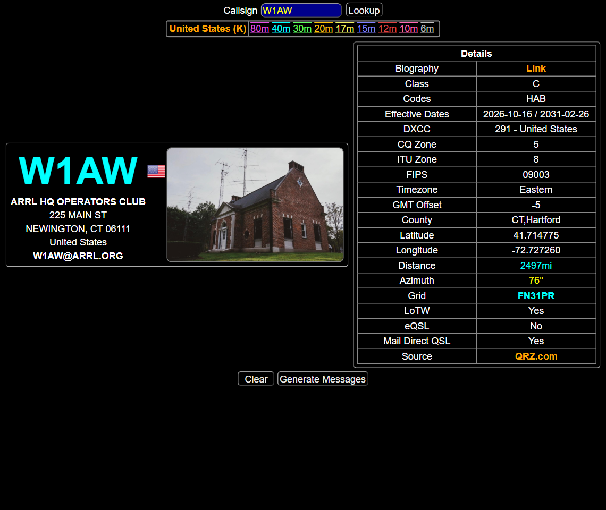
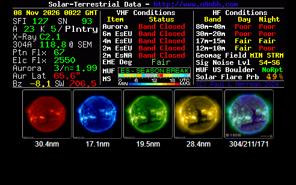

# Other Windows

## User Guide

Click the **User Guide** button (the life ring) in the side panel to open this guide in its own window; click it again to close the window, or right-click it to bring the window forward. The window opens where you last left it.

Type in the search box at the top to find a word: matches are highlighted and counted, **Enter** goes to the next one and **Shift+Enter** to the previous one. The toolbar below it shows the page number, zooms, rotates, prints or saves the guide, and its **☰** button shows page thumbnails and the contents. Links to websites open in your web browser. **Esc** closes the window.

## Callsign Lookup

Click the **Lookup** button in the side panel to open the Callsign Lookup window. Type a callsign and press **Enter** or click **Lookup**. Clicking a callsign almost anywhere in GridTracker2 (the rosters, the Logbook, the map's tooltips, the station you are working in the side panel) also looks it up.

The lookup service is chosen in [Settings → Lookups](../GridTracker-Overview/Settings-Sub-Menus.md#lookups-tab): Callook (US callsigns only, no login), HamQTH, QRZ.com or QRZCQ.com. What is shown depends on the service:

* first, your own log for that call: the bands and modes you have worked and confirmed it on, and your last QSO;
* a card with the station's name, address and photo. Click the card to copy the address;
* a **Details** table: license class, DXCC entity, zones, IOTA, time zone, county, latitude and longitude, the distance and bearing from you, the grid (click to copy it; highlighted when it is new to you), QSL information, and whether the station uses LoTW, eQSL and ClubLog OQRS.

**Generate Messages** puts the call and grid into WSJT-X or JTDX without calling. **Clear** empties the window.

With **Open Lookup on Transmit** on in Settings → Lookups, the station you start calling is looked up automatically. The Lookup window isn't available in Offline Mode.

## Current Conditions

Click the **Current Conditions** button (or press **Ctrl+E**) to see the solar-terrestrial conditions from [HamQSL](https://www.hamqsl.com/solar.html): the solar flux, sunspot number, A and K indices, HF and VHF band conditions, and the latest images of the Sun from SOHO and SDO. The images are refreshed every 30 minutes. Click the HamQSL banner to open their website.

While GridTracker2 receives the planetary K index, the Conditions button itself shows it, colored by its value, with an arrow showing whether it is rising or falling. It pulses during a geomagnetic storm (Kp above 5).

## Band Activity

Right-click the band activity graph in the side panel to pop it out into a small window of its own, without a frame, which stays on top of your other windows. Drag it wherever you like, for example next to WSJT-X. Right-click it to close it. See [Band Activity](../GridTracker-Overview/Control-Panel.md#band-activity).

## Pop-Out Details

Right-click a grid, pin, park or spot on the map to pop its details out into a window that stays open while you move the mouse away. Callsigns in it can be clicked to look them up.

## Alerts

The Alerts window opens when a Custom Alert set to **Visual Popup** goes off. See [Custom Alerts](Setting-Up-Audio-and-Visual-Alerts.md#custom-alerts).
