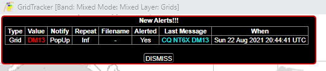

## Setting Up Audio and Visual Alerts  

GridTracker can send you an audio alert for a variety of events and a visual alert for some.

### Audio Alerts

Setting up an audible alert for messages that include **_YOUR CALLSIGN_**.  \[Helpful if you don't have your eagle eye on WSJT-X at all times.\]

1. In the Custom Alerts box click in the _type_ box to select "**QRZ**".  
2. Type your callsign in the "Value Box".  
3. The default alert will be an audible text-to-speech alert.  If you would rather have an audible sound effect click "Media File".  Your other options are a "Visual Popup" (a popup window) and "Map Center" (which will recenter the GridTracker map on your QTH ????)
4. If you want a sound effect notification click on the Select File dropdown list.  
5. Move over to click the "Repeat" button where you choose how often to repeat the alert.
6. Click on the ADD button.  **Note:**  you have the option to reset or delete any custom alerts you create.

There's an alternative but equally effective way to get an audio alert for your callsign using features in [Call Roster.](Using-Call-Roster.md)

Setting up an audible alert for messages that include a **_SPECIFIC CALLSIGN_**.  This is pretty much the same procedure as above except you will select "Callsign exact" as the _type_ of alert.  

Setting up an audible alert for messages that include a **_SPECIFIC GRID_**.  Select "Grid" as the _type_ of alert.  Enter at least the first two letters of the grid designation or the first two letters and numbers.  You'll then select the type of alert and repeat the cycle.

Setting up an audible alert for messages from a **_SPECIFIC DXCC_**.  This is slightly more complicated in that you need to know the standard callsign prefix for the country you are hoping to reach. Consider Iceland as an example.  All Icelandic callsigns begin with TFA through TFZ.  So you would select "_Callsign (partial)_" for the type of alert and type "**TF**" in the "Value" box.  

### Visual Alerts

Visual Alerts are available for only custom alerts.  Clicking on the menu under **Notify** allows you to set:

1. A Visual Popup which will look like this: 

2. A Map Center Alert -- this will recenter the GridTracker Map on the grid where the station of interest to you is located. (Theory being that this will capture your attention.)