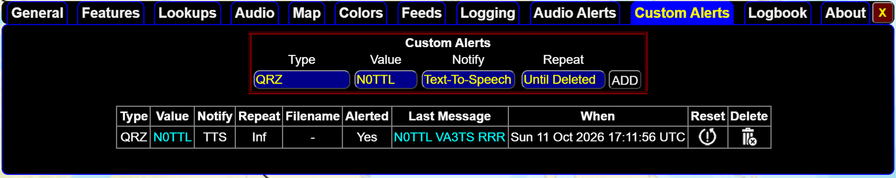

# Alerts

GridTracker2 can tell you when something you want shows up, so you don't have to watch the screen. There are three kinds of alerts:

* **Audio Alerts** speak or play a sound when a roster has a wanted station: a new grid, a new DXCC, a park you need. They follow the roster's Wanted choices.
* **Custom Alerts** watch for one particular callsign, part of a callsign or grid, whatever your roster settings, and can speak, play a sound, pop up a window or move the map.
* **Push notifications** send wanted stations to your phone. See [Push Notifications](../Third-Party-Integrations/PushNotifications-Integrations.md).

The **Audio Mute** button (or **Ctrl+M**) silences all sounds and speech at once. Pop-ups, Map Center and push notifications still go out. If you hear nothing, check it first, then the **Device** in Settings → Audio.

## Audio Alerts

Audio Alerts are set in [Settings → Audio Alerts](../GridTracker-Overview/Settings-Sub-Menus.md#audio-alerts-tab). Each roster has its own (Call Roster and Feed Roster sub-tabs).

1. Tick what you want to be alerted for: Callsign, Grid, DXCC, State and so on. These ticks are separate from the roster's Wanted box, so the roster can highlight more than you are alerted for.
2. For each one, choose **Text-To-Speech** or **Media File**, and what is said or played **On Single** (one wanted station) and **On Multiple** (several at once).
3. For DXCC, POTA and SOTA, choose something different **On ATNO**, for an entity, park or summit you have never worked, so you know to drop everything.
4. Check the **Reference** (which QSOs count as worked, and what you are hunting) and the **Exceptions**. These are shared with the roster.

A 🔔 next to a Wanted item in the roster means it has an audio alert. Click it to jump to that alert.

```{tip}
To be alerted only for, say, new DXCC entities, while the roster still highlights grids and states too: tick only DXCC in Settings → Audio Alerts, and Grid, DXCC and State in the roster's Wanted box.
```

## Custom Alerts

Custom Alerts are set in [Settings → Custom Alerts](../GridTracker-Overview/Settings-Sub-Menus.md#custom-alerts-tab). Choose a **Type**, a **Value**, how to **Notify** you and how often to **Repeat**, then click **ADD**.



The alert list shows when each alert last went off and the message that set it off. The decodes that set off an alert are also listed, with a 🚩, in the main window's message list.

### Examples

**When someone calls you:** Type **QRZ** (your callsign is filled in), Notify **Text-To-Speech** or **Media File**, Repeat **Until Deleted**. Useful if you step away from WSJT-X while calling CQ.

**When a friend is on the air:** Type **Callsign (exact)**, Value their callsign.

**When a particular country appears:** Type **Callsign (partial)** and the start of its callsigns, for example `TF` for Iceland. Callsign prefixes can be shared between countries, so check the entity, or use **Callsign (regex)** for an exact pattern such as `^TF[0-9]`.

**When a grid you need appears:** Type **Gridsquare** and the 4-character grid, for example `FK68`.

### How You Are Notified

* **Text-To-Speech** speaks the alert, using the voice set in Settings → Audio.
* **Media File** plays a sound. More than 200 sounds are included, and you can add your own to the **Extra Media** folder (see [Files and Folders](../GridTracker-File-Storage.md)).
* **Visual Popup** opens a small Alerts window listing the alert and the message that set it off. The alerts in it are cleared when you change band or mode.

  

* **Map Center** moves the map to the station's grid.

### Repeat

* **Until Deleted:** every time it matches, until you delete the alert.
* **Until Exit:** every time it matches, until GridTracker2 is closed.
* **Only Once** and **Never Repeat:** only the first time it matches. The alert stays in the list; click its reset icon to arm it again.

```{note}
Custom Alerts check WSJT-X and JTDX decodes (including WSPR), not DX Feeds spots.
```

## Band and Mode Memory

With **Roster/Alert Band Memory** on in Settings → Features, the Call Roster's Wanted choices and the Audio Alerts are remembered separately for each band and mode, so you can, for example, hunt grids on 6 m and DXCC entities on 20 m. **... include Exceptions** and **... include Custom Alerts** extend this to those too. An **M** next to the headings shows it is on. It works while a single WSJT-X or JTDX is running.
