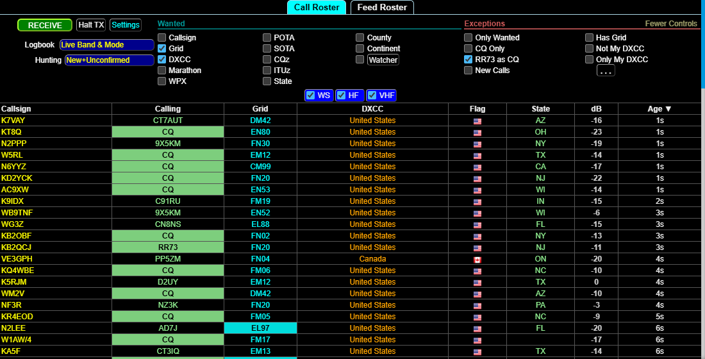
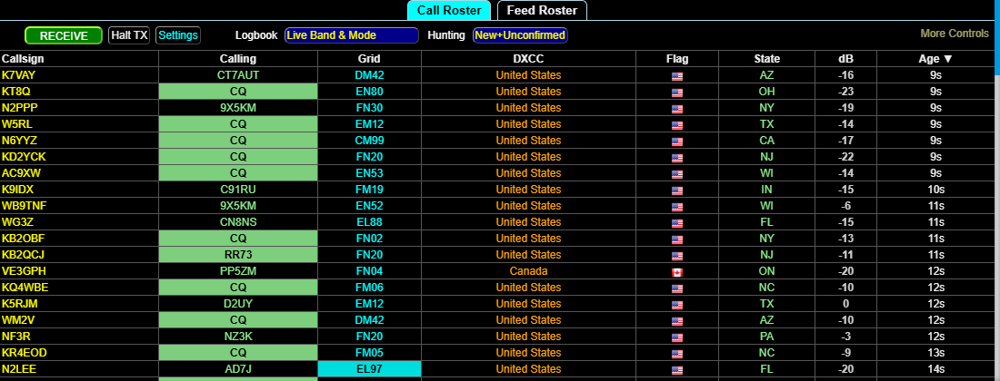
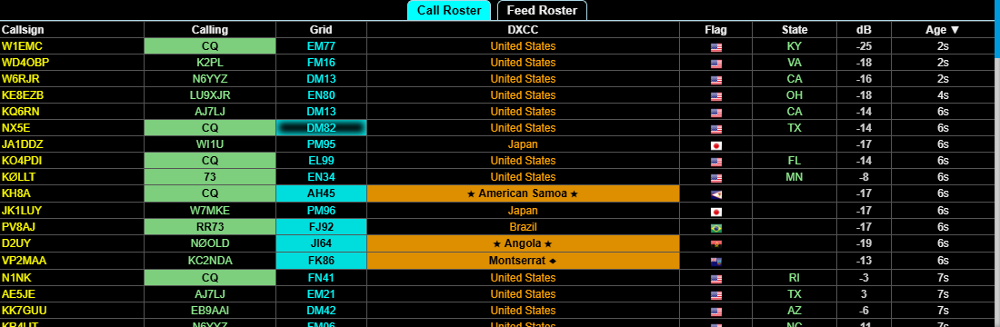
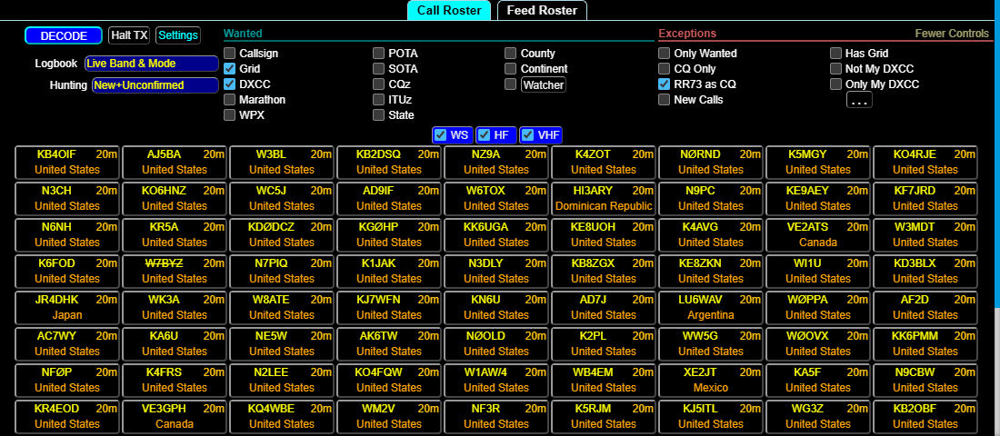
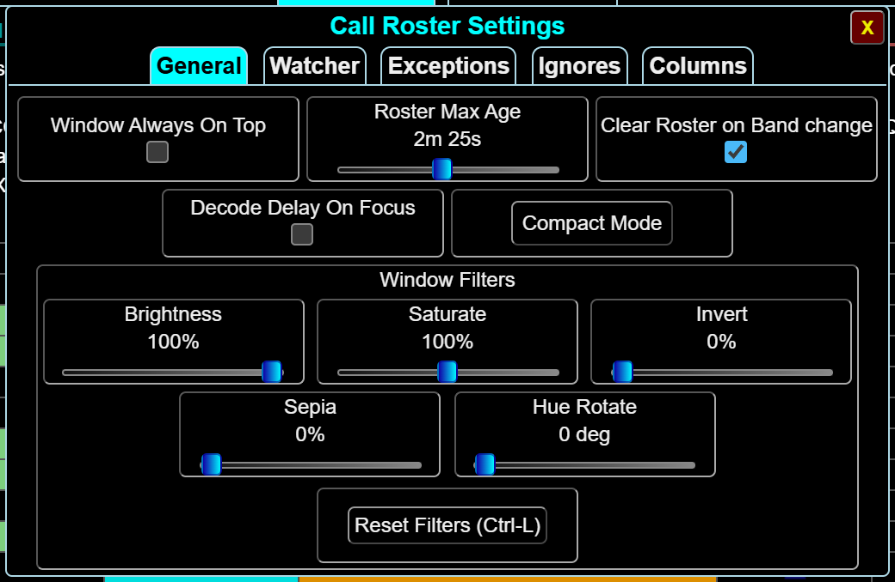
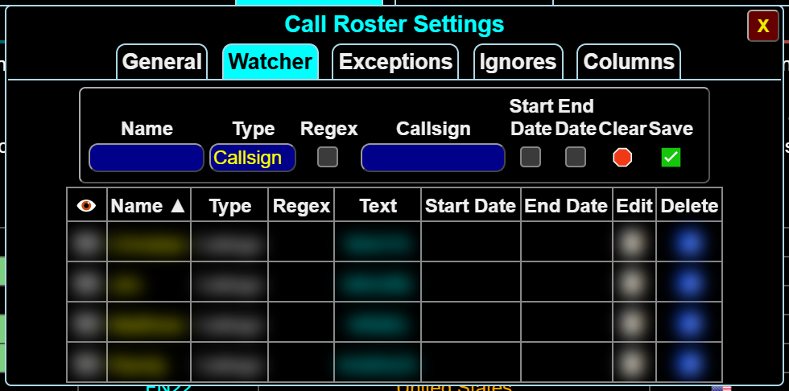
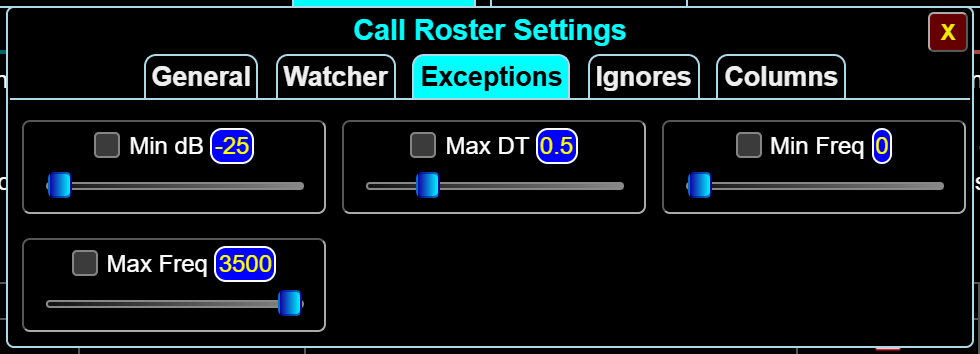
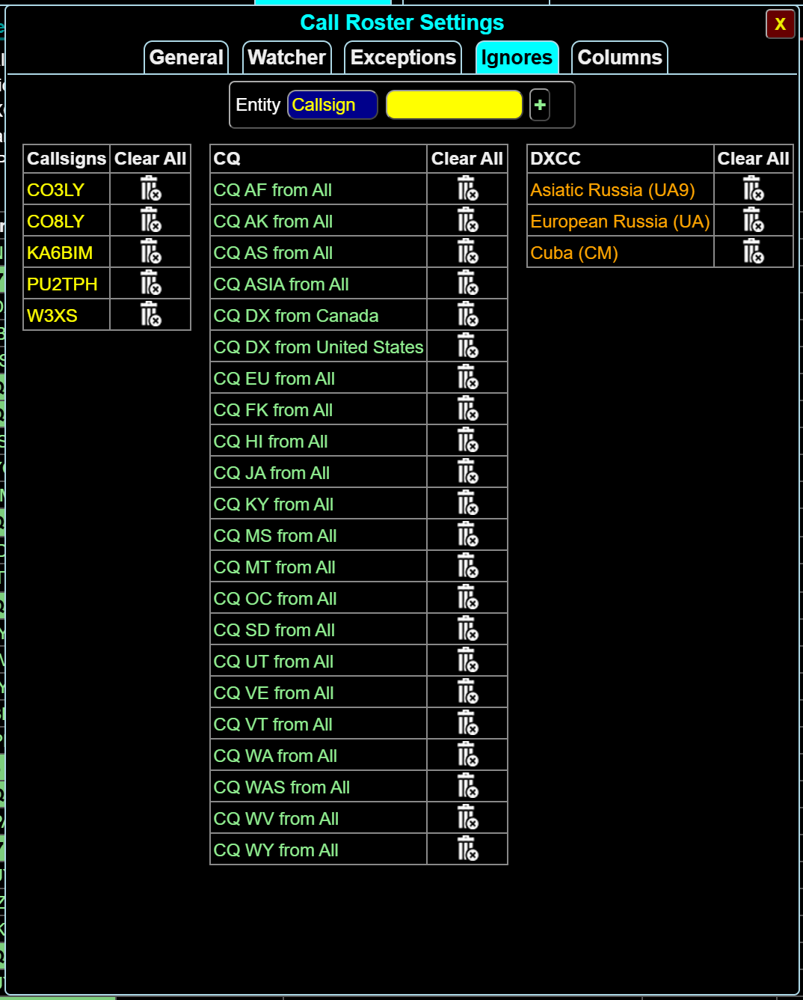
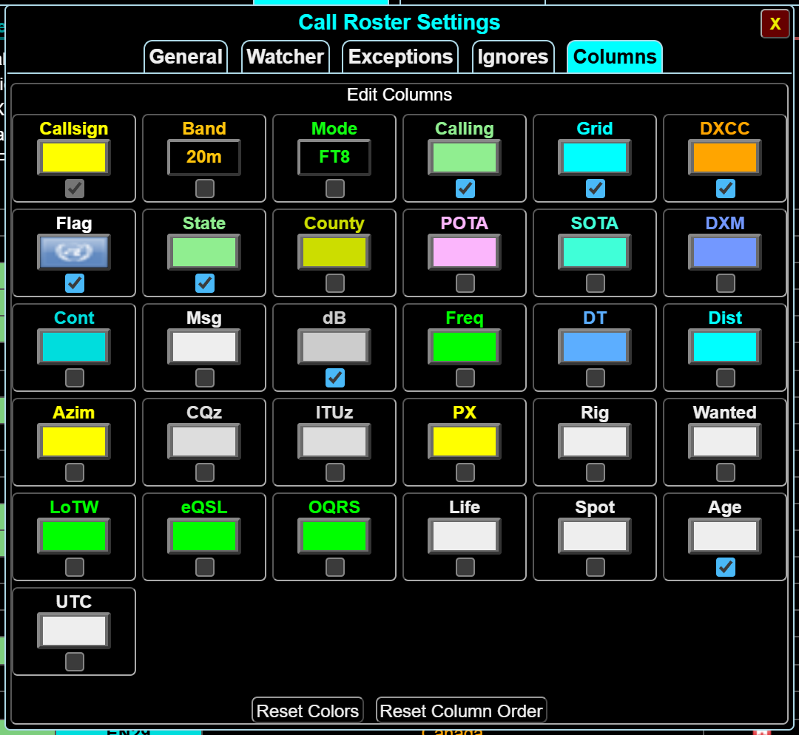

# The Call Roster

The Call Roster lists the stations you are decoding in WSJT-X, JTDX and similar programs, one row per station, and highlights the ones you want: a new grid, a new DXCC entity, a state you need, a park, a friend. Click a callsign to call that station.

Open it with the **Call Roster** button in the side panel, or press **Ctrl+F**.



The roster window holds two rosters. While [DX Feeds](Using-Feed-Roster.md) is turned on, **Call Roster** and **Feed Roster** tabs appear at the top. The Call Roster shows your decodes; the Feed Roster shows DX Cluster and CW Skimmer spots. Each roster has its own settings. This chapter covers the Call Roster, and almost everything in it also applies to the Feed Roster.

The window title counts the stations: how many were heard, how many are in the roster after your filters, and how many are wanted, for example "Call Roster: 147 heard • 107 in roster • 16 wanted". With several WSJT-X or JTDX instances, their names follow.

## Window Layout

From top to bottom:

* **Status, Halt TX and Settings.** The status box shows RECEIVE, DECODE or TRANSMIT, like the main window. **Halt TX** stops transmitting on every WSJT-X and JTDX instance. **Settings** opens the roster's settings.
* **Logbook and Hunting**, which decide what counts as worked and what you are looking for.
* **Wanted** and **Exceptions**, the boxes that pick out the stations you want and narrow the list down.
* **Instances:** with more than one WSJT-X or JTDX running, a tick box for each. Untick one to hide its decodes.
* **The roster table.**

### More Controls, Fewer Controls, Hide Controls

Click **Fewer Controls** in the top right corner to shrink the controls to a single line, and **More Controls** to bring them back.



Right-click an empty part of the roster and choose **Hide Controls** to see only the table; right-click and choose **Show Controls** to bring them back.



### Compact Mode

Compact Mode shows each station as a small tile instead of a table row, which fits many stations into a small window. Turn it on with **Compact Mode** in the roster's Settings → General (the button then reads **Roster Mode**, to go back). **Compact Mode Entity** chooses what each tile shows under the callsign: DXCC, grid, state and so on. Hover over a tile to see its details.



## Who Is Calling Whom

* The **Callsign** column is the station transmitting.
* The **Calling** column is who they are calling: "CQ" (with its target, such as "CQ DX" or "CQ POTA"), or another station's callsign.
* The **Grid** column is the grid the transmitting station sent.
* The **Msg** column, if you show it, is the whole decoded message.

For example, the message `G3VMN NZ6L DM03` is listed with NZ6L in the Callsign column, G3VMN in the Calling column and DM03 in the Grid column. It's easy to look for G3VMN in the Callsign column, but he is the one being called.

When a station calls **you**, its Calling cell shows your callsign in glowing yellow on blue, and the station stays in the roster even if your Exceptions would hide it.

## Highlighting

The roster colors what you want, in each column's color:

* **Highlighted** (colored background, black text): new, not yet worked.
* **Shaded** (a colored glow around the text): worked but not confirmed. This shows while Hunting is New+Unconfirmed or Mixed.
* **Normal text:** worked and confirmed, or not wanted.
* A callsign that is **struck through** has a confirmed QSO with you.

With Hunting set to **Mixed** and a "Mix Band" Logbook, a lighter background means new on this band but confirmed on another, and a lighter glow means worked on another band.

The **Wanted** column, if you show it, says why each station is wanted ("New Grid", "Worked DXCC", "20m State"), or names the Watcher that matched it. It also shows **Calling** (you are calling them), **Caller** (they are calling you) or **Working** (both).

A callsign outlined in **green** is in your WSJT-X or JTDX DX Call; outlined in **red**, you are also transmitting to it.

### Markers

* **DXCC:** ★ on both sides of the name means an All Time New One, an entity you have never worked. After the name, ◆ means you haven't worked it on this band, and ● means you haven't worked it in this mode. Hover over it to see which. These show whatever your Logbook choice.
* **Grid:** ◇ after a grid means the station didn't send it; GridTracker2 found it from a lookup or a SOTA summit, so it is likely but not certain.
* **County:** "+2" after a US county means the station's ZIP code covers 2 more counties. Click the county to do a full lookup.
* **POTA:** a full background means you have never worked that park, a lighter one means you worked it but not today on this band and mode, and a glow only means you already worked it today. "?-????" means the station is calling CQ POTA but its park isn't known yet.
* **SOTA:** two dots before the summit mean you haven't chased a summit in that association yet, one dot that you have chased one there; a dot after it means you haven't chased a summit in that region. The background works like POTA's.
* **LoTW:** ✔ means the station uses Logbook of The World. A yellow "?" means their last upload is older than the Uses LoTW age you set. Hover over it for their last upload date.
* **Callsign:** a small emoji after a callsign marks a GridTracker2 supporter; hover over it for their message.

## Logbook and Hunting

**Logbook** chooses which of your QSOs count as worked:

| Choice | Counts QSOs |
| --- | --- |
| Live Band & Mode | on the station's band and mode |
| Live Band, Mix Modes | on the station's band, any mode |
| Live Band, Digi Modes | on the station's band, any digital mode |
| Mix Band, Live Mode | in the station's mode, any band |
| Mix Band & Modes | any QSO |
| Mix Band & Digi Modes | any digital QSO |
| Award Tracker | see [Award Tracker](#award-tracker) |

**Hunting** chooses what is wanted:

* **New:** never worked.
* **New+Unconfirmed:** never worked, or worked but not confirmed (shaded).
* **Mixed:** like New+Unconfirmed, and with a "Mix Band" Logbook, also marks what is new on the current band.

## Wanted

Tick what you are hunting. Ticking an item also shows its column.

| Wanted | A station is wanted when |
| --- | --- |
| Callsign | you haven't worked that callsign |
| Grid | you haven't worked its grid |
| DXCC | you haven't worked its DXCC entity |
| Marathon | its DXCC entity or CQ zone is new for the DX Marathon this calendar year |
| WPX | you haven't worked its prefix |
| POTA | you haven't worked that activator at that park on this band and mode today (with POTA Hunting on) |
| SOTA | you haven't chased that summit today (with SOTA Chasing on) |
| CQz / ITUz | you haven't worked its CQ or ITU zone |
| State | you haven't worked its state or province |
| County | you haven't worked its US county (needs the US Callsigns database) |
| Continent | you haven't worked its continent |
| Watcher | it matches one of your [Watchers](#watcher) |

A 🔔 after an item means you also have an audio alert for it; click the bell to open Settings → Audio Alerts. An **M** after the heading means **Roster/Alert Band Memory** is on: your Wanted choices are remembered separately for each band and mode (while a single WSJT-X or JTDX is running).

```{note}
Stations calling you are always flagged, so there is no separate Wanted box for them. To be alerted when someone calls you, add a **QRZ** [Custom Alert](Setting-Up-Audio-and-Visual-Alerts.md).
```

## Exceptions

Exceptions hide stations from the roster:

* **Only Wanted:** only wanted stations (and stations calling you).
* **CQ Only:** only stations calling CQ, including directed CQs.
* **RR73 as CQ:** a station sending RR73 or 73 counts as calling CQ, since they are finishing a QSO and will usually call CQ next.
* **New Calls:** hides stations you have already worked (by your Logbook choice). An activator at a park or summit you haven't worked today still shows.
* **Has Grid:** only stations that sent a grid.
* **Not My DXCC** / **Only My DXCC:** only stations outside or inside your own DXCC entity, for example for a DX contest or for Field Day.
* **Spotted Me:** only stations that have spotted you (shown while the Spot column is on).
* **Uses eQSL** / **Uses OQRS:** only stations that use those services (shown while their database is on in Settings → Lookups).

The **. . .** button opens the [Exceptions tab](#exceptions-tab) with more.

```{tip}
The old **No**, **Only** and **Regex** text filters have been replaced: use a [Watcher](#watcher) (with Regex if you like) together with **Only Wanted** to see only certain stations, and [Ignores](#ignores) to hide stations.
```

## Columns

Right-click any column heading to tick which columns to show. **Drag a heading** onto another to move that column; Callsign always stays first. Click a heading to sort by it (▲ ascending, ▼ descending), and click again to reverse. The headings stay at the top while the roster scrolls.

| Column | Shows |
| --- | --- |
| Callsign | the transmitting station; click to call it |
| Band, Mode | its band and mode, in their colors (shown automatically when the roster has more than one) |
| Calling | who it is calling |
| Rig | which WSJT-X or JTDX instance decoded it |
| Wanted | why it is wanted |
| Grid | its grid; click to center the map on it |
| Msg | the whole message |
| POTA, SOTA | its park or summit |
| DXCC | its DXCC entity; click to center the map on it and flash its outline |
| Flag | its entity's flag |
| DXM | what is new for the DX Marathon: DXCC, CQz or both |
| State, County | its US state or Canadian province, and US county |
| Cont | its continent |
| dB, DT, Freq | signal report, time offset and audio frequency |
| Dist, Azim | distance and bearing from you |
| CQz, ITUz, PX | its zones and prefix |
| LoTW, eQSL, OQRS | whether it uses those services |
| Life | how long it has been heard |
| Spot | how long ago, and how well, this station heard you |
| Age | how long ago it was last heard |
| UTC | the time of its last decode (underlined on even cycles) |

Right-click an empty area and tick **Realtime** to have Age, Life and Spot count up every second.

## Calling a Station

Click a callsign to reply to that station: GridTracker2 tells the WSJT-X or JTDX that decoded it to call them, just like double-clicking the decode there.

* WSJT-X replies to stations calling CQ. If nothing happens when you click a station that isn't calling CQ, untick **CQ only** and tick **Hold Tx Freq** in WSJT-X's main window.
* JTDX replies according to its **Misc → Accept UDP Reply Message** setting: CQ only, CQ and 73, or any message. When replying to a station that isn't calling CQ, your transmit audio frequency must differ from theirs.
* JS8Call doesn't support replies.

See [Appendix B](../Appendices/Appendix-B-Configuring-WSJT-X-and-JTDX-for-GridTracker.md) for the WSJT-X and JTDX settings this needs. With several instances, Settings → General → **On QSO Reply** decides whether the others stop transmitting and whether the main window follows the transmitting one.

## Right-Click Menus

Right-click a cell for options:

* **Callsign:** Lookup, Gen Msgs (fill in WSJT-X's messages without calling), Add Watcher, Copy, Aim Rotator (with CatRotator / PstRotator on), Ignore Call, Edit Ignores.
* **Calling:** Lookup, Gen Msgs, Add Watcher, Copy, Aim Rotator.
* **A directed CQ** in the Calling column ("CQ DX", "CQ POTA"...): Add Watcher, **Ignore CQ from DXCC** (that CQ from this entity) and **Ignore CQ from All**.
* **Msg:** Add Watcher for the whole message.
* **Grid:** Add Watcher, Ignore Grid, Edit Ignores.
* **DXCC, CQz, ITUz:** Ignore DXCC, Ignore CQ Zone or Ignore ITU Zone, and Edit Ignores.
* **A column heading:** the list of columns to show.
* **Anywhere else:** Hide Controls / Show Controls, and Realtime.

## Settings

Click **Settings** in the roster (or press **Ctrl+S** there) to open the roster's own settings, titled "Call Roster Settings". Close them with the red **X** or **Esc**. While the Feed Roster tab is shown, the same pane shows the Feed Roster's settings.

### General

{width=520px}

* **Window Always On Top:** keeps the roster window above other windows.
* **Roster Max Age:** how long a station stays in the roster after it was last heard, 5 seconds to 5 minutes (up to 1 hour for the Feed Roster).
* **Clear Roster on Band change:** empties the roster when you change band or mode.
* **Decode Delay On Focus:** while the mouse is over the roster, new decodes wait (⌛ shows) so the row you are about to click doesn't move.
* **Compact Mode** and **Compact Mode Entity:** see [Compact Mode](#compact-mode).
* **Window Filters:** brightness, saturation, invert, sepia and hue of the whole roster window, for example to dim it at night. **Reset Filters** (or **Ctrl+L**) undoes them.

### Watcher

{width=520px}

A Watcher highlights stations that match what you type, and makes them wanted while **Watcher** is ticked in Wanted. Use them for friends, special event stations, nets or a whole group of callsigns.

* **Name:** a name for the Watcher. It is shown in the Wanted column when it matches.
* **Type:** what to match: **Callsign** (the transmitting station), **Calling** (the station being called), **Grid** or **Message** (the whole message).
* **Regex:** match a regular expression instead of exact text. Matching ignores upper and lower case.
* **Start Date** and **End Date** (UTC): the Watcher only works between them. **Auto Delete** removes it after its end date.

Click the ✅ to save it. In the list, 👀 turns a Watcher on or off, 📝 edits it and 🚮 deletes it. The matching text is highlighted in white in the roster.

Right-click a callsign, grid or message and choose **Add Watcher** to make one quickly.

```{tip}
Some useful regular expressions:
* `^[KNW][0-9][A-WYZ]$` matches US 1x1 special event callsigns.
* `^(W|K|N|A[A-L])[0-9]` matches US callsigns.
* `POTA|SOTA` as a Message Watcher matches stations calling CQ POTA or CQ SOTA.

[regex101.com](https://regex101.com/?flavor=javascript) is a good place to try them out.
```

### Exceptions Tab

{width=520px}

More Exceptions, each with a slider (use the arrow keys for small steps):

* **Min dB:** only stations at least this strong.
* **Max DT:** only stations within this time offset.
* **Min Freq** / **Max Freq:** only stations within this audio frequency range, for example to stay away from the edges of your receive filter.
* **Uses LoTW:** only stations that use LoTW and have uploaded within the chosen number of months (∞ for any time).

### Ignores

{width=520px}

Ignored stations are never shown in the roster. Choose the **Entity** to ignore (Callsign, CQ, DXCC, Grid, CQ Zone or ITU Zone), fill it in and click **+**. A **CQ** ignore hides one kind of directed CQ, such as "CQ POTA", from one DXCC entity or from all.

Each list has a trash can to remove one entry and **Clear All** to empty it. You can also add ignores from the right-click menus, which have **Edit Ignores** to open this tab. A station you are working is still shown, even if it is ignored.

### Columns

{width=520px}

Every column of the roster, in its current order:

* the color picker under each changes that column's color (the highlight color for wanted entries);
* the tick box shows or hides it;
* drag one onto another to move it.

**Reset Colors** returns this roster's colors to their defaults, and **Reset Column Order** its columns and order. The Band and Mode colors come from the main window: click Band to open Settings → Colors.

## Award Tracker

Choose **Award Tracker** as the Logbook to show only stations that would advance an award you are working toward. Click **Add Awards**, pick a **Sponsor** (ARRL, CQ Magazine, the European ROS Club, the FT8 Digital Mode Club, GridTracker, QRZ.com or Radio Amateurs of Canada), then the award. The list shows each award with an icon for your progress: a trophy when you have every endorsement, a medal when you have reached the award, a tally while you are working on it. Untick **Track** to pause an award, or remove it with its trash can. Hover over a callsign in the roster to see which award it would help.

## Audio Alerts

Audio alerts for wanted stations are set in [Settings → Audio Alerts](../GridTracker-Overview/Settings-Sub-Menus.md#audio-alerts-tab). The alert ticks there are separate from the roster's Wanted ticks, so you can highlight more than you are alerted for. The Logbook, Hunting and Exceptions are shared: change them in either place.

## Push Notifications

With [Pushover or Simplepush](../Third-Party-Integrations/PushNotifications-Integrations.md) set up in Settings → Features, new wanted stations are sent to your phone.

## Running a Script on Alerts

GridTracker2 can run a script of your own whenever new wanted stations appear, for example to send them somewhere else or to filter them further.

1. Put a script named `cr-alert.bat` (Windows) or `cr-alert.sh` (macOS and Linux) in the **Call Roster Scripts** folder in GridTracker2's data folder (see [Files and Folders](../GridTracker-File-Storage.md)). On macOS and Linux make it executable (`chmod 755 cr-alert.sh`) and start it with a shebang line such as `#!/usr/bin/python3`.
2. The next time there is a new wanted station, a **Script Disabled** button appears in the roster controls. Click it so it reads **Script Enabled**. **Shift+–** in the main window also toggles it.

Each time new wanted stations appear, GridTracker2 writes `cr-alert.json` next to the script, with every station in the roster keyed by callsign, then runs the script in that folder. Each station's entry includes, among others, `shouldRosterAlert` (it is wanted), `rosterAlerted` (false the first time it alerts), `dxccName`, `grid`, `band`, `mode`, `state`, `RSTsent`, `distance` and `hunting` (why it is wanted).

This example sends new wanted stations to Pushover:

```python
#!/usr/bin/python3
import json
import urllib.parse
import urllib.request

with open("cr-alert.json") as f:
    data = json.load(f)

lines = []
for call, s in data.items():
    if s.get("shouldRosterAlert") and not s.get("rosterAlerted"):
        lines.append(", ".join(str(x) for x in [call, s.get("dxccName"), s.get("RSTsent"), s.get("grid"), s.get("band"), s.get("state")] if x))

if lines:
    body = urllib.parse.urlencode({"user": "YOUR_USER_KEY", "token": "YOUR_API_TOKEN", "title": "GridTracker2", "message": "\n".join(lines)}).encode()
    urllib.request.urlopen("https://api.pushover.net/1/messages.json", body)
```

For the Feed Roster, the script only runs with **Allow Alert Script** ticked in Settings → Feeds.

## Hotkeys in the Roster Window

| Key | Action |
| --- | --- |
| Ctrl+S | Open the roster's Settings |
| Ctrl+W or Ctrl+O | Open the Watcher tab |
| Ctrl+E | Open the Exceptions tab |
| Ctrl+I | Open the Ignores tab |
| Ctrl+L | Reset the Window Filters |
| Esc | Close the Settings |
