# The Call Roster

GridTracker's Call Roster feature displays information on the _current traffic you are receiving in WSJT-X (or JTDX  ???)_ in a table.  It will reflect the traffic in the specific digital mode and on the specific band that WSJT-X is using. Therefore - unlike the Grid Map and the Statistics pages - it _functions independently_ of the settings you select for Map View Filters on the GridTracker Control Panel.

You can use Call Roster to filter out the chatter on a band and show you only the traffic you are interested in seeing:  DXCC traffic, traffic from a specific grid, traffic from a specific ITU zone, traffic that uses a specific logging site, etc., etc.

But here's the big thing:  As long as you have configured GridTracker to "talk" to WSJT-X properly **you can use Call Roster to _respond_ to CQs**[^1].  And since you have the power to see only the traffic you want to see Call Roster makes it faster and easier for you to make the contacts you want.  

## The Call Roster Page Layout

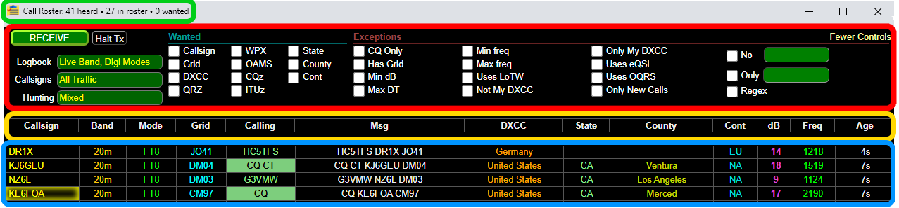

* **Green Box**:  The title bar of the Call Roster page tells you how many signals have been heard by WSJT-X during the last 2 minutes or so, how many of them are listed in your roster, and how many of them are stations you "want".  **_"Wanted"_** means they are stations that have qualities you have specifically identified in the [**Wanted**](#wanted-stations) section of the Call Roster Controls.  
* **Red Box:**  Call Roster controls.  This is the place where you can make choices to limit the Call Roster table to only the traffic that interests you.  (_Discussed at length below.)_  It's appearance will change depending on the options you select in the **Logbook, Callsigns, and Hunting** menus at the left side.  
* **Gold Box**:  Column headings for traffic data.  You get to select which columns -- how much or how little data-- appear in the table.  _(Discussed below.)_
* **Blue Box**:  Data from real-time traffic.

| Before proceeding we need to take a brief detour to explain text highlighting conventions used in both Call Roster and Statistics.

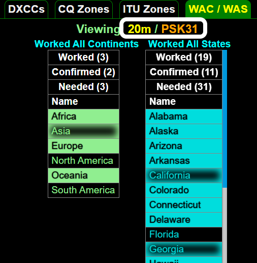

* We'll call text "shaded" if  it has a fuzzy border around the text.  Asia, California and Georgia are shaded in the illustration.
* We'll call text "highlighted" then the text is black with a colored background. Africa, Europe, Oceania, Alabama, Alaska, etc. are highlighted in the illustration.
* We'll call text that appears against a black background "normal" formatting.  North America, South America and Florida appears in normal text here.

## Who is Calling Who?

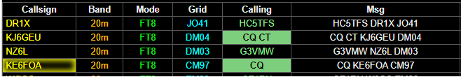

This is an enlargement of a section of the first screenshot in this section.  

* The **Callsign** is the station which is transmitting traffic.  
* The **Grid** is the grid reported by the **callsign**.  
* The **Calling** column tells you who the **callsign** is trying to contact.
* The **Msg** column (if you choose to include it in the table) shows the transmitted traffic as it would appear in WSJT-X or JTDX.

1st Row:  DR1X, in grid JO41, is calling HC5TFS (probably responding to a CQ).\
2nd Row:  KG6GEU, in grid DM04, is transmitting a CQ requesting responses from only stations in CT.\
3rd Row:  NZ6L, in grid DM03, is calling G3VMW\
4th Row:  KE6FOA, in grid CM97, is sending out a general CQ

**Why does the callsign KE6FOA have shading around it?**  

Because the user who provided the screenshot has worked that station at some time in the past possibly on different band or mode.

**The other callsigns are in "normal" text, what does that mean?** 

It means this is a new callsign for the user.

**CQ is highlighted, what does that mean?** 

It's just a programming choice intended to help make the fact the station is calling CQ more readily visible.  

&#10148; **_Practice Tip:_**  If you're trying to compare live traffic in the "Band Activity" window of WSJT-X to the same traffic in **Call Roster** and things just don't seem to "match" it's very likely because of messaging conventions used for transmissions.  Consider an example from the screenshot above: 

The transmitted message is:  **G3VMN NZ6L DM03.**  It's an easy mistake to look for **G3VMN** in the **Callsign** column but he's not sending the transmission.  He's being called by **NZ6L**.  **NZ6L** will be listed in the **Callsign** column while **G3VMN** will be listed in the **Calling** column.

### Call Roster:  Data Display Options

**Columns in Call Roster Data Table**

GridTracker gives you the option of displaying all the information available from  transmissions in the Roster mode.   Riight click almost anywhere in the Call Roster window **\*** and click on a data type to select the options that suit you.  The options you select will be columns in the Roster mode.  

**\*** The exceptions are the **Callsign**, **Calling** and **DXCC** columns.  If you right click an entry in any of these three columns you'll get the option to hide or "ignore" that entry. _See_ [_Ignore Options._](#call-roster-ignore-options)

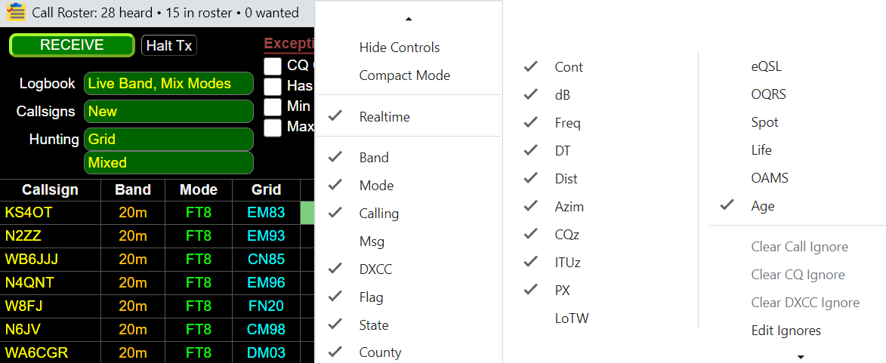

The screenshot above shows you all the types of data that can be included in the Call Roster data table.  Most are self-explanatory but to confirm what a few of them mean:

* **MSG** means the actual message transmitted in WSJT-X.
* **LoTW, eQSL, OQRS** mean that the station sending the TX (i.e., the "Callsign" station) uses one of these services.
* **Spot** shows that the station spotted your signal either on PSK Reporter or OAMS, the age of the spot and signal strenth (+/-dB) are shown in this column.

Clicking on column headings in the will sort the table by that column.

&#10148; **_Practice Tip:_**  you  may be useful to sort by the **Age** column - it makes it easier to correlate what you're seeing in Call Roster to what you're seeing in WSJT-X

**Note:**  You can select which columns appear in the **Roster** view but **_you cannot yet rearrange the columns._**  _{Rearranging columns is in the works.}_

### Call Roster:  "Ignore" Options

**Right Click any CALLSIGN Station** 

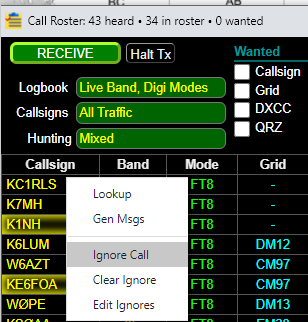

If you right click on a callsign in the **Callsign** column you'll get a pop-up menu that gives you options to:

* Use the GridTracker Lookup function to get more data about the station
* Generate messages for this callsign in WSJT-X but don't start calling them.
* "Ignore" the station.  The callsign is put on the "Ignore" list and any transmissions from that station are hidden in Call Roster until you unblock the Ignore. **Note:**  the ignore applies only to callsigns in the **Callsign** column --  the stations sending a transmission -- not to the callsigns in the **Calling** column -- the stations being called.  
* Clear the specific ignore -- how do you do this if you can't see the row?
* Edit your "Ignore" list.

**Right Click any CALLING Station**

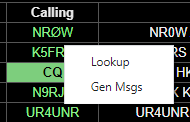

If you right click on a callsign in the **Calling** column you'll get a pop-up menu that allows you to:

* Use the GridTracker Lookup function to get more data about the station
* Generate messages for this callsign in WSJT-X but don't start calling them.
* **Note:  you can't set up an "Ignore" for stations that appear in the Calling column.**

**Right Click any DXCC Country**


If you right click on a country name listed in the **DXCC** column you'll get a pop-up menu that lets you

* Set up an "ignore" for that country which will hide any transmissions from that country in the Call Roster table until you unblock the Ignore.
* Edit your "Ignore" list. 

**Editing Your Ignore List**

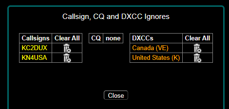

If you choose to **Edit Ignores** you'll get a pop-up window with your **Ignores** list.  (_See illustration that follows.)_   Simply click on the trashcan icon next to an "ignore" to delete from the list.

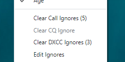

If you build up multiple "Ignores" when you right click anywhere in the Call Roster window  you'll see how many of each type you have and have the option to erase all of them at one time instead of clearing them one by one.  

How do you set up a CQ ignore???

### Call Roster Controls

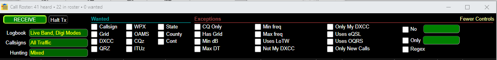

The screenshot above shows the full, "standard" menu but it will change depending on the choices you make in the three menus on the left side.  

### Call Roster:  Logbook Options

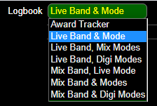

Click on the button next to "Logbook" for the drop down menu for choices of a mix of band and transmission modes. 

“**Live Band & Mode**”  is identical in operation as “Auto”/“Auto” for band and mode in “Map View Filters”.

**_Note:_**  _Choosing the "Award Tracker" option changes the **Callsigns** and **Hunting** menus.  They disappear and are replaced with an ADD button that allows you to add specific awards so you can see your progress.  (Don't worry, you can easily delete any award you add and start over!)_

### Call Roster: Callsigns Options

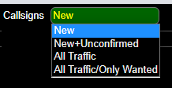

The **Callsigns** button gives you choices of: 

* New
* New + Unconfirmed
* All Traffic
* All Traffic / Only Wanted \[traffic\]

**_The Call Roster Controls will change depending on what you select:_**

**New OR  New + Unconfirmed**

* The **New** or **Unconfirmed** criteria here applies only to the **Callsign** station:  the station sending the TX not the **Calling** station that is receiving it.  
* The "Wanted" section of the Call Roster controls disappears, leaving only the "Exceptions" section.
* The **Hunting** menu changes from the inital illustration above to a split menu: one used to narrow down what aspect of new callsigns you're looking for (a specific DCXX, a specific US State, a specific callsign prefix, etc.) or one that limits your wants to _new_ stations only, _new plus unconfirmed,_ or _mixed._

**All Traffic OR All Traffic / Only Wanted:** 

* All callsigns; regardless of worked or confirmed status will appear in the roster.
* Both the "Wanted" and "Exceptions" sections of the Call Roster Controls are present.
* The "**Hunting"** menu choices are Mixed, New + Unconfirmed, and Mixed.

## Call Roster:  Hunting Options

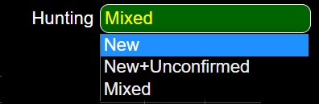

Click on the button next to "Hunting" for the drop down menu with choices of "New" callsigns,  "New + Unconfirmed" callsigns, or "Mixed" callsigns.  

## Setting Wanted and Exceptions Options

The **Logbook, Callsigns,** and **Hunting** options give you some broad tools to limit the traffic shown in Call Roster.  But the real meat of the Call Roster tool are the options **Wanted** and **Exceptions** tools that allow you to whittle down current, active traffic to see only the specific traffic that interests you.  

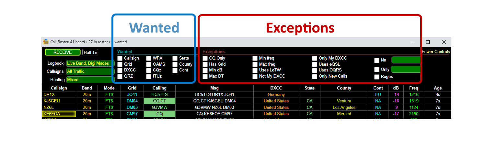

### Wanted Stations

Identifying stations that you **"want"** is pretty straight forward.  Simply click the box next to one or more of the attributes that interest you.  

**Note:  "Wanted"** criteria apply to **_the Callsign station ONLY_** (the station sending a Tx.) 

The following screenshot illustrates what you'll see if you check Callsign, Grid, DXCC WPX, CQz, ITUz, State, County, and Cont (continent). Clicking on one or more of the **wanted** attributes changes the way text is highlighted in the Call Roster table.  Callsigns, grids, counties, etc. that you have not previously contacted will be highlighted so they're more readily visible.

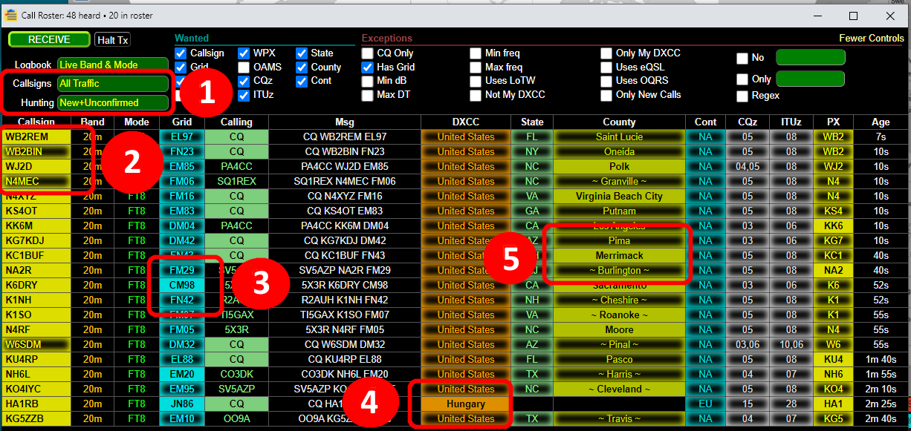

Things to note:

1. **Callsign** is set to "All Traffic" and **Hunting** is set to "New + Unconfirmed"
2. Some callsigns in the **Callsign** column are shaded and some are highlighted.  The shaded stations (WB2BIN and N4MEC)  are stations the user has contacted some time in the past but the contact hasn't been confirmed.  The highlighted stations (WB2REM and WJ2D) are "new" stations for the user.
3. The user has prior contacts with most of the grids in the past - they're shaded - but hasn't had a QSO with anyone in grid CM98 yet.
4. "Hungary" is lighlighted in the list of countries because that would be a new DXCC for this user.
5. Box #5 illustrates the possible conditions for counties.  "Pima" is shaded because the user has a prior contact with a station from that county.  "Merrimack" is highlighted because the user has never previously contacted anyone there.  "<span dir="">\~</span>Burlington<span dir="">\~</span>" is shaded and there are tildas (<span dir="">\~</span>) on each side which means that: 
   1. The user has a prior contact from Burlington Co.
   2. The zip code this station is located in falls in more then one county, clicking the county here will triger a lookup and if the lookup source knows the county, the correct county will be shown.

Here's essentially the same Call Roster listing but with the  "**CQ Only"** exception checked:  

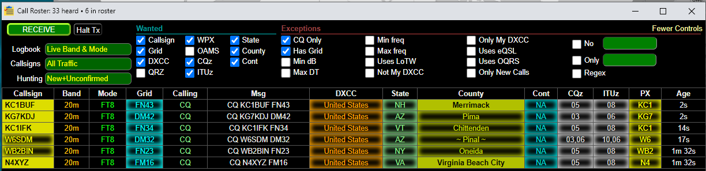

**Wanted "QRZ" (Response)**

The **QRZ** check box under **Wanted** has a neat function.  You can check this box along with the Call Roster alert function to get an audible alert whenever your callsign is included in a message.  Here are the steps (order doesn't matter):

1. Check the box for **QRZ** under the "**Wanted"** section of the Call Roster controls.
2. Go to **Settings > Call Roster** and click the button to enable "Audio Alert on New Wanted"
   1. Choose either a text-to-speech alert or a media sound effect

That's it.  Be aware that if you have _any_ "wanted" criteria checked, and if any traffic arrives that meets that criteria you will get an audio alert.  If you want an alert for your QRZ only then leave the other Wanted boxes unchecked.  

An alternative to this feature is setting up a "regular" audio alert for your callsign, _see_ [_Audio Alerts_](Setting-Up-Audio-and-Visual-Alerts.md) _section later in this guide._

## Setting up Exceptions

There are a couple of critical features you need to know when setting up **Exceptions**.

1. You can set up **Exceptions** _with or without_ checking any boxes for **Wants** to streamline your Call Roster Table.  
2. You must use **CAPITAL LETTERS** when setting up **No** and **Only** filtering criteria.  Both filters are **_case sensitive!_**  _(Unlike filtering in the Statistics function which is not.)_
3. Exceptions filters run searches on the text characters in the actual message text from actual decode message (what you'd see in the **Msg** column if shown).  
4. You cannot run exception filters for the text in the DXCC, State, County, Continent, CQz or ITUz columns.  To be explicit:  you cannot set up an "**Only**" exception condition to show only contacts specifically from Nebraska, or Bexar Co. or "EU" or Iceland or CQ zone 22, or ITU zone 38.  

### Types of Exceptions

* **CQ Only:**  Clicking this box means you will see only stations that are transmitting a CQ.  (You'll see transmissions with both regular and directional CQs.)
* **Has Grid:**  You'll see only the Callsign (transmitting) stations that have included their grid square in their current or a recent TX message.
* **Min dB  / Max DT:**  Allows you to set limits for minimum signal strength and maximum time difference with slider controls.  (Remember:  you can use your keyboard ◄ ► arrows to fine tune the slider number.)
* **Min / Max freq:**  Allows you to set frequency limits with slider controls. This is useful if you want to ignore stations near the edges of your radio's bandpass filter. 
* **Not my DXCC / Only my DXCC:**  Only shows stations either not in your DXCC entity or only in your DXCC entity. This is useful for contests where you either only work DX (CQ WW DX) or only work stations in your own country (Field Day).
* **Uses LoTW / Uses eQSO / Uses OQRS:**  Only show stations that use the specified logging service.
* **The No, Only, and Regex Limiters.**  Complete the box next to one of these limiters with at least one character to filter data and see only what you want to see. 

The **No**, **Only**, and **Regex** Limiters

* **The No Limiter:**  The No limiter applies a filter to the Call Roster data to _hide_ any rows where the Callsign, Grid, and/or Calling data contains the text characters/numbers you specify.
* **The ONLY Limiter:**  The Only limiter applies a filter to the Call Roster data to hide any rows unless the Callsign, Grid, and/or Calling data contains the text characters/numbers you specify.
* **The Regex Limiter:**  Functions in a similar way that the No and ONLY limiter does depending on how the regex entered is built.

&#10148; **_Practice Tip:_** Regex is a structured way to build filters on text, commonly used by programs to find or hide specific text combinations. Clicking on the "Regex" text in the call roster will take you to [Regex101.com](https://regex101.com/?flavor=javascript) where you can practice with regex and see how it'd filter various messages you can specify.

_There are so many different combinations of settings available to filter and organize data in Call Roster that it's impossible to cover all of them in this manual.  Instead we'll focus on some examples that many users may want to try. The development team sometimes emails out in the Groups.IO group the regex strings for filtering the call roster for popular special event stations such as "13 Colonies" or "Route 66" on the air._

**_Using Exceptions to filter Callsigns_** 

A.  If you choose the option to view **All Traffic** in **"Callsigns":** 

**Using the No Limiter**

If you enter a number (0 - 9) or a letter (A - Z) or a letter sequence\*\* ("WA", or "KG" or "GCE") in **No** then if either the Callsign or Calling station contains that/those character(s) the row will be hidden in the Call Roster table.   

* No "**K**"**:**  hides rows where either callsign contains a K (and, interestingly, the row where someone was calling "CQ KY")
* No "**F**":  hides rows where either callsign contains F, but still shows rows where grid square is is **F**✱✱✱
* No "**7**":  hides rows where either callsign contains 7
* No "**28**"  hides rows where the grid square is ✱✱28
* No "**FN**":  does NOT exclude all grids with  FN ✱✱ pattern.
* No "**FN20**":  does hide row(s) with grid square FN20

**Using the Only Limiter**

If you enter a number (0 - 9) or a letter (A - Z) or a letter sequence\*\* "(WA", or "KG" or "GCE") in **Only** then if either the Callsign or Calling station contains that/those character(s) the row will appear in the Call Roster table. If neither the Callsign nor Calling station contain those characters the row will be hidden.  

**\*\*Note:**  In either case, **No** or **Only,** the Gridtracker software will search for the exact text string.  "WA" is not the same as "AW" or" WUA"

B.  If you choose to view **All Traffic / Only Wanted** in **'Callsigns"**

C.  If you choose to view **New** or **New + Unconfirmed** in **"Callsigns"** and Set **Hunting** to **Callsign**

**_Using Exceptions to filter Grids_**

Call Roster is limited in its ability to filter traffic for grids you want.  The "No" and "Only" limiters are - well - limited.  The best options for filtering grids are:

1. Filter traffic for one specific grid, OR
2. Filter traffic for all new grids 

**Filtering for a Specific Grid:**

1. Set **Callsigns** to **New** or **New + Unconfirmed**
2. Set primary **Hunting** target to **Grid**
3. Set dropdown menu **Hunting** to either **Mixed**
4. Set the **Only** limiter to "FK68" or "DN95" or whatever your target might be.  

IF a station from FK68, starts transmitting then it will show up in your Call Roster table but until it does the table will be empty and when it does it will be the only row in the table.

Consider instead setting up an [Audio Alert](Setting-Up-Audio-and-Visual-Alerts.md) for the specific grid.  That way you'll continue to see other, new traffic but you'll get "beeped" when that special grid shows up.

**Filtering traffic for all new Grids:**

1. Set **Callsigns** to **New** or **New + Unconfirmed**
2. Set primary **Hunting** target to **Grid**
3. Set dropdown menu **Hunting** to either **New or New + Unconfirmed**.

**_Using Exceptions to filter Countries_**

A. If you choose to set **Callsigns** to either **_All Traffic_** or **_All Traffic/Only Wanted_** then you have two and only two choices for filtering countries: in the **Exceptions** menu pick either **Not my DXCC** or **Only my DXCC**.

B.  If you chose to set **Callsigns** to either **New** or **New + Unconfirmed** 

1. Set the primary **Hunting** target to  **DXCC** and the dropdown **Hunting** menu to **New**.  The only rows that will appear in the Call Roster table are those where the **Callsign** station is from a new country.
2. Set the primary **Hunting** target to **DXCC (Single)** and the dropdown **Hunting** menu for Select DXCC to the country that interests you.  
3. DXCC's can also be ignored by right clicking in the DXCC column and setting an **Ignore DXCC** filter

If you are desperately trying to chase down a contact with someone in Iceland this may be a really effective option. You won't see any other traffic in the Call Roster table until Iceland shows up but you can set an [audio alert ](../GridTracker-Overview/Settings-Sub-Menus.md#call-roster-tab)in **Settings > Call Roster** to let you know when it does

3. Set the primary **Hunting** target to **DXCC**, set the dropdown **Hunting** menu to **Mixed**, and check the exceptions box for **Not my DXCC.** 
4. Set the primary **Hunting** target to **DXCC** and the dripdown **Hunting** menu to **New.**  

## Call Roster Modes 

Call Roster has two operating modes:  **Roster** and **Compact** which refer to how the Call Roster controls are displayed.  You also have the option to hide controls entirely.  Up to this point the screenshot illustrations have shown the **Roster** mode:  a table with detailed data on current transmissions.  But if you right click somewhere in the call roster window you'll get a pop-up menu that lets you hide controls and use the **Compact** mode instead.  

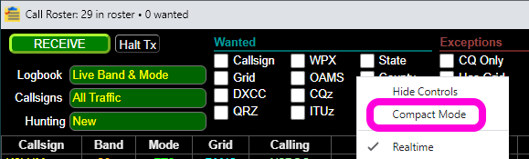

**More Controls - sample image**

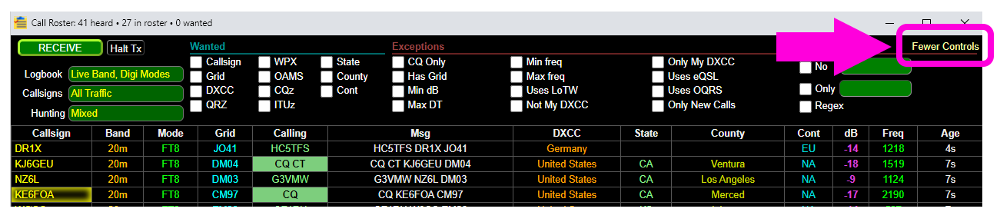

**Fewer Controls - sample image**

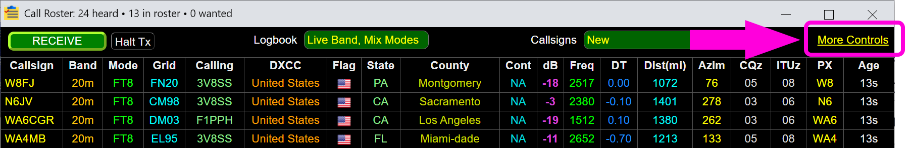

If you want to return to seeing all controls, click on **More Controls** at the top right corner of window.

**Hide Controls - sample image**

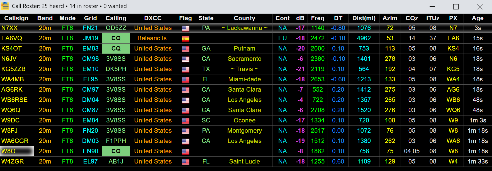

Right click anywhere in the of the Call Roster and select **Hide Controls** to hide all the controls. The only way to re-show them is to right click and select **Show Controls**.

**_Compact Mode_**

**More Controls - sample image**

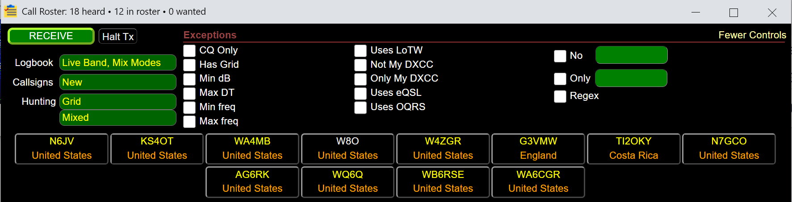

As with the **Roster** mode, you can flip back and forth between more controls and fewer controls using the button in the top, right corner of the window.  

**Fewer Controls  - sample image**

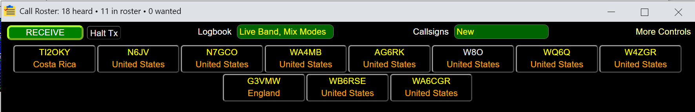

**Hide Controls - sample image**

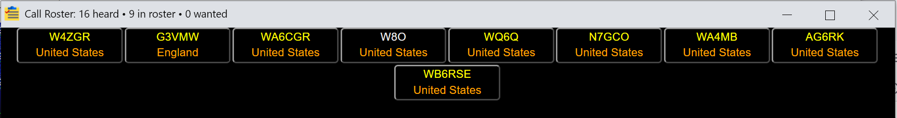

## Using Call Roster to Respond to a CQ

Here's an example of a typical QSO from the WSJT-X screen from the viewpoint of N6OPE who is watching for CQs: 

1. N1API sends out a basic CQ
2. N6OPE responds
3. After two tries N1API and N6OPE have exchanged data and end the QSO with 73s.

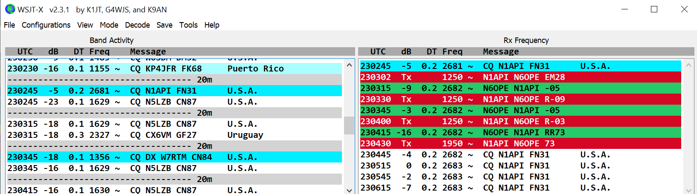

Here's the same exchange seen in Call Roster:

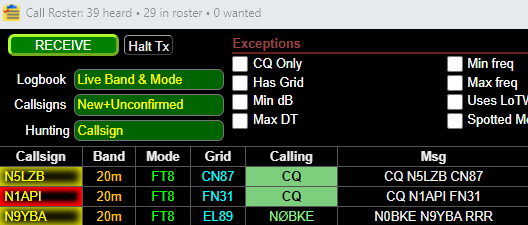

N1API sends out a CQ.  

The user (N6OPE in this example) can simply click on his callsign to initiate a response.

N1API's callsign is outlined in red to show that a reply has happened.

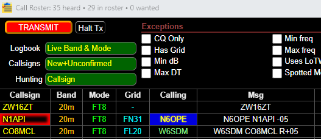

This is what N1API's response looks like in Call Roster.  He's sent a reply message to N6OPE.  N6OPE's callsign appears in a unique color in the Calling column.  N6OPE's rig is sending a reply back to N1API - that's why there's a bright, red **TRANSMIT** status at the top, left corner of the window.

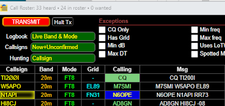

At this point the QSO exchange is ending.  N1API has send a 73 message to N6OPE and his callsign no longer has a special color border.  N6OPE is transmitting her 73 to end the exchange, that's why there's a TRANSMIT in the top, left corner.  

## Using Call Roster to execute any script for a hit (e.g. send Push notifications to your phone)

It is possible to use the Call Roster alerts to execute arbitrary actions on your computer. If `\~/Documents/GridTracker/scripts/cr-alert.sh` or `Documents\\GridTracker\\scripts\\cr-alert.bat` exits, there will be a new button in the Call Roster called "Script Enabled":

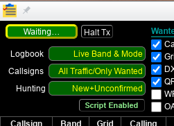

If the button is green, the script will be executed whenever there is a git in the CR. GridTracker will put a file called cr-alert.json in the same directory that contains the Call Roster contents in a parsable form. As long as the script is executable in linux (mode e.g. by doing `chmod 755 cr-alert.sh`) it doesn't matter if the script is really a bash script. Put a valid shebang into the first line and GT will execute it. That script can be used to execute any action you like. Here is an example to use the third party service "Pushover" that can send push notifications to your iPhone or Android device. Here is an example of how to use the script to send push notifications and do some filtering:

```python
#!/usr/bin/python3

import pycurl
from io import BytesIO
from urllib.parse import urlencode
import json

def readJson():
    message = ''
    with open('cr-alert.json') as json_file:
        data = json.load(json_file)
        for callsign in data:
            #print(data[callsign])
            if data[callsign]['shouldAlert']  == True and data[callsign]['alerted'] == False:
                # remove this if you want to work people in FN42 :)
                if data[callsign]['grid'] and data[callsign]['grid'] != 'FN42':
                    if data[callsign]['state']:
                        message = message + callsign + ', '+ data[callsign]['dxccName'] + ', ' + str(data[callsign]['RSTsent']) + ', ' + data[callsign]['grid']  + ', ' + data[callsign]['band'] + ', ' + data[callsign]['state'] + '\n'
                    else :
                        message = message + callsign + ', '+ data[callsign]['dxccName'] + ', ' + str(data[callsign]['RSTsent']) + ', ' + data[callsign]['grid']  + ', ' + data[callsign]['band'] + '\n'
                elif not data[callsign]['grid']:
                    if data[callsign]['state']:
                        message = message + callsign + ', '+ data[callsign]['dxccName'] + ', ' + str(data[callsign]['RSTsent'])  + ', ' + data[callsign]['band'] + ', ' + data[callsign]['state'] + '\n'
                    else:
                        message = message + callsign + ', '+ data[callsign]['dxccName'] + ', ' + str(data[callsign]['RSTsent'])  + ', ' + data[callsign]['band'] + '\n'
    return message
        
def pushnotify(message):
    buffer = BytesIO()
    c = pycurl.Curl()
    c.setopt(c.URL, 'https://api.pushover.net/1/messages.json')
    c.setopt(c.WRITEDATA, buffer)
    post_data = {'user': 'PUT_YOUR_USERNAME_HERE', 'token': 'PUT_YOUR_TOKEN_HERE', 'title': 'WSJT-X', 'message': message}
    postfields = urlencode(post_data)
    c.setopt(c.POSTFIELDS, postfields)
    c.perform()
    c.close()
    body = buffer.getvalue()
    print(body.decode('utf-8'))    

def main():
#    print(readJson())
    pushnotify(readJson())
    
if __name__ == "__main__":
    main()
```

---

[^1]: GridTracker Call Roster can only respond to CQ Messages in WSJT-X. However in JTDX and possibly other programs, you can reply to other message types. In JTDX, if the _MISC -> Accept UDP Reply Message_ menu is set to _CQ_ then only CQ messages can be replied to, likewise if set to _CQ and 73_ then CQ and 73 messages can be replied to. If _any messsages_ is selected then GridTracker can reply any message. Once caveat is that the transmit audio frequency must be different then the frequency the sending station is on unless they are calling CQ