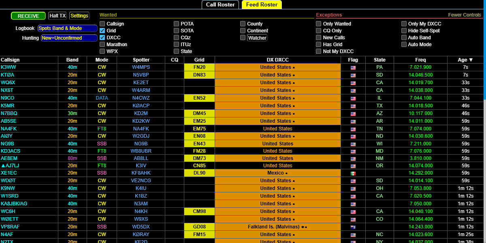
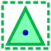
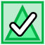
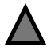

# The Feed Roster and DX Feeds

**DX Feeds** brings DX Cluster and CW Skimmer spots into GridTracker2, for every band and mode: CW, phone and digital. The spots are shown in their own roster, the **Feed Roster**, and on the map. You can hunt them with the same Wanted, Exceptions and Watchers as the Call Roster, and click a spot to work it with your radio.

## Turning It On

In [Settings → Features](../GridTracker-Overview/Settings-Sub-Menus.md#features-tab), under **Off-Air Services**, tick **DX Feeds**. This adds:

* the **Call Roster | Feed Roster** tabs at the top of the roster window;
* the **DX Feed Spots** button in the button panel, for the map;
* the **Feeds** tab in Settings;
* **Call Roster | Feed Roster** sub-tabs in Settings → Audio Alerts.

The spots come through GridTracker2's own server from the G7VRD DX Cluster and CW Skimmer feed and Spothole. Beacon spots are left out.

## The Feed Roster

The Feed Roster works like the [Call Roster](Using-Call-Roster.md), with these differences:

* It has its **own settings**: Logbook, Hunting, Wanted, Exceptions, Watchers, Ignores, columns, colors, sorting, Compact Mode and Roster Max Age (up to 1 hour). One set of settings covers all bands and modes.
* To tell the two apart at a glance, the Feed Roster's tabs, Settings button and settings title are **yellow** where the Call Roster's are cyan, and its callsigns are cyan and grids yellow (the other way around from the Call Roster).
* The Logbook choices say **Spots** instead of Live ("Spots Band & Mode", meaning the spot's band and mode), and add Phone and CW choices: **Spots Band, Phone Modes**, **Spots Band, CW Mode**, **Mix Band & Phone Modes** and **Mix Band & CW Mode**.

### Columns

The Feed Roster has some columns of its own:

* **Spotter:** the station that reported the spot. Right-click it for Lookup, Add Watcher, Copy, Ignore Spotter and Edit Ignores.
* **CQ:** ✔ when the spot's comment starts with CQ (except "CQ Contest").
* **Freq:** the spot's frequency in MHz.
* **DX DXCC** and **DX Cont:** the spotted station's entity and continent (the Call Roster's DXCC and Cont columns).
* **DE DXCC** and **DE Cont:** the spotter's entity and continent.
* **Msg:** the spot's comment.

A **▲** before a callsign means one of your radios is on that spot's band and mode, so you can work it straight away.

US stations get the same state and county lookups as decodes. A spot without a grid is placed at the center of its DXCC entity on the map, and its grid stays empty in the roster.

### Exceptions

Besides the Call Roster's Exceptions, the Feed Roster has:

* **Hide Self-Spot:** hides spots where the station spotted itself. W1AW-#, W1AW/P and VE/W1AW all count as W1AW.
* **Auto Band:** only spots on a band one of your radios is on (WSJT-X, JTDX, AC Log or Log4OM).
* **Auto Mode:** only spots in a mode one of your radios is on. With both ticked, only spots on a radio's band *and* mode.

With no radio connected, Auto Band and Auto Mode show everything. **Not My DXCC** and **Only My DXCC** apply to the spotted station.

### Watchers and Ignores

The Feed Roster has its own Watchers and Ignores, separate from the Call Roster's.

* A **Spotter** Watcher highlights spots from a particular spotter. A plain Spotter Watcher also matches that spotter's skimmers: W3LPL also matches W3LPL-# and W3LPL-2.
* Ignores add **DE DXCC** (drop spots from spotters in that entity), **DE Cont** (drop spots from spotters on that continent) and **Spotter** (drop a spotter that sends false or questionable spots). An ignored spotter's spots also leave the map.

## Working a Spot

Click a callsign in the Feed Roster, or a spot marker on the map, and GridTracker2 sends it to the right place:

1. A radio already on the spot's band and mode (WSJT-X, JTDX, AC Log or Log4OM) gets it. WSJT-X and JTDX get the call and grid in their DX Call and DX Grid, without starting to transmit.
2. Otherwise a connected **AC Log** gets it, on any band and mode: its entry tab is cleared and filled with the spot's frequency, band, mode, call and grid. With **Enable Rig Control** on, AC Log also tunes your rig to the spot.
3. Otherwise a connected **Log4OM** gets the call in its QSO entry, and with **Enable Rig Control** on, tunes your rig.
4. Otherwise it goes to the active WSJT-X or JTDX as **Gen Msgs**.

A callsign that is in one of your radios' DX Call is outlined in green. Rows that can't be worked show an arrow pointer; hover over one to see how to work it ("Set a rig to 20m CW to work this station").

See [N3FJP AC Log](../Third-Party-Integrations/N3FJP-AC-Log-Integration.md) and [Log4OM](../Third-Party-Integrations/Log4OM-Integration.md) for setting up the connection and rig control.

### Logging a POTA or SOTA QSO by Hand

For CW and phone activators when no logging program is connected, click the park in the POTA column or the summit in the SOTA column to log the QSO yourself. This is offered while no AC Log or Log4OM is connected and no WSJT-X or JTDX is on the spot's band and mode; hover over the park or summit to check.

The [Log QSO](Other-Windows.md#log-qso) window opens with the details filled in from the spot: the station worked, its park (`POTA_REF`) and summit (`SOTA_REF`), the date and time (UTC), frequency, band and mode, and signal reports. Check them, add a comment if you like, and click **Log QSO** (or press **Enter**). The QSO is logged like any other, and a park QSO is spotted to POTA. This works whether or not **Log QSOs By Hand** is on.

### Logging Any Spot's QSO

With **Log QSOs By Hand** on in Settings → Logging, double-click a call in the Feed Roster, or right-click it and pick **Log QSO...**: the [Log QSO](Other-Windows.md#log-qso) window opens filled in from the spot (call, park, summit, grid, frequency and mode). After you click a spot and tune to it, the side panel's **Log QSO** button fills in the same while your rig is still on the spot. Clicking a spot does what it always does.

## DX Feed Spots on the Map

Click the **DX Feed Spots** button to show the spots on the map. The markers show all bands, following only the Map View Filters and the Modes and Bands in Settings → Feeds:

* {width=20px} green target: a radio is on the spot's band and mode;
* {width=20px} green check: a radio is on the spot's band and mode, and you've already worked that call, as the roster shows it worked (by its Logbook setting: on this band and mode unless you change it);
* {width=20px} teal triangle: a radio is on the spot's band, in another mode;
* {width=20px} gray triangle: no radio is on the spot's band.

Hover over a marker (or right-click it) to see the call, spotter, age, DXCC entity, grid, frequency, mode, distance, bearing, time and comment. Click it to work the spot as described above. See [Spot Markers](../GridTracker-Overview/GridTracker-Map-View-—-Main-WIndow.md#spot-markers).

## Settings → Feeds

The [Feeds tab](../GridTracker-Overview/Settings-Sub-Menus.md#feeds-tab) sets how long spots stay on the map, clears all feed data, chooses which **Modes** and **Bands** to receive, and whether feed spots may run the roster alert script or send push notifications.

* Feed spots are kept for an hour after they were last spotted. The map shows them for **Feed Spots Max Age**, and the Feed Roster for its own **Roster Max Age**.
* Feed spots never set off Custom Alerts.

## Audio Alerts

With DX Feeds on, Settings → Audio Alerts has **Call Roster** and **Feed Roster** sub-tabs. Each roster has its own alert choices, sounds and speech. The Feed Roster's default spoken alerts say "Feed", for example "Wanted Feed Grid", so you can tell them from Call Roster alerts.

## SOTA Chasing

With DX Feeds on, you can also turn on **SOTA Chasing** to follow Summits on the Air activators. See [Summits On The Air](../Third-Party-Integrations/GridTracker2-and-Summits-On-The-Air.md).
