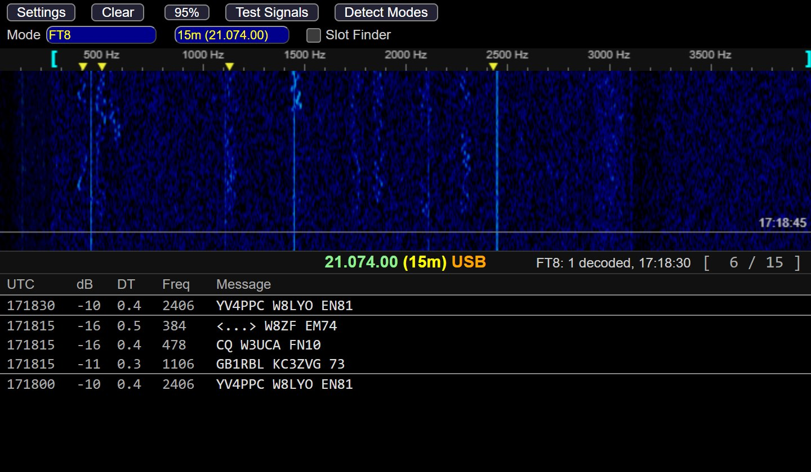
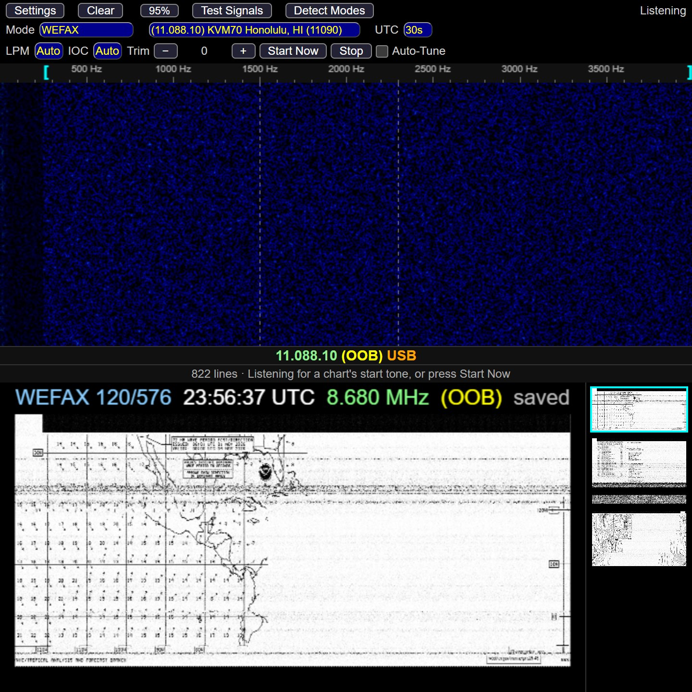
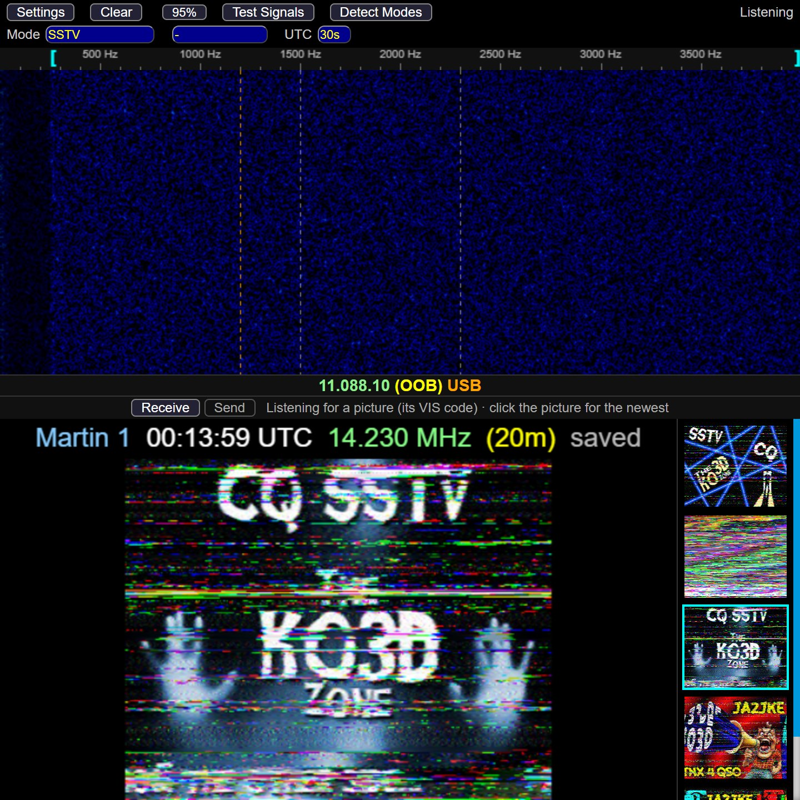
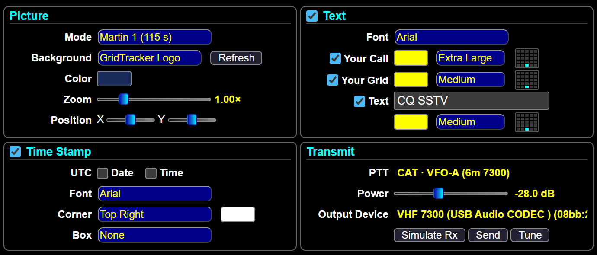
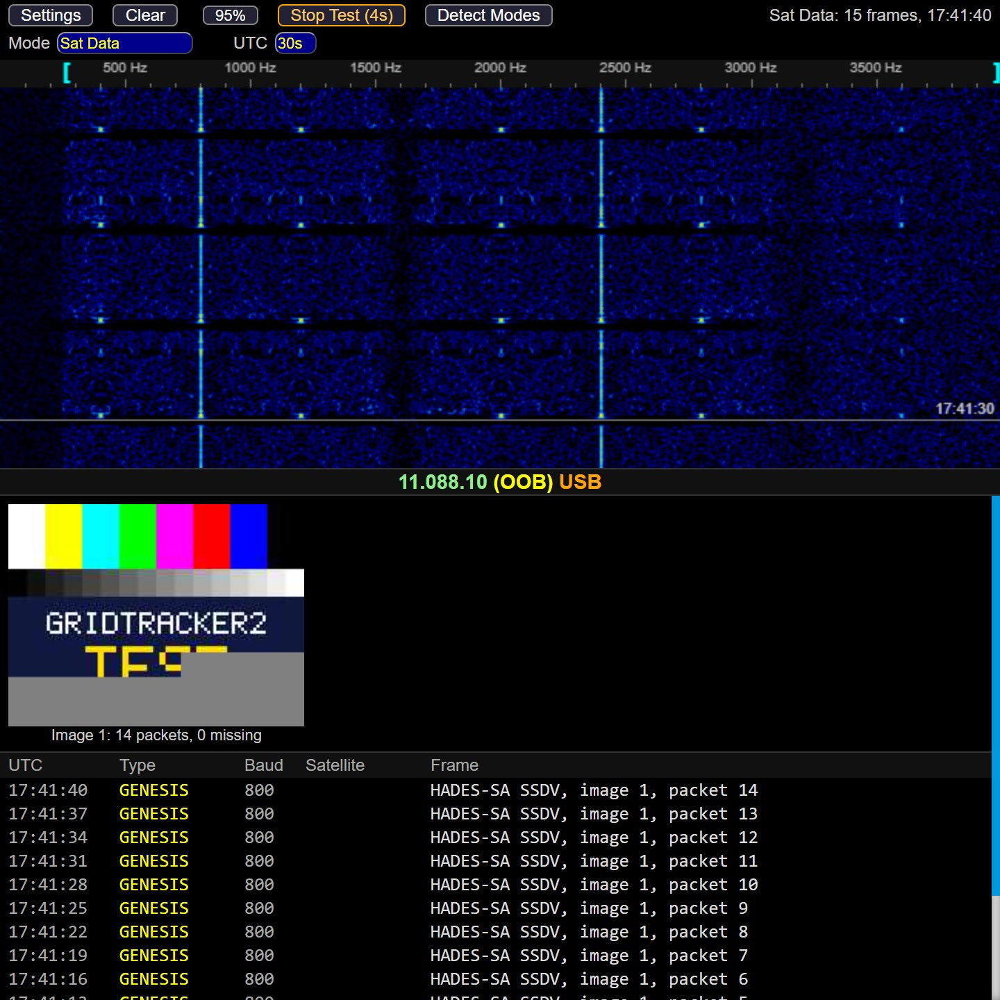

# Decoder Modes

See [The Multi-Mode Decoder](Multi-Mode-Decoder.md) for the window and the settings every mode shares.

Pick a mode in the **Mode** menu on the window's second line. Each mode below has its own list or picture view, and some have controls of their own on a row under the second line. The mode you pick is kept when GridTracker2 restarts.

A few things work the same way in most modes:

* **Frequency menu:** each mode's usual frequencies, beside the **Mode** menu. It shows only when **Rig Control** is on (the window's **Settings** → **General**), the mode's VFO is connected, and the mode's **Set Frequency** or **Set Mode** is ticked (the window's **Settings** → **Decoders**; both are on unless you turn them off). Picking a frequency tunes the rig there (**Set Frequency**) and sets the rig's mode (**Set Mode**). For USB and LSB, a VFO with **SSB Data** ticked (Settings → Radios → Rig Control) is set to its data mode instead. The frequencies come from the window's **Band Plans** tab, where you can edit them.
* **Tuning lock:** with **Rig Control** on, a lock sits before the rig's frequency on the divider: gold and closed while tuning is locked (as it starts), grey and open while unlocked. Click it to unlock: the mouse wheel on the waterfall then tunes the rig, 10 Hz a step (hold Shift for 100 Hz, Ctrl for 1 Hz). In FT8 and FT4, while the time skew is on, the wheel moves the skew instead. Click it again to lock. A middle-click on the waterfall locks or unlocks it too. While BirdWatch follows a satellite with the rig, the lock stays closed and nothing is sent to the rig.
* **Right-click a line:** in CW, PSK, RTTY, MFSK, DominoEX / THOR and Olivia, right-click a decoded line and pick **Delete** to remove it. A station that is still sending is listed again with what it sends next.

## CW

CW decodes every CW signal in the passband at once, each on its own line. It follows each operator's own speed, weighting and spacing (Farnsworth too) and copes with fading. A strong signal is taken out of the audio the others are decoded from, so a weaker station right beside it can still be read.


* **The list:** **Frequency** (on the air with Rig Control, otherwise the audio frequency), **dB** (the signal over the noise in a narrow filter, so higher than FT8's dB), **WPM** and **Decoded Text**.
* A **CQ** and the call after it are highlighted, and the line is shaded green.
* Text already decoded is corrected as the decoder learns an operator's timing, for example at the start of a transmission or after a change of speed. Corrected text glows for a moment.
* Click a line, or a signal on the waterfall, to pin it.
* **Frequency menu:** the QRP calling frequencies from 160 to 10 meters, the 6 meter CW calling frequency and the 2 meter CW center of activity. **Set Mode** sets the rig to CW.
* With **Follow BirdWatch**, a satellite's CW beacon switches the decoder to CW.

## FT8 and FT4

FT8 and FT4 decode each period on their own, without WSJT-X: 15 seconds for FT8, 7.5 seconds for FT4. Periods run on the UTC clock, so your computer's clock must be right. FT8 gets a few fewer decodes than WSJT-X: about nine in ten on a busy band.



* **The list:** **UTC**, **dB** (over 2500 Hz, as WSJT-X gives it), **DT**, **Freq** (audio Hz) and **Message**. The newest period is on top, with a line above each period's first message.
* Most messages show about 3 seconds before the period ends. Any new ones found at the end are added under them.
* A message decoded a harder way is marked as WSJT-X marks its own (hover over the mark for what it means): **o** for ordered statistics decoding, **a1** for a guessed CQ, **a2** for a guessed call to you, **a3** and **a4** for the next message of a QSO or station heard on that frequency two periods before, and **c** for a message added to the same message sent two periods before.
* A yellow mark on the scale shows each station decoded in the last two periods.
* The bar under the waterfall shows how far into the period the decoder is, for example **[ 7 / 15 ]**.

### Focus

Click the waterfall, or click a message, to put a 50 Hz focus band (red) there. It is searched harder each period. Drag it along the waterfall to move it, and click inside it to let go. In FT8 the focus works at the **Deep** depth only; FT4 always uses it.

### Time Skew

For a station whose clock is off, such as a DXpedition with no time source:

1. Right-click the waterfall. Orange period lines replace the usual gray ones, with the skew and their UTC time above them.
2. Turn the mouse wheel to move the timing (0.1 second a notch, or a second with **Shift**) until the orange lines line up with the station's transmissions.
3. Every period is now decoded on that timing, and **DT** shows in orange, counted from the usual timing. Stations that are on time aren't decoded meanwhile.
4. Right-click again to go back on time.

The skew is kept until GridTracker2 closes (FT8's and FT4's separately), so turning it on again comes back to it. **Clear** leaves it on; tuning the rig elsewhere or changing mode turns it off.

### Slot Finder

Tick **Slot Finder** on the second line (FT8 and FT4 each have their own, off at first) to mark the clearest frequency to transmit on, from what was heard and decoded lately. Each mark is labeled with its audio frequency and **Even**, **Odd** or **Even + Odd** for the periods it is clear in.

### Settings

In the window's **Settings** → **Decoders**, under **FT8** and **FT4**:

* **Depth** (FT8 only): **Normal**, the default, decodes each period once, quickly. **Deep** takes out each signal decoded and searches again for weaker ones it covered, tries the harder ways above, decodes early and uses the focus. It finds more, at the cost of more processor time. FT4 always decodes at Normal depth, plus the focus.
* **Send Decodes To Call Roster:** sends the decodes to the [Call Roster](../Making-GridTracker-Work-For-You/Using-Call-Roster.md) as well as the map. The band comes from Rig Control reading the mode's VFO; until it does, an orange note says **Waiting for Rig Control to read the FT8 VFO's dial**.
* **Set Mode** sets the rig to USB (its data mode with the VFO's **SSB Data**).

```{note}
FT8 and FT4 decodes go to GridTracker2's map and alerts through an instance named **MMD**, as a WSJT-X instance's do, even with the window closed. A green dot on the **Toggle Multi-Mode Decoder** button shows it is listening in the background. The decoder doesn't transmit, so MMD can't be answered.
```

* **Frequency menu:** FT8's dial frequencies from 160 meters to 70 cm, with the DXpedition (Fox/Hound) frequencies and regional ones noted. FT4 has WSJT-X's FT4 dial frequencies from 80 to 2 meters.
* With **Follow BirdWatch**, a satellite transmitter in FT8 or FT4 switches the decoder to that mode.

Built on ft8_lib by Kārlis Goba, YL3JG. The searching again, the harder ways and the early decode follow WSJT-X, with thanks to Joe Taylor, K1JT, and the WSJT development team.

## PSK

PSK decodes every PSK signal in the passband, each on its own line. Pick the submode on the row under the second line: **PSK31**, **PSK63**, **PSK125** or **QPSK31**.

* **The list:** **Frequency**, **dB**, **Baud** and **Decoded Text**, as in CW. A CQ and its call are highlighted.
* Click a line, or a signal on the waterfall, to pin it.
* Changing the submode clears the list and listens afresh.
* A signal that starts with an RSID is found as soon as it starts. Click its RSID label on the waterfall to switch to its submode.
* **Frequency menu:** PSK31's usual frequencies from 160 to 2 meters. **Set Mode** sets the rig to USB.

## RTTY

RTTY decodes every RTTY signal in the passband, each on its own line. Each signal's shift (170, 425 or 850 Hz) and speed (45.45, 50 or 75 baud) is found by itself, so there is no submode to pick.

* **The list:** **Frequency**, **dB**, **Baud** (as read) and **Decoded Text**, as in CW. A CQ and its call are highlighted.
* Click a line, or a signal on the waterfall, to pin it.
* A signal that starts with an RSID is found as soon as it starts.
* **Frequency menu:** the usual RTTY frequencies from 80 to 10 meters. **Set Mode** sets the rig to USB.

## MFSK

MFSK decodes every MFSK16 or MFSK32 signal in the passband, each found by itself and listed as PSK's are. Pick **MFSK16** or **MFSK32** on the row under the second line. MFSK16 copies down to about 13 dB below the noise (in 3 kHz).

* **The list:** **Frequency**, **dB**, **Baud** and **Decoded Text**.
* An RSID clicked on the waterfall sets the submode.
* **Frequency menu:** the W1AW MFSK16 bulletin frequencies and the MFSK16 frequencies used in New Zealand. **Set Mode** sets the rig to USB.

Written from ZL1BPU's published MFSK16 specification and IZ8BLY's varicode.

## DominoEX and THOR

The **DominoEX / THOR** mode decodes every DominoEX or THOR signal in the passband, each found by itself and listed as PSK's are. No tuning is needed, and a signal that drifts is followed.

* **Submode** (the row under the second line): **DominoEX** or **THOR** at speed 4, 5, 8, 11, 16 or 22, or **DominoEX All Speeds** / **THOR All Speeds** to decode every speed at once. The default is DominoEX 11.
* **The list:** **Frequency**, **dB**, **Baud** (the speed) and **Decoded Text**.
* An RSID clicked on the waterfall sets the submode.
* **Frequency menu:** the THOR22 NBEMS net frequency on 80 meters. **Set Mode** sets the rig to USB.

Written from ZL1BPU's published DominoEX descriptions, with THOR's error correction as W1HKJ describes it.

## Olivia and Contestia

The **Olivia** mode decodes one Olivia or Contestia signal at a time.

* **Submode** (the row under the second line): **Olivia** or **Contestia** at 4/250, 8/250, 8/500, 16/500, 16/1000 or 32/1000 (tones / bandwidth in Hz). The default is Olivia 8/500.
* **Where to listen:** click the signal on the waterfall. Dashed lines on the waterfall show the band decoded, with the submode at the bottom between them.
* An RSID heard for one of these submodes sets both the submode and where to listen, unless the signal being decoded is still printing.
* **The list:** the signal's line, as PSK's is, with its **Baud**.
* Olivia has no Frequency menu.

## NAVTEX

NAVTEX receives the maritime safety broadcasts: weather forecasts, navigational warnings, search and rescue and more. They are sent on 518 kHz (international, in English), 490 kHz (national languages) and HF channels. Each station sends in its own 10 minute slot every 4 hours.

* **The list:** each message (ZCZC to NNNN) in a block of its own, the newest on top. Its header shows the station, subject and number (for example **WA42**), the subject's name (**Navigational warning**, **Weather forecast**, **Search and rescue** ...), the UTC time, the frequency, and how cleanly it was received: the share of errors in green (received well), yellow, or **incomplete** in red. The message's text follows, as sent.
* A station in the middle of a message shows in a **Receiving** block on top.
* A message already received cleanly isn't listed again when its station repeats it: its header says **heard 2×** (and so on) instead, as NAVTEX receivers do.
* Right-click a message for **Copy To Clipboard**, **Save Message...** or **Delete**.
* **Save Messages** (the window's **Settings** → **Decoders**, under **NAVTEX**; off at first) saves each complete message as a text file in the **NAVTEX Messages** folder, beside GridTracker2's own folders, named by its UTC time, station, subject and number. A saved message's header says **saved**.
* **Frequency menu:** NAVTEX 490 and 518 kHz, HF NAVTEX 4209.5 kHz and the HF maritime safety channels from 4210 to 26100.5 kHz, each named. **Set Mode** sets the rig to USB.

## Feld-Hell

Feld-Hell prints Hellschreiber on a tape as it is heard, line after line, the newest line at the bottom. Each line is printed twice, one copy above the other, as Hell's own machines printed it: a print that slants out of one copy is whole in the other. Nothing is decoded into letters; you read the print.

* **Submode** (the row under the second line): **Feld-Hell**, **Feld-Hell X5** or **Feld-Hell X9**.
* The strongest Hell signal is found by itself, shown by cyan dashed lines on the waterfall. Click another signal on the waterfall to read it instead (orange lines), and click inside its band to go back to finding the strongest. The status shows where it is read and how strong.
* **Trim:** click **−** or **+** to straighten a print that slants: raise it if the print runs downhill to the right, lower it if uphill. Click the value to set it back to 0.
* **Frequency menu:** the Feld Hell Club's frequencies from 160 to 6 meters. **Set Mode** sets the rig to USB.

## WEFAX

WEFAX receives weather fax charts from the coast and weather stations that still send them on HF. Charts are shown in the same picture view as SSTV, the newest 12 kept in a strip on the right; click one to see it large. WEFAX's charts are kept apart from SSTV's pictures.

{width=480px}

* A chart starts by itself with its start tone. Its line rate and width are found by themselves, or you can pick them on the WEFAX row under the second line: **LPM** (lines a minute: **Auto**, 60, 90, 120 or 240) and **IOC** (the chart's width: **Auto**, 576 or 288).
* **Start Now** begins a chart that is already being sent. **Stop** ends the chart being received.
* Charts are kept straight and lined up by themselves, even when the sound card's clock is off or audio is lost for a moment. To do it by hand:
  * **Trim:** click **−** or **+** until the chart's upright lines stand straight (what came is drawn again). Click the value to set it back to 0. Trim is kept for next time.
  * Click the chart's real left edge, on the chart coming in, to line it up there.
* The header above the chart shows its line rate and width (for example **WEFAX 120/576**), its UTC time, frequency and band, and **saved** once it is.
* Right-click a chart for **Save Picture…**, **Copy To Clipboard**, **Rotate** (**90° Right**, **90° Left**, **180°** or **As Received**, for charts some stations send sideways), **Filter** or **Delete**. A rotated or filtered chart is saved and copied as shown.
* **Filter** (once the chart has ended) cleans up a noisy chart. Use as many as you like, one after another:
  * **Sharpen:** crisper lines and lettering.
  * **Noise Reduction:** takes out specks and static, keeping lines and lettering.
  * **Smooth:** softens grainy noise.
  * **Auto Contrast:** stretches a faded chart to full black and white.
  * **Equalize:** spreads the gray levels evenly, to bring out a faint chart.
  * **Lighten** and **Darken:** lighten or darken the middle grays, keeping black and white.
  * **Invert:** swaps black and white.
  * **Undo** takes back the last filter (the number beside it says how many can be undone, up to 20). **Undo All** takes them all back. A file saved already stays as it was.
* Each time the window opens, the newest 12 charts in the save folder are back in the strip.
* **Save Charts** (under **WEFAX** in the window's **Settings** → **Decoders**; off at first) saves each chart as a PNG when it ends, however much of it came. **Folder** shows where they go (`WEFAX Charts` at first, beside SSTV's `SSTV Pictures`; click it to open it); **Choose** picks another.
* **Frequency menu:** the stations heard around the world (NOAA's, Germany's, Japan's, Korea's, Australia's, the UK's and others), each named with its assigned frequency and its hours where it has them. **Set Mode** sets the rig to USB.

### Auto-Tune

With **Rig Control** on, tick **Auto-Tune** on the WEFAX row to have the rig tuned to each next chart from the stations' published schedules (NOAA's, Germany's, Japan's, Korea's, Australia's and the UK's), one chart after another. Beside it, it shows the station, frequency, chart and time it is waiting for, or **No chart scheduled**.

* For a station on several frequencies, the one that copied last time is used, else one suited to the hour (lower at night, higher by day).
* A frequency whose chart never starts is passed over for a while.
* Tuning the rig by hand turns Auto-Tune off. It is off each time GridTracker2 starts.

## WSPR

WSPR decodes each 2 minute period once it has ended: every station between 1350 and 1650 Hz of audio, down to about -28 dB.

* **The list:** **UTC**, **dB**, **DT**, **Frequency** (MHz on the air with Rig Control, otherwise audio Hz), **Drift**, **Call**, **Grid**, **dBm** and **Distance** (in the distance unit of Settings). The newest period is on top.
* The bar under the waterfall shows how far into the period the decoder is, for example **[ 47 / 120 ]**.
* Decodes go to GridTracker2's map as WSJT-X's WSPR decodes do, even with the window closed.
* **Frequency menu:** the WSPR dial frequencies from 2200 meters (136 kHz) to 70 cm. **Set Mode** sets the rig to USB (its data mode with the VFO's **SSB Data**).

Written from the published WSPR protocol (K1JT's description and G4JNT's specification).

## SSTV

SSTV receives slow-scan TV pictures in Martin 1 and 2, Scottie 1, 2 and DX, Robot 36 and 72, and PD 90, 120 and 180, each found by the VIS code that starts it. It can also send pictures (see [Sending Pictures](#sending-pictures)). Pick **Receive** or **Send** at the top of the picture view.

{width=480px}

* Each picture is drawn as it comes in, and the newest 12 are kept in a strip on the right. Click one to see it large, and click the large picture to go back to the newest.
* Above the picture, in color: its mode, the UTC time it started, its frequency with its band, and **saved** once it is.
* You don't need to tune exactly: a picture is found anywhere up to 1000 Hz either side of where its tones belong. Dashed lines on the waterfall show where its sync (1200 Hz), black (1500 Hz) and white (2300 Hz) tones are, moved to where the newest picture was found.
* A sender whose sound card runs a little fast or slow, one that drifts, or a satellite's Doppler, is put right, so the picture stays straight and its colors true.
* A sender that fades out part way is read on to the end, so the rest still comes if it comes back.
* Right-click a picture for **Save Picture…**, **Copy To Clipboard**, **Rotate**, **Filter** (the same as WEFAX's, see [WEFAX](#wefax)) or **Delete**.
* Each time the window opens, the newest 12 pictures in the save folder are back in the strip.
* **Save Pictures** (the window's **Settings** → **Decoders**, under **SSTV**; off at first) saves each picture as a PNG named by its UTC time, mode and frequency, however much of it came. **Folder** shows where they go (click it to open it); **Choose** picks another.
* **Frequency menu:** the usual SSTV frequencies from 160 to 2 meters, and the ISS's SSTV events on 145.800 MHz. **Set Mode** sets the rig to the frequency's sideband (LSB below 10 MHz, USB above), or FM for the ISS.
* With **Follow BirdWatch**, a satellite's SSTV transmitter switches the decoder to SSTV.

### Sending Pictures

The **Send** tab builds a picture and transmits it. The picture is shown on the right as it will be sent, with the status under it. Every change shows at once.



```{warning}
**Send** and **Tune** key your transmitter. Make sure your rig, its audio input and your antenna are ready, and that you are allowed to transmit SSTV on that frequency.
```

**Picture**

* **Mode:** the SSTV mode sent, each with how long it takes: Martin 1 and 2, Scottie 1, 2 and DX, Robot 36 and 72, and PD 90, 120 and 180.
* **Background:** **GridTracker Logo**, **Map** (the main window's map as it is now), **Waterfall** (the decoder's), **Color**, or **Image File** (pick it with **Choose Image…**). **Refresh** takes the background again, for example the map as it is now.
* **Color:** the whole picture's color, or what shows around a logo or image smaller than the picture.
* **Zoom** and **Position** (X and Y): the logo's or image's size and place. Double-click **Zoom** for 1x, and **X** or **Y** to center.

**Text** (tick its title to put text on the picture)

* **Font:** for every line of text.
* **Your Call**, **Your Grid** and **Text** (a line of your own, up to 40 characters): tick each one to show it, and pick its color, its size (**Small**, **Medium**, **Large** or **Extra Large**) and its place. Hover over the small grid beside a line for a larger one over the picture, and click where the line goes.

**Time Stamp** (tick its title to put it on the picture)

* **UTC:** **Date**, **Time** or both, as they are when the picture is sent.
* **Font**, **Corner** (**Top Left**, **Top Right**, **Bottom Left** or **Bottom Right**) and its color.
* **Box:** **None**, or **Color** for a box of that color behind it.

**Transmit**

* **PTT:** how the rig is keyed: the **PTT Method** of the SSTV mode's VFO in [Rig Control](../Rig-and-Rotor-Control.md#other-vfo-settings) (CAT, VOX, DTR or RTS). VOX sends a leader tone first.
* **Power:** the audio level into the rig, from -45 to 0 dB below full. Set it so the rig's ALC barely moves. It is kept for each band, and you can move it while sending.
* **Output Device:** where the audio goes, set by **Common Output Device** or SSTV's own **Output Device** in the window's Settings. **Same Sound Card As Input** uses the output of the sound card the decoder listens to.
* **Simulate Rx:** plays the picture into the decoder as if it were received, to see how it comes out. Nothing is keyed or sent. While it plays it shows **Abort**.
* **Send:** keys the rig and sends the picture. It is red while sending; click it again to stop.
* **Tune:** sends a steady 1900 Hz tone at the **Power**, for 30 seconds at most or until you click it again. Set the rig's drive and ALC with it.

While one of these runs, the others are grayed out. The decoder doesn't decode while you transmit, and sending stops if you leave SSTV mode or close GridTracker2.

```{note}
Sending needs the window's **Rig Control** on with a VFO picked for SSTV, an Output Device, and a PTT Method other than None on that VFO. With CAT, DTR or RTS the rig must also be connected; VOX only needs the audio. Nothing is sent while BirdWatch is using the rig.
```

Written from the published SSTV mode specifications (JL Barber, N7CXI), with ideas from slowrx by Oona Räisänen, OH2EIQ.

## Packet

Packet decodes AX.25 packets, listening for all of these at once: AFSK 1200 (APRS, the ISS's digipeater), FSK 9600 and GMSK 4800 (G3RUH, from a rig's 9600 data audio), and HF packet at 300 baud.

* **The list:** **UTC**, **Baud**, **From**, **To / Path** and **Message**, one packet a line, the newest on top. A packet with one bit wrong, or two side by side, is put right rather than lost.
* APRS is read: positions (plain, compressed and Mic-E, with the grid, course, speed and altitude), messages, status, objects, items, weather and telemetry. Other packets are shown as they are.
* A message to you is highlighted.
* AFSK 1200 heard through an SSB receiver (a satellite's packets, or a rig tuned a little off) is decoded up to 600 Hz off its usual tones.
* **HF packet** is found wherever its tones land between the **[** and **]**, so a station a little off frequency is still decoded. Each place one was heard lately is ticked at the top of the waterfall; hover over a 300 baud line's **Baud** to see where it was heard.
  * Click the waterfall, or a 300 baud line, to lock onto that place: only it is decoded, marked by a tick with guard lines either side. Click inside the guards to let go.
* A packet heard while BirdWatch follows a satellite with the rig is marked **via** that satellite, in cyan.
* **Frequency menu:** HF APRS (7.0486, 10.1476, 14.103 and 28.14 MHz), 10 meter APRS (29.25 MHz FM), the VHF APRS frequencies around the world, and the ISS's digipeater (145.825 MHz, and 437.825 MHz). **Set Mode** sets the rig to FM for VHF and LSB for HF packet.
* With **Follow BirdWatch**, a satellite transmitter sending AFSK, AX.25 or G3RUH switches the decoder to Packet.

## Sat Data

Sat Data decodes satellite telemetry frames. It listens for:

* **FUNcube** BPSK 1200 (AO-73 and its family, from SSB audio): its telemetry read (battery, photocurrent, sequence).
* **AX.100**: GomSpace AX.100 Modes 5 and 6, the common cubesat framing, at 1200 to 9600 baud (from a rig's flat 9600 data audio).
* **GENESIS**: AMSAT-EA's FSK at 800 and 200 bps (HADES-SA, HADES-L and the other HADES satellites, from SSB audio): telemetry, BBS and SSDV packets.

{width=480px}

* **The list:** **UTC**, **Type**, **Baud**, **Satellite** (the one BirdWatch follows) and **Frame** (a summary; hover over it to see the frame's bytes). The newest is on top.
* **SSDV pictures:** a satellite's SSDV packets are put together into its pictures above the list, each filling in as its packets come (what hasn't come yet is gray), with its image number and the packets received and missing under it. Right-click a picture for **Save Picture…** (as a JPEG), **Copy To Clipboard** or **Delete**.
* With **Follow BirdWatch**, a satellite transmitter in BPSK, AX.100 or GENESIS switches the decoder to Sat Data, and the transmitter followed picks which of the three listen.
* Sat Data has no Frequency menu: tune with BirdWatch.
