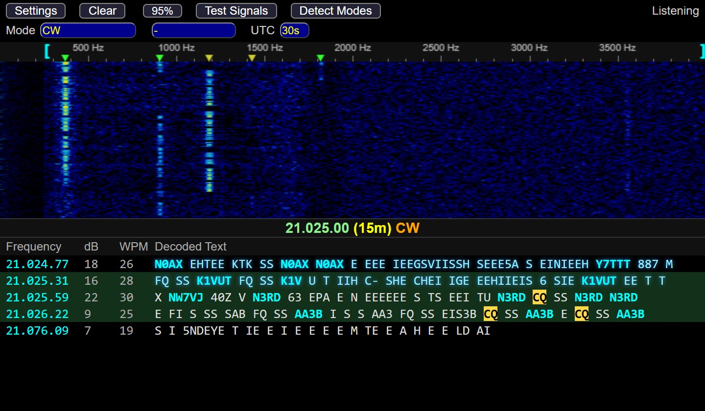

# Decoder Modes

See [The Multi-Mode Decoder](Multi-Mode-Decoder.md) for the window and the settings every mode shares.

Pick a mode in the **Mode** menu on the window's second line. Each mode below has its own list or picture view, and some have controls of their own on a row under the second line. The mode you pick is kept when GridTracker2 restarts.

A few things work the same way in most modes:

* **Frequency menu:** each mode's usual frequencies, beside the **Mode** menu. It shows only when **Rig Control** is on (the window's **Settings** → **General**), the mode's VFO is connected, and the mode's **Set Frequency** or **Set Mode** is ticked (the window's **Settings** → **Decoders**; both are on unless you turn them off). Picking a frequency tunes the rig there (**Set Frequency**) and sets the rig's mode (**Set Mode**). For USB and LSB, a VFO with **SSB Data** ticked (Settings → Radios → Rig Control) is set to its data mode instead. The frequencies come from the window's **Band Plans** tab, where you can edit them. With the mode's **Set Frequency** on, picking a mode in the **Mode** menu tunes the rig to its main frequency on the band you're on (**Main** in Band Plans, such as SSTV's 14.230 on 20 meters). When the mode has none on that band, the rig goes to its main frequency on the band of its nearest. A rig already on one of the mode's frequencies stays there.
* **Tuning lock:** with **Rig Control** on, a lock sits before the rig's frequency on the divider: gold and closed while tuning is locked (as it starts), grey and open while unlocked. Click it to unlock: the mouse wheel on the waterfall then tunes the rig, 10 Hz a step (hold Shift for 100 Hz, Ctrl for 1 Hz). Click it again to lock. A middle-click on the waterfall locks or unlocks it too. While BirdWatch follows a satellite with the rig, the lock stays closed and nothing is sent to the rig.
* **Right-click a line:** in CW (and the modes listed the same way), right-click a decoded line and pick **Delete** to remove it. A station that is still sending is listed again with what it sends next.

## CW

CW decodes every CW signal in the passband at once, each on its own line. It follows each operator's own speed, weighting and spacing (Farnsworth too) and copes with fading. A strong signal is taken out of the audio the others are decoded from, so a weaker station right beside it can still be read.



* **The list:** **Frequency** (on the air with Rig Control, otherwise the audio frequency), **dB** (the signal over the noise in a narrow filter, so higher than WSJT-X's dB over 2500 Hz), **WPM** and **Decoded Text**.
* A **CQ** and the call after it are highlighted, and the line is shaded green.
* Text already decoded is corrected as the decoder learns an operator's timing, for example at the start of a transmission or after a change of speed. Corrected text glows for a moment.
* Click a line, or a signal on the waterfall, to pin it.
* **Frequency menu:** the QRP calling frequencies from 160 to 10 meters, a 60 meter frequency, the 6 meter CW calling frequency and the 2 meter CW center of activity. **Set Mode** sets the rig to CW.
* With **Follow BirdWatch**, a satellite's CW beacon switches the decoder to CW.

## SSTV

SSTV receives slow-scan TV pictures in Martin 1 and 2, Scottie 1, 2 and DX, Robot 36 and 72, and PD 90, 120 and 180, each found by the VIS code that starts it. It can also send pictures (see [Sending Pictures](#sending-pictures)). Pick **Receive** or **Send** at the top of the picture view.

{width=480px}

* Each picture is drawn as it comes in, and the newest 12 are kept in a strip on the right. Click one to see it large, and click the large picture to go back to the newest. The Up and Down arrow keys show the picture above or below it in the strip.
* Above the picture, in color: its mode, the UTC time it started, its frequency with its band, and **saved** once it is.
* You don't need to tune exactly: a picture is found anywhere up to 1000 Hz either side of where its tones belong. Dashed lines on the waterfall show where its sync (1200 Hz), black (1500 Hz) and white (2300 Hz) tones are, moved to where the newest picture was found.
* A sender whose sound card runs a little fast or slow, one that drifts, or a satellite's Doppler, is put right, so the picture stays straight and its colors true.
* A sender that fades out part way is read on to the end, so the rest still comes if it comes back.
* Right-click a picture for **Save Picture…**, **Copy To Clipboard**, **Rotate** (**90° Right**, **90° Left**, **180°** or **As Received**), **Filter** or **Delete**. A rotated or filtered picture is saved and copied as shown.
* **Filter** (once the picture has ended) cleans up a noisy one. Use as many as you like, one after another:
  * **Sharpen:** crisper lines and lettering.
  * **Noise Reduction:** takes out specks and static, keeping lines and lettering.
  * **Smooth:** softens grainy noise.
  * **Auto Contrast:** stretches a faded picture to its full range.
  * **Equalize:** spreads the levels evenly, to bring out a faint picture.
  * **Lighten** and **Darken:** lighten or darken the middle tones, keeping black and white.
  * **Invert:** swaps black and white.
  * **Undo** takes back the last filter (the number beside it says how many can be undone, up to 20). **Undo All** takes them all back. A file saved already stays as it was.
* Each time the window opens, the newest 12 pictures in the save folder are back in the strip.
* **Save Pictures** (the window's **Settings** → **Decoders**, under **SSTV**; on at first) saves each picture as a PNG named by its UTC time, mode and frequency, however much of it came. **Folder** shows where they go, as its last two folders (hover over it to see the whole path, click it to open it); **Choose** picks another.
* **Frequency menu:** the usual SSTV frequencies from 160 to 2 meters, and the ISS's SSTV events on 145.800 MHz. There are none on 60 and 30 meters, where pictures may not be sent. **Set Mode** sets the rig to the frequency's sideband (LSB below 10 MHz, USB above), or FM for the ISS.
* With **Follow BirdWatch**, a satellite's SSTV transmitter switches the decoder to SSTV.

### Sending Pictures

The **Send** tab builds a picture and transmits it. The picture is shown on the right as it will be sent, with the status under it. Every change shows at once.


```{warning}
**Send** and **Tune** key your transmitter. Make sure your rig, its audio input and your antenna are ready, and that you are allowed to transmit SSTV on that frequency.
```

**Picture**

* **Mode:** the SSTV mode sent, each with how long it takes: Martin 1 and 2, Scottie 1, 2 and DX, Robot 36 and 72, and PD 90, 120 and 180.
* **Background:** **GridTracker Logo**, **Map** (the main window's map as it is now), **Waterfall** (the decoder's), **Color**, or **Image File** (pick it with **Choose Image…**). **Refresh** takes the background again, for example the map as it is now.
* **Color:** the whole picture's color, or what shows around a logo or image smaller than the picture.
* **Zoom** and **Position** (X and Y): the logo's or image's size and place. Double-click **Zoom** for 1x, and **X** or **Y** to center.

**Text** (tick its title to put text on the picture)

* **Font:** for every line of text.
* **Your Call**, **Your Grid** and **Text** (a line of your own, up to 40 characters): tick each one to show it, and pick its color, its size (**Small**, **Medium**, **Large** or **Extra Large**) and its place. Hover over the small grid beside a line for a larger one over the picture, and click where the line goes.

**Time Stamp** (tick its title to put it on the picture)

* **UTC:** **Date**, **Time** or both, as they are when the picture is sent.
* **Font**, and as for a line of **Text**: its color, its size (**Tiny**, **Smaller**, **Small**, **Medium**, **Large** or **Extra Large**) and its place, picked on the small grid (hover over it for a larger one over the picture). Text in the same place moves clear of it.
* **Box:** **None**, or **Color** for a box of that color behind it.

**Transmit**

* **PTT:** how the rig is keyed: the **PTT Method** of the SSTV mode's VFO in [Rig Control](../Rig-and-Rotor-Control.md#other-vfo-settings) (CAT, VOX, DTR or RTS). VOX sends a leader tone first.
* **Power:** the audio level into the rig, from -45 to 0 dB below full. Set it so the rig's ALC barely moves. It is kept for each band, and you can move it while sending.
* **Output Device:** where the audio goes, set by **Common Output Device** or SSTV's own **Output Device** in the window's Settings. **Same Sound Card As Input** uses the output of the sound card the decoder listens to.
* **Simulate Rx:** plays the picture into the decoder as if it were received, to see how it comes out. Nothing is keyed or sent. While it plays it shows **Abort**.
* **Send:** keys the rig and sends the picture. It is red while sending; click it again to stop.
* **Tune:** sends a steady 1900 Hz tone at the **Power**, for 30 seconds at most or until you click it again. Set the rig's drive and ALC with it.

While one of these runs, the others are grayed out. The decoder doesn't decode while you transmit, and sending stops if you leave SSTV mode or close GridTracker2.

```{note}
Sending needs the window's **Rig Control** on with a VFO picked for SSTV, an Output Device, and a PTT Method other than None on that VFO. With CAT, DTR or RTS the rig must also be connected; VOX only needs the audio. Nothing is sent while BirdWatch is using the rig.
```

Written from the published SSTV mode specifications (JL Barber, N7CXI), with ideas from slowrx by Oona Räisänen, OH2EIQ.

## Sat Data

Sat Data decodes satellite telemetry frames. It listens for:

* **FUNcube** BPSK 1200 (AO-73 and its family, from SSB audio): its telemetry read (battery, photocurrent, sequence).
* **AX.100**: GomSpace AX.100 Modes 5 and 6, the common cubesat framing, at 1200 to 9600 baud (from a rig's flat 9600 data audio).
* **GENESIS**: AMSAT-EA's FSK at 800 and 200 bps (HADES-SA, HADES-L and the other HADES satellites, from SSB audio): telemetry, BBS and SSDV packets.

{width=480px}

* **The list:** **UTC**, **Type**, **Baud**, **Satellite** (the one BirdWatch follows) and **Frame** (a summary; hover over it to see the frame's bytes). The newest is on top.
* **SSDV pictures:** a satellite's SSDV packets are put together into its pictures above the list, each filling in as its packets come (what hasn't come yet is gray), with its image number and the packets received and missing under it. Right-click a picture for **Save Picture…** (as a JPEG), **Copy To Clipboard** or **Delete**.
* With **Follow BirdWatch**, a satellite transmitter in BPSK, AX.100 or GENESIS switches the decoder to Sat Data, and the transmitter followed picks which of the three listen.
* Sat Data has no Frequency menu: tune with BirdWatch.

## WWV and WWVH

**WWV / WWVH** in the Mode menu reads NIST's time stations, WWV in Fort Collins, Colorado, and WWVH on Kauai, Hawaii: their time code and their second pulses, and how far your computer's clock is from them. Both stations share 2.5, 5, 10 and 15 MHz; WWV is also on 20 and 25 MHz. (Canada's CHU went off the air on June 22, 2026.)

* **Please give it a few minutes.** WWV sends only one pulse a second, and its time code takes a full minute to send, so the decoder needs about 4 to 5 minutes of listening before the time it shows is accurate. Until then you'll see it counting and reading, and an offset to the nearest second only. Thank you for your patience: it's worth the wait.
* **Tuning:** USB with the dial 1 kHz under the carrier, for example 9.999 MHz for 10 MHz. The carrier then sits at 1000 Hz on the waterfall, with the time code's 100 Hz either side of it, which a rig's SSB filter would cut with the dial on the carrier. AM works too. The decoder finds the carrier by itself, so the dial doesn't have to be exact.
* **The view:** the time as the stations send it (UTC, to the second), the date and the day of the year, DUT1 (UT1 less UTC), the leap second warning and U.S. daylight saving time, as the time code gives them. These change rarely, so a change is shown only once two minutes running read it (one misread minute doesn't show). Under it, each station and how strongly its second pulses come in, or **not heard**: WWV's pulses are 1000 Hz, WWVH's 1200 Hz, so both are timed on their own when both are heard.
* **PC clock:** for example **PC clock is 0.183 s ahead (± 0.050 s, 5 min)**, from the last 5 minutes. Each minute's pulses are timed against your computer's clock, less the radio path from your location (your grid square in GridTracker2's settings) to each station: a sky wave off the ionosphere at about 300 km, in one hop up to 3500 km and more beyond. Hover over it for how it is worked out.
  * The audio's delay from the antenna into the decoder is taken off too: 24 ms, measured with an IC-7300 through its USB sound card against internet time. The computer's own output delay is measured as it runs, but the rest (the rig's DSP, its sound card and the driver) differs from one setup to another and isn't measured, so the offset is given as good to about ±0.05 s. With network audio or an SDR server, the delay is a different one, and the offset says so.
  * Until the time code has been read (it needs the 100 Hz, so not with the dial on the carrier in USB), the offset is to the nearest second only, and says so.
  * When the stations fade out (or audio is lost for a moment), the time is no longer shown: **Pulses lost: listening for them again** until they are found, and the seconds are counted again from there. A minute read and confirmed before is remembered, so second 0 and the minute are found again at once.
  * The audio's own delay can change by itself by 10 ms or more (the sound card or its driver catching up after a hiccup). The stations' pulses don't move, so when their pulses move (both stations' alike, when both are heard) and the offset moves with them, the view says **The audio's delay changed by +10 ms (the sound card or its driver): the offset started again**, and the offset is worked out afresh from that minute on.
  * A first reading of the time code that the next minute hasn't confirmed yet is marked **Not Confirmed**, and its date is shown only when it is within an hour of your computer's clock; its pulses are timed to the nearest second.
* **Set PC Clock:** shown once the offset has held steady for 3 minutes or more with the time code read, and is more than 0.1 s (twice its ±0.05 s, so the clock ends up nearer than it was), with a sound card's audio. Click it and confirm (the question says how accurate it is), and your system asks for an administrator's permission (Windows' UAC prompt, your Linux desktop's password prompt, or macOS's). The clock is moved by the offset shown, counted from when you answer the prompt. GridTracker2 never sets the clock by itself.
  * **You're asked every time.** Every system needs an administrator to change the clock, and GridTracker2 asks for that only for the one change you clicked. So each Set PC Clock brings the prompt again: GridTracker2 never runs with an administrator's rights, and never changes the clock in the background.
  * **Windows:** the UAC prompt names **Windows PowerShell**, which is what sets the clock. Windows doesn't let a program show its own reason there. Its **Show more details** says what it's for, for example **GridTracker2 (WWV / WWVH): moving the PC clock by -0.5120 s**.
  * **Linux:** your desktop's password prompt (polkit) asks to run `/bin/sh` as the super user: that's GridTracker2 setting the clock. It needs the desktop's authentication agent, which full desktops such as GNOME, KDE and Xfce run. Without one (some minimal window managers, or over SSH), the clock isn't set, and the view says why.
  * **macOS:** the usual administrator password dialog, for **osascript**: that's GridTracker2 setting the clock. macOS sets the clock in whole seconds only, so GridTracker2 waits for the moment the corrected time falls on a whole second and sets that one, keeping the fraction.
  * Once set, the view notes it with the time, for example **PC clock moved by -0.512 s at 12:59:40 UTC**, and so does the [Event Viewer](../GridTracker-Overview/Control-Panel.md#event-viewer). If the clock couldn't be set, both say why.
  * A clock that keeps its time from the internet is more accurate than this, and will set itself back at its next sync: Windows Time on Windows; chrony, ntpd or systemd-timesyncd on Linux; **Set time and date automatically** on macOS. Set PC Clock is for a computer with no internet time, such as one in the field.
  * Time programs that keep correcting the clock all day, such as Meinberg NTP or Dimension 4, are set up once to run as a system service or as administrator, which is why they don't ask each time. GridTracker2 makes one correction, when you ask for it.
* **The list:** each minute timed, the newest on top: **UTC**, **Station**, **Time Code** (**Read**, **Counted** on from the last minute read when a minute was too weak to read, **Not Confirmed** for a first reading that the next minute hasn't confirmed yet, or **Nearest Second**), **Pulses** (the second pulses timed that minute), **Offset (s)** (that minute's, the path taken off), **Path (ms)** (with its number of hops) and **dB**.
* **Frequency menu:** 2.5, 5, 10, 15, 20 and 25 MHz, each 1 kHz under the carrier. **Set Mode** sets the rig to USB.
* **Best Signal Search:** a button under the Mode menu, there while the decoder's **Rig Control** and WWV's **Set Frequency** (Settings, Decoders) are on and the rig is connected. Click it and the decoder tunes to each of WWV's frequencies in turn (those in the Frequency menu, so your own from Band Plans too), listens about 10 seconds on each and then tunes the rig to the one whose second pulses came in clearest. The whole search takes about a minute. The view shows the frequency it's listening to, then each one's result: the station heard best there, or **not heard**, with the best in green. If no station is heard anywhere, the rig goes back where it was.
  * While it runs the button says **Stop Search**: click it to stop, and the rig goes back where it was. Tuning the rig yourself, changing the mode or stopping the decoder stops it too.
  * Which frequency is best changes through the day: the lower ones at night, the higher ones by day.

Written from NIST Special Publication 432, *NIST Time and Frequency Radio Stations: WWV, WWVH, and WWVB*.
