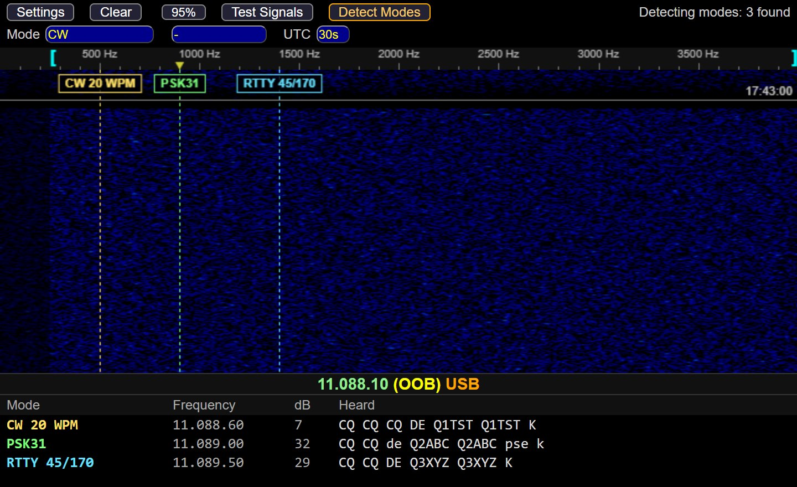

# The Multi-Mode Decoder

The **Multi-Mode Decoder** decodes the signals your receiver hears, right inside GridTracker2, without another program. It listens to your rig's audio (or an SDR's), shows the whole passband as a waterfall, and decodes every signal it finds there in the mode you pick: CW, FT8, FT4, PSK, RTTY, MFSK, DominoEX and THOR, Olivia, NAVTEX, Feld-Hell, WEFAX, WSPR, SSTV, Packet and satellite data.

You don't need Rig Control to use it. Without it, the decoder shows audio frequencies (Hz in your receiver's passband). With it, the decoder shows each signal at its frequency on the air, and can tune your rig.

Its FT8, FT4 and WSPR decodes can also go to GridTracker2's map, alerts and Call Roster, as if they came from WSJT-X.

This chapter covers the window and the settings shared by every mode. Each mode is described in [Decoder Modes](Decoder-Modes.md).

## Turning It On

In [Settings → Features](../GridTracker-Overview/Settings-Sub-Menus.md#features-tab), under **Service**, tick **Multi-Mode Decoder**. This adds the **Toggle Multi-Mode Decoder** button to the button panel.

* Click the button to show or hide the Multi-Mode Decoder window.
* Right-click it to show the window (it is never hidden by a right-click).
* The window opens where you last left it. If it was open when you closed GridTracker2, it opens again at the next start.

Turning **Multi-Mode Decoder** off hides the window, stops it listening and removes the button.

### Listening in the Background

In most modes the decoder only listens while its window is showing. When you hide the window, it lets go of the sound card.

In **FT8**, **FT4** and **WSPR** it keeps listening with the window hidden, so their decodes keep reaching the map and the Call Roster (see [Decodes in GridTracker2](#decodes-in-gridtracker2)). A green dot on the **Toggle Multi-Mode Decoder** button shows that it is listening in the background. Hover over the button and its tooltip says so.

## The Window


From top to bottom, the window has:

1. the top line: **Settings**, **Clear**, the audio levels, **Test Signals**, **Detect Modes** and the status;
2. the second line: **Mode**, the Frequency menu, and the mode's own controls;
3. the band scope strip, for an Icom radio that sends its scope (see [The Band Scope](#the-band-scope));
4. the scale, with the **[** and **]** handles;
5. the waterfall;
6. the frequency bar, with the frequency, band and mode;
7. the decoded lines (or, in SSTV, WEFAX and Feld-Hell, the pictures or the tape).

### The Top Line

* **Settings:** opens the window's own settings panel (see [Settings](#settings)). Click it again, or the red **X**, to close it.
* **Clear:** forgets every signal decoded and starts again from scratch: the lines, the waterfall, and what the decoder has learned about each signal.
* **Levels:** the audio levels of the Input Device, for example `-3 dB  45%`. Hover over them to set them (see [Audio Levels](#audio-levels)).
* **Test Signals:** plays recordings of the mode's signals into the decoder (see [Test Signals](#test-signals)).
* **Detect Modes:** listens for every mode at once and names each signal it finds (see [Detect Modes](#detect-modes)).
* The status, on the right: **Listening**, **Starting audio…**, or an error in orange, such as an Input Device that couldn't be opened. In FT8, FT4 and WSPR the status is on the frequency bar instead.

### The Second Line

* **Mode:** what is decoded. The modes are listed in [The Modes](#the-modes). The mode you pick is kept when GridTracker2 restarts.
* **Frequency menu:** each mode's usual frequencies. Pick one to tune your rig there. It appears only with Rig Control (see [The Frequency Menu](#the-frequency-menu)).
* **UTC:** lines across the waterfall on the UTC clock, each with its time: **Off**, 10s, 15s, 30s or 1m. FT8, FT4 and WSPR don't have this menu; their waterfall shows each period instead.
* **Slot Finder** (FT8 and FT4): marks the clearest frequency to transmit on in the even and odd periods.

Some modes add a row of their own under the second line: the submode menu for PSK, MFSK, DominoEX / THOR, Olivia and Feld-Hell, and the chart controls for WEFAX. See [Decoder Modes](Decoder-Modes.md).

### The Scale and the Waterfall

The waterfall shows the passband as it is heard, the newest at the top. Low frequencies are always on the left and high on the right, in LSB and CW-R too. Each signal found is marked on it.

The scale above it shows the frequencies: audio frequencies without Rig Control, frequencies on the air with it.

**[** and **]** on the scale set the lowest and highest audio decoded. Drag them to leave out hum and noise at the low end, or a busy part of the passband. What is outside them is dimmed and not decoded. Hover over a handle to see its frequency. Each mode keeps its own **[** and **]**.


When you change band, or pick a frequency from the Frequency menu, a bar is drawn across the waterfall with the new band and frequency on it. The waterfall is kept. When you turn the dial on the same band, the waterfall slides across so each signal stays at its frequency on the air.

How the waterfall moves and looks is set in [Settings → General](#general): **Waterfall Speed**, **Waterfall Style**, **Palette**, **Resolution**, **Window** and **Sharp Pixels**.

### The Frequency Bar

The bar between the waterfall and the decoded lines shows, in its center:

* with Rig Control, the rig's frequency, band and mode, for example **14.074.00 (20m) USB** (the frequency in green, the band in yellow, the mode in orange);
* without it, the audio decoded, from the **[** to the **Bandpass**, for example **250 Hz - 4 kHz** in cyan.

In FT8, FT4 and WSPR its right end shows the status and how far into the period it is, for example `[ 7 / 15 ]`.

Drag the bar up or down to give the waterfall or the decoded lines more room.

### The Decoded Lines

Under the bar are the decoded lines, the newest kept in view. Their columns depend on the mode. In CW, for example, each signal has one line with its **Frequency**, **dB** (its signal over the noise), **WPM** and **Decoded Text**. PSK, RTTY, MFSK, DominoEX / THOR and Olivia use the same list, with the **Baud** in place of WPM.

A **CQ** is highlighted in yellow, the call after it in cyan, and its line is shaded green.

## Working With Signals

These work in CW and in the modes listed the same way: PSK, RTTY, MFSK, DominoEX / THOR and Olivia.

* **Hover linking:** hover over a line and its signal is marked on the waterfall. Hover over a signal on the waterfall and its line is shaded.
* **Pinning:** click a line to pin its signal (in CW, PSK, RTTY, MFSK and DominoEX / THOR, a click on the signal on the waterfall does it too). Its marks stay on the waterfall and its line stays listed, even while you tune elsewhere. Its line has a light red edge. Click it again to let it go.
* **Deleting a line:** right-click a line and pick **Delete**. A station that is still sending is listed again with what it sends next.
* **Copying text:** select text in a line with the mouse to copy it. A click that selects text doesn't pin.

In FT8 and FT4, a click on the waterfall or a message sets the focus instead, and a right-click on the waterfall turns the time skew on or off. Other modes have clicks of their own (Packet, Feld-Hell, Olivia). See [Decoder Modes](Decoder-Modes.md).

### Tuning Lock

With Rig Control on, a lock sits before the rig's frequency on the divider. Gold and closed, tuning is locked (as it starts); grey and open, it is unlocked. Click the lock to unlock it: the mouse wheel on the waterfall then tunes your rig, 10 Hz a step (hold Shift for 100 Hz, Ctrl for 1 Hz), each step landing on that step's round number. A label over the waterfall shows the frequency tuned to and the change (its total while you keep turning the wheel), then fades; a click on the band scope shows one over the scope the same way. In FT8 and FT4, while the time skew is on, the wheel moves the skew instead. Click it again to lock it; a middle-click on the waterfall locks or unlocks it too. While BirdWatch follows a satellite with the rig, the lock stays closed: the decoder sends nothing to the rig then.

## Test Signals

**Test Signals** (beside the levels) lets you see what the decoder does without waiting for signals on the air. Click it and pick a recording from the menu. Each entry gives the number of signals in it, and whether it starts with an RSID or was recorded off the air.

* The window is cleared first. The recording is then played into the decoder over a band's noise floor, and what your radio hears is silenced while it plays.
* Many recordings have several stations at once. Every mode has some.
* FT8 and FT4 recordings start on a period's boundary: the button shows **Test Starts In** and the seconds left.
* While one plays, the button shows **Stop Test** and the seconds left. Click it to stop.
* What a test decodes stays in the window. It isn't sent to the map or the Call Roster, and its pictures aren't saved by themselves.

The button is shown while the decoder is listening and the mode has test signals.

## Detect Modes

Not sure what a signal is? Click **Detect Modes**. The decoder listens for every mode at once and names each signal it finds, once it decodes: CW (with its speed), PSK31, PSK63, PSK125, QPSK31, RTTY (with its baud and shift), MFSK16, MFSK32, DominoEX and THOR (with their speed), Packet, SSTV (with its mode), each FT8 and FT4 station (with its message), and any mode an RSID names.



* Each signal is labeled on the waterfall, and listed in place of the decoded lines with its **Mode**, **Frequency**, **dB** and what was **Heard**.
* Click one, on the waterfall or in the list, to decode it: its mode and submode are picked and Detect Modes turns off. A CW signal is pinned, an HF packet station is locked onto, and the FT8 or FT4 focus is put on the station.
* The button is orange while Detect Modes is on. Click it again to go back to the mode you were in. Picking a mode in **Mode** also ends it.

## RSID

Many digital-mode programs (fldigi, MultiPSK and others) can start a transmission with an RSID, a short burst that names its mode. With **RSID** on (in [Settings → General](#general), on unless you turn it off), the decoder names each RSID it hears on the waterfall where the transmission starts, in every mode: for example **RSID Olivia 8/500**, **RSID MT63-1000L** or **RSID BPSK31**.

Click an RSID of a mode decoded here (BPSK31, BPSK63, BPSK125, QPSK31, RTTY 45, MFSK16, MFSK32, DominoEX, THOR, Packet 1200, Olivia, Contestia) to switch to that mode and submode. The transmission is decoded from its start, and nothing already decoded is cleared.

## Audio Levels

The levels on the top line are those of the mode's Input Device. Hover over them for two sliders and a peak meter:

* **SW:** a gain inside the decoder, from -20 to +20 dB. Each mode keeps its own. It can't undo clipping in the sound card.
* **HW:** the Input Device's own recording level, the same one your computer's sound settings set. It is shown only when your computer has one for that device (on macOS, only for the default input). It changes the level for every program using that device.
* The meter beside them shows the peak of the audio the sound card hands over, in dBFS. It turns yellow within 6 dB of full scale and red within 1 dB.

Set **HW** so the loudest signals stay out of the red: a sound card driven into clipping garbles every signal in the passband. The wheel steps either slider.

```{tip}
If your rig's audio is too loud, turn down **HW** (or the rig's own USB audio level) first. **SW** only helps a signal that is too quiet.
```

## The Modes

Pick the mode in **Mode** on the second line. Each one is described in [Decoder Modes](Decoder-Modes.md).

| Mode | What it decodes |
| --- | --- |
| [CW](Decoder-Modes.md#cw) | Every CW signal in the passband, each on its own line with its speed. |
| [DominoEX / THOR](Decoder-Modes.md#dominoex-and-thor) | Every DominoEX or THOR signal, at the speed you pick or all speeds at once. |
| [Feld-Hell](Decoder-Modes.md#feld-hell) | Hellschreiber, printed on a tape as it is heard (Feld-Hell, X5 and X9). |
| [FT4](Decoder-Modes.md#ft8-and-ft4) | Each 7.5 second FT4 period. |
| [FT8](Decoder-Modes.md#ft8-and-ft4) | Each 15 second FT8 period. |
| [MFSK](Decoder-Modes.md#mfsk) | Every MFSK16 or MFSK32 signal. |
| [NAVTEX](Decoder-Modes.md#navtex) | Maritime safety broadcasts on 518 and 490 kHz and HF NAVTEX. |
| [Olivia](Decoder-Modes.md#olivia-and-contestia) | An Olivia or Contestia signal, in the submode you pick. |
| [Packet](Decoder-Modes.md#packet) | AX.25 packets and APRS: AFSK 1200, FSK 9600, GMSK 4800 and HF 300 baud. |
| [PSK](Decoder-Modes.md#psk) | Every PSK31, PSK63, PSK125 or QPSK31 signal. |
| [RTTY](Decoder-Modes.md#rtty) | Every RTTY signal, its shift and baud found by itself. |
| [Sat Data](Decoder-Modes.md#sat-data) | Satellite telemetry frames and SSDV pictures. |
| [SSTV](Decoder-Modes.md#sstv) | Slow-scan TV pictures, received and sent. |
| [WEFAX](Decoder-Modes.md#wefax) | Weather fax charts. |
| [WSPR](Decoder-Modes.md#wspr) | Each 2 minute WSPR period. |

The right-click menus of pictures, charts and messages (copy, save, delete, rotate) are described with each mode.

## Using Rig Control

The decoder works on its own, from audio alone. Rig Control is optional. It lets the decoder:

* read the rig's frequency and mode, so signals are shown at their frequency on the air and the frequency bar shows the band;
* tune the rig, from the Frequency menu, the mouse wheel on the waterfall (unlocked) or a click on the band scope;
* set the rig's mode when you pick a frequency;
* give FT8, FT4 and WSPR decodes their band in GridTracker2.

To use it:

1. Set up your rig as a VFO in Settings → Radios → **Rig Control**. See [Rig and Rotor Control](../Rig-and-Rotor-Control.md).
2. In the decoder window, open **Settings**, and on the **General** tab tick **Rig Control**. It is off until you turn it on: while it is off, the decoder sends your rig nothing at all.
3. Pick the VFO the decoder reads: under **Common VFO** on the **General** tab, or for each mode on the **Decoders** tab (see [Settings](#settings)).

```{note}
**Common VFO** is **None** until you pick one. With Rig Control on and no VFO picked, the decoder still shows audio frequencies only.
```

While BirdWatch follows a satellite with a rig, the decoder sends that rig nothing: the Frequency menu is grayed out until BirdWatch stops following it.

### The Frequency Menu

With Rig Control on and the mode's VFO read, the Frequency menu appears on the second line. It lists the mode's usual frequencies, each with its band, for example **20m (14.074.00)**. WEFAX and NAVTEX list their stations by name instead. The frequency your rig is on is picked in the menu; on another frequency, the menu shows **-**.

Picking a frequency sends your rig what that mode allows in [Settings → Decoders](#decoders):

* **Set Frequency:** tunes the rig there;
* **Set Mode:** sets the rig's mode, for example CW for CW, USB for FT8 and the digital modes, LSB below 10 MHz and USB above for SSTV, FM for VHF packet and LSB for HF packet.

Both are on unless you turn them off. With both off, the menu isn't shown. With **Data** ticked for the VFO's **SSB** in Rig Control, the digital modes use the rig's data mode (USB-D, PKTUSB, DATA-U) instead of plain USB or LSB.

Olivia and Sat Data have no Frequency menu.

The frequencies come from the [Band Plans](#band-plans) tab, where you can change them.

## The Band Scope

An Icom radio that sends its spectrum scope over USB (the IC-7300 and others) can show its own scope in a strip above the decoder's waterfall. You see the whole span the radio shows, not only the audio passband.


To turn it on, tick **Use Scope If Present** in the Icom CI-V VFO's box in Settings → Radios → Rig Control (see [Rig and Rotor Control](../Rig-and-Rotor-Control.md)). It is off until you check it. The strip then shows while the decoder window is open, its Rig Control is on, and the mode's VFO is that radio.

* The frequencies run along its top, and the radio's own waterfall under them, the newest at the top. Its colors start at the band's noise floor, so it looks the same at every span.
* Where the radio is tuned is marked, and the audio the decoder takes (between **[** and **]**) is shaded.
* Click the strip to tune the radio there: what you click is put in the middle of the audio decoded.
* **−** and **+** in its top corners narrow and widen the radio's span, from ±2.5 kHz to ±500 kHz, going round at either end. The span is shown beside them, for example **−500 kHz** and **+500 kHz**. In the radio's Fixed mode, the edges are set at the radio, and **−** and **+** are grayed out.

The radio needs these settings for the scope to come:

* **CI-V USB Baud Rate** at 115200, on the radio and in Rig Control.
* **CI-V USB Port** set to **Unlink from [REMOTE]**, on the radio.
* The radio's scope turned on.

If one is missing, a yellow note under **Use Scope If Present** and over the strip says which, for example: "The scope needs 115200 baud: set it here and on the radio (CI-V USB Baud Rate)". While the strip waits for the first sweep it shows "Waiting for the radio's scope" in gray.

## SDR Inputs

A **SPY Server** (an Airspy or RTL-SDR shared over the network) or an **SDR++ (Server)** set up as a VFO in Rig Control sends its I/Q stream to the decoder. Its stream is listed in every **Input Device** menu by the server type and its VFO's name, for example **SPY Server: VFO-C (HF+)**. Setting up these VFOs is described in [Rig and Rotor Control](../Rig-and-Rotor-Control.md).

* Pick it as the **Input Device**, and pick the same VFO as the mode's **VFO**, so the signals are shown at their frequency on the air.
* The decoder hears the audio above the VFO's frequency, as in USB.
* An SDR gives far more than a rig's 3 kHz: set **Bandpass** in [Settings → General](#general) to decode more of it, up to the whole of a 96 kHz stream.
* While the server can't be reached, the status says **Waiting for** and the input's name, and the decoder tries again by itself.
* The server only streams while a decoder uses it.

## Network Inputs and Outputs

Audio from another computer, or from a networked rig, is in the **Input Device** and **Output Device** menus too:

* The streams set up in [Network Audio](../Network-Audio.md) (Settings → Audio), by protocol and name, for example **VBAN: Shack PC** or **RTP (PipeWire / PulseAudio / AES67): Desktop**.
* A FlexRadio or Icom LAN VFO's own audio, for example **FlexRadio DAX: VFO-A (Flex)** or **Icom LAN: VFO-B (IC-9700)**.

While a network input's first audio hasn't arrived yet, the status says **Waiting for audio from** the input, with the stream's own status after it. The decoder runs at the stream's own sample rate, and starts again by itself if the stream changes rate. With a rig's own network audio as the Input Device and no Output Device picked, SSTV pictures are sent back to the same rig.

The HW level isn't shown for an SDR input; SW still works.

## Decodes in GridTracker2

While the Multi-Mode Decoder is turned on in Settings → Features, GridTracker2 has an instance named **MMD**, as it has one for each WSJT-X or JTDX. Its mode is the decoder's mode (CW, PSK63, RTTY, Olivia, FT8 ...), and its band is the one Rig Control reads on that mode's VFO. Without Rig Control, its frequency is 0 and GridTracker2 doesn't know its band. It is there whether the window is open or not, and the Event Viewer notes when it starts and closes.

* **FT8 and FT4:** the decodes go to GridTracker2's map and alerts, as a WSJT-X instance's do, also with the window hidden.
* **Send Decodes To Call Roster** (FT8 and FT4 each, in [Settings → Decoders](#decoders); off until you turn it on): the decodes go to the Call Roster as well, and **MMD** appears among the roster's instances. Turn it off and the calls it put in the Call Roster are taken out.
* **WSPR:** the decodes go to the map, as WSJT-X's WSPR decodes do, also with the window hidden.

While **Send Decodes To Call Roster** is on but Rig Control isn't reading the mode's VFO, the decoder's settings show "Waiting for Rig Control to read the FT8 VFO's dial" (or FT4's) in orange.

```{note}
The MMD instance only receives. Clicking one of its stations in the Call Roster can't answer it, since the decoder doesn't transmit FT8 or FT4.
```

## Sending SSTV Pictures

In **SSTV** mode the picture view has two tabs on its header: **Receive** (the pictures received) and **Send**, which builds a picture and transmits it through your rig. See [Sending Pictures](Decoder-Modes.md#sending-pictures).

## Settings

Click **Settings** on the window's top line to open its settings panel. It has three tabs: **General**, **Decoders** and **Band Plans**. Close it with **Settings** again or the red **X**.

{width=330px}

### General

The waterfall, for every mode:

* **Waterfall Speed:** how fast the waterfall moves down, from 0.1× to 4×. At 1× it is as heard (about 7 seconds in view); slower holds more time (about a minute at 0.1×), faster gives each moment more room.
* **Waterfall Style:** how the levels are colored:
  * **Auto Level:** the colors follow the band's level by themselves.
  * **WSJT-X:** the levels as heard, with **Gain** (contrast) and **Zero** (the level drawn black) sliders.
  * **Crisp:** the noise drawn black, with **Floor** (dB over the noise still drawn black) and **Range** (dB from black to white) sliders.
* **Palette:** the waterfall's colors: **Classic**, **Ember**, **Twilight**, **Neon**, **Aurora**, **Clear Sight** (easy to read with red-green color blindness), **Prism**, **Glacier**, **Phosphor**, **Moonlight** or **Paper**.
* **Resolution:** sharper in time or in frequency: **By Mode** (CW, PSK and RTTY sharp in time for crisp dots and dashes, FT8 and FT4 sharp in frequency), **Sharpest Time**, **Sharp Time**, **Balanced** or **Sharp Frequency**.
* **Window:** **Hann** or **Blackman-Harris** (a darker floor beside strong signals).
* **Sharp Pixels:** each frequency drawn as a sharp block.

Then:

* **Bandpass:** the audio decoded, from 0 Hz up. 2.5k to 4.5k suits a rig's passband; 10k, 44.1k, 48k and 96k are for an SDR's wider stream (the last three are the whole of a stream at that sample rate). Changing it starts the decoder again.
* **Rig Control:** lets the decoder read each mode's VFO and send the rig what each mode allows. Off until you turn it on; off, the decoder has nothing to do with your rigs and shows audio frequencies only. See [Using Rig Control](#using-rig-control).
* **Follow BirdWatch:** shown while BirdWatch is on with its Satellite Tracking toggled on. As BirdWatch's rig starts following a satellite transmitter, the decoder switches to its mode (CW, SSTV, Packet, Sat Data, FT8 or FT4). You can still change **Mode** afterwards. While BirdWatch is on with its Rig Control, every mode reads BirdWatch's Downlink VFO, and the VFO menus show it grayed out. Off until you turn it on.
* **RSID:** names the mode of a transmission on the waterfall when its sender starts it with an RSID (see [RSID](#rsid)). On unless you turn it off.
* **Common Input Device:** one Input Device for every mode, picked in the menu under it. Off, each mode uses its own (on the **Decoders** tab), as you left it. On unless you turn it off.
* **Common Output Device:** one Output Device for every mode that transmits (SSTV), picked in the menu under it. Off, SSTV uses its own. On unless you turn it off.
* **Common VFO:** shown with **Rig Control** on. One Rig Control VFO for every mode to read and tune, picked in the menu under it (**None** until you pick one). Off, each mode uses its own VFO (on the **Decoders** tab). On unless you turn it off.

```{tip}
Pick the sound card your rig's audio comes in on, often called "USB Audio CODEC", as the **Input Device**. Don't pick it as GridTracker2's own **Output Device** in Settings → Audio, or GridTracker2's alerts would be transmitted.
```

If an Input Device you picked has gone missing, or your computer's audio inputs have changed, GridTracker2 warns you, with **Warning when audio devices change** on in [Settings → Audio](../GridTracker-Overview/Settings-Sub-Menus.md#audio-tab). A missing Input Device is replaced by your computer's default input until it comes back.

### Decoders

The **Decoders** tab has a box for each mode. Each box can have:

* **Input Device:** the rig's audio this mode listens to. Shown while **Common Input Device** is off.
* **Output Device** (SSTV): the audio output pictures are sent to (the rig's audio input). Shown while **Common Output Device** is off.
* **VFO:** the Rig Control VFO this mode reads (the frequency shown, and the signals' frequencies on the air) and, with Rig Control, tunes. **None**, or one of your VFOs by name. Shown with **Rig Control** on and **Common VFO** off. With Common VFO off, a mode with none picked reads your first VFO.
* **Set Frequency** and **Set Mode:** what picking a frequency in the Frequency menu sends the rig (see [The Frequency Menu](#the-frequency-menu)). Shown with **Rig Control** on. Each is on unless you turn it off.

Some modes have settings of their own here, described in [Decoder Modes](Decoder-Modes.md):

* **FT8:** **Depth** (**Normal** or **Deep**) and **Send Decodes To Call Roster**.
* **FT4:** **Send Decodes To Call Roster**.
* **NAVTEX:** **Save Messages**.
* **SSTV:** **Save Pictures**, and its **Folder** (click it to open it, **Choose** to pick another).
* **WEFAX:** **Save Charts**, and its own **Folder**, the same way.

Running one sound card for several radios? Turn off **Common Input Device** and **Common VFO**, and give each mode its own. For example, FT8 can listen to an SDR on a VFO of its own while CW listens to your HF rig.

A VFO removed in Rig Control is taken out of every mode's menu at once; a mode that used it uses **None** until you pick another.

### Band Plans

The **Band Plans** tab lists each mode's usual frequencies: the ones the Frequency menu lists.


* Pick a mode in the **Frequencies** menu, or **All Modes**.
* Each row has the **Mode**, **Band**, **Frequency (MHz)**, **Rig Mode** (USB, LSB, CW, FM or AM) and a **Note** (its region, net or DXpedition, or a station's name and schedule).
* Click a value to edit it in place.
* To add a frequency, fill in the top row and click **Add**. The **×** at the end of a row deletes it.

Your edited copy is used from then on, and **Your edited band plans are in use** is shown at the top. **Restore Shipped** deletes your edits and goes back to the band plans GridTracker2 ships.
