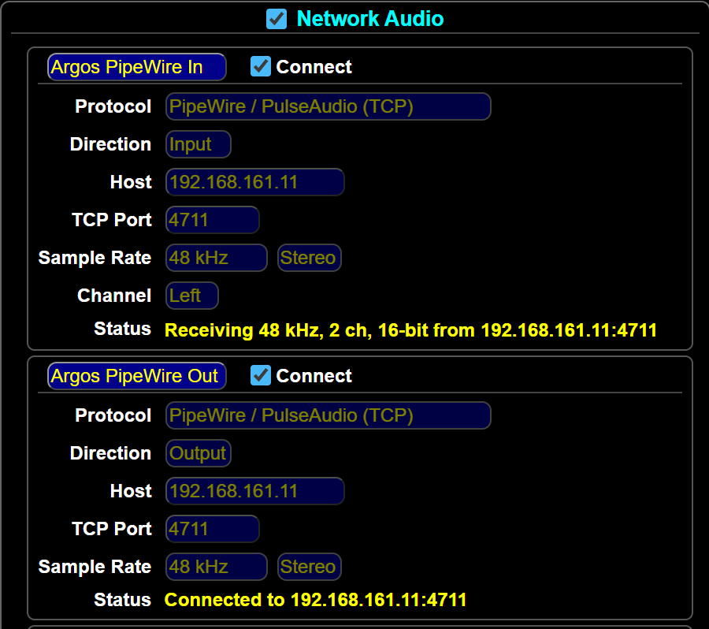

# Network Audio

Network Audio brings audio into GridTracker2, and sends it out, over your home network instead of through a sound card. The [Multi-Mode Decoder](Multi-Mode-Decoder/Multi-Mode-Decoder.md) can then decode a rig that's connected to another computer, and send SSTV pictures back to it.

There are two kinds:

* **Streams** you set up in Settings → Audio: **VBAN** (Voicemeeter and other VBAN programs), **RTP** (PipeWire, PulseAudio and AES67 equipment) and **PipeWire / PulseAudio (TCP)**.
* **A rig's own network audio**: a **FlexRadio** (DAX) or a networked **Icom** (IC-705, IC-7610, IC-9700, IC-905 ...) set up as a VFO in [Rig Control](Rig-and-Rotor-Control.md). Its audio needs nothing set up here.

Each stream and each such VFO appears in the Multi-Mode Decoder's **Input Device** and **Output Device** menus, beside your sound cards.

## Setting Up a Stream

In [Settings → Features](GridTracker-Overview/Settings-Sub-Menus.md#features-tab), under **Service**, tick **Network Audio**. Its streams are set up in the **Radios** tab, which appears to the right of Features (see [Radios Tab](GridTracker-Overview/Settings-Sub-Menus.md#radios-tab)). Click **Add Stream** for each stream, up to eight.

{width=450px}

Each stream has a box of its own:

* **Name:** your own name for the stream. The device menus show it after the protocol, for example **VBAN: Shack PC**.
* **Connect:** a new stream starts with it unticked. Set the stream up, then tick **Connect**. While it is ticked the settings are grayed out; untick it to change them. **✕** removes a stream while **Connect** is unticked.
* **Protocol:** VBAN, RTP, or PipeWire / PulseAudio (TCP).
* **Direction:** **Input** (audio the decoder hears) or **Output** (audio it sends, such as SSTV pictures).
* **Found:** streams announced on your network, if any (RTP's and VBAN's). Pick one to fill in its settings.
* The fields the protocol needs: **Host**, **UDP Port** or **TCP Port**, **Stream Name**, **Sample Rate** with **Mono** or **Stereo**, and **Channel** (for a stereo input: **Left**, **Right**, or **Mix** of both).
* **Status:** what the stream is doing, for example "Receiving 48 kHz, 2 ch, 16-bit from 192.168.1.20 (Stream1)", "No audio for 2 s", or an error in orange.

An input listens all the time while **Connect** is ticked, so its status shows straight away whether audio is arriving. A stream that fails, or whose far end restarts, is tried again by itself.

Then pick the stream in the Multi-Mode Decoder: in its **Settings**, as the **Input Device** (or **Output Device**) of every mode with **Common Input Device** on, or of one mode on the **Decoders** tab.

## VBAN

VBAN is VB-Audio's protocol, used by Voicemeeter and many other programs and devices. It's the easiest way to bring audio from another Windows PC.

* **Input:** the **UDP Port** to listen on (6980 by default) and the **Stream Name** to hear. Leave **Stream Name** blank to hear the first stream that arrives; the status says which. Leave **Host** blank to hear the stream from any computer, or enter a computer's address to hear only that one. VBAN streams heard on port 6980 are listed under **Found**.
* **Output:** the **Host** to send to, its **UDP Port** (6980), the **Stream Name** the receiving program expects, and the **Sample Rate** and **Mono** or **Stereo**.

An input takes whatever rate and format the sender uses: 8 to 32-bit, or 32 or 64-bit float. GridTracker2 sends 16-bit.

In Voicemeeter, add a stream in its VBAN window: an outgoing stream to this computer's address for GridTracker2's input, or an incoming stream named as your GridTracker2 output.

```{note}
PipeWire's VBAN receiver (`libpipewire-module-vban-recv`) plays every stream at its own rate, 44.1 kHz unless set, whatever the sender says. Set its `audio.rate` to the rate of your GridTracker2 output, or the audio comes out off pitch.
```

## RTP

RTP is the standard way PipeWire and PulseAudio send audio over a network, and what AES67 equipment uses.

* **Input:** the **Host** is the multicast group to listen on (224.0.0.56, PipeWire's and PulseAudio's, by default), or blank for a stream sent straight to this computer. Enter the **UDP Port** (46000 by default), and the **Sample Rate** and **Mono** or **Stereo** the sender uses. A stream that announces itself (SAP) is listed under **Found** and sets them for you.
* **Output:** the **Host** to send to (224.0.0.56 for every PipeWire and PulseAudio computer on your network, or one computer's address), its **UDP Port**, and the rate and channels.
* **Announce** (output): announces the stream, so PipeWire and PulseAudio computers listening for announcements pick it up by themselves: it shows as **RTP Stream (** and the stream's name **)**. Every such computer on your network then has it. It is on for a multicast group and off for one computer's address until you change it.

On the PipeWire or PulseAudio computer (including PipeWire with pipewire-pulse):

```
pactl load-module module-rtp-send source=<source name> destination_ip=224.0.0.56 port=46000 rate=48000 channels=2 format=s16be
pactl load-module module-rtp-recv sap_address=224.0.0.56
```

The first sends a source to GridTracker2; the second plays the streams GridTracker2 announces. `pactl list short sources` lists the source names; `<sink name>.monitor` sends what a sink plays.

## PipeWire / PulseAudio (TCP)

The "simple protocol": plain audio over one TCP connection, to a PipeWire or PulseAudio computer that serves it. Use it where multicast doesn't get through, for example over Wi-Fi or a VPN.

Enter the server's **Host** and **TCP Port** (4711), and the **Sample Rate** and **Mono** or **Stereo** the server is set to. They must match: if they don't, the status says so. An input and an output to the same server share one connection.

On the server, PulseAudio or PipeWire with pipewire-pulse:

```
pactl load-module module-simple-protocol-tcp rate=48000 format=s16le channels=2 record=true playback=true port=4711 listen=0.0.0.0 source=<source name> sink=<sink name>
```

For a permanent setup, put the same line, without `pactl`, in `~/.config/pulse/default.pa`. Or with PipeWire itself, in a file such as `~/.config/pipewire/pipewire.conf.d/gridtracker-simple.conf`, then restart PipeWire (`systemctl --user restart pipewire`):

```
context.modules = [
  { name = libpipewire-module-protocol-simple
    args = {
      capture = true
      playback = true
      audio.rate = 48000
      audio.format = S16
      audio.channels = 2
      audio.position = [ FL FR ]
      server.address = [ "tcp:0.0.0.0:4711" ]
      capture.props = { target.object = "<source name>" }
      playback.props = { target.object = "<sink name>" }
    }
  }
]
```

`capture` sends audio to GridTracker2 (its input); `playback` takes GridTracker2's output.

```{warning}
The simple protocol has no password: anyone on your network can listen or play. Use it on your own network only, and open TCP 4711 in the server's firewall.
```

## A Rig's Own Network Audio

A **FlexRadio** or a networked **Icom** set up as a VFO in [Rig Control](Rig-and-Rotor-Control.md) brings its own audio. It is listed in the device menus by the protocol and the VFO, for example **FlexRadio DAX: VFO-A (Flex)** or **Icom LAN: VFO-B (IC-9700)**, and started only while the decoder uses it.

With a rig's network audio as the Input Device and no Output Device picked, SSTV pictures are sent to the same rig. The rig is keyed by its **PTT Method** (CAT), as usual.

* **FlexRadio:** the audio of VFO-A's slice through DAX, 24 kHz. If the slice has no DAX channel, GridTracker2 gives it the first free one. Sending uses DAX TX.
* **Icom LAN:** the radio's receive audio and transmit audio, 16-bit at 16 kHz. To transmit the decoder's audio, set the radio's modulation input for data to the network: on the IC-705, MENU › SET › Connectors › MOD Input › DATA MOD › **WLAN**.

## Clocks and Gaps

A network stream comes from a computer with its own clock, and its packets arrive in bursts. GridTracker2 holds a short queue of the audio (about 0.2 s) and plays it a tiny bit faster or slower to keep up with the sender, so no samples are lost or doubled and SSTV pictures and weather faxes stay straight.

Packets lost on the way (VBAN, RTP, FlexRadio DAX and Icom LAN number theirs) are replaced with the same length of silence, so the timing stays true. TCP never loses audio, but can't tell when the server drops some.

## Firewall

The first time a stream is opened, Windows may ask whether GridTracker2 may use the network: allow it on private networks. Inputs need these ports open on this computer: VBAN UDP 6980, RTP UDP 46000 (and UDP 9875 for announcements), FlexRadio and Icom LAN as their VFOs use them.
