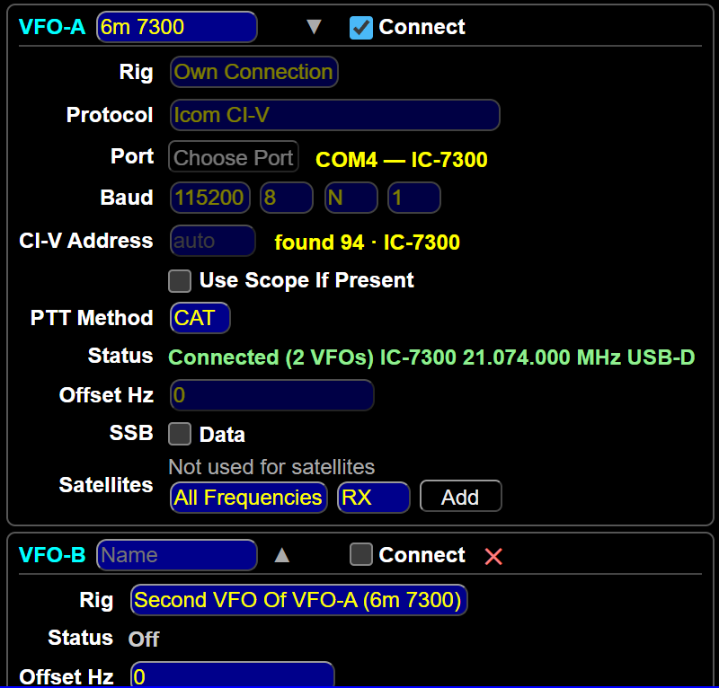
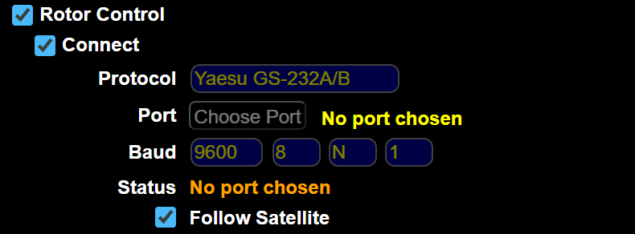

# Rig and Rotor Control

GridTracker2 can talk to your radios and your antenna rotator itself, without WSJT-X or a logging program in between:

* **Rig Control** reads and tunes your rigs and SDRs. The [Multi-Mode Decoder](Multi-Mode-Decoder/Multi-Mode-Decoder.md) and [BirdWatch](BirdWatch.md) use it.
* **Rotor Control** turns your antenna toward a station, a point on the map, or a satellite.

Tick **Rotor Control** or **Rig Control** in [Settings → Features](GridTracker-Overview/Settings-Sub-Menus.md#features-tab), in the **Service** box. Their settings are in the **Radios** tab, to the right of Features, which appears while either of them (or Network Audio) is on.

## Rig Control

Rig Control works with these:

* Hamlib's **rigctld** and **flrig**, which can share one rig with WSJT-X and other programs.
* An **Icom** (CI-V), a **Kenwood** or a **Yaesu** (CAT) on a serial or USB port.
* An SDR through **SPY Server** or **SDR++**.
* A **FlexRadio** through SmartSDR, and a networked **Icom** (IC-705, IC-7610, IC-9700, IC-905 ...) over the network, each with its audio too.

### VFOs

Rig Control is set up as a list of VFOs, each in a box of its own. Each VFO is called by a letter, **VFO-A**, **VFO-B** and so on, from its place in the list. At first there are two: VFO-A, a rig of its own, and VFO-B, the second VFO of that rig.

{width=420px}

In each box's title line:

* **Name:** your own name for the VFO. It is shown after its letter, e.g. VFO-C (SDR).
* **▲** and **▼** move the VFO up or down the list. Its letter changes with its place. BirdWatch uses the VFOs higher in the list first.
* **Connect:** see [Connect and Status](#connect-and-status).
* **✕** removes the VFO. It only shows while **Connect** is unticked, and the last VFO can't be removed.

**Add VFO** adds a new VFO at the end of the list, up to eight (VFO-A to VFO-H).

**Rig** says where the VFO is:

* **Own Connection:** a rig of its own, with its own connection settings below.
* **Second VFO Of VFO-A** (or another VFO): the second VFO (VFO B, or Sub) of a rig set up in another box. It has no connection of its own; it uses that rig's. Each rig can have one second VFO.

A rig whose second VFO can be read and set shows **(2 VFOs)** in its status. If it has none, the second VFO's status says "The rig has no second VFO that can be read and set".

When a rig is first found to have a second VFO and none is set up for it, GridTracker2 adds one for you, right after the rig's own VFO. Its **Connect** is unticked, and its **Satellites** is set to **All Frequencies TX**, for satellite uplinks. Tick **Connect** to use it. If you remove it, it isn't added again.

A rig's VFO and its second VFO show side by side while they are next to each other in the list. If the window is too narrow, the second one goes under the first.

The Multi-Mode Decoder and BirdWatch each pick the VFOs they use, in their own settings. If you remove a VFO, what used it uses **None** until you pick another one.

### Connection Types

Pick the VFO's connection in **Protocol**. The fields under it change to match.

**Hamlib rigctld**

Enter the **Host** and **TCP Port** where rigctld runs (127.0.0.1 and 4532 by default). Start rigctld for your rig first, for example `rigctld -m <model number> -r COM3 -s 19200` (`rigctl -l` lists the model numbers).

* **Force VFO Mode:** needed for the second VFO on a radio whose VFOs are called Main and Sub (for example the Yaesu FTX-1). It works like starting rigctld with `--vfo`, but only on Rig Control's own connection; other programs connected to the same rigctld aren't affected. If your rig needs it, the Event Viewer tells you.

**flrig**

Enter the **Host** and **TCP Port** of flrig's XML-RPC server (127.0.0.1 and 12345 by default). flrig must have your rig connected.

**Icom CI-V, Kenwood CAT, Yaesu CAT**

For a rig on a serial or USB port. The choices are **Icom CI-V**, **Kenwood CAT (TS-2000+)**, **Yaesu CAT (FT-991+)** and **Yaesu CAT (FT-817/818/857/897)**. A note under the Kenwood and Yaesu choices lists the other rigs that use them, for example Elecraft rigs and SDR programs with a TS-2000 port (SDR# CalicoCAT, SmartSDR CAT) under Kenwood.

* **Port:** click **Choose Port** and pick the port from the list. Each port shows its name and, where the USB device has one, its serial number, so two rigs of the same model can be told apart (for example Silicon Labs CP210x USB to UART Bridge (COM3) — IC-7300_02018437). Ports that another VFO or the rotator already has open are grayed out. The port's name shows beside the button, and on Windows also the rig's model when the USB driver gives it (for example COM3 — IC-7300). GridTracker2 finds the rig's port again by its USB device, so it keeps working when the system gives it another port name.
* **Baud:** the rig's CAT or CI-V baud rate, 4800 to 115200 (19200 by default), followed by the data bits, parity and stop bits (8 N 1). These must match the rig's own menu settings.
* **DTR** and **RTS:** see [Other VFO Settings](#other-vfo-settings).
* **CI-V Address** (Icom only): leave it blank. GridTracker2 asks the rig for its address and shows "found 94 · IC-7300" beside the field. Enter one only to insist on it, in hex (IC-7300 94, IC-9700 A2, IC-705 A4, IC-7100 88).
* **Use Scope If Present** (Icom only): see [Band Scope](#band-scope).

The FT-817, FT-818, FT-857 and FT-897 can only reach VFO B by swapping VFOs. For a satellite, use two of these rigs, each a VFO of its own.

```{warning}
Only one program can open a serial port. If WSJT-X (or another program) already has the rig's port, the port can't be opened, and the message under **Choose Port** says so. GridTracker2 keeps trying while **Connect** is ticked, and connects as soon as the other program lets the port go (even for a moment, as WSJT-X does when its settings are changed), so untick **Connect** while the other program should keep the rig. To use the rig in both, set WSJT-X's **Rig** to **Hamlib NET rigctl** or **flrig**, and choose the same here.
```

On Linux, if your user isn't allowed to open serial ports, a note under the port tells you the command to run.

**SPY Server by Airspy**

An Airspy, Airspy HF+ or RTL-SDR shared by SPY Server. Enter the **Host** and **TCP Port** of the server (5555 by default). The VFO is the frequency the server's stream is centered on. GridTracker2 can tune it only if the server lets this client tune. Its I/Q stream is also offered as an input in the Multi-Mode Decoder (see [What Uses Rig Control](#what-uses-rig-control)).

**SDR++ (Server)**

SDR++ started with `--server`. Enter the **Host** and **TCP Port** (5259 by default). The VFO is the frequency the server's device is tuned to. Once connected, three menus from the server appear:

* **Source:** the SDR++ source, as in SDR++'s own menu.
* **Device:** the device that source uses. **Refresh** looks for devices again.
* **Sample Rate:** the device's sample rate. The decoder takes what it needs from it.

The menus show **Not Connected** until the server answers. The gain is set in SDR++ itself. The server takes one client at a time, and sends its I/Q only while a decoder uses it.

**SDR++ (rigctl)**

The VFO selected in the SDR++ window, through SDR++'s **Rigctl Server** module. Add that module in SDR++ and start it, then enter its **Host** and **TCP Port** (4532 by default). SDR++ keeps its own audio, and the module takes one client at a time.

**FlexRadio SmartSDR**

A FlexRadio 6000 or 8000 series radio, with SmartSDR (or a Maestro) running and connected to it. Enter the radio's address in **Host**, or leave it blank to use the first FlexRadio found on your network, and the **TCP Port** (4992).

* **VFO-A** is the slice that transmits, of the SmartSDR client GridTracker2 joins; **VFO-B**, its second VFO, is that client's next slice.
* Digital modes set in USB or LSB with **SSB Data** use DIGU or DIGL, shown as USB-D and LSB-D.
* **PTT Method** CAT keys the radio (`xmit`).
* Its DAX audio is offered to the Multi-Mode Decoder (see [Network Audio](Network-Audio.md)).

**Icom LAN**

An Icom with a network connection (IC-705, IC-7610, IC-9700, IC-905 ...), reached over your network the way Icom's Remote Utility does, with no computer at the radio. Enter the radio's address in **Host** and its **UDP Port** (50001), and the **Username** and **Password** of a network user set in the radio.

On the radio: turn **Network Control** on, and set up a network user (the IC-705's MENU › SET › WLAN Set › Remote Settings › Network User1). Only one program can use the radio over the network at a time; if another has it, the status says which.

* The radio tells GridTracker2 its CI-V address; **CI-V Address** is for insisting on another, as with a USB connection.
* Frequency, mode, data mode, the second VFO and PTT work as with **Icom CI-V**.
* Its receive and transmit audio is offered to the Multi-Mode Decoder (see [Network Audio](Network-Audio.md)).

```{note}
An SDR has no mode of its own: a SPY Server or SDR++ (Server) VFO always shows USB, which is what its I/Q gives the Multi-Mode Decoder.
```

### Connect and Status

A new VFO starts with **Connect** unticked. Set it up, then tick **Connect** to connect it.

While **Connect** is ticked, the VFO's connection settings (**Rig**, **Protocol**, port, **Baud**, **DTR**, **RTS**, **CI-V Address**, **Host**, **TCP Port**, **Force VFO Mode** and **Offset Hz**) are grayed out and can't be changed, so nothing half set reaches your rig. Untick **Connect** to disconnect the rig and change them. A second VFO's **Connect** only works while its rig's **Connect** is ticked too.

**Status** shows how the VFO is doing:

* **Off:** Rig Control or the VFO's **Connect** is off. A second VFO that is off still shows its frequency while its rig is connected and reads it (not with rigctld). GridTracker2 only reads it there; it never tunes a VFO that is off.
* **No port chosen:** pick one with **Choose Port**.
* **Connecting** (yellow).
* **Connected** (green), with the rig's name and its frequency and mode, e.g. "Connected (2 VFOs) IC-7300 14.074.000 MHz USB". The second VFO's frequency and mode are shown in its own box.
* **No Answer** (orange): the connection is open, but the rig doesn't answer, or it stopped answering 5 seconds ago (switched off behind its CI-V interface, for example). Its last frequency isn't shown or used until it answers again. Check the baud rate, and that the rig's CI-V or CAT port is turned on. A Yaesu may need RTS High (see [Other VFO Settings](#other-vfo-settings)).
* **Error** (red): the connection failed. A port that can't be opened is explained in full under **Choose Port**.

A connection that fails or is lost is tried again after a short wait, for as long as **Connect** is ticked. A rig that is switched off or unplugged, or whose port another program has open, connects by itself once its port is back or free, and **Connect** stays ticked until you untick it.

If the rig doesn't go to a frequency GridTracker2 sent it, a warning is added to the Event Viewer.

### Other VFO Settings

* **PTT Method:** how the Multi-Mode Decoder keys the rig when it transmits (Send Picture in SSTV): **CAT** (the rig's own PTT command), **VOX** (the rig's VOX, keyed by the audio), **DTR** or **RTS** (a line of the serial port, as the rig's PTT input is set up, serial rigs only), or **None** (it isn't keyed). Nothing else in GridTracker2 keys your rig. If GridTracker2 closes or restarts while it has your rig keyed, it unkeys it first. A second VFO's box shows its rig's PTT Method, e.g. "CAT (VFO-A)"; it's set in the rig's own box, since it keys the whole rig.
* **DTR** and **RTS** (serial rigs only): the serial port's two control lines while the rig is connected, **Low** (the default; RTS High for Yaesu CAT (FT-991+), below) or **High**. Leave a line Low unless your interface needs it High (an interface powered from the port's lines, for example). A rig set to transmit, or to send CW or RTTY, on DTR or RTS (an Icom's USB SEND or USB Keying setting, for example) needs that line Low. A newer Yaesu with **CAT RTS** turned on in its menu (the FT-991 and FT-991A come that way) doesn't answer while RTS is Low, so picking **Yaesu CAT (FT-991+)** sets RTS High; set it Low only if you turn **CAT RTS** off in the radio. The line **PTT Method** uses shows **PTT**: it is always low until GridTracker2 keys the rig, and goes low again when it unkeys it. On Windows both lines stay low as the port opens, and are then set as chosen. On Linux and macOS the system raises both for a moment as a port opens; they are set as chosen right after.
* **Offset Hz:** for a converter between the antenna and the rig, such as an LNB, an upconverter or a transverter. It is added to the frequency sent to the rig, and taken off what the rig reads, so GridTracker2 always shows the frequency on the air. It can be negative: an LNB with a 9750 MHz LO is `-9750000000`. A VFO with an offset shows **LO** after its frequency.
* **SSB** **Data:** the digital modes the Multi-Mode Decoder sets on this VFO in USB or LSB use the rig's data mode (USB-D, PKTUSB, DATA-U). Off unless ticked. BirdWatch's voice modes aren't affected. A second VFO doesn't have it.
* **Satellites:** what BirdWatch may use this VFO for. Pick a band, **All Frequencies**, or **Custom** (enter its range in MHz), then **RX**, **TX** or **RX/TX**, and click **Add**. Each range shows in the list with a **✕** to remove it. Until you add a receive range, a VFO is used for receiving on every frequency, and never for transmitting. With every range removed, it says "Not used for satellites". See [BirdWatch](BirdWatch.md) for how the VFOs are picked.

### Band Scope

**Use Scope If Present** (Icom CI-V only) shows your radio's own band scope in the Multi-Mode Decoder, above its waterfall. It works with the IC-7300 and the other Icoms that send their scope over USB. Off unless ticked.

The radio must be set up for it:

* **CI-V USB Baud Rate** at 115200 on the radio, and **Baud** 115200 here.
* **CI-V USB Port** set to **Unlink from [REMOTE]** on the radio.
* The radio's own scope turned on.

If something is missing, a yellow note under the checkbox says which: "The scope needs 115200 baud: set it here and on the radio (CI-V USB Baud Rate)", "The radio won't send its scope: set its CI-V USB Port to Unlink from [REMOTE]" or "The radio's scope is off: turn it on at the radio". See the [Multi-Mode Decoder](Multi-Mode-Decoder/Multi-Mode-Decoder.md) for using the scope.

### What Uses Rig Control

* **The Multi-Mode Decoder** reads the VFO each mode uses, shows signals at their frequency on the air, and can tune the rig, for example from its Frequency menu, a right-click on the waterfall, or a click on the band scope. Its own **Rig Control** checkbox, in its window's settings, must be ticked for it to read or tune the rigs. An SPY Server or SDR++ (Server) VFO's I/Q is in the decoder's **Input Device** menus, named after the server and the VFO (e.g. "SPY Server: VFO-C"). See [Multi-Mode Decoder](Multi-Mode-Decoder/Multi-Mode-Decoder.md).
* **BirdWatch** follows a satellite with the rig, correcting the Doppler shift on the downlink and uplink VFOs, and can list only the satellites your rig can hear or work. Its rig box in the BirdWatch panel shows the VFOs' frequencies. See [BirdWatch](BirdWatch.md).

### Rig Control and Your Logging Program

Rig Control is separate from the **Enable Rig Control** options of [Log4OM](Third-Party-Integrations/Log4OM-Integration.md) and [N3FJP AC Log](Third-Party-Integrations/N3FJP-AC-Log-Integration.md). Clicking a spot in the Call Roster or the Feed Roster, or a spot marker on the map, still tunes your rig through WSJT-X, Log4OM or AC Log, never through Rig Control. See [Working a Spot](Making-GridTracker-Work-For-You/Using-Feed-Roster.md#working-a-spot).

```{tip}
To use one rig with WSJT-X, your logging program and GridTracker2 at once, connect them all to the same rigctld or flrig.
```

## Rotor Control

Rotor Control turns an antenna rotator, from a controller on a serial port, through Hamlib's rotctld, or through CatRotator or PstRotator.

{width=400px}

### Setting It Up

1. Tick **Rotor Control**.
2. Untick **Connect**. While it is ticked the settings are grayed out and can't be changed.
3. Pick the **Protocol**:
   * **Yaesu GS-232A/B**, **Easycomm II** or **SPID Rot2Prog:** a controller on a serial or USB port. Click **Choose Port** and pick its port, then set the **Baud** (1200 to 115200, 9600 by default) and the data bits, parity and stop bits (8 N 1) to match the controller.
   * **Hamlib rotctld:** enter the **Host** and **TCP Port** where rotctld runs (127.0.0.1 and 4533 by default).
   * **CatRotator / PstRotator:** enter the **Host** and **UDP Port** the program listens on (127.0.0.1 and 12000 by default). The program's position replies are received on the next port up (12001).
4. Tick **Connect**.

**Status** shows **Off**, **No port chosen**, **Connecting**, **Connected** with the rotator's position (e.g. 123°, or 123° / 45° for a rotator with elevation), or **Error**. With CatRotator / PstRotator it shows "Sending to" the address and port, since there is no connection to be up or down. A connection that fails or is lost is tried again after a short wait.

### Aiming the Antenna

* **Call Roster:** right-click a callsign (in the Callsign or Calling column) and choose **Aim Rotator**. The choice is there while Rotor Control is on.
* **Map:** hold **Ctrl** and click a point on the map. The antenna turns to the bearing from your QTH to that point.

The Event Viewer shows "Aiming rotator at" the station, or "Aiming rotator to" the bearing, or "Rotator not connected" in red if the rotator isn't connected. A rotator with elevation is set level for a station on the ground.

### Follow Satellite

With **Follow Satellite** ticked (on by default), the rotator follows the satellite selected in [BirdWatch](BirdWatch.md) while it is up, azimuth and elevation, and points at where it will rise a few minutes before each pass. While Rotor Control is on, the BirdWatch panel shows the rotator's position; click it to open these settings.

### CatRotator and PstRotator

CatRotator / PstRotator used to be an option of its own in the Service box. It is now a **Protocol** of Rotor Control. If you had it turned on, your address and port are carried over, and Rotor Control is turned on with that protocol.
