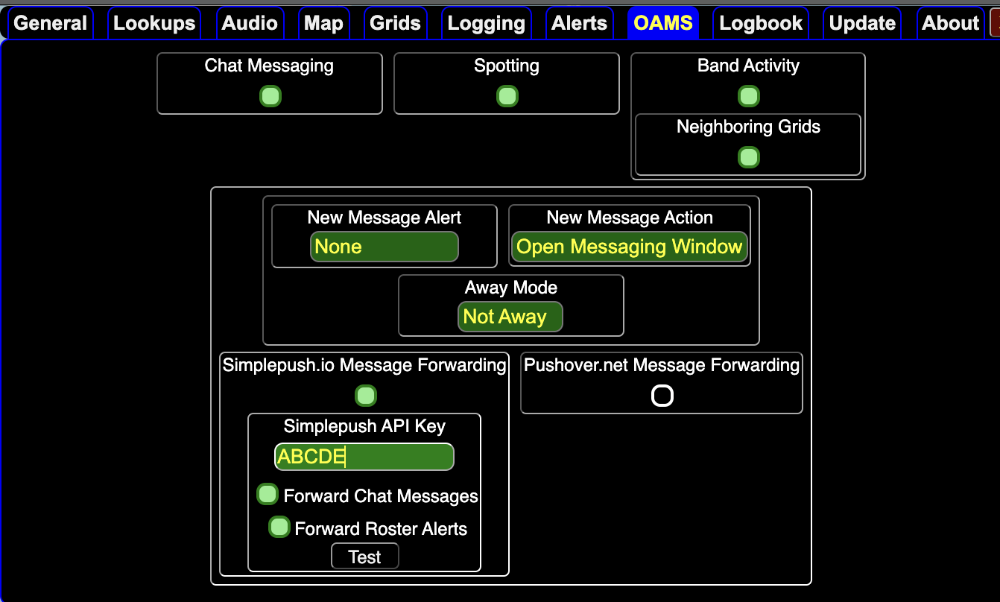
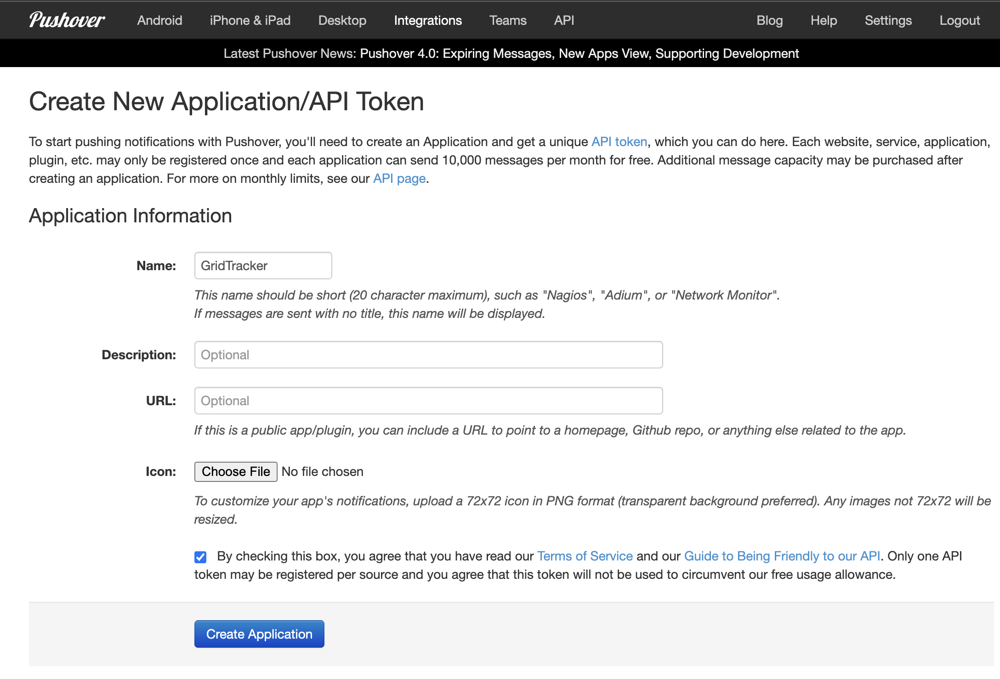
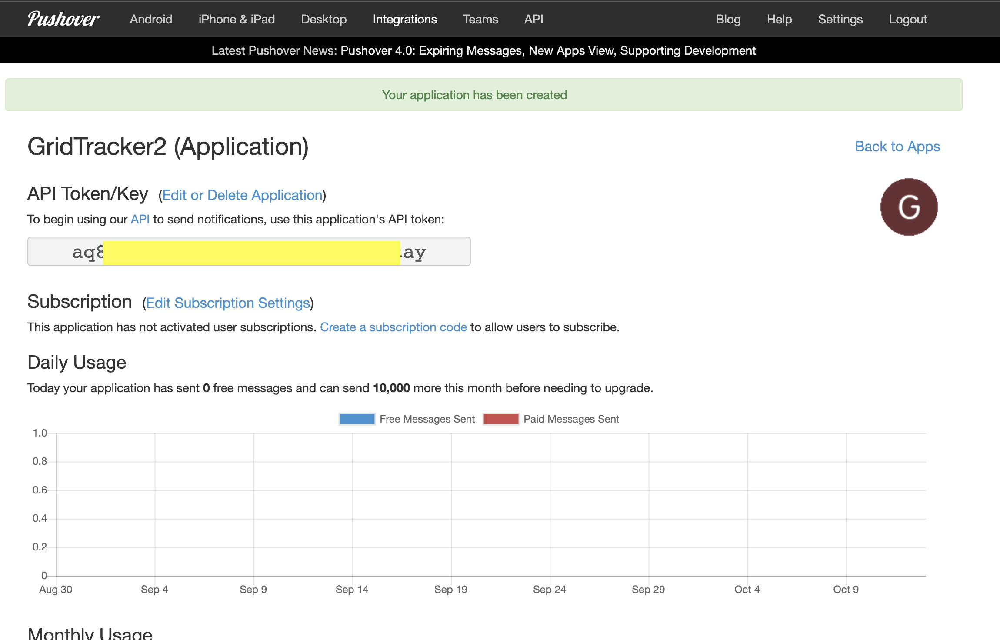
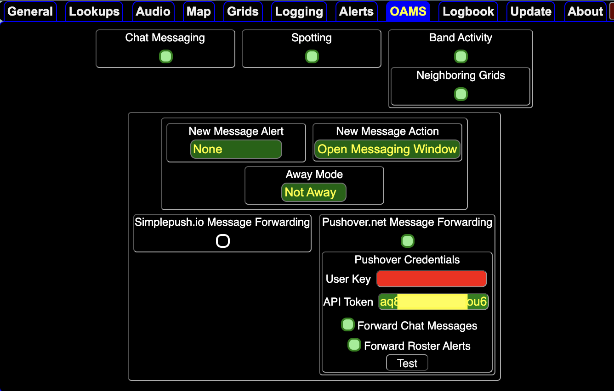
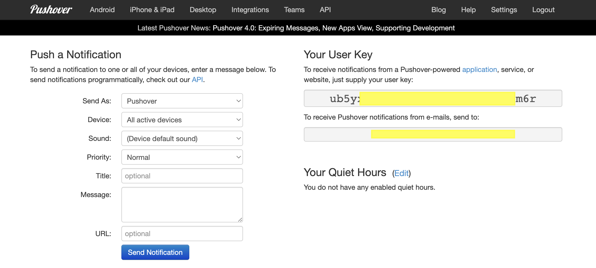
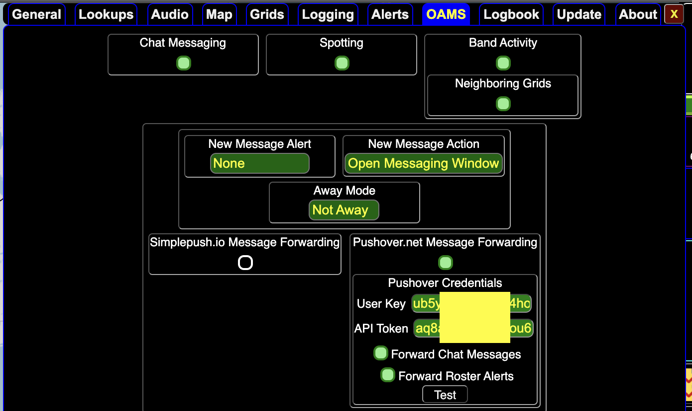
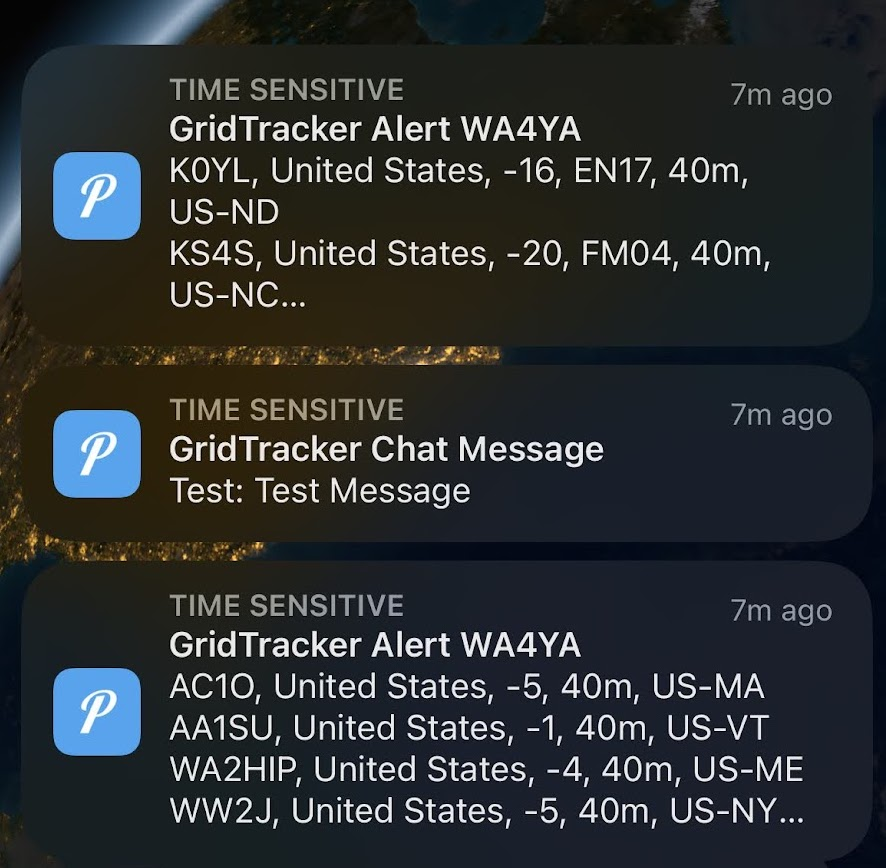

## **HamClock**

[https://www.clearskyinstitute.com/ham/HamClock/](https://www.clearskyinstitute.com/ham/HamClock/)

HamClock can receive UDP broadcasts from WSJT-X and JTDX to update the DX location on HamClock. GridTracker can in turn provide the same DX / Grid information that WSJT-X or JTDX does.

You must be using HamClock version 2.51 or greater.

Enter WSJT-X for the “Cluster?Spider host:” and in “port:” enter the port number you configured in GridTracker to broadcast.

Click “Done” when finished.

HamClock will continue to load / launch.

Once HamClock is up and running, when you initiate a QSO, if configured properly, the DX station will be 1) shown in the DX window, 2) the VOACAP DE-DX will be updated, 3) the DX placed on the map along with the DX legend (lower left) will be updated.

## **Push Notification Forwarding to your phone**

GridTracker can forward unseen chat messages and hits on the Call Roster to your phone through third-party services. We currently support [SimplePush.io](https://simplepush.io/) and [Pushover.net](https://pushover.net/). Both services can be tested, SimplePush allows 10 free messages per month while Pushover has a 30-day free trial. After that you will need to either purchase a subscription for SimplePush for $13 per year or do a one time in-app purchase in Pushover for $5 to get 10,000 messages free each month, no subscription required.

### How-To SimplePush.io notifications ###

Download the SimplePush.io app from the Apple Appstore or the Google Play store. Open the app and it will display a 6-letter code. This your API key:

If you click the test button you should get a test message to your phone and GT should push CR hits and chat messages. Unfortunately you'll get only 10 messages per month for free.

### How-To Pushover.net notifications ###

Register on [pushover.net](https://pushover.net/) with a new user account. You'll get 30 days to test it out. Download the pushover.net app from the Apple Appstore or the Google Play store. Log in with your username/password. Go back to the [webpage](https://pushover.net) and create a new [Pushover application](https://pushover.net/apps/build). Call it GridTracker for example and check the terms of service box:

You'll see this screen with your API token:

Copy that token to the API token field for Pushover:

Go to the [pushover.net](https://pushover.net/) home page and find your user key:

Now add your user key and click the test button:

You should now get notifications to your phone:

If you run your station 24/7 you'll no longer miss incoming OAMS chat messages nor Call Roster hits. GridTracker has to be running though, no messages will be sent to your phone otherwise.
