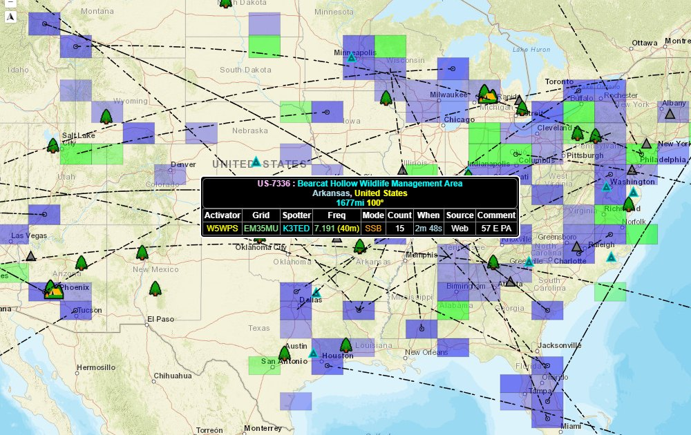
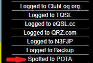

# Parks On The Air (POTA)

Parks On the Air® (POTA) is an activity where amateurs operate from parks (Activators) while others (Hunters) contact them. See [parksontheair.com](https://parksontheair.com/) for more.

GridTracker2 helps Hunters find parks they haven't worked, and helps Activators find other Activators for Park to Park (P2P) contacts.

## Setting Up

In [Settings → Features](../GridTracker-Overview/Settings-Sub-Menus.md#features-tab), tick **POTA Hunting** in the Online box. It is on by default in new installations.

Turning it on also turns on **Load At Startup** and **Log QSO** for the **GridTracker2** log in [Settings → Logging](../GridTracker-Overview/Settings-Sub-Menus.md#logging-tab). GridTracker2 uses its own log to know which parks you have worked, today, on which band and mode, because logging programs record POTA in different ways. Keep both ticked.

## How Parks Are Counted

GridTracker2 follows the POTA rules: each activator, park, band and mode is a new contact each UTC day, and the day starts again at midnight UTC.

For example, if you work N0TTL at park US-1234 on FT8 at 2330Z, then he switches to FT4, he is new again on FT4. If he goes back to FT8 at 0001Z, he is new again on FT8, because it is a new UTC day.

## Where Park Information Comes From

* The **POTA spots** at [pota.app](https://pota.app/), downloaded every 5 minutes. A newly spotted activation may take up to 5 minutes to appear, and an activator who has gone QRT may stay on the map until the next download.
* **Scheduled activations** posted on pota.app, for activators you decode.
* **DX Feeds** spots, when [DX Feeds](../Making-GridTracker-Work-For-You/Using-Feed-Roster.md) is on: a park reference in a spot's comment gives that activator's park.

You may hear activators who haven't posted their activation and haven't been spotted. They show "?-????" until their park becomes known.

## POTA on the Map

The **POTA** button in the button panel shows or hides the parks on the map.

| Icon | Meaning |
| --- | --- |
| {width=28px} | An activator on your radio's band and mode that you haven't worked today. |
| {width=28px} | An activator you have worked today on this band and mode. It changes back to the tent if they change band or mode, or a new UTC day starts. |
| {width=28px} | An activator on a band or mode none of your radios is on. |

Like everything on the map, the parks follow the [Map View Filters](../GridTracker-Overview/Control-Panel.md#map-view-filters). For example, with Band on Auto and Mode on Mixed while you work 20 m FT8, an activator on 20 m SSB shows as a pine tree.

Hold the mouse over a park to see its reference and name, its location, the distance and bearing from you, and its spots: activator, grid, spotter, frequency, mode, how many times it was spotted, when, where the spot came from, and the comment.

* **Click** a park to work the activator: the spot goes to a radio on its band and mode, or to a connected AC Log or Log4OM (which can tune your rig), or to WSJT-X as Gen Msgs. See [Working a Spot](../Making-GridTracker-Work-For-You/Using-Feed-Roster.md#working-a-spot).
* **Right-click** a park to pop its tooltip out into its own window. Callsigns there can be clicked to look them up.
* A park whose activator is in your radio's DX Call is ringed.
* Overlapping parks, summits and DX spots in the same DXCC entity are grouped into one marker while **Group Overlapping Spots** is on in Settings → Map.

## POTA in the Rosters

In the Call Roster (and the Feed Roster), tick **POTA** under **Wanted**. This also shows the **POTA** column, which you can drag to where you want it.

The park in the POTA column is highlighted:

* with a **full background** when you have never worked that park, an All Time New One (ATNO);
* with a **lighter background** when you have worked the park before, but not today on this band and mode;
* with a **glow only** when you have already worked it today on this band and mode.

A station calling CQ POTA whose park isn't known yet shows "?-????". The park appears as soon as GridTracker2 learns it.

Once you have worked an activator, their further CQs may be hidden, depending on your Exceptions, until the UTC day changes, they change mode or park, or you change band and they are on that band too.

To highlight every station calling CQ POTA, add a **Message** Watcher with the text `CQ POTA` (tick Regex to match it anywhere in the message). See [Watchers](../Making-GridTracker-Work-For-You/Using-Call-Roster.md#watcher).

In Settings → Audio Alerts you can choose a sound or spoken alert for wanted parks, and a different one, **On ATNO**, for parks you have never worked.

## Spotting to POTA

When you log a QSO with a known activator, GridTracker2 spots them on pota.app for you. The message list shows "Spotted to POTA". This works for QSOs logged from WSJT-X or JTDX, logged in AC Log with a park in an Other field titled `POTA_REF`, and logged by hand from the Feed Roster.

The spot appears on pota.app with your callsign, the spot information, and the comment from the WSJT-X log window.

If the park wasn't known when you logged the QSO ("?-????"), GridTracker2 can't spot it, and that activator's later CQ POTA calls keep showing as wanted.

## The Logbook

The [Statistics](../Making-GridTracker-Work-For-You/GridTracker-Statistics.md) window's Logbook tab has a **POTA** column, with its own search box, whenever your log has POTA QSOs. GridTracker2 reads a park from either `POTA_REF` or `SIG`=POTA with `SIG_INFO` in your ADIF logs, and writes `POTA_REF` when it logs a QSO with a known activator.
