# GridTracker2 and Parks On The Air® (POTA).

Parks On the Air® (POTA) is a popular activity that involves hams all over the world operating from parks (Activators) and other hams known as Hunters making contacts with them. More information located at [https://parksontheair.com/](https://parksontheair.com/).

GridTracker2 is a powerful tool for both Hunters looking to make contacts with parks, and Activators looking for other Activators for Park to Park (P2P) contacts.

## Setting GridTracker2 up for POTA

Under Settings> Features, enable POTA Hunting in the Online box:

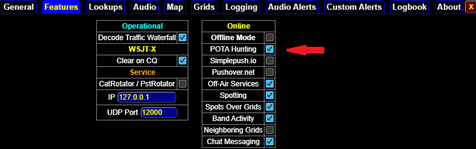

Enabling this will place a POTA button on the Main Menu. Use of this button will toggle between displaying and removing POTA icons from the map.

At this point GridTracker2’s map will display icons representing current POTA activations as listed at [https://pota.app/#/](https://pota.app/#/).

The data from the pota.app site is refreshed every 5 minutes. So it is possible that there are new activations not displayed on the GT2 map, and that Activators that have gone QRT are still being displayed.

You may see/hear activations that do not appear on the map due to the Activator not posting their activation to the pota.app site.

As with all other uses of the GridTracker2 map, the displayed parks will be dependent on the Map View Filter settings in the main menu (Mixed vs Auto etc.)

Please also note that GridTracker2 follows the POTA standard of treating each operator/park/band/mode as a unique entity each day, and resets at Midnight UTC.

For example if you work NØTTL at park US-1234 on FT8 at 2330Z, and then he switches to FT4, that will be treated as a new entity. If he then goes to back to FT8 at 0001Z, he will again be treated as a new entity.

## POTA Icons

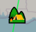 Tent/Tree: A POTA station active on your Band/Mode that you have not worked.

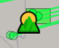 Sunrise over a Mountain: A POTA Station you have worked on your currently active Band/Mode. Should the station change band or mode, or the time switches to a new UTC day, that Icon will switch back to the Tent/Tree Icon.

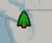 Pine Tree: POTA station on a Band or Mode other than the one on which you are currently active.
For instance: if you are working 20M FT8, have your Band Map View Filter set to Auto and Mode set to Mixed, a POTA station working SSB on 20M would show as a Pine Tree.

If you hover your mouse over a POTA Icon, the map will display a box with park information:

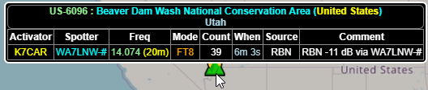

The box gives you the number and name of the park, and information on the activator, band, mode, age and source of latest spot as provided the pota.app site.

## POTA Spotting

When operating Digital Modes with WSJT-X, GridTracker2 will spot a POTA station you have worked to the pota.app site when you log it from WSJT-X. A successful spot will be noted in the GridTracker2 menu message scroll:

The message will appear on the worked stations listing on pota.app as follows

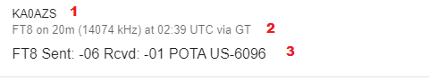

1. Your Call
2. Spot information
3. Data from the comments section of the WSJT-X log screen

## Call Roster

The GridTracker2 Call Roster can also provide useful information when POTA
hunting. 

In Call Roster, go to the More Controls Screen, and enable POTA under Wanted:

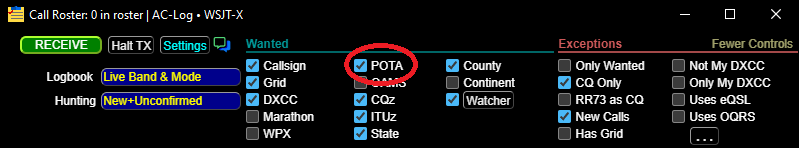

You can then right click on the column headings in the Call Roster and select POTA to display a column for POTA information. You can then lift click on the column and drag it to where you want in the column list:

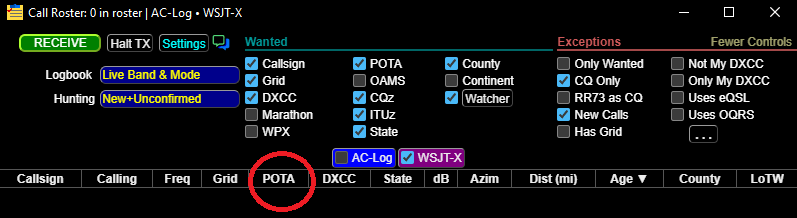

Another way to highlight stations calling CQ POTA is to set up a watcher in the Call Roster Settings:

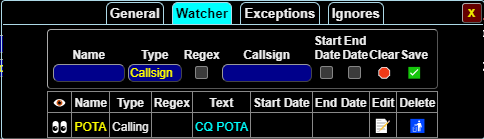

With these settings, when K7CAR for instance, calls CQ POTA he will show in the Call Roster like this:

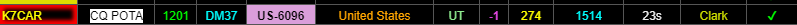

The “CQ POTA” is highlighted in White due to the Watcher Settings.
The POTA Column has the Park Number fully highlighted in pink.

Once you have worked the station and it has been logged with WSJT-X, it will display like this until it drops off the call roster:

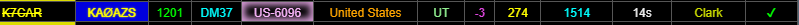

The Park number now has a partially highlighted box to show that you have worked that park today on the active Band.

Further CQ POTA calls from that Activator will be filtered depending on your other Call Roster settings, and may not appear in the Call Roster until either the UTC day changes, they change Mode, they change parks, or you switch bands and they start working on that band.

If an Activator that has not registered his activation on the pota.app site or been spotted there, and is calling CQ POTA, the Call Roster will display “?-????” in the POTA column.

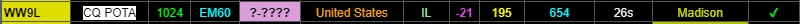

This can also happen if the station only registered or been spotted on pota.app since the last time that GridTracker2 refreshed it’s information. In that case, the Park Number will be displayed as soon as the information is received by GridTracker2 from pota.app.

Note: If you work a park without park information for either of the above reasons, GridTracker2 will not provide a spot to pota.app, and the POTA rules for displaying POTA stations will not apply, so future CQ POTA calls will continue to be displayed in the Call Roster.