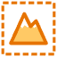
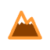
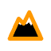

# Summits On The Air (SOTA)

Summits on the Air (SOTA) is an award program for operating from, and contacting, mountain summits. Activators climb to a summit and operate from it; Chasers contact them. See [sota.org.uk](https://www.sota.org.uk/) for more.

GridTracker2's **SOTA Chasing** finds activators in the DX Feeds spots, shows them in the rosters and on the map, and records the summit with your QSO.

## Setting Up

1. In [Settings → Features](../GridTracker-Overview/Settings-Sub-Menus.md#features-tab), turn on **Off-Air Services** and **DX Feeds**.
2. Tick **SOTA Chasing**, under DX Feeds.

Like POTA Hunting, this turns on **Load At Startup** and **Log QSO** for the GridTracker2 log in Settings → Logging, so GridTracker2 knows which summits you have chased. A **SOTA** button is added to the button panel.

## SOTA in the Rosters

The Feed Roster and the Call Roster both get a **SOTA** Wanted choice and a **SOTA** column (off by default: turn it on in the roster's Settings → Columns, or tick SOTA under Wanted).

* The column shows the summit reference. Hover over it for the summit's name, height and points, and how many summits you have chased in its association and region.
* **Dots** show what a summit is worth to you: two dots before the reference mean you haven't chased any summit in that association yet, one dot that you have chased one there. A dot after it means you haven't chased a summit in that region.
* The highlighting works like POTA's: a full background for a summit you have never chased, lighter for one chased before but not today, a glow only for one chased today.
* **SOTA** under Wanted highlights summits you haven't chased today, using the `SOTA_REF` of the QSOs in your logs.

In the Call Roster, a station you decode that DX Feeds has spotted on a summit gets that summit. The station's grid stays the one it sends; if it sends none, the summit's grid is shown, marked ◇.

In Settings → Audio Alerts → Feed Roster, choose alerts for **Wanted Feed Summit** and **Many Feed Summits**, and **On ATNO** for summits you have never chased.

## SOTA on the Map

The **SOTA** button shows or hides summits on the map. Each summit with activators has one marker, a snow-capped double peak:

* {width=24px} a radio is on the spot's band and mode;
* {width=24px} a radio is on the spot's band, in another mode;
* {width=24px} no radio is on the spot's band.

The tooltip has the summit, its location, height and points, then every spot on it, newest first. Your own decodes of the activator are listed as spots from you. Click the summit to work the newest spot. SOTA summits are drawn above POTA parks, which are drawn above DX Feeds spots.

## How Activations Are Followed

* A spot on a summit places the activator there: the summit's grid is used for the distance, and for a logged QSO that has no grid.
* A later spot that doesn't name the summit (from a skimmer, say) keeps the summit the activator is on.
* A spot saying **QRT**, or a spot with no frequency, ends that activation: the activator leaves the Feed Roster and the map until spotted again.
* An activator spotted on another summit leaves the old one at once.
* An activator you are still decoding keeps their summit, even after their last spot has aged out.

## Logging

A QSO logged with a spotted activator gets the summit's `SOTA_REF`. This works for QSOs logged from WSJT-X or JTDX, logged in AC Log with an Other field titled `SOTA_REF`, and logged by hand from the Feed Roster's SOTA column (see [Logging a POTA or SOTA QSO by Hand](../Making-GridTracker-Work-For-You/Using-Feed-Roster.md#logging-a-pota-or-sota-qso-by-hand)).

## Exporting Your Chaser Log

The Statistics window's Logbook tab has a **SOTA** column, and an **Export SOTA Chaser Log…** button whenever your log has SOTA QSOs. It writes your chases as a CSV file for the SOTA database's chaser log upload.

1. Click **Export SOTA Chaser Log…**.
2. Pick the **From** and **To** times. They are in your local time; the file is written in UTC. Each export starts where the last one ended, so you don't upload a QSO twice.
3. Check the QSOs listed. You can edit any field, or leave a QSO out with its ✕. Possible duplicates (the same station, summit, day, band and mode) are highlighted. Your changes only affect the file, never your logbook.
4. Click **Export CSV…** and save the file, then upload it on the SOTA database website.
