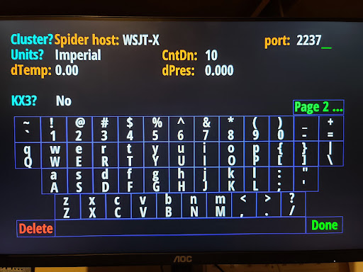
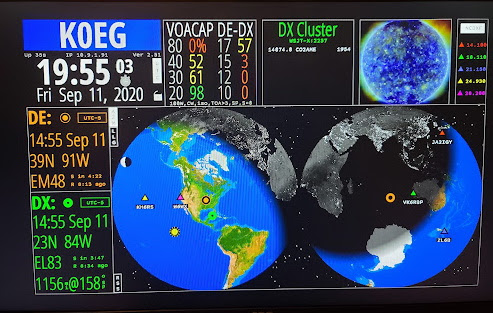

# HamClock

[HamClock](https://www.clearskyinstitute.com/ham/HamClock/) can listen to WSJT-X and JTDX messages to show the station you are working. GridTracker2 can pass those messages on to HamClock, so HamClock and GridTracker2 can both follow WSJT-X. You need HamClock version 2.51 or later.

## GridTracker2

In [Settings → General](../GridTracker-Overview/Settings-Sub-Menus.md#general-tab), in the **Forward UDP Messages** box:

1. Add the IP address of the computer running HamClock to **IP(s)/Hostname(s)**. Separate several addresses with commas if you forward to other programs too.
2. Set the **Port** HamClock will listen on, for example 2238.
3. Tick **Enabled?**.

## HamClock

{width=460px}

In HamClock's setup, enter **WSJT-X** for the "Cluster? Spider host:" and the port you set in GridTracker2 for "port:". Click **Done**.

When you start a QSO, HamClock shows the DX station in its DX window, updates its VOACAP DE-DX prediction, and places the DX station on its map.

{width=460px}
