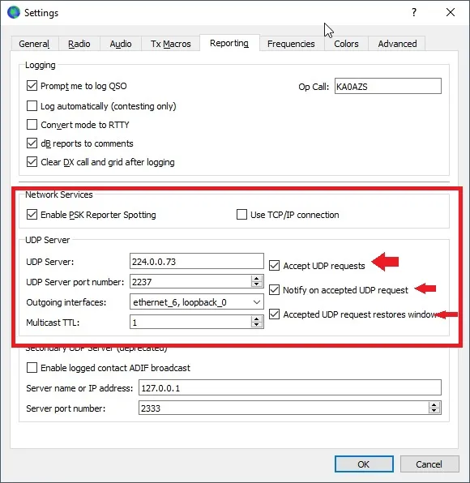
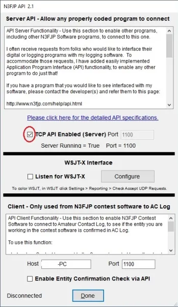
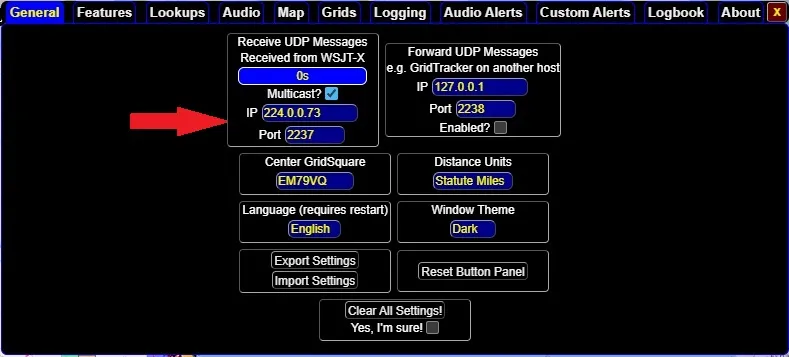
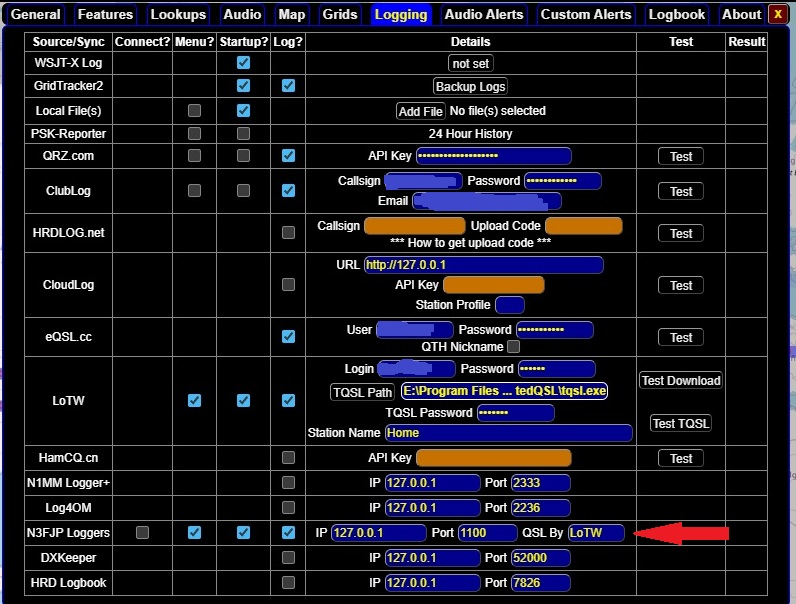
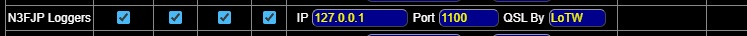
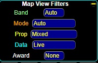
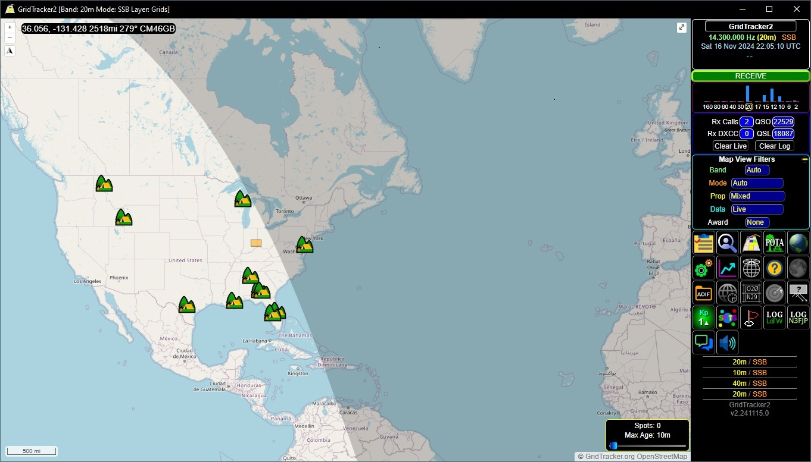

## GridTracker2 and N3FJP ACLog Integration

[N3FJP Website](https://www.n3fjp.com/aclog.html)

GridTracker2 can interface with N3FJP’s ACLog software to pass QSO information from the WSJT-X UDP data stream to ACLog.

GridTracker2 can also connect to ACLog to have the map and info menu follow band, mode and frequency changes when ACLog is controlling your radio through it’s Rig Control function.

### Logging

**WSJT-X:** 

Settings > Reporting. Note the UDP server and port numbers under Network Services, and
ensure all boxes under Network Services are checked.

**ACLog:** 

Settings> Application Program Interface (API)… Ensure “TCP API Enabled (server) Port” box is checked. Note the Port number.

**GridTracker2:** 

Settings> General. Ensure the IP Address and Port Number in “Receive UDP Messages Received from
WSJT-X “match the numbers you noted from WSJT-X, and that Multicast is checked.

Settings> Logging. Ensure the IP address and Port number on the “N3FJP Loggers” line match the numbers you noted from the ACLog API screen.

“QSL BY” should be set at your preferred source for valid QSLs as listed in N3FJP records.

Ensure the “Log?” column box is checked to pass QSO data from WSJT-X to ACLog.

Enabling the “Startup?” column box has GridTracker 2 check you ACLog to update QSO totals. (Note, ACLog must be running before starting GridTracker 2 or you will get an error message).

Enabling the “Menu?” column box displays an N3FJP button on your main menu. This will allow you to query ACLog to update QSO counts as needed.

### GridTracker 2/ACLog Connected Mode

GridTracker 2 can display status information from ACLog for non-digital modes such as SSB when ACLog is controlling your radio using it’s Rig Control option.

**ACLog Settings:**

The API Settings under Settings>Application Program Interface (API)… are the same as for digital modes.

Settings>Rig Interface: See the N3FJP website for full details on setting ACLog up for rig control.

**GridTracker2 Settings:**

Once your ACLog is controlling your radio, start GridTracker 2 go to Settings> Logging and check the “Connect?” column on the “N3FJP Loggers” Line.

Ensure that you have the Map View Filters set to Band Auto and Mode Auto.

In GridTracker 2 you will now see the frequency/band and mode information at the top of the screen.

If you have POTA enabled you will see any parks spotted on the pota.app website displayed on the map.

Please note that there will be slight delay in displaying frequency and band changes based on the Polling Rate selected in the ACLog Rig Interface settings.