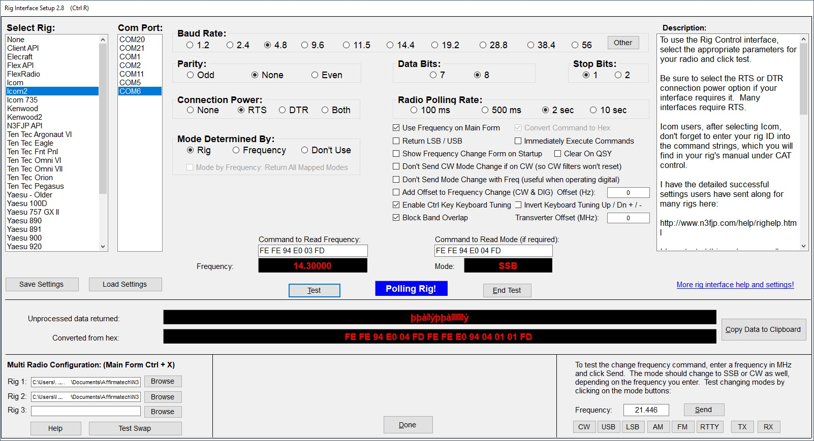

# N3FJP AC Log

[N3FJP's Amateur Contact Log](https://www.n3fjp.com/aclog.html) (AC Log) works with GridTracker2 in two ways:

* **Logging:** QSOs from WSJT-X and JTDX are sent to AC Log, and your AC Log logbook can be loaded into GridTracker2.
* **Connected:** GridTracker2 follows AC Log's rig and entry tab, so the map and rosters follow your phone and CW operating too. Clicking a spot fills AC Log's entry tab, and can tune your rig.

## AC Log Settings

In AC Log, open **Settings → Application Program Interface (API)...** and tick **TCP API Enabled (server)**. Note the **Port** (1100 by default).

{width=300px}

For the connected features, set up rig control in AC Log under **Settings → Rig Interface**. See the N3FJP website for details.

{width=520px}

## GridTracker2 Settings

In [Settings → Logging](../GridTracker-Overview/Settings-Sub-Menus.md#logging-tab), on the **N3FJP Loggers** row of the **Logging Programs** box:

* Enter AC Log's **IP** address (127.0.0.1 when it runs on the same computer) and the **Port** you noted.
* **Log QSO:** sends each QSO logged in WSJT-X or JTDX to AC Log.
* **Load At Startup:** loads your AC Log logbook when GridTracker2 starts. AC Log must already be running.
* **Menu Button:** adds an N3FJP button to the button panel, to reload your AC Log logbook whenever you like.
* **QSL By:** which confirmations in AC Log count as QSLs: Any, Card, eQSL, LoTW, QRZ.com or Clublog. Shown while Load At Startup or Menu Button is ticked.
* **Connect:** links GridTracker2 to AC Log. A dot next to it shows green while connected, red while not.
  * **Enable Rig Control:** clicking a spot tunes your rig through AC Log. Shown while Connect is ticked; needs rig control set up in AC Log.


## Logging From WSJT-X

For WSJT-X QSOs to reach AC Log, WSJT-X must send to GridTracker2 (see [Appendix B](../Appendices/Appendix-B-Configuring-WSJT-X-and-JTDX-for-GridTracker.md)), and **Log QSO** must be ticked on the N3FJP row. Each QSO you log in WSJT-X is then added to AC Log, and "Logged to N3FJP" shows in the [Event Viewer](../GridTracker-Overview/Control-Panel.md#event-viewer).

## Connected Operation

With **Connect** ticked:

* AC Log becomes one of your radios. Its frequency, band and mode show at the top of the side panel, and the status bar shows **CONNECTED** while AC Log is the active radio. When AC Log has no rig frequency, the band and mode follow its entry tab. With several radios, use the ◀ ▶ selector to choose AC Log.
* The call and grid in AC Log's entry tab show in GridTracker2 as you type, even before you tab out of the call, and clear when you clear the entry tab.
* QSOs you log in AC Log are added to GridTracker2's logbook, even several in quick succession.
* A QSO logged in AC Log with a park in an Other field titled `POTA_REF` is spotted to POTA (with POTA Hunting on).

Set the Map View Filters' Band and Mode to **Auto** so the map follows AC Log.


There is a short delay before frequency and band changes show, depending on the polling rate set in AC Log's Rig Interface settings.

### Working Spots Through AC Log

When you click a callsign in the Feed Roster, or a POTA, SOTA or DX Feeds marker on the map, and no radio is already on that spot's band and mode, AC Log gets the spot on any band and mode:

* Its entry tab is cleared and filled with the spot's frequency, band, mode, call and grid.
* With **Enable Rig Control** on, AC Log also tunes your rig to the spot's frequency and mode.
* If you have titled any of AC Log's Other fields `POTA_REF` or `SOTA_REF`, they are filled with the spot's park or summit.

```{tip}
To have parks and summits filled in automatically, open AC Log's Other field settings and title one field `POTA_REF` and another `SOTA_REF`. GridTracker2 notices the titles when it connects, and when you change them.
```
