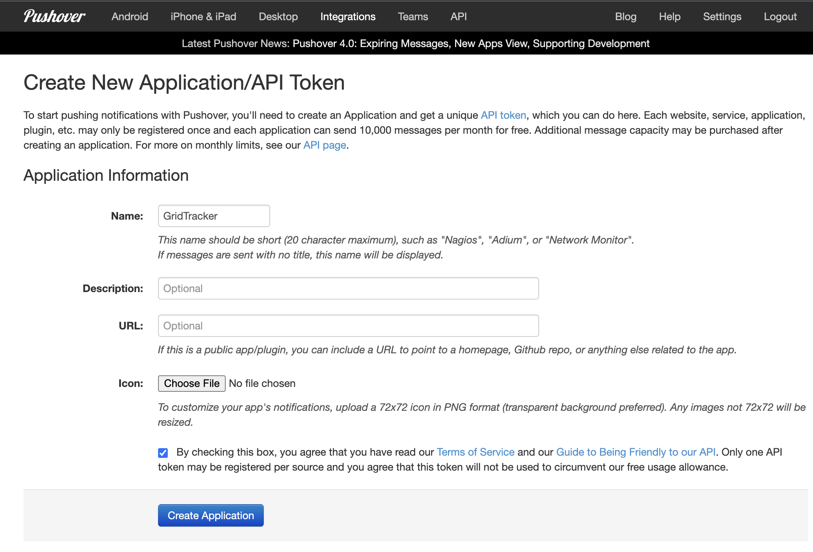
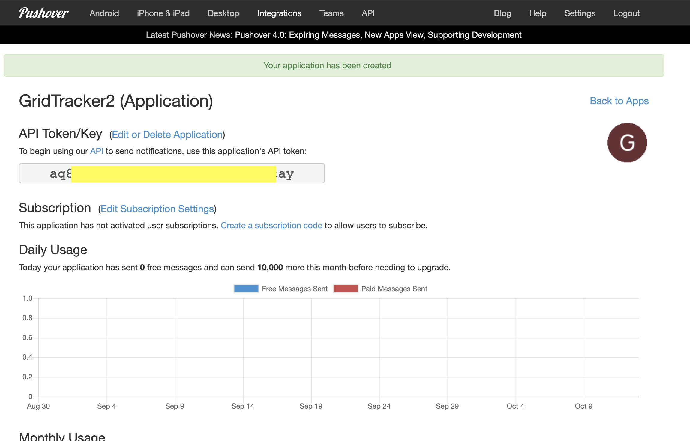
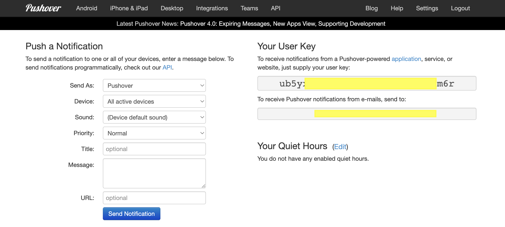
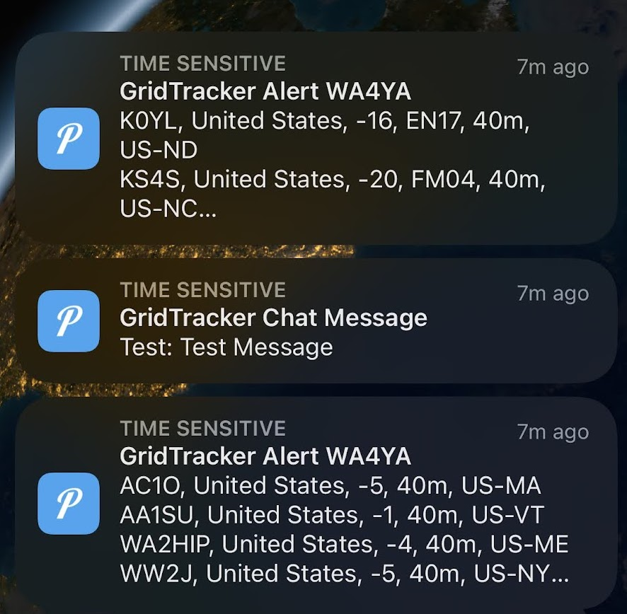

# Push Notifications to Your Phone

GridTracker2 can send new wanted stations from the Call Roster to your phone through [Simplepu.sh](https://simplepu.sh/) or [Pushover](https://pushover.net/). Feed Roster stations are sent too when **Allow Notifications (Pushover, Simplepush)** is ticked in Settings → Feeds.

GridTracker2 must be running for notifications to be sent. Turn the services on in [Settings → Features](../GridTracker-Overview/Settings-Sub-Menus.md#features-tab), in the Online box; each one then shows its own settings box.

Both services can follow a **Use Daily Schedule**: notifications are only sent between the **Start Time** and **End Time** you choose, for example not at night.

## Simplepu.sh

1. Install the Simplepush app on your phone from the App Store or Google Play, and create an **API Token**.
2. In Settings → Features, tick **Simplepu.sh** and enter the token in **API Token**.
3. Tick **Notification Only** if you want plain notifications rather than tasks.
4. Click **Test**. A test message should arrive on your phone.

```{note}
Simplepush moved from Simplepush.io to Simplepu.sh. Keys from the old service no longer work: create a new API Token in the app.
```

## Pushover

1. Register at [pushover.net](https://pushover.net/). Pushover has a 30-day free trial, then a one-time purchase per platform.
2. Install the Pushover app on your phone and log in.
3. On the Pushover website, [create an application](https://pushover.net/apps/build). Call it GridTracker2, for example.

   {width=460px}

4. Copy the application's **API Token**.

   {width=460px}

5. Find your **User Key** on the Pushover home page.

   {width=460px}

6. In Settings → Features, tick **Pushover.net** and enter the **User Key** and **API Token**.
7. Click **Test**. A test message should arrive on your phone.

{width=300px}

Each notification is titled "GT Alert" (or "Feed Alert" from the Feed Roster) and lists each new wanted station: callsign, DXCC entity, signal report, grid, band and state, with why it is wanted.

For more control over what is sent, you can also run your own script on roster alerts: see [Running a Script on Alerts](../Making-GridTracker-Work-For-You/Using-Call-Roster.md#running-a-script-on-alerts).
