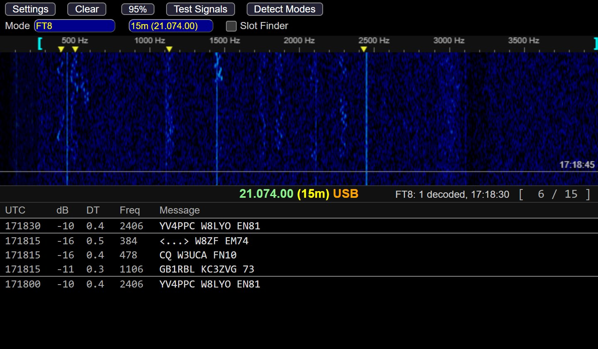

# FT8 / FT4

FT8 / FT4 is a Multi-Mode Decoder plugin with two modes, **FT8** and **FT4**. Each decodes every period on its own, without WSJT-X: 15 seconds for FT8, 7.5 seconds for FT4. Periods run on the UTC clock, so your computer's clock must be right. FT8 gets a few fewer decodes than WSJT-X: about nine in ten on a busy band.

Once the plugin is installed, pick **FT8** or **FT4** in the decoder's **Mode** menu. How the decoder itself works (its waterfall, Input Device, Rig Control and the Frequency menu) is in the GridTracker2 User Guide, under *The Multi-Mode Decoder*.

{width=480px}

## The List

* **UTC**, **dB** (over 2500 Hz, as WSJT-X gives it), **DT**, **Freq** (audio Hz) and **Message**. The newest period is on top, with a line above each period's first message.
* Most messages show about 3 seconds before the period ends. Any new ones found at the end are added under them.
* A message decoded a harder way is marked as WSJT-X marks its own (hover over the mark for what it means): **o** for ordered statistics decoding, **a1** for a guessed CQ, **a2** for a guessed call to you, **a3** and **a4** for the next message of a QSO or station heard on that frequency two periods before, and **c** for a message added to the same message sent two periods before.
* A yellow mark on the scale shows each station decoded in the last two periods. The scale has a short tick every 100 Hz.
* The status and how far into the period the decoder is show at the right of the frequency bar under the waterfall, for example **[ 7 / 15 ]**. The waterfall marks each period instead of the **UTC** menu's lines.

## Focus

Click the waterfall, or click a message, to put a 50 Hz focus band (red) there. It is searched harder each period. Drag it along the waterfall to move it, and click inside it to let go. In FT8 the focus works at the **Deep** depth only; FT4 always uses it.

## Time Skew

For a station whose clock is off, such as a DXpedition with no time source:

1. Right-click the waterfall. Orange period lines replace the usual gray ones, with the skew and their UTC time above them.
2. Turn the mouse wheel to move the timing (0.1 second a notch, or a second with **Shift**) until the orange lines line up with the station's transmissions.
3. Every period is now decoded on that timing, and **DT** shows in orange, counted from the usual timing. Stations that are on time aren't decoded meanwhile.
4. Right-click again to go back on time.

The skew is kept until GridTracker2 closes (FT8's and FT4's separately), so turning it on again comes back to it. **Clear** leaves it on; tuning the rig elsewhere or changing mode turns it off. While the skew is on, the mouse wheel moves the skew instead of tuning the rig.

## Slot Finder

**Slot Finder** on the decoder's second line (FT8 and FT4 each have their own, on at first; untick it to turn it off) marks the clearest frequency to transmit on, from what was heard and decoded lately. Each mark is labeled with its audio frequency and **Even**, **Odd** or **Even + Odd** for the periods it is clear in.

## GridTracker2's Map and Call Roster

FT8 and FT4 decodes go to GridTracker2's map and alerts through its instance named **MMD**, as a WSJT-X instance's do, whether the decoder's window is showing or not. The band comes from Rig Control reading the mode's VFO; without Rig Control, GridTracker2 doesn't know the decodes' band.

With **Send Decodes To Call Roster** on (see Settings, below), the decodes go to the Call Roster as well, and **MMD** appears among the roster's instances. Turn it off and the calls it put in the Call Roster are taken out.

The decoder doesn't transmit, so the MMD instance can't be answered: clicking one of its stations in the Call Roster does nothing. FT8 and FT4 QSOs are logged by WSJT-X, so the decoder has no Log QSO for them.

## Detect Modes

With the plugin installed, the decoder's **Detect Modes** also names each FT8 and FT4 station it hears, with its message. Click one to decode it: FT8 or FT4 is picked and the focus is put on the station.

## Frequencies

The Frequency menu lists FT8's dial frequencies from 160 meters to 70 cm, with the DXpedition (Fox/Hound) frequencies and regional ones noted. FT4 has WSJT-X's FT4 dial frequencies from 80 to 2 meters, and 1.843 MHz on 160 meters (not in WSJT-X's list, but where FT4 is usually heard there). **Set Mode** sets the rig to USB (its data mode with the VFO's **SSB Data**).

With **Follow BirdWatch**, a satellite transmitter in FT8 or FT4 switches the decoder to that mode.

## Settings

In the decoder window's **Settings** → **Decoders**, under **FT8** and **FT4**:

* **Input Device** and **VFO:** as every mode has them. FT4, new, starts on FT8's Input Device.
* **Set Frequency** and **Set Mode:** what picking a frequency in the Frequency menu sends the rig. Shown with **Rig Control** on. Each is on unless you turn it off.
* **Depth** (FT8 only): **Normal**, the default, decodes each period once, quickly. **Deep** takes out each signal decoded and searches again for weaker ones it covered, tries the harder ways above, decodes early and uses the focus. It finds more, at the cost of more processor time. FT4 always decodes at Normal depth, plus the focus.
* **Send Decodes To Call Roster:** sends the decodes to the Call Roster as well as the map. Off until you turn it on. Until Rig Control reads the mode's VFO, an orange note says **Waiting for Rig Control to read the FT8 VFO's dial** (or FT4's).

## Test Signals

The decoder's **Test Signals** plays five FT8 or FT4 stations at once. A recording starts on a period's boundary: the button shows **Test Starts In** and the seconds left. What it decodes stays in the window and isn't sent to the map or Call Roster.

Built on ft8_lib by Kārlis Goba, YL3JG. The searching again, the harder ways and the early decode follow WSJT-X, with thanks to Joe Taylor, K1JT, and the WSJT development team.
