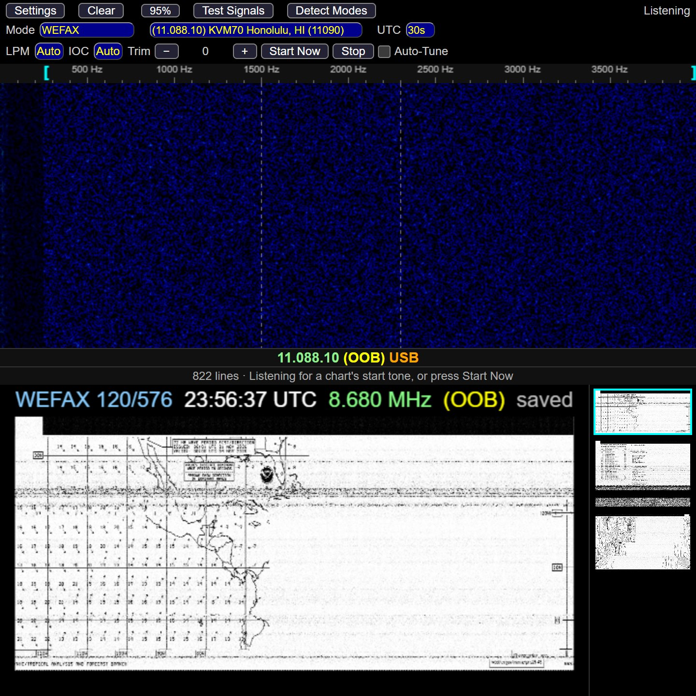

# WEFAX

WEFAX is a Multi-Mode Decoder plugin. It receives weather fax charts from the coast and weather stations that still send them on HF. Charts are shown in the decoder's picture view, the newest 12 kept in a strip on the right; click one to see it large. WEFAX's charts are kept apart from SSTV's pictures.

Once the plugin is installed, pick **WEFAX** in the decoder's **Mode** menu. How the decoder itself works (its waterfall, Input Device, Rig Control and the Frequency menu) is in the GridTracker2 User Guide, under *The Multi-Mode Decoder*.

{width=480px}

## Receiving Charts

* A chart starts by itself with its start tone, or with its phasing lines (the black lines with a white mark that follow the start tone) when static garbles the tone. Its line rate and width are found by themselves, or you can pick them on the WEFAX row under the second line: **LPM** (lines a minute: **Auto**, 60, 90, 120 or 240) and **IOC** (the chart's width: **Auto**, 576 or 288).
* **Start Now** begins a chart that is already being sent. **Stop** ends the chart being received. A chart keeps going through a fade of up to two minutes.
* Charts are kept straight and lined up by themselves, even when the sound card's clock is off or audio is lost for a moment. Many stations place a chart partway across the line, so its right side would show on the left: the decoder finds the strip of blank paper between the chart's edges and starts each line after it, as the chart comes in.
  * **Trim:** click **−** or **+** until the chart's upright lines stand straight (what came is drawn again). Click the value to set it back to 0. Trim is kept for next time.
* Dashed lines on the waterfall show where a chart's black (1500 Hz) and white (2300 Hz) tones are, moved to where the newest chart was found.
* The header above the chart shows the station it is from (for example **NMC · Point Reyes, CA**, found from the frequency and the stations' schedules) on a line of its own, then its line rate and width (for example **WEFAX 120/576**), its UTC date and time and frequency, and **saved** once it is.
* Right-click a chart for **Save Picture…**, **Copy To Clipboard**, **Rotate** (**90° Right**, **90° Left**, **180°** or **As Received**, for charts some stations send sideways), **Filter** or **Delete**, as for SSTV's pictures. A rotated or filtered chart is saved and copied as shown. **Filter** (once the chart has ended) cleans up a noisy chart: the filters are described in the User Guide, under SSTV.
* Each time the window opens, the newest 12 charts in the save folder are back in the strip.
* **Test Signals** plays a WEFAX chart into the decoder, to see what it decodes. What it decodes stays in the window and is never saved.

## Printing and Tidying Up a Chart

The right-click also has these for charts:

* **Print…:** the chart on a page of its own, fitted to it (landscape when the chart is wider than tall), with the station, line rate and width, UTC date and time and frequency under it.
* **Show In Folder:** opens the folder the chart was saved in, with its file picked out. Only while a saved file is there.
* **Auto-Align:** a chart that started without its phasing lines (tuned in partway, or **Start Now**) can come out with its right side on the left. Auto-Align finds the chart's left edge and moves it to the left side of the picture, wrapping what was before it round to the right.
* **Wrap Scroll** (**Left**, **Right** or **Reset**): moves the chart sideways by hand, a little at a time, wrapping round the edges. You can also drag the chart sideways with the mouse; a click without moving still shows the newest chart. Not on a rotated chart (set **Rotate** back to **As Received** first).
* **Auto-Crop:** takes off the empty edges around the chart (the blank part of the line Auto-Align leaves at the right, and blank rows above and below).

Auto-Align, Wrap Scroll and Auto-Crop work once the chart has ended, and each is a step of **Filter**'s **Undo** (Wrap Scroll moves one after another make one step), so **Undo All** puts the chart back as received, for up to its last 20 steps. As with Filter, a chart is saved, copied and printed as shown, and a file saved already stays as it was.

## Frequencies

The Frequency menu lists the stations heard around the world (NOAA's, Germany's, Japan's, Korea's, Australia's, the UK's and others), grouped by the station's location (in alphabetical order, each one's frequencies lowest first), each named with its assigned frequency and its hours where it has them. **Set Mode** sets the rig to USB.

## Auto-Tune

With **Rig Control** on, tick **Auto-Tune** on the WEFAX row to have the rig tuned to each next chart from the stations' published schedules (NOAA's, Canada's, Germany's, Japan's, Korea's, Australia's and the UK's), one chart after another. Beside it, it shows the station, frequency, distance, expected path, chart and time it is waiting for, or **No chart scheduled**.

The chart is chosen by how its transmitter reaches the locator set in **Settings → General → My Grid**:

* **Ground wave:** very close to the transmitter.
* **One F2 hop:** outside the skip zone (the dead ring between the ground wave and where the first hop returns) and within about 4,000 km. The skip zone depends on the band and the time: it is small on 80 and 40 meters and can be about 2,000 km on 20 meters at night or 10 meters by day.
* **Marginal paths:** when no ground-wave or one-hop chart is available, a sporadic-E path or a two-hop F2 path may be taken. Higher-band two-hop paths only work near the solar maximum and fade away as it declines.

The solar cycle is estimated from the date, and low frequencies are penalized or rejected in daylight (D-layer absorption). Auto-Tune takes the soonest chart, unless it would still be on when the rig has to be tuned for a later chart with a better path (ground wave is best, then one F2 hop, then a marginal path). Then it waits for that one instead. A chart is taken to last until its station's next chart, but no more than 20 minutes. So a one-hop chart that finishes before a ground-wave chart begins is received too, and so is a marginal chart that finishes before the next reliable one. Charts at the same time go to the better path, then the nearer station. With no locator set, or when no modeled path reaches you (every station out of range, or every frequency dead or in the skip zone), Auto-Tune falls back to choosing the soonest chart as before. Changing **My Grid** while Auto-Tune waits makes it choose again.

* For a station on several frequencies, the one that reaches you best is used, then the one that copied last time, then one suited to the hour (lower at night, higher by day).
* A frequency whose chart never starts is passed over for a while.
* Tuning the rig by hand turns Auto-Tune off. It is off each time GridTracker2 starts.

## Settings

In the decoder window's **Settings** → **Decoders**, under **WEFAX**:

* **Input Device** and **VFO:** as every mode has them. A new install starts on CW's Input Device.
* **Set Frequency** and **Set Mode:** what picking a frequency in the Frequency menu sends the rig. Shown with **Rig Control** on. Each is on unless you turn it off.
* **Save Charts** (on at first): saves each chart as a PNG when it ends, however much of it came, named by its UTC time, line rate and width, frequency and station (for example `20261113-201456Z_WEFAX120576_8680kHz_NMC.png`). **Folder** shows where they go (`WEFAX Charts` at first, beside GridTracker2's own folders; click it to open it); **Choose** picks another.
